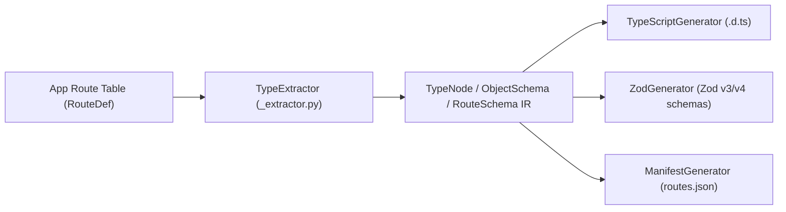

# TypeScript/Zod Codegen & Inertia v3 Protocol

Vertebra bridges backend Python route signatures and data models to the [`@vertebra/client`](../../../../../src/ts/vertebra-client/package.json) frontend SDK through a zero-runtime-overhead codegen pipeline and native Inertia.js v3 protocol middleware.

## 1. Type Extraction & Intermediate Representation (`_extractor.py`)

[`TypeExtractor`](../../../../../src/py/vertebra/builder/_codegen/_extractor.py) inspects registered route handlers and converts Python type annotations into a language-neutral [`TypeNode`](../../../../../src/py/vertebra/builder/_codegen/_extractor.py) AST (`TypeKind.PRIMITIVE`, `LITERAL`, `ARRAY`, `TUPLE`, `RECORD`, `UNION`, `OBJECT`, `ENUM`, `ANY`, `VOID`):

- Supports `dataclasses`, `TypedDict` (`__required_keys__` / `__optional_keys__`), `NamedTuple`, `msgspec.Struct` (`__struct_fields__`, `msgspec.NODEFAULT`), Pydantic v2 `BaseModel` (`model_fields`), `enum.Enum`, PEP 604 `X | Y` unions, `Literal[...]`, and `Annotated[T, ...]`.
- Extracts path parameters from `{param}` segments, query parameters from primitive handler arguments, request body schemas from structured parameters on `POST`/`PUT`/`PATCH` routes, and response schemas from return annotations.

## 2. TypeScript, Zod & Route Manifest Generators

- **[`TypeScriptGenerator`](../../../../../src/py/vertebra/builder/_codegen/_typescript.py)**: Emits `export interface` declarations for every `ObjectSchema`, `export type` unions for enums, and a typed `RouteMap` mapping `"METHOD /path"` to `{ params, query, request, response }`.
- **[`ZodGenerator`](../../../../../src/py/vertebra/builder/_codegen/_zod.py)**: Emits runtime `z.object(...)`, `z.enum(...)`, `z.union(...)`, and `.nullable()` / `.optional()` validators matching the TypeScript interfaces.
- **[`ManifestGenerator`](../../../../../src/py/vertebra/builder/_codegen/_manifest.py)**: Emits `routes.json` with route patterns, HTTP methods, parameter metadata, and schema references consumed by `@vertebra/client`.
- **Import Map Generation ([`_import_map.py`](../../../../../src/py/vertebra/builder/_import_map.py))**: Resolves `node_modules` ESM entrypoints (`exports["."].import` / `module` / `main`), copies vendor bundles into `<output_dir>/vendor/`, and produces `<script type="importmap">` JSON for zero-bundle-step browser loading.

## 3. Inertia.js v3 Protocol (`_inertia.py` & `@vertebra/client/inertia`)

[`InertiaMiddleware`](../../../../../src/py/vertebra/framework/_inertia.py) and [`InertiaConfig`](../../../../../src/py/vertebra/framework/_inertia.py) implement server-side Inertia.js v3 content negotiation:

- **Initial Full-Page Visit**: When `X-Inertia` is absent, renders the HTML shell via `ssr_render(page_data)` with `data-page` JSON escaped for safe attribute embedding.
- **XHR Inertia Visit (`X-Inertia: true`)**: Returns `200 OK` with `Content-Type: application/json`, `X-Inertia: true`, and `Vary: X-Inertia`.
- **Asset Version Mismatch**: When `X-Inertia: true` on a `GET` request carries an `X-Inertia-Version` that differs from `InertiaConfig.version`, returns `409 Conflict` with `X-Inertia-Location: <url>` to trigger a client hard reload.
- **Partial Reloads & Redirects**: Filters `props` using `X-Inertia-Partial-Data` and `X-Inertia-Partial-Except` when `X-Inertia-Partial-Component` matches the active component, and converts `301`/`302` redirects after `PUT`/`PATCH`/`DELETE` into `303 See Other`.
