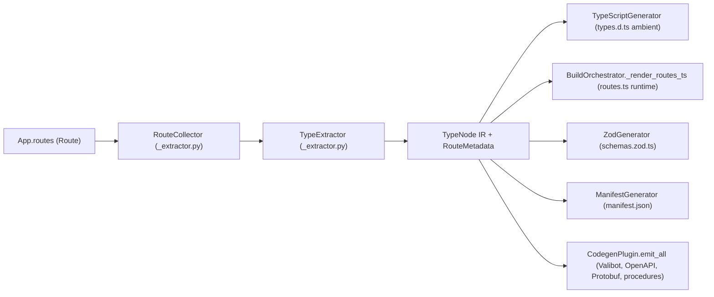

# Route Codegen Targets & Inertia v3 Middleware

<!-- truth: start -->
- `TypeExtractor` lowers `App` route signatures and `msgspec.Struct` schemas into a canonical `TypeNode` IR shared across TypeScript, Zod, Valibot, OpenAPI, Protobuf v3, and procedure generators.
- `TypeScriptGenerator` emits ambient `types.d.ts` (`export declare const routes`, `export declare const websocketRoutes`, `export declare function wsUrl`), while `BuildOrchestrator._render_routes_ts` emits runtime `routes.ts` (`routes`, `websocketRoutes` with `{ method: "WS", path }`, and `wsUrl`).
- `SyncInertiaMiddleware` and `AsyncInertiaMiddleware` implement Inertia v3 (`X-Inertia`, BLAKE2b `digest_size=4` manifest version, async prop/iterable resolution, `onceProps` and `X-Inertia-Reset` metadata, `409 X-Inertia-Location` version mismatches, `Link` early hints, and `render_page_shell` SSR/CSR shell injection).
<!-- truth: end -->

[`vertebra.build.codegen`](../../../../../src/py/vertebra/build/codegen/__init__.py)[^src-build-codegen-init-py] converts handler signatures on a Vertebra `App` into a msgspec-tagged IR, then renders client artifacts. [`BuildOrchestrator`](../../../../../src/py/vertebra/build/_orchestrator.py)[^src-build-orchestrator-py] runs the TypeScript, Zod, manifest, and runtime `routes.ts` emitters (see [Bundler, HMR & SSR](bundler-hmr-and-ssr.md)); the remaining targets run through `CodegenPlugin.emit_all` or direct calls.

## IR and extraction (`_ir.py`, `_extractor.py`)

[`TypeNode`](../../../../../src/py/vertebra/build/codegen/_ir.py)[^src-build-codegen-ir-py] is `msgspec.Struct(frozen=True, tag_field="_type", tag=True)` with subclasses `PrimitiveType`, `LiteralType`, `ArrayType`, `TupleType`, `GenericType` (`Set`, `Record`), `UnionType`, `ObjectType` (`fields`, `name`, `optional_fields`), `NamedTypeRef` (recursive models), `AnnotatedType`, `StreamType`, `RawType` (TypeVars), and `UnknownType`. Each implements `to_typescript()` and `iter_children()`.

[`TypeExtractor.from_hint`](../../../../../src/py/vertebra/build/codegen/_extractor.py)[^src-build-codegen-extractor-py] maps:

- `int`/`float` → `number`, `str` → `string`, `bool` → `boolean`, `None` → `null`, `bytes`/`bytearray`/`memoryview` → `Uint8Array`, `Any`/`object` → `UnknownType`.
- `list`, `set`, `dict`, `tuple` (`tuple[T, ...]` → array), PEP 604 and `Union`, `Literal`, `Annotated`, and sync/async iterators and generators (`StreamType`).
- `msgspec.Struct` (`msgspec.structs.fields`; a default makes the field optional) and dataclasses, cached per class.

`TypedDict`, `NamedTuple`, Pydantic models, and `Enum` fall through to `UnknownType`. `extract(handler)` returns one `TypeNode` per non-`self`/`cls` parameter plus the return type; it does not classify path, query, or body locations.

[`RouteCollector.collect(app)`](../../../../../src/py/vertebra/build/codegen/_extractor.py) extracts `RouteMetadata` per route from any supported framework application (`vertebra.App`, Litestar, FastAPI, Starlette, Flask, and Django `urlpatterns`), filtering out DI-injected parameters (`Inject`, `NamedDependencyMarker`, or parameters matching the route/app `DependencyGraph`). `operation_id` is the lowercased method plus path segments joined by `.`, with `{id}` → `by_id`, `-` → `_`, and `root` for `/` (`GET /users/{id}` → `get.users.by_id`).

## Generators

| Generator | Module | Output |
| --- | --- | --- |
| `TypeScriptGenerator` | `_typescript.py` | `// DO NOT EDIT` header, `export interface <Name>` per named `ObjectType` (`?` for optional fields), `export namespace Procedures { ... }` nested by `operation_id` segment (`export type <leaf> = (params: {...}) => Promise<Ret>;`), ambient `export declare const routes: Record<string, { readonly method: string; readonly path: string }>;`, and (when WebSocket routes exist) `WebSocketRouteName`, ambient `export declare const websocketRoutes: Record<WebSocketRouteName, { readonly method: "WS"; readonly path: string }>;`, `WebSocketRoutePathParams`, `WebSocketChannelPayloads`, and ambient `export declare function wsUrl(...)`. `format_typescript` trims trailing whitespace. |
| `BuildOrchestrator._render_routes_ts` | `_orchestrator.py` | Emits runtime `routes.ts` owning `export const routes = { ... } as const;` (`{ method, path }`), plus (when `protocol == "websocket"` routes exist) runtime `export const websocketRoutes = { ... } as const;` (`{ method: "WS", path }`), `export type WebSocketRouteName`, and runtime `export function wsUrl(...)`. |
| `ZodGenerator` | `zod.py` | `import { z } from "zod";` then `export const <operation_id>Params = z.object({...})` using `z.union`, `z.literal`, and `.optional()`. Also `generate_from_node`, `generate_from_schema` (JSON Schema), `emit_schema`. |
| `ManifestGenerator` | `_manifest.py` | `{"routes": {operation_id: {handlerName, method, paramsSchema, procedureId, protocol, responseSchema, route, channelKey?}}, "version": 1, "websocketRoutes"?: ...}`. |
| `ValibotGenerator` | `valibot.py` | `import * as v from 'valibot';` schemas with the same entry points as `ZodGenerator`. |
| `OpenAPIGenerator` | `openapi.py` | `generate` / `generate_json` producing an `"openapi": "3.1.0"` document. |
| `ProtobufGenerator` / `ProtobufParser` | `protobuf.py` | Bidirectional `.proto` ↔ `TypeNode` IR + `RouteMetadata`: `ProtobufGenerator` emits `syntax = "proto3";` messages plus one `service` (`unary`, `server_streaming`, `client_streaming`, `bidi` RPCs and `google.api.http` annotations), while `ProtobufParser` parses `.proto` files into `ProtoFileSpec`, `msgspec.Struct` stubs (`generate_python_stubs`), and `RouteMetadata` (`to_routes`). |
| `ProcedureClientGenerator` | `procedures.py` | Interfaces plus an `export interface ProcedureRpcClient` map from the `ProcedureRegistry` filled by `@procedure`. |

`procedures.py` also defines Litestar-style parameter markers (`Parameter`, `Body`, `FromPath`, `FromQuery`, `FromHeader`, `FromCookie`, `JSONBody`, `MsgPackBody`, `MultipartBody`, `URLEncodedBody`, `SkipValidation`, `NamedDependency`), `resolve_parameter_node` (used by the Zod, Valibot, and OpenAPI targets to place parameters), and `json_schema_to_type_node`.

[`CodegenPlugin(config, registry)`](../../../../../src/py/vertebra/build/codegen/plugin.py)[^src-build-codegen-plugin-py] stores `CodegenConfig` under `CODEGEN_STATE_KEY = "codegen"` (`install_state`, Litestar `on_app_init`) and `emit_all(routes, output_dir=None)` writes `schemas.valibot.ts`, `schemas.zod.ts`, `openapi.json`, `service.proto`, and `procedures.client.ts`. `CodegenConfig` defaults: `output_dir=src/generated`, Valibot/Zod/OpenAPI/procedures on, Protobuf off, `openapi_title="Vertebra API"`, `openapi_version="1.0.0"`.

## Watch helpers (`plugin.py`)

`CodegenWatcher(project_dir, callback, poll_interval=0.5)` reruns `callback` on `.py` changes, skipping `.venv`, `node_modules`, `build`, `dist`, `target`, and cache directories. `HmrNotifier(base_url).notify()` POSTs to `/__vertebra/hmr/signal` on the Rust server. `HmrEventRouter.route_event(files)` uses `classify_file` (`python`/`frontend`/`config`/`unknown`) to broadcast `full-reload` or `update` messages to subscribed WebSocket clients.

## Inertia v3 (`framework/inertia/__init__.py`)

[`SyncInertiaMiddleware(config=None, ssr_client=None)` and `AsyncInertiaMiddleware(config=None, ssr_client=None)`](../../../../../src/py/vertebra/framework/inertia/__init__.py)[^src-framework-inertia-init-py] inherit `_BaseInertiaMiddleware` and turn an `InertiaResponse(component, props, encrypt_history, clear_history)` (helper `inertia()`) into an `InertiaHttpResponse(status, headers, body, early_hints)`. `AsyncInertiaMiddleware` awaits async prop callables and async iterables via `_resolve_async_value`, while `SyncInertiaMiddleware` resolves synchronous callables.

A [native route](../../../../../docs/usage/frontend-and-ssr.md#inertia-v3) awaits `AsyncInertiaMiddleware.process(request, inertia(component, props))` and returns its status, headers, and body through the native response tuple.

- **Version**: `get_version()` returns `InertiaConfig.version`, else the first 8 hex chars of the BLAKE2b digest (`digest_size=4`) of `manifest_path` (`dist/.vite/manifest.json`), else `"dev"`.
- **Headers & URLs**: Header lookups (`_get_header`) are case-insensitive across mapping and sequence header formats, and `_build_request_url` preserves query strings on `page["url"]` and `409` conflict redirects.
- **Conflict**: An `X-Inertia: true` `GET` whose `X-Inertia-Version` differs returns `409` with `X-Inertia-Location: <request.url>`.
- **XHR visit**: `200`, `Content-Type: application/json`, `X-Inertia: true`, `Vary: X-Inertia`, body is the JSON page object.
- **Initial visit & SSR shell**: `200` HTML rendered by [`render_page_shell`](../../../../../src/py/vertebra/framework/ssr/__init__.py)[^src-framework-ssr-init-py] with `
`, optional SSR `head`/`body` from `ssr_client.render(page)` when `ssr_enabled` (CSR fallback on error), resolved `asset_manifest` tags (`early_hints` emitting HTTP `Link` headers and `csp_nonce_header` nonce propagation), `static_props`, and `<script data-page="app" type="application/json">`; templates containing only `<!--ssr-body-->` (without `<!--inertia-->` or `@inertia`) still receive the `
` wrapper and `data-page` script.
- **Page object & shared data**: `component`, `props` (configured `shared_data` merged first and preserved during partial reloads), `url`, `version`, optional `encryptHistory`/`clearHistory`, and metadata `deferredProps`, `mergeProps`, `prependProps`, `deepMergeProps`, `scrollProps`, and `onceProps`.
- **Prop wrappers & reset**: `DeferredProp(once=..., expires_in=...)`, `MergeProp(prepend=...)`, `DeepMergeProp`, `OnceProp(expires_in=...)`, `ScrollProp`, and `OptionalProp`. `DeferredProp.once` emits `onceProps` metadata and honors `X-Inertia-Except-Once-Props`, while `X-Inertia-Reset` clears merge and `onceProps` metadata for named props without emitting non-standard fields. Partial reloads honor `X-Inertia-Partial-Component`, `X-Inertia-Partial-Data`, and `X-Inertia-Partial-Except`.

`InertiaConfig` fields are listed in [Routing & App](../../domains/framework/routing-and-app.md).

Provenance sources: [^src-build-codegen-typescript-py], [^src-build-codegen-manifest-py], [^src-build-codegen-zod-py], [^src-build-codegen-valibot-py], [^src-build-codegen-openapi-py], [^src-build-codegen-protobuf-py], [^src-build-codegen-procedures-py], [^src-framework-router-py], [^src-tests-unit-codegen-test-codegen-extractor-py].

[^src-build-codegen-init-py]: `src/py/vertebra/build/codegen/__init__.py` — Python implementation module (src/py/vertebra/build/codegen/__init__.py).
[^src-build-codegen-ir-py]: `src/py/vertebra/build/codegen/_ir.py` — Python implementation module (src/py/vertebra/build/codegen/_ir.py).
[^src-build-codegen-extractor-py]: `src/py/vertebra/build/codegen/_extractor.py` — Python implementation module (src/py/vertebra/build/codegen/_extractor.py).
[^src-build-codegen-typescript-py]: `src/py/vertebra/build/codegen/_typescript.py` — Python implementation module (src/py/vertebra/build/codegen/_typescript.py).
[^src-build-codegen-manifest-py]: `src/py/vertebra/build/codegen/_manifest.py` — Python implementation module (src/py/vertebra/build/codegen/_manifest.py).
[^src-build-codegen-zod-py]: `src/py/vertebra/build/codegen/zod.py` — Python implementation module (src/py/vertebra/build/codegen/zod.py).
[^src-build-codegen-valibot-py]: `src/py/vertebra/build/codegen/valibot.py` — Python implementation module (src/py/vertebra/build/codegen/valibot.py).
[^src-build-codegen-openapi-py]: `src/py/vertebra/build/codegen/openapi.py` — Python implementation module (src/py/vertebra/build/codegen/openapi.py).
[^src-build-codegen-protobuf-py]: `src/py/vertebra/build/codegen/protobuf.py` — Python implementation module (src/py/vertebra/build/codegen/protobuf.py).
[^src-build-codegen-procedures-py]: `src/py/vertebra/build/codegen/procedures.py` — Python implementation module (src/py/vertebra/build/codegen/procedures.py).
[^src-build-codegen-plugin-py]: `src/py/vertebra/build/codegen/plugin.py` — Python implementation module (src/py/vertebra/build/codegen/plugin.py).
[^src-build-orchestrator-py]: `src/py/vertebra/build/_orchestrator.py` — `BuildOrchestrator` runtime `routes.ts` codegen emitter.
[^src-framework-inertia-init-py]: `src/py/vertebra/framework/inertia/__init__.py` — Python implementation module (src/py/vertebra/framework/inertia/__init__.py).
[^src-framework-ssr-init-py]: `src/py/vertebra/framework/ssr/__init__.py` — SSR clients and `render_page_shell` HTML shell renderer.
[^src-framework-router-py]: `src/py/vertebra/framework/_router.py` — Python implementation module (src/py/vertebra/framework/_router.py).
[^src-tests-unit-codegen-test-codegen-extractor-py]: `src/py/tests/unit/codegen/test_codegen_extractor.py` — Python implementation module (src/py/tests/unit/codegen/test_codegen_extractor.py).
