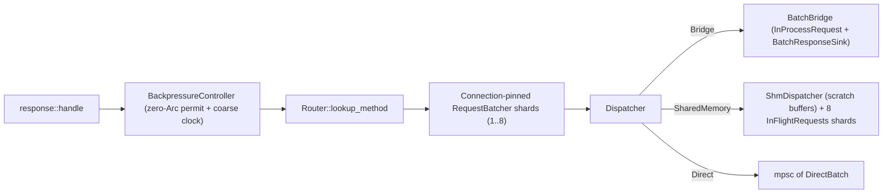

# Request Batching, Dispatch & Backpressure

<!-- truth: start -->
- `BackpressureController` enforces lock-free atomic admission (`Ordering::SeqCst` across `in_flight` and `queue_depth`) with zero-`Arc` borrowed `AdmissionPermit`s and a coarse monotonic circuit clock before route lookup or batch queueing.
- Connection tasks in `server.rs` wrap keep-alive sockets in a lazy `IdleTimeoutStream` and pin each connection to a `RequestBatcher` shard (`1..=8`), coalescing `PendingRequest` items up to `BatchLimit`.
- `BridgeCorrelation` allocates batch correlation IDs under a single shard lock (`InFlightRequests::insert_with_now`) and completes response batches via `complete_many`; `ShmDispatcher` reuses per-shard scratch buffers across batches.
- `ResponseReaderRegistry` isolates slow response streams via per-stream `StreamPumpTable` queues (`stream_queue_depth`) and joins worker reader tasks before `RingPair::reclaim()`.
<!-- truth: end -->

After [`server.rs`](../../../../../src/rs/vertebra-http/src/server.rs)[^src-vertebra-http-src-server-rs] reads an HTTP request over a lazy `IdleTimeoutStream` (arming its Tokio `Sleep` timer only when `poll_read` returns `Poll::Pending` so active pipelined/keep-alive reads never reset timers), [`response::handle`](../../../../../src/rs/vertebra-http/src/response.rs)[^src-vertebra-http-src-response-rs] admits and routes the request (see [HTTP Ingress](ingress-and-routing.md)), enqueues a `PendingRequest` on the connection's pinned `RequestBatcher` shard, and awaits its `oneshot` reply. Batchers drain ready requests without lingering timers and hand each batch to [`Dispatcher`](../../../../../src/rs/vertebra-http/src/dispatcher/mod.rs)[^src-vertebra-http-src-dispatcher-mod-rs].

## Request & Response Types (`batcher.rs`, `body.rs`, `response.rs`)

- [`PendingRequest`](../../../../../src/rs/vertebra-http/src/batcher.rs)[^src-vertebra-http-src-batcher-rs]: holds `handler_id`, `method_tag`, `http_version_tag`, `flags`, `path_and_query: http::uri::PathAndQuery`, compact binary `headers_mp` (`[name_len: u8][name][val_len: u16 LE][val]`), `body: Bytes`, and `reply: oneshot::Sender<PendingResponse>`.
- [`PendingResponse`](../../../../../src/rs/vertebra-http/src/body.rs)[^src-vertebra-http-src-body-rs]: `{ status, headers_mp, body, stream_rx: Option<FrameReceiver> }` with `unary` and `streaming` constructors.
- [`ResponseBody`](../../../../../src/rs/vertebra-http/src/body.rs): `Either<Full<Bytes>, FrameReceiver>` wrapped as `HttpResponse = Response<ResponseBody>`. `build_response_with_offloads` picks streaming when `stream_rx` is present and applies CORS/compression offloads to unary replies.

## `RequestBatcher` & `BatchLimit` (`batcher.rs`)

- **Connection-Pinned Sharded Pool**: [`RequestBatcher::spawn_pool`](../../../../../src/rs/vertebra-http/src/batcher.rs) spawns `1..=8` Tokio tasks aligned to consumer parallelism (`workers.count.clamp(1, 8)` in `Shm`, `py_threads.clamp(1, 8)` in `Embedded`, channel capacity 16,384), tagging each task with `shard_idx`. Each accepted connection pins its collector shard index at accept time so requests from the same connection avoid per-request atomic round-robin counters. `BatchLimit::default()` caps each batch at 64 items.
- **Double-Buffered Coalescing**: Each task keeps two `Vec<PendingRequest>` buffers (`pending` and `draining`) to preserve capacity without reallocation. It awaits the first item, drains ready items via `try_recv()`, and yields once (`tokio::task::yield_now().await`) only when `pending.len() < max_size && (dispatcher.in_flight() > 0 || !rx.is_empty())`—so single-connection requests flush with zero yield latency while concurrent tasks woken in the same `epoll_wait` batch coalesce before dispatch.

## Dispatcher Backends (`dispatcher/`)

`DispatchBackend` has three variants:

1. **Bridge (`Topology::Embedded`)**: [`BridgeCorrelation`](../../../../../src/rs/vertebra-http/src/dispatcher/bridge.rs)[^src-vertebra-http-src-dispatcher-bridge-rs] uses 8 cache-line-padded `Mutex<InFlightRequests>` shards, refcounted `InProcessRequest` batches on `BatchBridge`, a bounded `ResponseStreamRegistry` (default depth 64), and direct `BatchResponseSink` / `ResponseSink` callbacks. Batch dispatch takes a single `Instant::now()` and acquires one shard mutex for the entire batch (`InFlightRequests::insert_with_now`), while `complete_many` groups batch replies by shard, pops all matching `oneshot::Sender`s under one lock per touched shard, **drops shard mutexes first**, and calls `tx.send(...)` directly with no intermediate reader task (`spawn_bridge_sweeper` expires stale correlations every 1 s).
2. **Shm (`Topology::Shm` on Unix)**: Detailed below.
3. **Direct**: [`dispatch_direct_vec`](../../../../../src/rs/vertebra-http/src/dispatcher/direct.rs)[^src-vertebra-http-src-dispatcher-direct-rs] packs a `Batch` and `try_send`s on a bounded `mpsc` channel.

## Shared-Memory Dispatch (`dispatcher/shm.rs`, `correlation.rs`, `shm_reader.rs`, `streams.rs`)

- **Sharded Correlation & Health**: [`ShmDispatcher`](../../../../../src/rs/vertebra-http/src/dispatcher/shm.rs)[^src-vertebra-http-src-dispatcher-shm-rs] allocates 8 cache-line-padded `Mutex<InFlightRequests>` shards (`65,536 / 8 = 8,192` slots each), tracks per-worker health and in-flight counts, and sweeps entries older than 30 s every 1 s (`sweep_worker` fails in-flight requests and closes streams on worker crash). [`InFlightRequests`](../../../../../src/rs/vertebra-http/src/dispatcher/correlation.rs)[^src-vertebra-http-src-dispatcher-correlation-rs] uses a generation-tagged slab (`(generation << 32) | index`) with `insert_with_now` to share one timestamp per batch.
- **Shard-Affinitized Routing & Scratch Reuse**: `dispatch_shm_vec_from_shard` routes batcher shard `i` to `home = i % worker_count` (falling back to the healthiest least-loaded worker if `home` is unhealthy, full, or above 64 in-flight) and aligns the correlation shard (`worker_idx & SHM_CORRELATION_MASK`) so `(Batcher i, Worker i, Reader i)` run disjointly. Each shard reuses pre-allocated `TransportNode` and staging scratch buffers across batches, writes directly into the request ring via `try_send_with` (spilling single requests `> 64 KiB` to a named `VQOV` overflow segment), and signals `notify_request_if_sleeping()` once per batch via Dekker `consumer_sleeping`.
- **Response Readers & Reclamation**: [`ResponseReaderRegistry`](../../../../../src/rs/vertebra-http/src/dispatcher/shm_reader.rs)[^src-vertebra-http-src-dispatcher-shm-reader-rs] spawns one Tokio task per worker, draining zero-copy via `drain_frames_with` (auto-opening and unlinking `VROV` segments `> 2 MiB`), releasing the correlation mutex before `tx.send`, and yielding once before arming Dekker `prepare_response_sleep`. [`Supervisor`](../../../../../src/rs/vertebra-http/src/workers/supervisor.rs)[^src-vertebra-http-src-workers-supervisor-rs] calls `readers.stop_and_join_worker(worker_id).await` **before** `RingPair::reclaim()`, and `main.rs` calls `stop_and_join_all().await` on shutdown.
- **Per-Stream Isolation (`StreamPumpTable`)**: Multi-frame `VRSF` streams flow through [`ResponseStreamRegistry`](../../../../../src/rs/vertebra-http/src/dispatcher/streams.rs)[^src-vertebra-http-src-dispatcher-streams-rs] (`stream_queue_depth`, default 64). Each reader delivers the first frame synchronously and stages continuations into a per-stream bounded `mpsc` `StreamPump`. A slow client backpressures only its own pump (aborting with `500` `FLAG_STREAMING | FLAG_ERROR` on saturation) without blocking other requests on the response ring.

## `BackpressureController` (`backpressure.rs`)

| Setting (`BackpressureConfig`) | Default | Env override |
|---|---|---|
| `max_in_flight` | `4096` | `VERTEBRA_BP_MAX_IN_FLIGHT` |
| `max_queue_depth` | `4096` waiters | `VERTEBRA_BP_MAX_QUEUE_DEPTH` |
| `max_queue_time` | `5000 ms` | `VERTEBRA_BP_MAX_QUEUE_TIME_MS` |
| `max_active_streams` | `65,536` | none |
| `high_watermark` / `low_watermark` | `192` / `64` chunks | none |
| `priority_routes` | `/healthz`, `/readyz`, `/__vertebra/health` | none |
| `CircuitBreakerConfig` | `0.5` failure rate, `20` min samples, `10 s` window, `5` probes | `VERTEBRA_BP_CB_*` |

- **Lock-Free Zero-`Arc` Admission Barrier**: `try_acquire_for_path` grants priority permits to health paths first, otherwise CAS-increments `in_flight` (returning a borrowed, zero-`Arc` `AdmissionPermit<'_>` with no atomic refcount bump on the hot path) or queues waiters up to `max_queue_depth` / `max_queue_time`. Waiter registration and `AdmissionPermit::drop` pair `SeqCst` fences across `in_flight` and `queue_depth` so permit releases never miss waking a waiter.
- **Atomic Circuit Breaker & Coarse Clock**: `record_success` and `record_failure` update a 16-bucket atomic sliding window (`[AtomicU64; 16]`) and single-word state (`Closed`/`Open`/`HalfOpen`) driven by a coarse monotonic epoch clock (avoiding per-request `Instant::now()` syscalls) with zero locks or allocations.
- **Rejection Codes**: `Saturated`, `QueueTimeout`, and `StreamLimitExceeded` return `503`; `CircuitOpen` returns `429` (all with `retry-after: 1`). `snapshot()` feeds `/__vertebra/health`.

Provenance sources: [^src-vertebra-http-src-backpressure-rs], [^src-vertebra-http-src-dispatcher-types-rs], [^src-vertebra-http-src-main-rs].

[^src-vertebra-http-src-body-rs]: `src/rs/vertebra-http/src/body.rs` — Rust implementation module (src/rs/vertebra-http/src/body.rs).
[^src-vertebra-http-src-response-rs]: `src/rs/vertebra-http/src/response.rs` — Rust implementation module (src/rs/vertebra-http/src/response.rs).
[^src-vertebra-http-src-batcher-rs]: `src/rs/vertebra-http/src/batcher.rs` — Rust implementation module (src/rs/vertebra-http/src/batcher.rs).
[^src-vertebra-http-src-backpressure-rs]: `src/rs/vertebra-http/src/backpressure.rs` — Rust implementation module (src/rs/vertebra-http/src/backpressure.rs).
[^src-vertebra-http-src-dispatcher-mod-rs]: `src/rs/vertebra-http/src/dispatcher/mod.rs` — Rust implementation module (src/rs/vertebra-http/src/dispatcher/mod.rs).
[^src-vertebra-http-src-dispatcher-direct-rs]: `src/rs/vertebra-http/src/dispatcher/direct.rs` — Rust implementation module (src/rs/vertebra-http/src/dispatcher/direct.rs).
[^src-vertebra-http-src-dispatcher-bridge-rs]: `src/rs/vertebra-http/src/dispatcher/bridge.rs` — Rust implementation module (src/rs/vertebra-http/src/dispatcher/bridge.rs).
[^src-vertebra-http-src-dispatcher-shm-rs]: `src/rs/vertebra-http/src/dispatcher/shm.rs` — Rust implementation module (src/rs/vertebra-http/src/dispatcher/shm.rs).
[^src-vertebra-http-src-dispatcher-types-rs]: `src/rs/vertebra-http/src/dispatcher/types.rs` — Rust implementation module (src/rs/vertebra-http/src/dispatcher/types.rs).
[^src-vertebra-http-src-dispatcher-correlation-rs]: `src/rs/vertebra-http/src/dispatcher/correlation.rs` — Rust implementation module (src/rs/vertebra-http/src/dispatcher/correlation.rs).
[^src-vertebra-http-src-dispatcher-shm-reader-rs]: `src/rs/vertebra-http/src/dispatcher/shm_reader.rs` — Rust implementation module (src/rs/vertebra-http/src/dispatcher/shm_reader.rs).
[^src-vertebra-http-src-main-rs]: `src/rs/vertebra-http/src/main.rs` — Rust implementation module (src/rs/vertebra-http/src/main.rs).
[^src-vertebra-http-src-dispatcher-streams-rs]: `src/rs/vertebra-http/src/dispatcher/streams.rs` — Rust implementation module (src/rs/vertebra-http/src/dispatcher/streams.rs).
[^src-vertebra-http-src-workers-supervisor-rs]: `src/rs/vertebra-http/src/workers/supervisor.rs` — Rust implementation module (src/rs/vertebra-http/src/workers/supervisor.rs).
[^src-vertebra-http-src-server-rs]: `src/rs/vertebra-http/src/server.rs` — Rust implementation module (src/rs/vertebra-http/src/server.rs).
