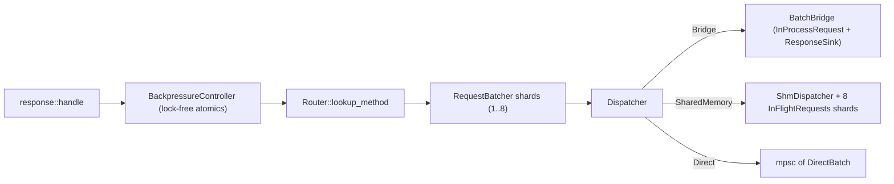

# Request Batching, Dispatch & Backpressure

After [`response::handle`](../../../../../src/rs/vertebra-http/src/response.rs) admits and routes a request (see [HTTP Ingress](ingress-and-routing.md)), it sends a `PendingRequest` to one of the `RequestBatcher` tasks and awaits a `oneshot` reply. Batchers drain queued requests opportunistically without lingering sleep and hand each batch to [`Dispatcher`](../../../../../src/rs/vertebra-http/src/dispatcher/mod.rs), which transfers it to Python workers and resolves responses back into Hyper.

## Request and response types (`batcher.rs`, `response.rs`)

- [`PendingRequest`](../../../../../src/rs/vertebra-http/src/batcher.rs): `handler_id: u64`, `method_tag` (`GET`=0 … `CONNECT`=8, other=255), `http_version_tag` (`HTTP/1.0`=0, `HTTP/1.1`=1, `HTTP/2`=2, `HTTP/3`=3, matching `TransportNode::http_version()`), `flags: u32` (`vertebra_core::protocol::flags`), `path_and_query: http::uri::PathAndQuery`, compact binary `headers_mp: Bytes` (`[name_len: u8][name][val_len: u16 LE][val]`), `body: Bytes`, and `reply: oneshot::Sender<PendingResponse>`.
- `PendingResponse { status, headers_mp, body, stream_rx: Option<PendingResponseBody> }` with `PendingResponse::unary` and `PendingResponse::streaming`.
- [`ResponseBody`](../../../../../src/rs/vertebra-http/src/response.rs) is `Either<Full<Bytes>, StreamingBody>`, where `StreamingBody = StreamBody<ReceiverFrameStream>` over `mpsc::Receiver<Result<Frame<Bytes>, Infallible>>`. `HttpResponse = Response<ResponseBody>`. `build_response_with_offloads` selects streaming when `stream_rx` is set and applies configured Rust CORS and compression offloads on unary responses.

## `RequestBatcher` and `BatchLimit` (`batcher.rs`)

- [`RequestBatcher::spawn_pool(dispatcher, limit, shard_count, channel_capacity)`](../../../../../src/rs/vertebra-http/src/batcher.rs) spawns `shard_count` independent Tokio tasks (`config.worker_threads.clamp(1, 8)` in `main.rs`, channel capacity `16,384`).
- [`BatchLimit`](../../../../../src/rs/vertebra-http/src/batcher.rs) bounds the maximum items drained per batch (`BatchLimit::default()` = `64`).
- Each batcher task maintains double-buffered `Vec<PendingRequest>` storage (`pending` and `draining`), awaits the first request via `rx.recv().await`, opportunistically drains ready requests via `rx.try_recv()` up to `limit.batch_size()` with zero timer sleep, swaps `pending` and `draining` to preserve vector capacity without heap reallocation, and invokes `Dispatcher::dispatch`.

## Dispatcher backends (`dispatcher/`)

`DispatchBackend` has three variants (`Dispatcher::backpressure()` returns the optional `BackpressureController` attached with `with_backpressure`):

1. **Bridge** (`Dispatcher::new()`, used by `Topology::Embedded`). [`BridgeCorrelation`](../../../../../src/rs/vertebra-http/src/dispatcher/bridge.rs) replaces `DashMap` and the `1 MiB` `DataSlab` copy with an 8-shard cache-line-padded `Mutex<InFlightRequests>` slab, zero-copy `BatchBridge::submit_inprocess_batch(Vec<InProcessRequest>)` (passing `headers_mp` and `body` `Bytes` by refcount without MessagePack transcoding), and a direct `ResponseSink` callback registered on `BatchBridge`. When Python submits a response or batch, `ResponseSink` pops the `oneshot::Sender` from the correlation shard, **releases the shard `Mutex` first**, and resolves `tx.send(...)` directly with zero intermediate reader-task hops (`spawn_bridge_sweeper` expires stale correlations every 1 s).
2. **Shm** (`Dispatcher::from_shm(shm)`, used when `Topology::Shm` on Unix). Detailed below.
3. **Direct** (`Dispatcher::new_direct(capacity)`). [`dispatch_direct`](../../../../../src/rs/vertebra-http/src/dispatcher/direct.rs) packs requests into a `Batch` and `try_send`s on a bounded `mpsc` channel.

## SharedMemory dispatch (`dispatcher/shm.rs`, `dispatcher/correlation.rs`, `dispatcher/shm_reader.rs`)

- [`ShmDispatcher::new`](../../../../../src/rs/vertebra-http/src/dispatcher/shm.rs) allocates 8 cache-line-padded `Mutex<InFlightRequests>` shards of `max_inflight / 8` slots (`65,536 / 8 = 8,192`) and runs a periodic 1 s sweeper expiring entries older than 30 s (`sweep_for_worker` fails in-flight requests for a crashed worker during `Supervisor` respawn).
- [`InFlightRequests`](../../../../../src/rs/vertebra-http/src/dispatcher/correlation.rs) is a generation-tagged slab (`(generation << 32) | index` combined with shard routing) with `allocate_batch`, `complete`, `complete_many`, `sweep_expired`, and `sweep_for_worker`.
- `dispatch_shm` operates with **zero** global `Mutex<ShmBatchScratch>`: it routes the entire batch to a single target worker (sticking to the warm MRU worker when total in-flight load is `<= 4` for single-request cache locality, and advancing round-robin per batch under concurrent load), computes the exact serialized batch byte size (passing compact `headers_mp` through untouched), writes directly into the worker's SHM request ring via `request_ring.try_send_with` (falling back to bounded `send_with` on transient ring pressure), and calls `worker.rings.notify_request_if_sleeping()` once per batch using the `ShmHeader` Dekker `consumer_sleeping` flag (`0` `eventfd` syscalls while the Python worker is awake).
- [`spawn_response_readers`](../../../../../src/rs/vertebra-http/src/dispatcher/shm_reader.rs) runs one Tokio task per worker. Each reader drains responses zero-copy via `drain_responses_with` (`0` intermediate `Vec<u8>` slot copies), extracts `oneshot::Sender`s from the correlation shard while releasing the shard `Mutex` *before* calling `tx.send(response)`, and brackets `AsyncFd` waits with Dekker `prepare_response_sleep` / `cancel_response_sleep`.
- `ShmDispatcher::handle_raw_response_slot` forwards multi-frame `ResponseSlot` streams through `PendingRequests` (`register_stream`, `deliver_raw_frame`).

## `BackpressureController` (`backpressure.rs`)

| Setting (`BackpressureConfig`) | Default | Env override |
|---|---|---|
| `max_in_flight` | `1024` | `VERTEBRA_BP_MAX_IN_FLIGHT` |
| `max_queue_depth` | `1024` waiters | `VERTEBRA_BP_MAX_QUEUE_DEPTH` |
| `max_queue_time` | `100 ms` | `VERTEBRA_BP_MAX_QUEUE_TIME_MS` |
| `max_active_streams` | `65,536` | none |
| `high_watermark` / `low_watermark` | `192` / `64` chunks | none |
| `priority_routes` | `/healthz`, `/readyz`, `/__vertebra/health` | none |
| `CircuitBreakerConfig` | failure rate `0.5`, `20` min samples, `10 s` window, `5` half-open probes | `VERTEBRA_BP_CB_*` |

- **Lock-free admission & wakeup barrier**: `try_acquire_for_path` grants priority permits to health paths first, otherwise increments cache-line-padded `in_flight: CacheLine<AtomicUsize>` via CAS, queueing bounded waiters up to `max_queue_depth` and `max_queue_time`. Both waiter registration (`notified.enable()` -> `SeqCst` fence -> `in_flight` re-check) and `AdmissionPermit::drop` (`in_flight.fetch_sub` -> `SeqCst` fence -> `queue_depth.load`) enforce a `SeqCst` store-load barrier so permit releases never miss waking a queued request.
- **Lock-free sliding-window circuit breaker**: `record_success` and `record_failure` update a 16-bucket atomic sliding window (`[AtomicU64; 16]`) and single-word `AtomicU64` phase/timestamp state (`Closed`, `Open`, `HalfOpen`) driven by a coarse monotonic millisecond clock with **zero** `Mutex` locks and zero `VecDeque` allocations.
- `RejectionReason::Saturated`, `QueueTimeout`, and `StreamLimitExceeded` return `503`; `CircuitOpen` returns `429` (all with `retry-after: 1`). `snapshot()` returns `BackpressureMetricsSnapshot` for `/__vertebra/health`.
