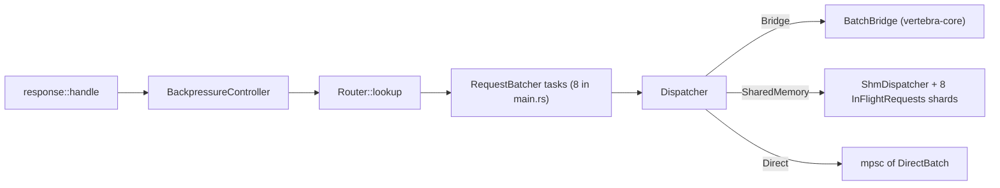

# Request Batching, Dispatch & Backpressure

After [`response::handle`](../../../../../src/rs/vertebra-http/src/response.rs) admits and routes a request (see [HTTP Ingress](ingress-and-routing.md)), it sends a `PendingRequest` to one of the `RequestBatcher` tasks and awaits a `oneshot` reply. Batchers group requests and hand each batch to the [`Dispatcher`](../../../../../src/rs/vertebra-http/src/dispatcher/mod.rs), which moves it to Python workers and routes responses back.

## Request and response types (`batcher.rs`, `response.rs`)

- [`PendingRequest`](../../../../../src/rs/vertebra-http/src/batcher.rs): `handler_id: u64`, `method_tag` (from `method_tag`, `GET`=0 … `CONNECT`=8, other=255), `http_version_tag`, `flags: u32` (`vertebra_core::protocol::flags`), `path`, `query`, compact `headers_mp`, `body`, and `reply: oneshot::Sender<PendingResponse>`.
- `PendingResponse { status, headers_mp, body, stream_rx: Option<PendingResponseBody> }` with `PendingResponse::unary` and `PendingResponse::streaming`.
- [`ResponseBody`](../../../../../src/rs/vertebra-http/src/response.rs) is `Either<Full<Bytes>, StreamingBody>`, where `StreamingBody = StreamBody<ReceiverFrameStream>` over `mpsc::Receiver<Result<Frame<Bytes>, Infallible>>`. `HttpResponse = Response<ResponseBody>`. `full_body` and `stream_body` build each branch; `build_response` picks the streaming branch when `stream_rx` is set.
- `ResponseCollector` (`new`, `with_stream_sender`, `collect_chunk`, `set_trailers`, `into_bytes`) collects chunked response streams.

## `RequestBatcher` and `BatchPolicy` (`batcher.rs`)

- [`RequestBatcher::spawn_pool(dispatcher, policy, shard_count, channel_capacity)`](../../../../../src/rs/vertebra-http/src/batcher.rs) spawns `shard_count` independent Tokio tasks, each owning a bounded `mpsc::Receiver<PendingRequest>`. `main.rs` uses 8 tasks with capacity 16,384.
- Each task awaits `rx.recv()`, drains already-queued requests with `try_recv` up to `policy.batch_size()`, calls `Dispatcher::dispatch`, and records the batch size.
- [`BatchPolicy`](../../../../../src/rs/vertebra-http/src/batcher.rs) is `Fixed { size, timeout }` (`default_fixed`: 64, 1 ms; also `Default`) or `Adaptive { preferred_sizes, max_queue_delay, ema_arrival_rate, ema_alpha, min_size, max_size }` (`default_adaptive`: `[8, 16, 32, 64]`, 200 µs, 0.0, 0.25, 1, 64).

## Dispatcher modes (`dispatcher/`)

`DispatchMode` has three variants. `Dispatcher::backpressure()` exposes the optional controller attached with `with_backpressure`.

1. **Bridge** (`Dispatcher::new()`, the default and the embedded topology). [`dispatch_bridge`](../../../../../src/rs/vertebra-http/src/dispatcher/bridge.rs) assigns a monotonic `next_id`, stores the reply in a `DashMap<u64, oneshot::Sender>` (skipped for `FIRE_AND_FORGET`), pushes a `WriteRequest` into `BatchBridge::batch_writer()`, and seals the batch. The `spawn_response_reader` task in `main.rs` drains `bridge.recv_responses()` and calls `Dispatcher::complete`.
2. **SharedMemory** (`Dispatcher::new_shm(ring_pairs, max_inflight)`, used when `Topology::Shm`). See the next section.
3. **Direct** (`Dispatcher::new_direct(capacity)`). [`dispatch_direct`](../../../../../src/rs/vertebra-http/src/dispatcher/direct.rs) converts the batch into a `DirectBatch` of `DirectRequest`s and `try_send`s it on a bounded mpsc; a full channel drops the whole batch.

## SharedMemory dispatch (`dispatcher/shm.rs`, `dispatcher/correlation.rs`, `dispatcher/shm_reader.rs`)

- [`ShmDispatcher::new`](../../../../../src/rs/vertebra-http/src/dispatcher/shm.rs) creates 8 cache-line-padded `Mutex<InFlightRequests>` shards of `max_inflight / 8` slots (65,536 / 8 = 8,192 in `main.rs`) and spawns a sweep task that runs every 1 s and expires entries older than 30 s.
- [`InFlightRequests`](../../../../../src/rs/vertebra-http/src/dispatcher/correlation.rs) is a slab with a free list and per-slot generations. `insert` returns `(generation << 32) | index`; `complete`, `sweep_expired`, and `sweep_for_worker` resolve or fail entries.
- `dispatch_shm` picks workers round-robin (`(start + offset) % worker_count`), probing for a ring with capacity. Requests are grouped per `(worker, flags)` into `ShmDispatchBatch` and serialized by `ShmBatchWriter` directly into a request-ring slot with `try_send_with`. The worker is notified only when the ring goes from empty to non-empty.
- A request that does not fit a slot, a full set of rings, or a full correlation shard gets a 503. A ring-full error during flush fails every correlation in that batch with 503.
- [`run_response_reader`](../../../../../src/rs/vertebra-http/src/dispatcher/shm_reader.rs) runs one task per worker. It waits on the response notifier through `AsyncFd`, falling back to 100 µs polling. It drains `TieredRingSet::try_recv_response()` and completes through `Dispatcher::complete_many`, which locks the correlation shard per response.
- `ShmDispatcher::handle_raw_response_slot` forwards multi-frame `ResponseSlot` streams through the `DashMap`-backed [`PendingRequests`](../../../../../src/rs/vertebra-http/src/dispatcher/shm_reader.rs) (`register_stream`, `deliver_raw_frame`).

## `BackpressureController` (`backpressure.rs`)

| Setting (`BackpressureConfig`) | Default | Env override |
|---|---|---|
| `max_in_flight` | 1024 | `VERTEBRA_BP_MAX_IN_FLIGHT` |
| `max_queue_depth` | 1024 waiters | `VERTEBRA_BP_MAX_QUEUE_DEPTH` |
| `max_queue_time` | 100 ms | `VERTEBRA_BP_MAX_QUEUE_TIME_MS` |
| `max_active_streams` | 65,536 | none |
| `high_watermark` / `low_watermark` | 192 / 64 chunks | none |
| `priority_routes` | `/healthz`, `/readyz`, `/__vertebra/health` | none |
| `CircuitBreakerConfig` | failure rate 0.5, 20 min samples, 10 s window, 5 half-open probes | `VERTEBRA_BP_CB_*` |

- `try_acquire_for_path` first tries a separate `priority_semaphore` for priority routes, then falls back to `try_acquire`: an immediate permit, else a wait bounded by `max_queue_depth` and `max_queue_time`.
- `RejectionReason::Saturated`, `QueueTimeout`, and `StreamLimitExceeded` map to 503; `CircuitOpen` maps to 429. `rejection_response` always adds `retry-after: 1`.
- `record_success` and `record_failure` feed a sliding-window breaker with `Closed`, `Open`, and `HalfOpen` phases. They take a mutex on every response.
- `snapshot()` returns `BackpressureMetricsSnapshot`, served as JSON at `/__vertebra/health`.
- The stream API (`acquire_stream`, `StreamGuard`, `on_stream_chunk_enqueued`, `on_stream_chunk_dequeued`, `wait_until_resumed`) is called only from `tests/backpressure_streams_tests.rs`.
