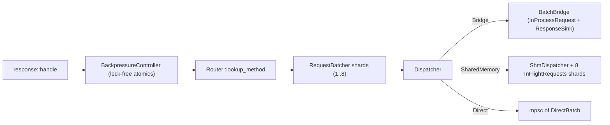

# Request Batching, Dispatch & Backpressure

<!-- truth: start -->
- `BackpressureController` enforces lock-free atomic admission (`Ordering::SeqCst` across `in_flight` and `queue_depth`) before route lookup or batch queueing.
- Sharded `RequestBatcher` tasks coalesce `PendingRequest` items up to `BatchLimit` (yielding once on the first item to avoid Tokio LIFO starvation) and dispatch via `BatchBridge` (`Embedded`) or `ShmDispatcher` + sharded `InFlightRequests` (`Shm`), while `ResponseReaderRegistry` isolates slow streams via per-stream `StreamPumpTable` queues (`stream_queue_depth`) and joins worker readers before `RingPair::reclaim()`.
<!-- truth: end -->

After [`response::handle`](../../../../../src/rs/vertebra-http/src/response.rs)[^src-vertebra-http-src-response-rs] admits and routes a request (see [HTTP Ingress](ingress-and-routing.md)), it sends a `PendingRequest` to one of the `RequestBatcher` tasks and awaits a `oneshot` reply. Batchers drain queued requests opportunistically without lingering sleep and hand each batch to [`Dispatcher`](../../../../../src/rs/vertebra-http/src/dispatcher/mod.rs)[^src-vertebra-http-src-dispatcher-mod-rs], which transfers it to Python workers and resolves responses back into Hyper.

## Request and response types (`batcher.rs`, `body.rs`, `response.rs`)

- [`PendingRequest`](../../../../../src/rs/vertebra-http/src/batcher.rs)[^src-vertebra-http-src-batcher-rs]: `handler_id: u64`, `method_tag` (`GET`=0 … `CONNECT`=8, other=255), `http_version_tag` (`HTTP/1.0`=0, `HTTP/1.1`=1, `HTTP/2`=2, `HTTP/3`=3, matching `TransportNode::http_version()`), `flags: u32` (`vertebra_core::protocol::flags`), `path_and_query: http::uri::PathAndQuery`, compact binary `headers_mp: Bytes` (`[name_len: u8][name][val_len: u16 LE][val]`), `body: Bytes`, and `reply: oneshot::Sender<PendingResponse>`.
- [`PendingResponse`](../../../../../src/rs/vertebra-http/src/body.rs)[^src-vertebra-http-src-body-rs] `{ status, headers_mp, body, stream_rx: Option<FrameReceiver> }` exposes `PendingResponse::unary` and `PendingResponse::streaming`.
- [`ResponseBody`](../../../../../src/rs/vertebra-http/src/body.rs) (re-exported by [`response.rs`](../../../../../src/rs/vertebra-http/src/response.rs)) is `Either<Full<Bytes>, FrameReceiver>` (`full_body` and `stream_body` helpers over `mpsc::Receiver<Result<Frame<Bytes>, Infallible>>`), with `HttpResponse = Response<ResponseBody>`. `build_response_with_offloads` selects streaming when `stream_rx` is set and applies configured Rust CORS and compression offloads on unary responses.

## `RequestBatcher` and `BatchLimit` (`batcher.rs`)

- [`RequestBatcher::spawn_pool(dispatcher, limit, shard_count, channel_capacity)`](../../../../../src/rs/vertebra-http/src/batcher.rs) spawns `shard_count` independent Tokio tasks (`config.workers.count.clamp(1, 8)` in `Topology::Shm` and `config.worker_threads.clamp(1, 8)` in `Topology::Embedded` in `main.rs`, channel capacity `16,384`), tagging each task with `shard_idx: Option<usize>`.
- [`BatchLimit`](../../../../../src/rs/vertebra-http/src/batcher.rs) bounds the maximum items drained per batch (`BatchLimit::default()` = `64`).
- Each batcher task maintains double-buffered `Vec<PendingRequest>` storage (`pending` and `draining`), awaits the first request via `rx.recv().await`, opportunistically drains ready requests via `rx.try_recv()`, yields once via `tokio::task::yield_now().await` only when `pending.len() < max_size && (dispatcher.in_flight() > 0 || !rx.is_empty())` so single-connection (`c=1`) requests flush immediately with zero yield latency while concurrent sibling connection tasks woken in the same `epoll_wait` batch enqueue before flush, swaps `pending` and `draining` to preserve vector capacity without heap reallocation, and invokes `Dispatcher::dispatch_requests_from_shard(self.shard_idx, draining)`.

## Dispatcher backends (`dispatcher/`)

`DispatchBackend` has three variants (`Dispatcher::backpressure()` returns the optional `BackpressureController` attached with `with_backpressure`):

1. **Bridge** (`Dispatcher::new()` / `Dispatcher::new_with_queue_depth(stream_queue_depth)`, used by `Topology::Embedded`). [`BridgeCorrelation`](../../../../../src/rs/vertebra-http/src/dispatcher/bridge.rs)[^src-vertebra-http-src-dispatcher-bridge-rs] replaces `DashMap` and the `1 MiB` `DataSlab` copy with an 8-shard cache-line-padded `Mutex<InFlightRequests>` slab, zero-copy `BatchBridge::submit_inprocess_batch(Vec<InProcessRequest>)` (passing `headers_mp` and `body` `Bytes` by refcount without MessagePack transcoding), a bounded `ResponseStreamRegistry::with_capacity(stream_queue_depth)` (default `64`), and a direct `ResponseSink` callback registered on `BatchBridge`. When Python submits a response or batch, `ResponseSink` pops the `oneshot::Sender` from the correlation shard, **releases the shard `Mutex` first**, and resolves `tx.send(...)` directly with zero intermediate reader-task hops (`spawn_bridge_sweeper` expires stale correlations and calls `streams.sweep_closed()` every 1 s).
2. **Shm** (`Dispatcher::from_shm(shm)`, used when `Topology::Shm` on Unix). Detailed below.
3. **Direct** (`Dispatcher::new_direct(capacity)`). [`dispatch_direct_vec`](../../../../../src/rs/vertebra-http/src/dispatcher/direct.rs)[^src-vertebra-http-src-dispatcher-direct-rs] packs requests into a `Batch` and `try_send`s on a bounded `mpsc` channel.

## SharedMemory dispatch (`dispatcher/shm.rs`, `dispatcher/correlation.rs`, `dispatcher/shm_reader.rs`)

- [`ShmDispatcher::new`](../../../../../src/rs/vertebra-http/src/dispatcher/shm.rs)[^src-vertebra-http-src-dispatcher-shm-rs] / `ShmDispatcher::new_with_queue_depth(ring_pairs, max_inflight, stream_queue_depth)` allocates 8 cache-line-padded `Mutex<InFlightRequests>` shards of `max_inflight / 8` slots (`65,536 / 8 = 8,192`), tracks per-worker health (`WorkerState::healthy`, `set_worker_healthy` / `is_worker_healthy`) and per-worker in-flight depth (`WorkerState::in_flight`, `worker_in_flight`), configures `ResponseStreamRegistry::with_capacity(stream_queue_depth)` (default `64`), and runs a periodic 1 s sweeper expiring entries older than 30 s and calling `streams.sweep_closed()` (`sweep_worker` fails in-flight requests and closes streams for a crashed worker during `Supervisor` respawn after marking it unhealthy).
- [`InFlightRequests`](../../../../../src/rs/vertebra-http/src/dispatcher/correlation.rs)[^src-vertebra-http-src-dispatcher-correlation-rs] is a generation-tagged slab (`(generation << 32) | index` combined with shard routing) with `take_completed_with_worker`, `take_expired_with_worker`, `complete`, `complete_many`, `sweep_expired`, and `sweep_for_worker`.
- `dispatch_shm_vec_from_shard` operates with **zero** global `Mutex<ShmBatchScratch>`: when driven by a `RequestBatcher` shard `Some(shard_idx)`, it routes to `home = shard_idx % worker_count` (or the warm MRU worker when `prev_active == 0`, spilling over to the healthy worker with the lowest `in_flight` count if `home` is unhealthy, full, or exceeds `64` in-flight requests) and aligns correlation shard selection (`worker_idx & SHM_CORRELATION_MASK`) so each `(Batcher i, Worker i, Reader i)` pipeline operates on a disjoint ring and correlation shard without cross-worker lock or CAS contention. It computes the exact serialized batch byte size (passing compact `headers_mp` through untouched), writes directly into the worker's SHM request ring via `request_ring.try_send_with` (or spills oversized `> 64 KiB` single requests into a one-shot named `ShmRegion` via `ShmBatchWriter::write_overflow_envelope`), and calls `worker.ring_pair.notify_request_if_sleeping()` once per batch using the `ShmHeader` Dekker `consumer_sleeping` flag (`0` `eventfd` syscalls while the Python worker is awake).
- [`ResponseReaderRegistry`](../../../../../src/rs/vertebra-http/src/dispatcher/shm_reader.rs)[^src-vertebra-http-src-dispatcher-shm-reader-rs] (`spawn_all`, `spawn_worker_reader`, `stop_and_join_worker`, `stop_and_join_all`, `spawn_response_readers`) runs one Tokio task per worker. Each reader drains responses zero-copy via `drain_frames_with` (`0` intermediate `Vec<u8>` slot copies, automatically opening and unlinking `VROV` named SHM overflow regions for responses `> 2 MiB`), extracts `oneshot::Sender`s from the correlation shard while releasing the shard `Mutex` *before* calling `tx.send(response)`, yields once via `tokio::task::yield_now().await` after draining responses before arming Dekker `prepare_response_sleep` so woken Hyper connection tasks execute immediately and follow-up batches avoid `eventfd` wakeups, and brackets `AsyncFd` waits with `prepare_response_sleep` / `cancel_response_sleep`. [`Supervisor`](../../../../../src/rs/vertebra-http/src/workers/supervisor.rs)[^src-vertebra-http-src-workers-supervisor-rs] calls `readers.stop_and_join_worker(worker_id).await` **before** `RingPair::reclaim()` on worker exit, and `main.rs` calls `readers.stop_and_join_all().await` on shutdown.
- **Isolated per-stream delivery (`StreamPumpTable`)**: bounded multi-frame `VRSF` (`ResponseStreamFrame`) streams flow through [`ResponseStreamRegistry`](../../../../../src/rs/vertebra-http/src/dispatcher/streams.rs)[^src-vertebra-http-src-dispatcher-streams-rs] (`ServerConfig::stream_queue_depth`, default `64`). Within `run_worker_reader`, `StreamPumpTable` delivers each stream's first frame synchronously (`dispatcher.deliver_stream_frame`) and stages continuation frames per `request_id` into an isolated bounded `mpsc::channel(DEFAULT_STREAM_QUEUE_DEPTH)` (`StreamPump`) pumped by its own Tokio task. A slow client applies backpressure only to its own `StreamPump` (and closes/aborts that stream with a `500` `FLAG_STREAMING | FLAG_ERROR` frame if its staging queue saturates) without stalling the worker's response ring for other concurrent requests.

## `BackpressureController` (`backpressure.rs`)

| Setting (`BackpressureConfig`) | Default | Env override |
|---|---|---|
| `max_in_flight` | `4096` | `VERTEBRA_BP_MAX_IN_FLIGHT` |
| `max_queue_depth` | `4096` waiters | `VERTEBRA_BP_MAX_QUEUE_DEPTH` |
| `max_queue_time` | `5000 ms` | `VERTEBRA_BP_MAX_QUEUE_TIME_MS` |
| `max_active_streams` | `65,536` | none |
| `high_watermark` / `low_watermark` | `192` / `64` chunks | none |
| `priority_routes` | `/healthz`, `/readyz`, `/__vertebra/health` | none |
| `CircuitBreakerConfig` | failure rate `0.5`, `20` min samples, `10 s` window, `5` half-open probes | `VERTEBRA_BP_CB_*` |

- **Lock-free admission & wakeup barrier**: `try_acquire_for_path` grants priority permits to health paths first, otherwise increments cache-line-padded `in_flight: CacheLine<AtomicUsize>` via CAS, queueing bounded waiters up to `max_queue_depth` and `max_queue_time`. Both waiter registration (`notified.enable()` -> `SeqCst` fence -> `in_flight` re-check) and `AdmissionPermit::drop` (`in_flight.fetch_sub` -> `SeqCst` fence -> `queue_depth.load`) enforce a `SeqCst` store-load barrier so permit releases never miss waking a queued request.
- **Lock-free sliding-window circuit breaker**: `record_success` and `record_failure` update a 16-bucket atomic sliding window (`[AtomicU64; 16]`) and single-word `AtomicU64` phase/timestamp state (`Closed`, `Open`, `HalfOpen`) driven by a coarse monotonic millisecond clock with **zero** `Mutex` locks and zero `VecDeque` allocations.
- `RejectionReason::Saturated`, `QueueTimeout`, and `StreamLimitExceeded` return `503`; `CircuitOpen` returns `429` (all with `retry-after: 1`). `snapshot()` returns `BackpressureMetricsSnapshot` for `/__vertebra/health`.

Provenance sources: [^src-vertebra-http-src-backpressure-rs], [^src-vertebra-http-src-dispatcher-types-rs], [^src-vertebra-http-src-main-rs].

[^src-vertebra-http-src-body-rs]: `src/rs/vertebra-http/src/body.rs` — Rust implementation module (src/rs/vertebra-http/src/body.rs).
[^src-vertebra-http-src-response-rs]: `src/rs/vertebra-http/src/response.rs` — Rust implementation module (src/rs/vertebra-http/src/response.rs).
[^src-vertebra-http-src-batcher-rs]: `src/rs/vertebra-http/src/batcher.rs` — Rust implementation module (src/rs/vertebra-http/src/batcher.rs).
[^src-vertebra-http-src-backpressure-rs]: `src/rs/vertebra-http/src/backpressure.rs` — Rust implementation module (src/rs/vertebra-http/src/backpressure.rs).
[^src-vertebra-http-src-dispatcher-mod-rs]: `src/rs/vertebra-http/src/dispatcher/mod.rs` — Rust implementation module (src/rs/vertebra-http/src/dispatcher/mod.rs).
[^src-vertebra-http-src-dispatcher-direct-rs]: `src/rs/vertebra-http/src/dispatcher/direct.rs` — Rust implementation module (src/rs/vertebra-http/src/dispatcher/direct.rs).
[^src-vertebra-http-src-dispatcher-bridge-rs]: `src/rs/vertebra-http/src/dispatcher/bridge.rs` — Rust implementation module (src/rs/vertebra-http/src/dispatcher/bridge.rs).
[^src-vertebra-http-src-dispatcher-shm-rs]: `src/rs/vertebra-http/src/dispatcher/shm.rs` — Rust implementation module (src/rs/vertebra-http/src/dispatcher/shm.rs).
[^src-vertebra-http-src-dispatcher-types-rs]: `src/rs/vertebra-http/src/dispatcher/types.rs` — Rust implementation module (src/rs/vertebra-http/src/dispatcher/types.rs).
[^src-vertebra-http-src-dispatcher-correlation-rs]: `src/rs/vertebra-http/src/dispatcher/correlation.rs` — Rust implementation module (src/rs/vertebra-http/src/dispatcher/correlation.rs).
[^src-vertebra-http-src-dispatcher-shm-reader-rs]: `src/rs/vertebra-http/src/dispatcher/shm_reader.rs` — Rust implementation module (src/rs/vertebra-http/src/dispatcher/shm_reader.rs).
[^src-vertebra-http-src-main-rs]: `src/rs/vertebra-http/src/main.rs` — Rust implementation module (src/rs/vertebra-http/src/main.rs).
[^src-vertebra-http-src-dispatcher-streams-rs]: `src/rs/vertebra-http/src/dispatcher/streams.rs` — Rust implementation module (src/rs/vertebra-http/src/dispatcher/streams.rs).
[^src-vertebra-http-src-workers-supervisor-rs]: `src/rs/vertebra-http/src/workers/supervisor.rs` — Rust implementation module (src/rs/vertebra-http/src/workers/supervisor.rs).
