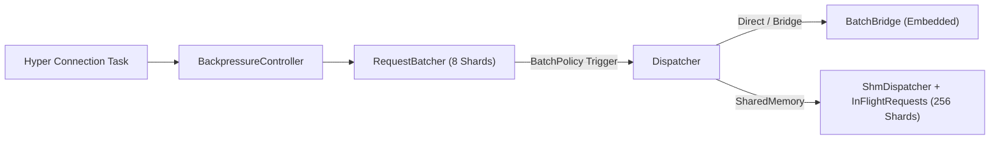

# Request Batching, Dispatch & Backpressure

Dynamic requests matched by `Router` pass through [`BackpressureController`](../../../../../src/rs/vertebra-http/src/backpressure.rs), [`RequestBatcher`](../../../../../src/rs/vertebra-http/src/collector.rs), and [`Dispatcher`](../../../../../src/rs/vertebra-http/src/dispatcher/mod.rs) to amortize IPC and GIL acquisition across concurrent connections.

## 1. 8-Shard `RequestBatcher` & `BatchPolicy` (`collector.rs`, `policy.rs`)

[`RequestBatcher`](../../../../../src/rs/vertebra-http/src/collector.rs) partitions incoming requests across `NUM_SHARDS = 8` cache-line-aligned `Mutex<Vec<PendingRequest>>` shards selected via multiplicative Fibonacci hashing of the caller thread ID (`thread_id * 0x9E37_79B9_7F4A_7C15`):

- **Zero-Timer Idle Sleep**: When `pending_count == 0`, the drain loop sleeps on `Notify::notified().await` with zero timer wheel overhead.
- **Adaptive Drain (`BatchPolicy`)**: Configured by [`BatchPolicy`](../../../../../src/rs/vertebra-http/src/policy.rs) (`max_batch_size = 64`, `linger_us`, `adaptive = true`). When a batch reaches `max_batch_size`, `submit()` immediately wakes `flush_notify`. Under sustained high load, the drain loop skips the linger timer and drains all 8 shards immediately.

## 2. Three `Dispatcher` Modes (`dispatcher/`)

[`Dispatcher`](../../../../../src/rs/vertebra-http/src/dispatcher/mod.rs) routes requests according to deployment topology:

1. **[`Direct`](../../../../../src/rs/vertebra-http/src/dispatcher/direct.rs)** (`direct_worker.rs`): Dispatches directly to the embedded Python handler inside the same process without intermediate batch queuing—achieving `123,790 req/s` (`8.08 ms` per 1,000 concurrent HTTP/1.1 requests).
2. **[`Bridge`](../../../../../src/rs/vertebra-http/src/dispatcher/bridge.rs)**: Flushes [`RequestBatcher`](../../../../../src/rs/vertebra-http/src/collector.rs) batches into the in-process [`BatchBridge`](../../../../../src/rs/vertebra-core/src/bridge.rs) (`113,030 req/s`).
3. **[`SharedMemory`](../../../../../src/rs/vertebra-http/src/dispatcher/shm.rs)** (`response_reader.rs`): Encodes requests into `VREQ` wire format across worker `RingPair` instances. Dedicated Tokio response reader tasks (`response_reader.rs`) drain the 4-tier response `TieredRingSet` using zero-copy `SlotView` and resolve callers via [`InFlightRequests`](../../../../../src/rs/vertebra-http/src/correlation.rs).

## 3. 256-Shard `InFlightRequests` & `BackpressureController`

- **[`InFlightRequests`](../../../../../src/rs/vertebra-http/src/correlation.rs)**: Pre-allocates `65,536` correlation slots partitioned across `256` independent `Mutex` shards (`256` slots per shard), eliminating cross-core lock contention during high-QPS response completion and deadline sweeps.
- **[`BackpressureController`](../../../../../src/rs/vertebra-http/src/backpressure.rs)**: Guards ingress with a bounded `Semaphore` (`max_in_flight`) and a sliding-window circuit breaker (`Closed`, `Open`, `HalfOpen`), shedding overload immediately with `503 Service Unavailable` and `Retry-After`.
