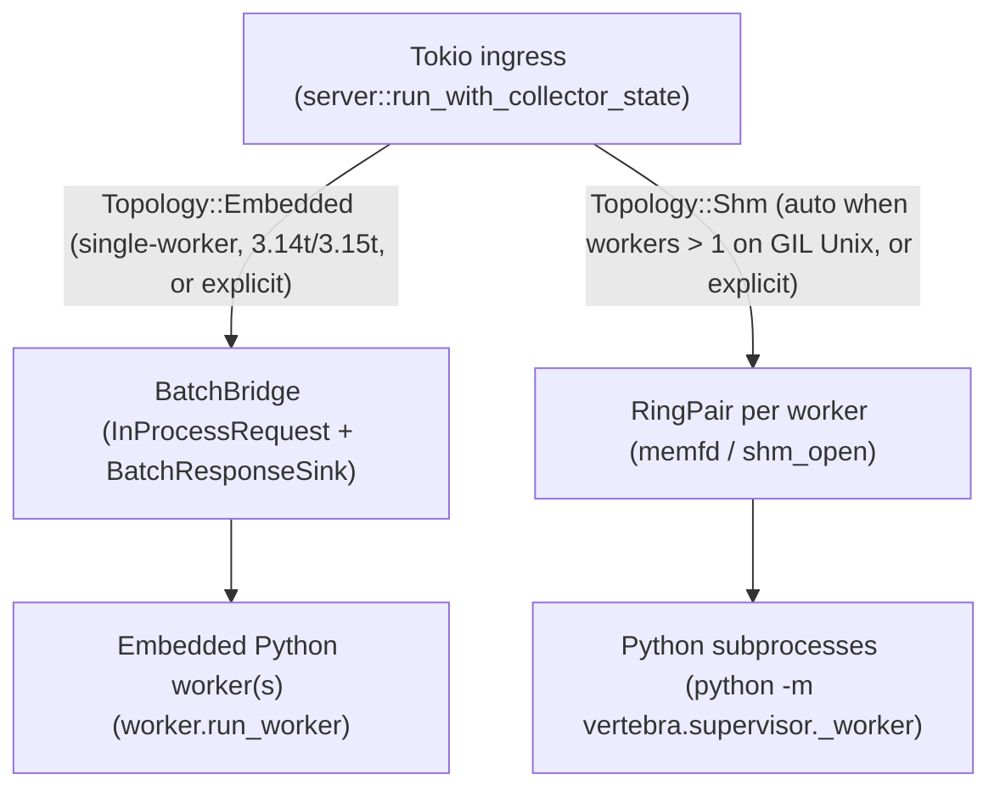

# Runtime Topologies & Python Embedding

<!-- truth: start -->
- `--topology auto` selects `Embedded` for single-worker or free-threaded (`3.14t`/`3.15t`) runtimes and `Shm` when `workers > 1` on POSIX GIL Python.
- Single-worker GIL `Embedded` defaults to `available_cpus.clamp(1, 2)` Tokio worker threads (overridable via `VERTEBRA_TOKIO_THREADS`), while `EmbeddedSupervisor` computes cgroup `cpu.max`-aware budgets (`tokio_threads = (cpus / (2 * workers)).max(1)`, `py_threads <= (cpus / workers).max(1)`) per `SO_REUSEPORT` child process.
- `RequestBatcher::spawn_pool` sizes shards to consumer parallelism (`compute_batcher_shard_count`: `workers.count.clamp(1, 8)` in `Shm`, `embedded_consumers.clamp(1, 8)` in `Embedded`, yielding `1` shard on 1-worker GIL Embedded).
<!-- truth: end -->

The `vertebra-server` binary ([`main.rs`](../../../../../src/rs/vertebra-http/src/main.rs)[^src-vertebra-http-src-main-rs]) builds an explicit Tokio runtime (`Builder::new_current_thread` when `worker_threads <= 1`, `Builder::new_multi_thread` when `> 1`) and hosts Python in one of two [`Topology`](../../../../../src/rs/vertebra-http/src/config.rs)[^src-vertebra-http-src-config-rs] variants (`Embedded` or `Shm`), with `VERTEBRA_TOPOLOGY=auto` / `--topology auto` automatically resolving to `Shm` on POSIX non-free-threaded Python when `workers > 1` and `Embedded` for single-worker or free-threaded `3.14t`/`3.15t` runtimes.

## Topology Selection

- `vtb run` ([`run.py`](../../../../../src/py/vertebra/cli/run.py)[^src-cli-run-py]) and `ServerLaunchEnv.to_environ()` ([`_launch.py`](../../../../../src/py/vertebra/cli/_launch.py)[^src-cli-launch-py]) preserve inherited `VERTEBRA_TOPOLOGY`, `VERTEBRA_WORKERS`, `VERTEBRA_THREADS`, and `VERTEBRA_JIT` environment variables whenever the corresponding CLI options (`--topology auto|embedded|shm`, `--workers`, `--threads`, `--jit/--no-jit`) are omitted, automatically resolving `auto`/omitted topology to `"shm"` when `workers > 1` on POSIX standard GIL builds (`not is_free_threaded_runtime()`) and `"embedded"` otherwise before launching the binary through `run_supervisor` (see [Platform & Lifecycle](platform-and-lifecycle.md)).
- In single-worker GIL `Topology::Embedded`, `ServerConfig::apply_runtime_thread_env` ([`config.rs`](../../../../../src/rs/vertebra-http/src/config.rs)[^src-vertebra-http-src-config-rs]) defaults `worker_threads` to `available_cpus.clamp(1, 2)` when `VERTEBRA_TOKIO_THREADS` is unset, keeping Tokio I/O responsive without starving the single Python worker thread.
- When `Topology::Embedded` runs with `config.workers.count > 1` (either on free-threaded Python or via explicit `--topology embedded`) and `VERTEBRA_EMBEDDED_WORKER` is unset, `EmbeddedSupervisor` pre-initializes shared SHM broker FDs (`ShmLeaseTable` / `ShmStatementCache`) and spawns `W` child `vertebra-server` worker processes (`VERTEBRA_EMBEDDED_WORKER=1`) binding the same port via `SO_REUSEPORT`, computing per-worker `(tokio_threads, py_threads)` via `compute_embedded_worker_budgets` (`tokio_threads = (cpus / (2 * workers)).max(1)`, `py_threads <= (cpus / workers).max(1)`) against `num_cpus()` (cgroup v2 `cpu.max` and `std::thread::available_parallelism()`) to prevent core oversubscription.
- `Topology::Shm` (`VERTEBRA_TOPOLOGY=shm`, selected automatically for `workers > 1` on standard GIL Unix or explicitly via `--topology shm`) runs one central Rust HTTP ingress process dispatching across shared-memory `RingPair`s to `W` Python worker subprocesses, sizing `config.worker_threads` (`available_cpus.saturating_sub(W).clamp(1, 4)`) when `VERTEBRA_TOKIO_THREADS` is unset so the central ingress and `W` Python workers share the CPU budget without oversubscription. On non-Unix targets `Shm` falls back to the in-process bridge dispatcher.

## Startup Sequence (`main.rs`)

1. `cleanup_stale_shm()` (skipped for `VERTEBRA_EMBEDDED_WORKER` children), `install_panic_cleanup_hook()`, `ServerConfig::from_env()`, `validate_http3()`, and `EmbeddedSupervisor` check (`workers > 1` under `Embedded` on Unix spawns `SO_REUSEPORT` child workers and supervises signals/respawns).
2. With the `python` feature, `prepare_embedded_python_env` prepends `.venv/bin` / `VIRTUAL_ENV/bin` to `PATH` before CPython initialization (so relocatable `uv` `python-build-standalone` `libpython` resolves `pyvenv.cfg`), and `append_to_inittab!(pymodule_init)` registers the statically linked `_vertebra` module before the first `Python::attach`.
3. Explicit `tokio::runtime::Builder` construction (`new_current_thread` for `<= 1` Tokio thread, `new_multi_thread` otherwise).
4. `BatchBridge::init` runs **only** when the resolved topology is `Topology::Embedded` (never allocated in `Topology::Shm` on Unix).
5. `Python::attach` populates `sys.path` via `ensure_embedded_python_path` (including `.venv`/`VIRTUAL_ENV` `site-packages`), imports `VERTEBRA_APP` (default `app:app`), invokes `extract_offload_json_from_app` (calling `VertebraPlugin.ensure_finalized(app)` and reading `app.state["vertebra_offload_config_json"]` when `VERTEBRA_OFFLOAD_CONFIG` is unset), and `build_route_table_from_app` reads `handler_index` and registers each mount prefix across `GET`, `POST`, `PUT`, `DELETE`, `PATCH`, `OPTIONS`, and `HEAD` encoded with `MOUNT_HANDLER_BASE | mount_idx` (`0xFFFF_0000_0000_0000 | idx`).
6. `Router::from_entries` builds the router.
7. Dispatcher selection (next sections).
8. `RequestBatcher::spawn_pool(dispatcher, BatchLimit::default(), shard_count, 16384)` starts the double-buffered collector tasks sized via `compute_batcher_shard_count` (`config.workers.count.clamp(1, 8)` in `Topology::Shm` for 1:1 batcher-to-worker affinity, and `embedded_consumers.clamp(1, 8)` in `Topology::Embedded`, yielding `1` shard on 1-worker GIL Embedded).
9. `server::run_with_collector_state` serves until `SIGINT`/`SIGTERM` or `CancellationToken` drain resolves.
10. In `Shm`, `main.rs` awaits `pubsub_forwarder`, `shm_supervisor`, and `readers.stop_and_join_all().await`, then calls `RingFactory::shutdown_workers(&mut children, 5 s)`; in `Embedded`, Python worker `JoinHandle`s are joined cleanly.

## Embedded Mode (`Topology::Embedded`)

Each `vertebra-server` worker process hosts its own Tokio ingress and embedded Python interpreter.

- **Single `_vertebra` copy**: `vertebra-server` links `vertebra-py` directly. `spawn_python_workers` imports the inittab module `_vertebra` and sets `sys.modules["vertebra._vertebra"]` to it, so Python never `dlopen`s the wheel's `_vertebra.cpython-*.so` with a second `static BRIDGE: OnceLock<BatchBridge>`.
- **Dispatcher**: `Dispatcher::new_with_queue_depth(config.stream_queue_depth)` (`DispatchBackend::Bridge(Arc<BridgeCorrelation>)`) uses an 8-shard `InFlightRequests` correlation slab, submits zero-copy `Vec<InProcessRequest>` batches via `BatchBridge::submit_inprocess_batch`, and registers direct `BatchResponseSink`, `ResponseSink`, and `StreamSink` callbacks on `BatchBridge` that complete Hyper `oneshot::Sender`s directly on submission without an intermediate reader task, alongside `spawn_bridge_sweeper`.
- **Python worker thread(s)**: `spawn_python_workers` ([`main.rs`](../../../../../src/rs/vertebra-http/src/main.rs)) checks `_vertebra.FREE_THREADED`, sets `BatchBridge::set_consumer_count(worker_threads)`, calls `init_transport()`, creates a `ZPagesRegistry`, and invokes `run_worker` in [`worker.py`](../../../../../src/py/vertebra/server/worker.py)[^src-server-worker-py]. If an embedded worker thread errors or exits unexpectedly before server shutdown, it cancels `server_shutdown_token` and causes `run_server` to exit non-zero. When `consumer_count == 1` and async/ASGI/RSGI handlers are mounted, the worker runs inline on a single `uvloop` thread via `loop.add_reader(request_notify_fd, ...)` with Dekker `prepare_request_sleep` / `cancel_request_sleep`; pure-sync native embedded workers poll `get_batch` directly with `py.detach`.

## Shared-Memory Mode (`Topology::Shm`, Unix)

- `RingFactory::with_broker_config(worker_count.max(1), RingPairConfig::for_environment(worker_count.max(1)), ...)` creates one [`RingPair`](../../../../../src/rs/vertebra-core/src/transport/ring_pair.rs) per worker: a request `MpmcRing` plus a right-sized `TieredRingSet` of response `SpscRing`s (`ShmHeader` `ABI_VERSION = 3`, `46 MiB/worker` default or `12 MiB/worker` `compact` profile), backed by anonymous `memfd_create` on Linux and `shm_open` elsewhere (with `/tmp/vtb-*` fallback for `VQOV`/`VROV` overflow regions when `/dev/shm` is constrained).
- `Dispatcher::from_shm(ShmDispatcher::new_with_queue_depth(ring_pairs, 65536, config.stream_queue_depth))` routes whole batches with 1:1 batcher-to-worker shard affinity (`home = shard_idx % worker_count`, sticking to the warm MRU worker at `prev_active == 0` and spilling to the least-loaded healthy worker when `home` is unhealthy, full, or `in_flight > 64`) and signals `notify_request_if_sleeping()` via Dekker `consumer_sleeping`; `ResponseReaderRegistry::spawn_all` drains response slots zero-copy via `drain_frames_with`.
- `RingFactory::spawn_all` starts `python -m vertebra.supervisor._worker` once per worker. Spawn, FD inheritance, and shutdown are covered in [SHM Worker Spawn & Shutdown](shm-supervision-and-recovery.md).
- Inside each child, [`_worker.main`](../../../../../src/py/vertebra/supervisor/_worker.py)[^src-supervisor-worker-py] imports the app (registering native `App` routes only when `VERTEBRA_NATIVE` is truthy so `--asgi` / `VERTEBRA_NATIVE=0` mounts `App` once without double-mounting) and calls `run_worker` (`VERTEBRA_TRANSPORT_MODE=shm` -> `init_transport(mode="shm")`).

## Worker Loop Modes (`worker.py`)

- When `scheduler.size == 1` and a request `notify_fd` is active (`RingPair` in `shm` or single-consumer `BatchBridge` in `embedded` with async/ASGI/RSGI routes), `Worker._run_inline_event_loop` drives `try_get_batch()` directly on the `uvloop` / `asyncio` loop thread via `loop.add_reader(notify_fd, ...)` with zero cross-thread `call_soon_threadsafe` hops.
- When `pool_size > 1` on free-threaded builds without multi-thread `spawn_python_workers`, async work shards across `EventLoopPool(size=pool_size)`.

## Free-Threaded Python (`3.14t` & `3.15t`)

- All 13 PyO3 extensions (`_vertebra`, `_bundler`, `_storage`, `_bigquery`, `_duckdb`, `_mssql`, `_mysql`, `_oracle`, `_postgres`, `_redis`, `_spanner`, `_sqlite`, and `_valkey`) declare `#[pymodule(gil_used = false)]` ([`vertebra-py/src/lib.rs`](../../../../../src/rs/vertebra-py/src/lib.rs)[^src-vertebra-py-src-lib-rs], `vertebra-*/src/lib.rs`), omit PyO3 global-mutex `freelist`s under `#[cfg(Py_GIL_DISABLED)]`, and set `immutable_type` on non-subclassed `#[pyclass]` types.
- `spawn_python_workers` in `vertebra-http` queries `_vertebra.FREE_THREADED` and spawns `N` symmetric embedded Python worker threads sharing `BatchBridge`'s lock-free `crossbeam` receiver when `py_threads > 1`, keeping object creation, execution, and `Drop` on the owning thread (`ob_tid` biased refcount locality).
- The `vertebra-server` binary installs `mimalloc::MiMalloc` as `#[global_allocator]` behind the default `mimalloc` feature (`default-features = false`, without `override`, coexisting cleanly with `libpython3.14t`/`libpython3.15t`'s internal `mimalloc`). PyO3 extension wheels use the host allocator.
- Loop sharding, GIL auditing, and CPU affinity are described in [Platform & Lifecycle](platform-and-lifecycle.md).

Provenance sources: [^src-vertebra-http-src-server-rs], [^src-vertebra-http-src-workers-factory-rs], [^src-vertebra-py-src-transport-rs], [^src-server-dispatch-py].

[^src-vertebra-http-src-main-rs]: `src/rs/vertebra-http/src/main.rs` — Rust implementation module (src/rs/vertebra-http/src/main.rs).
[^src-vertebra-http-src-config-rs]: `src/rs/vertebra-http/src/config.rs` — Rust implementation module (src/rs/vertebra-http/src/config.rs).
[^src-vertebra-http-src-server-rs]: `src/rs/vertebra-http/src/server.rs` — Rust implementation module (src/rs/vertebra-http/src/server.rs).
[^src-vertebra-http-src-workers-factory-rs]: `src/rs/vertebra-http/src/workers/factory.rs` — Rust implementation module (src/rs/vertebra-http/src/workers/factory.rs).
[^src-vertebra-py-src-lib-rs]: `src/rs/vertebra-py/src/lib.rs` — Rust implementation module (src/rs/vertebra-py/src/lib.rs).
[^src-vertebra-py-src-transport-rs]: `src/rs/vertebra-py/src/transport.rs` — Rust implementation module (src/rs/vertebra-py/src/transport.rs).
[^src-server-worker-py]: `src/py/vertebra/server/worker.py` — Python implementation module (src/py/vertebra/server/worker.py).
[^src-server-dispatch-py]: `src/py/vertebra/server/_dispatch.py` — Python implementation module (src/py/vertebra/server/_dispatch.py).
[^src-supervisor-worker-py]: `src/py/vertebra/supervisor/_worker.py` — Python implementation module (src/py/vertebra/supervisor/_worker.py).
[^src-cli-launch-py]: `src/py/vertebra/cli/_launch.py` — Python implementation module (src/py/vertebra/cli/_launch.py).
[^src-cli-run-py]: `src/py/vertebra/cli/run.py` — Python implementation module (src/py/vertebra/cli/run.py).
