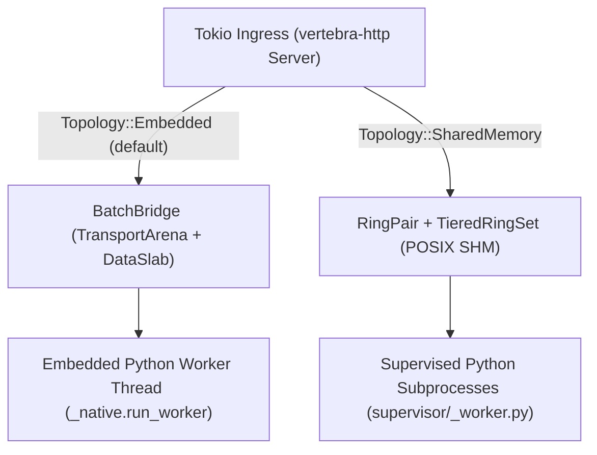

# Runtime Topologies & Python Embedding

Vertebra supports three execution topologies configured via [`Topology`](../../../../../src/rs/vertebra-http/src/config.rs) (`Embedded`, `SharedMemory`, and `Auto`) and exposed through the `vtb run` and `vtb dev` CLI commands in [`src/py/vertebra/cli/run.py`](../../../../../src/py/vertebra/cli/run.py) and [`src/py/vertebra/cli/dev.py`](../../../../../src/py/vertebra/cli/dev.py).

## 1. Embedded Single-Process Mode (`Topology::Embedded`)

`Topology::Embedded` is the default runtime mode (`workers == 1`). A single OS process hosts both the Rust Tokio HTTP ingress and an embedded Python interpreter:

1. **Inittab Registration Before Interpreter Init**: Because `vertebra-server` links `vertebra-py` directly while Python also installs a standalone `vertebra/_vertebra.cpython-*.so` wheel extension, importing `vertebra._vertebra` via standard file-backed import would `dlopen` a second dynamic library with its own duplicate `static BRIDGE: OnceLock<BatchBridge>`. To prevent split globals, [`register_inittab()`](../../../../../src/rs/vertebra-py/src/lib.rs) invokes `pyo3::append_to_inittab!(_vertebra)` before `Python::initialize()`, and [`server.rs`](../../../../../src/rs/vertebra-http/src/server.rs) aliases `sys.modules["vertebra._vertebra"] = sys.modules["_vertebra"]`.
2. **Process-Global Bridge Initialization**: Before spawning the Python worker thread, Rust initializes the process-global [`BatchBridge`](../../../../../src/rs/vertebra-core/src/bridge.rs) (`BatchBridge::init`).
3. **Dedicated Python Worker Thread & `DirectWorkerPool`**: Rust spawns the embedded Python worker thread, imports [`vertebra.server._native`](../../../../../src/py/vertebra/server/_native.py), and calls [`run_worker()`](../../../../../src/py/vertebra/server/_native.py) with the application's compiled route table and mounted sub-apps. For direct dispatch, [`DirectWorkerPool`](../../../../../src/rs/vertebra-http/src/direct_worker.rs) scales from 1 thread on GIL-enabled builds to $N$ worker threads under `Py_GIL_DISABLED`.
4. **GIL Release Around Blocking Wait**: Inside [`get_batch(timeout_ms)`](../../../../../src/rs/vertebra-py/src/api.rs), `vertebra-py` calls `py.detach(|| bridge.poll_batch(timeout))` so the Python GIL is released whenever the worker waits for the next batch of HTTP requests.

## 2. Multi-Process Shared-Memory Mode (`Topology::SharedMemory`)

When `workers > 1` or `--topology shm` is selected, `Server` isolates the Rust Tokio ingress from $N$ supervised Python worker subprocesses:

- Each worker receives a dedicated [`RingPair`](../../../../../src/rs/vertebra-core/src/transport/ring_pair.rs) (request `MpmcRing` + 4-tier response [`TieredRingSet`](../../../../../src/rs/vertebra-core/src/tiered_ring.rs)) over anonymous POSIX shared memory (`memfd_create` on Linux, `shm_open` on macOS).
- Each Python child process executes [`vertebra.supervisor._worker`](../../../../../src/py/vertebra/supervisor/_worker.py) and attaches to its inherited SHM and notifier file descriptors via `init_transport(mode="shm")` in [`api.rs`](../../../../../src/rs/vertebra-py/src/api.rs).

## 3. Free-Threaded Mode (`Python 3.14t` / `Py_GIL_DISABLED`) & Runtime Tuning

Vertebra supports PEP 703 free-threaded builds (`cp314t`) with zero GIL re-enablement:

- **`#[pymodule(gil_used = false)]`**: Both [`vertebra-py`](../../../../../src/rs/vertebra-py/src/lib.rs) (`_vertebra`) and [`vertebra-bundler`](../../../../../src/rs/vertebra-bundler/src/lib.rs) (`_bundler`) declare `#[pymodule(gil_used = false)]` so importing either extension under `python3.14t` never re-enables the GIL (`sys._is_gil_enabled() is False`).
- **`mimalloc` Global Allocator**: [`vertebra-http`](../../../../../src/rs/vertebra-http/src/lib.rs) installs `mimalloc::MiMalloc` as `#[global_allocator]` to eliminate multi-threaded allocator lock contention across Tokio ingress and free-threaded Python worker threads.
- **`AsgiEventLoopPool` & `apply_runtime_tuning`**: [`_runtime_tuning.py`](../../../../../src/py/vertebra/server/_runtime_tuning.py) provides [`AsgiEventLoopPool`](../../../../../src/py/vertebra/server/_runtime_tuning.py) (round-robin multi-thread `asyncio` event loop pool for `3.14t`) and [`apply_runtime_tuning()`](../../../../../src/py/vertebra/server/_runtime_tuning.py) (`gc.set_threshold(50_000, 20, 20)`, `gc.freeze()` after startup warmup, and `MALLOC_ARENA_MAX=2`).
