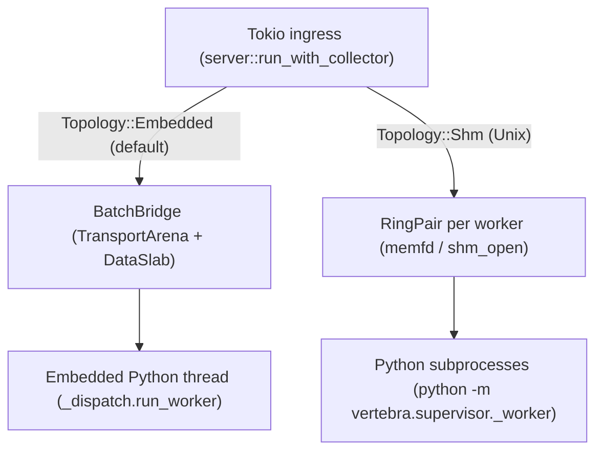

# Runtime Topologies & Python Embedding

The `vertebra-server` binary ([`main.rs`](../../../../../src/rs/vertebra-http/src/main.rs)) owns the Tokio HTTP ingress and hosts Python in one of two topologies selected by [`Topology`](../../../../../src/rs/vertebra-http/src/config.rs): `Embedded` (default) or `Shm`. `Topology::from_str` accepts only `"embedded"` and `"shm"`.

## Topology Selection

- `vtb run` ([`run.py`](../../../../../src/py/vertebra/cli/run.py)) always exports `VERTEBRA_TOPOLOGY` (`--topology embedded|shm`, default `embedded`) and `VERTEBRA_WORKERS` (default `0` for embedded, `1` for shm), then launches the binary through `run_supervisor` (see [Platform & Lifecycle](platform-and-lifecycle.md)).
- `ServerConfig::from_env` also switches to `Shm` when `VERTEBRA_WORKERS > 0` and `VERTEBRA_TOPOLOGY` is unset. That only applies when the binary is launched directly.
- On non-Unix targets `Shm` falls back to the in-process bridge dispatcher.

## Startup Sequence (`main.rs`)

1. `ServerConfig::from_env()`.
2. `BatchBridge::init(256, 1_048_576, 4, config.workers.count)` (arena capacity, slab bytes, channel depth, max workers). This runs for both topologies.
3. With the `python` feature, `append_to_inittab!(pymodule_init)` registers the statically linked `_vertebra` module before the first `Python::attach`.
4. `Python::attach` imports `VERTEBRA_APP` (default `app:app`) and `build_route_table_from_app` reads `handler_index` and registers each mount prefix as a `/*rest` catch-all for `GET`/`POST`/`PUT`/`DELETE`/`PATCH`. A raw callable without `handler_index` is wrapped in `App()` and mounted at `/`.
5. `Router::from_entries` builds the router.
6. Dispatcher selection (next sections).
7. `RequestBatcher::spawn_pool(dispatcher, BatchPolicy::default_adaptive(), 8, 16384)` starts the collector tasks.
8. `server::run_with_collector` serves until `ctrl_c` (SIGINT) or `CancellationToken` drain resolves.
9. In `Shm`, `RingFactory::shutdown_workers(children, 5 s)` stops the subprocesses.

## Embedded Mode (`Topology::Embedded`)

One OS process hosts the Tokio ingress and the interpreter.

- **Single `_vertebra` copy**: `vertebra-server` links `vertebra-py` directly. `spawn_python_worker` imports the inittab module `_vertebra` and sets `sys.modules["vertebra._vertebra"]` to it, so Python never `dlopen`s the wheel's `_vertebra.cpython-*.so` with a second `static BRIDGE: OnceLock<BatchBridge>`.
- **Dispatcher**: `Dispatcher::new()` with `spawn_response_reader`, which awaits `BatchBridge::recv_responses()` and completes Hyper futures.
- **Python thread**: `spawn_python_worker` calls `init_transport()` (idempotent; "bridge already initialized" is ignored) and then `run_worker(app._handlers, mounts=list(app.mounts), worker_count=...)`, where `worker_count` is parsed from `VERTEBRA_WORKERS` (1 when unset; `vtb run` sets it to `0` for embedded), from [`_dispatch.py`](../../../../../src/py/vertebra/server/_dispatch.py).
- **GIL release**: [`get_batch`](../../../../../src/rs/vertebra-py/src/transport.rs) wraps `bridge.poll_batch(timeout)` in `py.detach`, so the GIL is free while the worker waits.

## Shared-Memory Mode (`Topology::Shm`, Unix)

- `RingFactory::new(worker_count.max(1), RingPairConfig::default())` creates one [`RingPair`](../../../../../src/rs/vertebra-core/src/transport/ring_pair.rs) per worker: a request `MpmcRing` plus a `TieredRingSet` of response `SpscRing`s, backed by `memfd_create` on Linux and `shm_open` elsewhere.
- `Dispatcher::new_shm(ring_pairs, 65536)` routes batches into the request rings; `shm_reader::run_response_reader` drains the response rings.
- `RingFactory::spawn_all` starts `python -m vertebra.supervisor._worker` once per worker. Spawn, FD inheritance, and shutdown are covered in [SHM Worker Spawn & Shutdown](shm-supervision-and-recovery.md).
- Inside each child, [`_worker.main`](../../../../../src/py/vertebra/supervisor/_worker.py) imports the app (wrapping it in an ASGI mount when `VERTEBRA_NATIVE=0`) and calls `run_worker`. `run_worker` sees `VERTEBRA_TRANSPORT_MODE=shm` and calls `init_transport(mode="shm")`, which runs `RingPair::from_env(RingPairConfig::default())`.

## Worker Pool Sizing (`run_worker`)

- `pool_size = worker_count` when given, else `VERTEBRA_LOOP_SHARDS` / `VERTEBRA_THREADS` or `os.cpu_count()`. Both production entrypoints pass `worker_count`.
- `use_pool = pool_size > 1 or is_free_threaded()`. With a pool, async work runs on an `EventLoopPool(size=pool_size)`; otherwise embedded mode uses `EventLoopPool(size=1)` and SHM mode runs `_shm_worker_loop` without a scheduler.
- SHM children inherit the parent environment, so each child receives `worker_count = VERTEBRA_WORKERS` (the process count).

## Free-Threaded Python (`3.14t`)

- `_vertebra`, `_bundler`, and `_storage` declare `#[pymodule(gil_used = false)]` ([`vertebra-py/src/lib.rs`](../../../../../src/rs/vertebra-py/src/lib.rs), `vertebra-bundler/src/lib.rs`, `vertebra-storage/src/lib.rs`). `_vertebra` exports `FREE_THREADED` (from `cfg(Py_GIL_DISABLED)`) and `GIL_USED = False`.
- `vertebra-http` never branches on `Py_GIL_DISABLED`; the free-threaded switch lives in Python (`is_free_threaded()` in `run_worker`).
- The `vertebra-server` binary installs `mimalloc::MiMalloc` as `#[global_allocator]` behind the default `mimalloc` feature. PyO3 extension wheels use the host allocator.
- Loop sharding, GIL auditing, and CPU affinity are described in [Platform & Lifecycle](platform-and-lifecycle.md).
