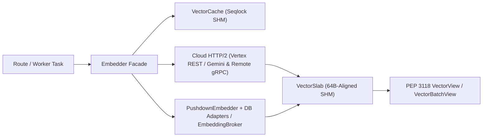

# Shared-Memory Vector Slabs, Zero-Weight Cloud & SQL Embeddings, and Local Broker

<!-- truth: start -->
- **Shared-Memory Vector Arena (`vertebra-core::vector`, `vertebra-py::vector`)**: [`VectorSlab`](../../../../../src/rs/vertebra-core/src/vector.rs)[^src-vertebra-core-src-vector-rs] (`VECTOR_SLAB_MAGIC = *b"VTBVSLAB"`) stores 64-byte-aligned dense vectors (`Float32`, `Float64`, `Float16`, `Int8`, `Binary`) in a POSIX `ShmRegion`. [`VectorView`](../../../../../src/rs/vertebra-py/src/vector.rs)[^src-vertebra-py-src-vector-rs] and [`VectorBatchView`](../../../../../src/rs/vertebra-py/src/vector.rs) expose zero-copy PEP 3118 buffers, Arrow `FixedSizeListArray` streams (`to_arrow_shm`), and database wire frames (`to_pgvector_bytes`, `to_oracle_bytes`, `to_sqlite_blob`).
- **Cloud and SQL Embeddings**: `Embedder()` defaults to `VertexEmbedder` (`gemini-embedding-001`, 768 dims) over Rust HTTP/2 REST (`gcp_http2_post` / `gcp_http2_post_async` in [`gcp_auth.rs`](../../../../../src/rs/vertebra-py/src/gcp_auth.rs)[^src-vertebra-py-src-gcp-auth-rs]): `gemini-embedding-001` (`1` instance/call) and `text-embedding-005` / `text-multilingual-embedding-002` (`250` instances/call) call Vertex v1 `:predict`, while `gemini-embedding-2` and `embed_multimodal` call `:embedContent` (`autoTruncate=False` default), using `SyncGcpTokenCache` / `AsyncGcpTokenCache` and per-loop `_GoogleEmbedder` queue isolation. `GeminiEmbedder` targets `generativelanguage.googleapis.com` gRPC (`BatchEmbedContents`); `embed_multimodal` calls `encode_gemini_embed_contents_grpc_frame` with protobuf `Part` fields `2` (`text`), `3` (`inline_data`), and `6` (`file_data`). `RemoteEmbedder` accepts `id_token_cache` (`SyncGcpIdTokenCache` / `AsyncGcpIdTokenCache` from [`gcp_identity.rs`](../../../../../src/rs/vertebra-py/src/gcp_identity.rs)[^src-vertebra-py-src-gcp-identity-rs]) and `audience` with single-flight `401` refresh. `PushdownEmbedder` wraps engine-owned `EmbeddingPushdown` (`embed_documents` / `embed_batch` / `embed_query`).
- **Engine-Owned Pushdown**: `db/adapters/{bigquery,spanner,postgres,oracle}/embeddings.py` implements `EmbeddingPushdown` without importing `vertebra.embeddings`, validating identifiers, rejecting boolean numeric arguments, preserving order, and mapping inference `DataError` to `EmbeddingError`. Spanner `use_ai_function=True` binds `@task_type` and `@output_dimensionality`; PostgreSQL binds model values; Oracle batches through `DBMS_VECTOR.UTL_TO_EMBEDDINGS` (`VECTOR_ARRAY_T`), checks 128-byte URLs, and rotates credentials from explicit `token_cache` over `SyncOracleDriver` / `AsyncOracleDriver` (`vertebra._oracle`).[^src-adapters-oracle-driver-py]
- **Single-Copy `1x` RAM Local Model Broker (`_broker.py`, `_local.py`)**: [`EmbeddingBroker`](../../../../../src/py/vertebra/embeddings/_broker.py)[^src-embeddings-broker-py] loads `GemmaEmbedder` / `FastEmbedder` weights once across workers, isolates async state per event loop, batches by token budget (`max_batch_tokens = 16_384`, `max_pending_requests = 1024`), forwards validated `GemmaEmbedder` `precision` into `BackendFactory` options, and isolates `onnxruntime` / `ctranslate2` in child processes on free-threaded Python `3.14t`/`3.15t`.
<!-- truth: end -->

## 1. Architecture Overview

## 2. Shared-Memory `VectorSlab`, `VectorCache` & SIMD Kernels (`vertebra-core::vector`)

| Component | Source | Responsibility |
| :--- | :--- | :--- |
| [`VectorSlabHeader`](../../../../../src/rs/vertebra-core/src/vector.rs) | `vertebra-core/src/vector.rs` | `#[repr(C, align(64))]` 64-byte header (`magic = *b"VTBVSLAB"`, `version = 1`, `dtype`, `flags`, `count`, `dimensions`, `row_stride_bytes`, `scales_offset`, `data_offset`, `total_bytes`). |
| [`VectorDtype`](../../../../../src/rs/vertebra-core/src/vector.rs) | `vertebra-core/src/vector.rs` | `Float32 = 1` (`"f"`), `Float64 = 2` (`"d"`), `Float16 = 3` (`"e"`), `Int8 = 4` (`"b"`), `Binary = 5` (`"B"`). |
| [`VectorSlab`](../../../../../src/rs/vertebra-core/src/vector.rs) | `vertebra-core/src/vector.rs` | Allocates 64-byte-aligned rows (`from_f32_batch`, `from_i8_batch`, `from_binary_batch`) and executes Matryoshka truncation (`mrl_truncate_and_normalize`), scalar quantization (`quantize_f32_to_i8`), and 1-bit packing (`quantize_f32_to_binary`). |
| [`VectorCache`](../../../../../src/rs/vertebra-core/src/vector.rs) | `vertebra-core/src/vector.rs` | Set-associative seqlock cache keyed by 64-bit FNV-1a (`compute_vector_cache_key(model_id, task, dimensions, text)`), with off-GIL SIMD `cosine_top_k`, `dot_top_k`, and `hamming_top_k`. |
| [`StaticEmbedderCore`](../../../../../src/rs/vertebra-core/src/vector.rs) | `vertebra-core/src/vector.rs` | Pure-Rust `mmap` wordpiece/unigram token table (`model2vec` / `potion-base-8M`) pooling and L2-normalizing token rows directly into `VectorSlab` in `<50 µs` with zero Python ML dependencies. |
| `format_gemma_prompt` | `vertebra-core/src/vector.rs` | Formats asymmetrical `EmbeddingGemma` prompts (`"task: search result \| query: {text}"` vs `"title: {title \| none} \| text: {text}"`). |

## 3. PEP 3118 `VectorView` & `VectorBatchView` (`vertebra-py::vector`)

[`VectorView`](../../../../../src/rs/vertebra-py/src/vector.rs) and [`VectorBatchView`](../../../../../src/rs/vertebra-py/src/vector.rs) pin `Arc<VectorSlab>` and implement `tp_as_buffer` (`memoryview(view)` and `np.asarray(view)` expose zero-copy read-only views with format `"f"`, `"d"`, `"e"`, `"b"`, or `"B"`). `.truncate(dims)` slices and L2-renormalizes into a new slab; `.quantize_int8()` and `.quantize_binary()` produce `Int8` and packed `Binary` views. Database codecs emit `pgvector` (`.to_pgvector_bytes()`), Oracle 26ai `VECTOR` `0xDB` (`.to_oracle_bytes()`), `sqlite-vec` (`.to_sqlite_blob()`), and SHM Arrow IPC `FixedSizeListArray` streams (`.to_arrow_shm`).

## 4. Embedder Hierarchy (`vertebra.embeddings`)

| Class | Default Model | Execution Path |
| :--- | :--- | :--- |
| [`Embedder`](../../../../../src/py/vertebra/embeddings/_base.py)[^src-embeddings-base-py] | Delegates to `VertexEmbedder` | Unified facade with `embed_query()`, `embed_document()`, `embed_many()`, `embed_arrow()`, and `similarity_search()`. |
| [`VertexEmbedder`](../../../../../src/py/vertebra/embeddings/_google.py)[^src-embeddings-google-py] | `gemini-embedding-001` (`768` dims) | Rust HTTP/2 REST (`gcp_http2_post` / `gcp_http2_post_async`) to Vertex AI v1 `:predict` (`gemini-embedding-001`, `text-embedding-005`, `text-multilingual-embedding-002`) or `:embedContent` (`gemini-embedding-2`, `embed_multimodal`), with `SyncGcpTokenCache` / `AsyncGcpTokenCache` and `autoTruncate=False`. |
| [`GeminiEmbedder`](../../../../../src/py/vertebra/embeddings/_google.py) | `gemini-embedding-001` (`768` dims) | Targets `generativelanguage.googleapis.com` gRPC (`BatchEmbedContents`) with `x-goog-api-key` or ADC Bearer auth; `embed_multimodal` sends real `Part` fields `2`/`3`/`6` via `encode_gemini_embed_contents_grpc_frame`. |
| `PushdownEmbedder` | `gemini-embedding-001` (`768` dims) | Generic facade delegating to engine-owned SQL capabilities (`embed_documents` / `embed_batch` / `embed_query`) without importing adapters. |
| `BigQueryEmbeddingPushdown` | `gemini-embedding-001` | `ML.GENERATE_EMBEDDING` / `AI.GENERATE_EMBEDDING` and `VECTOR_SEARCH`. |
| `SpannerEmbeddingPushdown` | `gemini-embedding-001` | `ML.PREDICT` or `AI.GENERATE_EMBEDDING` (`use_ai_function=True` binding `@task_type` and `@output_dimensionality`). |
| `PostgresEmbeddingPushdown` | `gemini-embedding-001` | AlloyDB `embedding()` with bound model values and `%s` / `$N` `pgvector` distance queries. |
| `OracleEmbeddingPushdown` | `gemini-embedding-001` | Batched `DBMS_VECTOR.UTL_TO_EMBEDDINGS` (`VECTOR_ARRAY_T`), 128-byte endpoint validation, and credential rotation from explicit `token_cache` over `vertebra._oracle`. |
| [`GemmaEmbedder`](../../../../../src/py/vertebra/embeddings/_local.py)[^src-embeddings-local-py] | `embeddinggemma-2-270m` (`768` dims) | `EmbeddingBroker`-hosted `EmbeddingGemma`; enforces `precision` in `{"int8", "q4", "bf16", "fp32"}`, rejects `fp16` (`ValueError`), and forwards `precision` in `BackendFactory.options`. |
| [`FastEmbedder`](../../../../../src/py/vertebra/embeddings/_local.py) | `BAAI/bge-small-en-v1.5` (`384` dims) | `EmbeddingBroker`-hosted ONNX Runtime execution (`BGE`, `Nomic`, `Arctic`, `Jina`, `MiniLM`). |
| [`StaticEmbedder`](../../../../../src/py/vertebra/embeddings/_local.py) | `potion-base-8M` (`512` dims) | Pure-Rust `StaticEmbedderCore` mmap lookup table with zero ML dependencies. |
| [`RemoteEmbedder`](../../../../../src/py/vertebra/embeddings/_remote.py)[^src-embeddings-remote-py] | `gemini-embedding-001` (`768` dims) | Rust HTTP/2 gRPC ([`grpc.rs`](../../../../../src/rs/vertebra-http/src/grpc.rs)[^src-vertebra-http-src-grpc-rs]) `/vertebra.EmbeddingService/BatchEmbed` client/server with optional `id_token_cache` (`SyncGcpIdTokenCache` / `AsyncGcpIdTokenCache`) and `audience`. |

SQL embedding execution stays adapter-owned (`%s` / `$N` binds in PostgreSQL); generic `EmbeddingPushdown` and `PushdownEmbedder` never import concrete adapters or construct SQL. [^src-adapters-postgres-embeddings-py][^src-embeddings-pushdown-py]

## 5. `EmbeddingBroker`, Loop Isolation & Quarantine (`_broker.py`)

[`EmbeddingBroker`](../../../../../src/py/vertebra/embeddings/_broker.py) caches weights once per worker group, enforces `max_pending_requests = 1024`, collects items over `batch_window_ms = 2.0`, sorts by `estimate_gemma_token_count` within `max_batch_tokens = 16_384` / `max_batch_items = 64`, and restores caller order. Async `_GoogleEmbedder` and broker instances partition state per running event loop, offload in-process `backend_fn` via `asyncio.to_thread`, and quarantine `BackendFactory` into subprocesses (`submit_batch_in_subprocess`) on free-threaded Python `3.14t`/`3.15t`. Missing both `backend_fn` and `backend_factory` raises `ImproperConfigurationError`.

Provenance sources: [^src-embeddings-pushdown-py], [^src-adapters-bigquery-embeddings-py], [^src-adapters-spanner-embeddings-py], [^src-adapters-postgres-embeddings-py], [^src-adapters-oracle-embeddings-py], [^src-adapters-oracle-driver-py], [^src-embeddings-init-py], [^src-embeddings-models-py], [^src-cli-ai-py], [^src-tests-unit-embeddings-test-vector-views-py], [^src-tests-unit-embeddings-test-google-embedders-py], [^src-tests-unit-embeddings-test-embedding-broker-py].

[^src-vertebra-core-src-vector-rs]: `src/rs/vertebra-core/src/vector.rs` — Rust vector slab and cache module.
[^src-vertebra-py-src-vector-rs]: `src/rs/vertebra-py/src/vector.rs` — PyO3 vector views and wire codecs.
[^src-vertebra-py-src-gcp-auth-rs]: `src/rs/vertebra-py/src/gcp_auth.rs` — GCP OAuth token caches and HTTP/2 client bindings.
[^src-vertebra-py-src-gcp-identity-rs]: `src/rs/vertebra-py/src/gcp_identity.rs` — GCP OIDC ID token cache bindings.
[^src-vertebra-http-src-grpc-rs]: `src/rs/vertebra-http/src/grpc.rs` — HTTP/2 gRPC router and client framing.
[^src-embeddings-init-py]: `src/py/vertebra/embeddings/__init__.py` — Embeddings public lazy exports.
[^src-embeddings-base-py]: `src/py/vertebra/embeddings/_base.py` — Unified `Embedder` facade and SHM query cleanup.
[^src-embeddings-google-py]: `src/py/vertebra/embeddings/_google.py` — `VertexEmbedder` REST and `GeminiEmbedder` gRPC clients.
[^src-embeddings-remote-py]: `src/py/vertebra/embeddings/_remote.py` — `RemoteEmbedder` gRPC client with optional `id_token_cache`.
[^src-embeddings-models-py]: `src/py/vertebra/embeddings/_models.py` — Local model metadata and cache helpers.
[^src-embeddings-broker-py]: `src/py/vertebra/embeddings/_broker.py` — Per-loop `EmbeddingBroker` dynamic batching and quarantine.
[^src-embeddings-local-py]: `src/py/vertebra/embeddings/_local.py` — `GemmaEmbedder`, `FastEmbedder`, and `StaticEmbedder`.
[^src-cli-ai-py]: `src/py/vertebra/cli/ai.py` — `vtb ai` CLI model management commands.
[^src-tests-unit-embeddings-test-vector-views-py]: `src/py/tests/unit/embeddings/test_vector_views.py` — Vector slab and codec tests.
[^src-tests-unit-embeddings-test-google-embedders-py]: `src/py/tests/unit/embeddings/test_google_embedders.py` — Cloud embedder wire tests.
[^src-tests-unit-embeddings-test-embedding-broker-py]: `src/py/tests/unit/embeddings/test_embedding_broker.py` — Broker batching tests.
[^src-embeddings-pushdown-py]: `src/py/vertebra/embeddings/_pushdown.py` — SQL embedding capability and facade.
[^src-adapters-bigquery-embeddings-py]: `src/py/vertebra/db/adapters/bigquery/embeddings.py` — BigQuery SQL embedding adapter.
[^src-adapters-spanner-embeddings-py]: `src/py/vertebra/db/adapters/spanner/embeddings.py` — Spanner SQL embedding adapter.
[^src-adapters-postgres-embeddings-py]: `src/py/vertebra/db/adapters/postgres/embeddings.py` — PostgreSQL SQL embedding adapter.
[^src-adapters-oracle-embeddings-py]: `src/py/vertebra/db/adapters/oracle/embeddings.py` — Oracle SQL embedding adapter.
[^src-adapters-oracle-driver-py]: `src/py/vertebra/db/adapters/oracle/driver.py::SyncOracleDriver` — Oracle drivers over `vertebra._oracle`.
