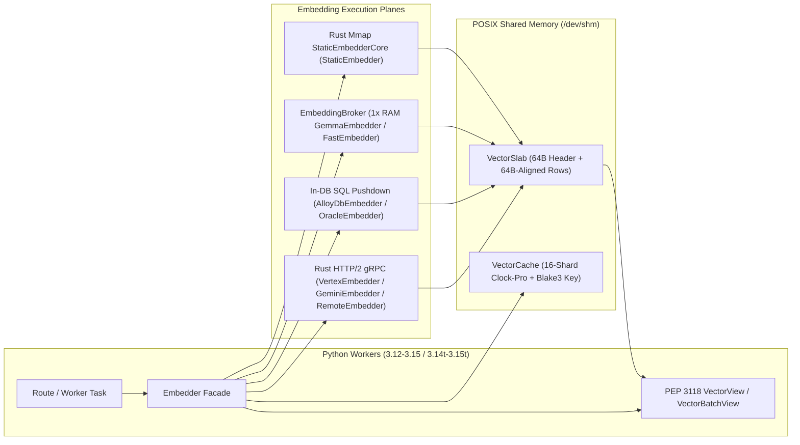

# Shared-Memory Vector Slabs, Zero-Weight Cloud & SQL Embeddings, and Local Broker

<!-- truth: start -->
- **Shared-Memory Vector Arena (`vertebra-core::vector`, `vertebra-py::vector`)**: [`VectorSlab`](../../../../../src/rs/vertebra-core/src/vector.rs) (`VECTOR_SLAB_MAGIC = 0x5654_4256`) stores 64-byte-aligned dense vectors (`Float32`, `Float16`, `Int8`, `Binary`) in a POSIX shared-memory region with a 64-byte header and lock-free `AtomicU64` bump allocation. [`VectorView`](../../../../../src/rs/vertebra-py/src/vector.rs) (1D) and [`VectorBatchView`](../../../../../src/rs/vertebra-py/src/vector.rs) (2D) expose zero-copy PEP 3118 buffers (`memoryview`, `numpy.asarray`), Apache Arrow `FixedSizeListArray` streams (`to_arrow_shm`), and binary database wire frames (`to_pgvector_bytes`, `to_oracle_bytes`, `to_sqlite_blob`).
- **Google-First Zero-Weight Cloud & SQL Pushdown (`_google.py`, `_remote.py`)**: [`Embedder`](../../../../../src/py/vertebra/embeddings/_base.py) defaults to [`VertexEmbedder`](../../../../../src/py/vertebra/embeddings/_google.py) (`gemini-embedding-001`, 768 dims) over native Rust HTTP/2 gRPC (`predict_vertex_embeddings_grpc`, `batch_embed_contents_grpc` in [`vertebra-http/src/grpc.rs`](../../../../../src/rs/vertebra-http/src/grpc.rs)) with [`RefreshingGcpCredentialProvider`](../../../../../src/rs/vertebra-storage/src/gcp_auth.rs) auth, decoding Protobuf v3 packed-`f32` (`wire_type = 2`) fields directly into `VectorSlab` off-GIL. [`AlloyDbEmbedder`](../../../../../src/py/vertebra/embeddings/_google.py) and [`OracleEmbedder`](../../../../../src/py/vertebra/embeddings/_google.py) push embedding generation into database SQL (`google_ml.embedding()`, `DBMS_VECTOR.UTL_TO_EMBEDDING()`) and decode binary `pgvector` / Oracle `0xDB` wire payloads into `VectorBatchView`.
- **Single-Copy `1x` RAM Local Model Broker (`_broker.py`, `_local.py`)**: [`EmbeddingBroker`](../../../../../src/py/vertebra/embeddings/_broker.py) loads local weights (`GemmaEmbedder`, `FastEmbedder`) once for an entire multi-worker deployment, dynamic-batches concurrent worker requests by token budget (`max_batch_tokens = 8192`) with length-sorted grouping, and isolates `onnxruntime` / `ctranslate2` inside a dedicated child process when running on free-threaded Python `3.14t`/`3.15t` (`sys._is_gil_enabled() is False`) so C-extension loads never re-enable the GIL in HTTP workers.
<!-- truth: end -->

---

## 1. Architecture Overview

---

## 2. Shared-Memory `VectorSlab`, `VectorCache` & SIMD Kernels (`vertebra-core::vector`)

| Component | Source | Responsibility |
| :--- | :--- | :--- |
| [`VectorSlabHeader`](../../../../../src/rs/vertebra-core/src/vector.rs) | `vertebra-core/src/vector.rs` | `#[repr(C, align(64))]` 64-byte header (`magic = 0x5654_4256`, `version = 1`, `dtype`, `dimensions`, `row_stride_bytes`, `capacity_bytes`, `write_offset: AtomicU64`, `active_leases: AtomicU32`, `generation: AtomicU64`). |
| [`VectorDType`](../../../../../src/rs/vertebra-core/src/vector.rs) | `vertebra-core/src/vector.rs` | `Float32 = 1` (`"f"`), `Float16 = 2` (`"e"`), `Int8 = 3` (`"b"`), `Binary = 4` (`"B"`). |
| [`VectorSlab`](../../../../../src/rs/vertebra-core/src/vector.rs) | `vertebra-core/src/vector.rs` | Allocates 64-byte-aligned rows (`allocate_batch`) and writes Matryoshka-truncated (`write_truncated_and_normalized`), scalar-quantized (`write_quantized_int8`), or bit-packed (`write_quantized_binary`) batches. |
| [`VectorCache`](../../../../../src/rs/vertebra-core/src/vector.rs) | `vertebra-core/src/vector.rs` | 16-shard lock-free Clock-Pro cache keyed by `blake3(model_id \|\| 0x00 \|\| task_type \|\| 0x00 \|\| dims_le16 \|\| dtype_u8 \|\| normalized_text)`. Hits return a `VectorLocation` without network or model execution. |
| [`StaticEmbedderCore`](../../../../../src/rs/vertebra-core/src/vector.rs) | `vertebra-core/src/vector.rs` | Pure-Rust `mmap` wordpiece/unigram token table (`model2vec` / `potion-base-8M`) pooling and L2-normalizing token rows directly into `VectorSlab` in `<50 µs` with zero Python ML dependencies. |
| `format_gemma_prompt` | `vertebra-core/src/vector.rs` | Formats asymmetrical `EmbeddingGemma` prompts (`"task: search result \| query: {text}"` vs `"title: {title \| none} \| text: {text}"`). |

---

## 3. PEP 3118 `VectorView` & `VectorBatchView` (`vertebra-py::vector`)

[`VectorView`](../../../../../src/rs/vertebra-py/src/vector.rs) and [`VectorBatchView`](../../../../../src/rs/vertebra-py/src/vector.rs) pin their underlying `Arc<VectorSlab>` and implement `tp_as_buffer` (`__getbuffer__` / `__releasebuffer__`):

- **Buffer Protocol**: `memoryview(view)` and `np.asarray(view)` expose read-only 1D `(dims,)` or 2D `(rows, dims)` views with format `"f"` (`f32`), `"e"` (`f16`), `"b"` (`i8`), or `"B"` (`u8` bit-packed) and zero heap copies.
- **Matryoshka & Quantization**: `.truncate(dims)` slices `[:dims]` and L2-renormalizes into a new slab allocation; `.quantize_int8()` and `.quantize_binary()` produce `Int8` and packed `Binary` views.
- **Database Wire Codecs**:
  - `.to_pgvector_bytes()`: PostgreSQL `pgvector` binary wire format (`uint16 dims`, `uint16 unused = 0`, big-endian `f32[dims]`).
  - `.to_oracle_bytes()`: Oracle 26ai `VECTOR` binary `0xDB` frame (`encode_vector_binary`).
  - `.to_sqlite_blob()`: Little-endian packed payload for `sqlite-vec`.
  - `.to_arrow_shm()`: Apache Arrow IPC `RecordBatch` stream with a `FixedSizeListArray(Float32, dims)` column inside a `ShmRegion`.

---

## 4. Embedder Hierarchy (`vertebra.embeddings`)

| Class | Default Model | Execution Path |
| :--- | :--- | :--- |
| [`Embedder`](../../../../../src/py/vertebra/embeddings/_base.py) | Delegates to `VertexEmbedder` | Unified facade with `embed()`, `embed_query()`, `embed_document()`, `embed_many()`, `similarity()`, and `similarity_search()`. |
| [`VertexEmbedder`](../../../../../src/py/vertebra/embeddings/_google.py) | `gemini-embedding-001` (`768` dims) | Rust HTTP/2 gRPC `PredictionService/Predict` with `RefreshingGcpCredentialProvider` Bearer token injection and packed-`f32` decoding into `VectorSlab`. |
| [`GeminiEmbedder`](../../../../../src/py/vertebra/embeddings/_google.py) | `gemini-embedding-001` (`768` dims) | Rust HTTP/2 gRPC `GenerativeService/BatchEmbedContents` with `x-goog-api-key` or ADC Bearer auth. |
| [`AlloyDbEmbedder`](../../../../../src/py/vertebra/embeddings/_google.py) | `gemini-embedding-001` (`768` dims) | Executes `SELECT google_ml.embedding($1, text)::vector` in AlloyDB `ai` / `google_ml_integration` and decodes binary `pgvector` into `VectorBatchView`. |
| [`OracleEmbedder`](../../../../../src/py/vertebra/embeddings/_google.py) | `ALL_MINILM_L12_V2` (`384` dims) | Executes `SELECT DBMS_VECTOR.UTL_TO_EMBEDDING(:text, JSON(:params))` in Oracle 26ai and decodes binary `0xDB` `VECTOR` frames into `VectorBatchView`. |
| [`GemmaEmbedder`](../../../../../src/py/vertebra/embeddings/_local.py) | `google/embeddinggemma-300m` (`768` dims) | `EmbeddingBroker`-hosted `EmbeddingGemma` (`300M`, `100+` languages, MRL `768`/`512`/`256`/`128`). Rejects `dtype="fp16"` (`ValueError`) to prevent activation overflow; supports `int8` (default), `q4`, `bf16`, and `fp32`. |
| [`FastEmbedder`](../../../../../src/py/vertebra/embeddings/_local.py) | `BAAI/bge-small-en-v1.5` (`384` dims) | `EmbeddingBroker`-hosted ONNX Runtime execution for BGE, Nomic, Arctic, Jina, and MiniLM models. |
| [`StaticEmbedder`](../../../../../src/py/vertebra/embeddings/_local.py) | `minishlab/potion-base-8M` (`256` dims) | Pure-Rust `StaticEmbedderCore` mmap lookup table with zero ML dependencies. |
| [`RemoteEmbedder`](../../../../../src/py/vertebra/embeddings/_remote.py) | Configurable (`768` dims) | Rust HTTP/2 gRPC `vertebra.embeddings.v1.EmbeddingService/EmbedBatch` client and server (`create_embedding_grpc_service`) plus OpenAI-compatible `/v1/embeddings` HTTP JSON fallback. |

---

## 5. `EmbeddingBroker` & Free-Threaded `3.14t`/`3.15t` Quarantine (`_broker.py`)

- **`1x` Model RAM Across Workers**: [`EmbeddingBroker`](../../../../../src/py/vertebra/embeddings/_broker.py) loads model weights once in the supervisor/broker context and exposes `submit()` / `submit_sync()`.
- **Token-Budgeted Length-Sorted Dynamic Batching (`form_token_budget_batches`)**: Collects pending items across a `max_wait_ms = 2.0` window, estimates token length (`estimate_gemma_token_count`), sorts items by descending token length to minimize right-padding waste across attention layers, splits batches at `max_batch_tokens = 8192` or `max_batch_items = 64`, and restores caller ordering in the output `VectorBatchView`.
- **Free-Threaded `3.14t`/`3.15t` Subprocess Quarantine (`should_quarantine_subprocess`)**: When `sys._is_gil_enabled() is False` and the backend uses `onnxruntime` or `ctranslate2` (`GemmaEmbedder`, `FastEmbedder`), `EmbeddingBroker` spawns a dedicated child process (`multiprocessing.get_context("spawn")`) so C-extensions without `Py_mod_gil` slots never re-enable the GIL inside free-threaded HTTP worker processes.
