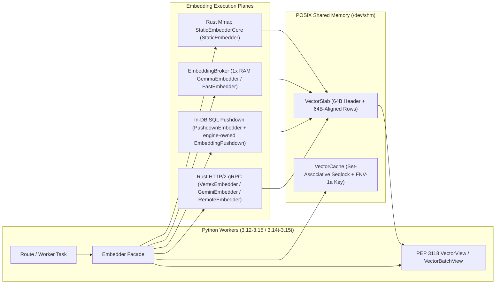

# Shared-Memory Vector Slabs, Zero-Weight Cloud & SQL Embeddings, and Local Broker

<!-- truth: start -->
- **Shared-Memory Vector Arena (`vertebra-core::vector`, `vertebra-py::vector`)**: [`VectorSlab`](../../../../../src/rs/vertebra-core/src/vector.rs)[^src-vertebra-core-src-vector-rs] (`VECTOR_SLAB_MAGIC = *b"VTBVSLAB"`) stores 64-byte-aligned dense vectors (`Float32`, `Float64`, `Float16`, `Int8`, `Binary`) in a POSIX shared-memory `ShmRegion` with a 64-byte [`VectorSlabHeader`](../../../../../src/rs/vertebra-core/src/vector.rs). [`VectorView`](../../../../../src/rs/vertebra-py/src/vector.rs)[^src-vertebra-py-src-vector-rs] (1D) and [`VectorBatchView`](../../../../../src/rs/vertebra-py/src/vector.rs) (2D) expose zero-copy PEP 3118 buffers (`memoryview`, `numpy.asarray`), Apache Arrow `FixedSizeListArray` streams (`to_arrow_shm`), and binary database wire frames (`to_pgvector_bytes`, `to_oracle_bytes`, `to_sqlite_blob`).
- **Cloud and SQL Embeddings**: `Embedder()` defaults to `VertexEmbedder` (`gemini-embedding-001`, 768 dimensions), dispatching over native Rust HTTP/2 (`gcp_http2_post` / `gcp_http2_post_async` in [`src/rs/vertebra-py/src/gcp_auth.rs`](../../../../../src/rs/vertebra-py/src/gcp_auth.rs)[^src-vertebra-py-src-gcp-auth-rs]) with refreshable `SyncGcpTokenCache` / `AsyncGcpTokenCache` credentials, packed-float decoding, and a persistent background portal in `Embedder._run_sync`. `GeminiEmbedder.embed_multimodal` forwards inline `bytes` and `MultimodalPart` payloads alongside text parts. `PushdownEmbedder` wraps the engine-owned `EmbeddingPushdown` capability while inheriting cache, sync, Arrow, and SIMD search methods. Its query path calls `embed_query`; document and batch paths call `embed_documents`; `vector_search` calls the capability's `similarity_search`.
- **Engine-Owned Pushdown**: `db/adapters/{bigquery,spanner,postgres,oracle}/embeddings.py` implements `EmbeddingPushdown` without importing `vertebra.embeddings`. Adapters use `select` on async drivers and thread offloading on sync drivers, validate interpolated identifiers, preserve batch ordering, and raise `DataError` for incomplete vectors. The facade translates inference `DataError` to `EmbeddingError`. PostgreSQL binds model values; Oracle batches both `embed_documents` and `embed_query` through `DBMS_VECTOR.UTL_TO_EMBEDDINGS` (`VECTOR_ARRAY_T`), validates 128-byte UTF-8 Vertex URLs, and rotates credentials through sync or async token caches and drivers. `OracleEmbeddingPushdown` needs an Oracle driver, and `SyncOracleDriver` / `AsyncOracleDriver` raise `MissingDependencyError` until the native Oracle driver ships, so the Oracle path is verified as SQL text and binds only.[^src-adapters-oracle-driver-py] The embeddings package lazily exports its public API and has no former SQL-provider aliases.
- **Single-Copy `1x` RAM Local Model Broker (`_broker.py`, `_local.py`)**: [`EmbeddingBroker`](../../../../../src/py/vertebra/embeddings/_broker.py)[^src-embeddings-broker-py] loads local weights (`GemmaEmbedder`, `FastEmbedder`) once for an entire multi-worker deployment, dynamic-batches concurrent worker requests by token budget (`max_batch_tokens = 16_384`, `max_pending_requests = 1024`) with length-sorted grouping, offloads in-process `backend_fn` calls via `asyncio.to_thread` when subprocess quarantine is not active, and isolates `onnxruntime` / `ctranslate2` inside a dedicated child process (`submit_batch_in_subprocess`) when running on free-threaded Python `3.14t`/`3.15t` (`sys._is_gil_enabled() is False`) so C-extension loads never re-enable the GIL in HTTP workers.
<!-- truth: end -->

## 1. Architecture Overview

## 2. Shared-Memory `VectorSlab`, `VectorCache` & SIMD Kernels (`vertebra-core::vector`)

| Component | Source | Responsibility |
| :--- | :--- | :--- |
| [`VectorSlabHeader`](../../../../../src/rs/vertebra-core/src/vector.rs) | `vertebra-core/src/vector.rs` | `#[repr(C, align(64))]` 64-byte header (`magic = *b"VTBVSLAB"`, `version = 1`, `dtype`, `flags`, `count`, `dimensions`, `row_stride_bytes`, `scales_offset`, `data_offset`, `total_bytes`). |
| [`VectorDtype`](../../../../../src/rs/vertebra-core/src/vector.rs) | `vertebra-core/src/vector.rs` | `Float32 = 1` (`"f"`), `Float64 = 2` (`"d"`), `Float16 = 3` (`"e"`), `Int8 = 4` (`"b"`), `Binary = 5` (`"B"`). |
| [`VectorSlab`](../../../../../src/rs/vertebra-core/src/vector.rs) | `vertebra-core/src/vector.rs` | Allocates 64-byte-aligned rows (`from_f32_batch`, `from_i8_batch`, `from_binary_batch`) and executes Matryoshka truncation (`mrl_truncate_and_normalize`), scalar quantization (`quantize_f32_to_i8`), and 1-bit packing (`quantize_f32_to_binary`). |
| [`VectorCache`](../../../../../src/rs/vertebra-core/src/vector.rs) | `vertebra-core/src/vector.rs` | Set-associative seqlock cache keyed by 64-bit FNV-1a (`compute_vector_cache_key(model_id, task, dimensions, text)`), with off-GIL SIMD `cosine_top_k`, `dot_top_k`, and `hamming_top_k`. |
| [`StaticEmbedderCore`](../../../../../src/rs/vertebra-core/src/vector.rs) | `vertebra-core/src/vector.rs` | Pure-Rust `mmap` wordpiece/unigram token table (`model2vec` / `potion-base-8M`) pooling and L2-normalizing token rows directly into `VectorSlab` in `<50 µs` with zero Python ML dependencies. |
| `format_gemma_prompt` | `vertebra-core/src/vector.rs` | Formats asymmetrical `EmbeddingGemma` prompts (`"task: search result \| query: {text}"` vs `"title: {title \| none} \| text: {text}"`). |

## 3. PEP 3118 `VectorView` & `VectorBatchView` (`vertebra-py::vector`)

[`VectorView`](../../../../../src/rs/vertebra-py/src/vector.rs) and [`VectorBatchView`](../../../../../src/rs/vertebra-py/src/vector.rs) pin their underlying `Arc<VectorSlab>` and implement `tp_as_buffer` (`__getbuffer__` / `__releasebuffer__`):

- **Buffer Protocol**: `memoryview(view)` and `np.asarray(view)` expose read-only 1D `(dims,)` or 2D `(rows, dims)` views with format `"f"` (`f32`), `"d"` (`f64`), `"e"` (`f16`), `"b"` (`i8`), or `"B"` (`u8` bit-packed) and zero heap copies.
- **Matryoshka & Quantization**: `.truncate(dims)` slices `[:dims]` and L2-renormalizes into a new slab allocation; `.quantize_int8()` and `.quantize_binary()` produce `Int8` and packed `Binary` views.
- **Database Wire Codecs**:
  - `.to_pgvector_bytes()`: PostgreSQL `pgvector` binary wire format (`uint16 dims`, `uint16 unused = 0`, big-endian `f32[dims]`).
  - `.to_oracle_bytes()`: Oracle 26ai `VECTOR` binary `0xDB` frame (`encode_vector_binary`).
  - `.to_sqlite_blob()`: Little-endian packed payload for `sqlite-vec`.
  - `.to_arrow_shm(column_name="embedding", *, shm_name=None)`: Apache Arrow IPC `RecordBatch` stream with a `FixedSizeListArray(Float32, dims)` column inside a `ShmRegion`.

## 4. Embedder Hierarchy (`vertebra.embeddings`)

| Class | Default Model | Execution Path |
| :--- | :--- | :--- |
| [`Embedder`](../../../../../src/py/vertebra/embeddings/_base.py)[^src-embeddings-base-py] | Delegates to `VertexEmbedder` | Unified facade with `embed_query()`, `embed_document()`, `embed_many()`, `embed_arrow()`, and `similarity_search()`. |
| [`VertexEmbedder`](../../../../../src/py/vertebra/embeddings/_google.py)[^src-embeddings-google-py] | `gemini-embedding-001` (`768` dims) | Rust HTTP/2 (`gcp_http2_post` / `gcp_http2_post_async`) `PredictionService/EmbedContent` with `SyncGcpTokenCache` / `AsyncGcpTokenCache` Bearer token injection and packed-`f32` decoding into `VectorSlab`. |
| [`GeminiEmbedder`](../../../../../src/py/vertebra/embeddings/_google.py) | `gemini-embedding-001` (`768` dims) | Rust HTTP/2 gRPC `GenerativeService/BatchEmbedContents` with `x-goog-api-key` or ADC Bearer auth and inline `bytes` / `MultimodalPart` multimodal support (`embed_multimodal`). |
| `PushdownEmbedder` | `gemini-embedding-001` (`768` dims) | Generic embedding facade over engine-owned capabilities. |
| `BigQueryEmbeddingPushdown` | `gemini-embedding-001` | `ML.GENERATE_EMBEDDING` / `AI.GENERATE_EMBEDDING` and `VECTOR_SEARCH`. |
| `SpannerEmbeddingPushdown` | `gemini-embedding-001` | `ML.PREDICT` / `AI.GENERATE_EMBEDDING` and exact or approximate vector distance. |
| `PostgresEmbeddingPushdown` | `gemini-embedding-001` | AlloyDB `embedding()` inference and pgvector distance operators. |
| `OracleEmbeddingPushdown` | `gemini-embedding-001` | Batched `DBMS_VECTOR.UTL_TO_EMBEDDINGS` (`VECTOR_ARRAY_T`) for both `embed_documents` and `embed_query`, credential rotation, and `VECTOR_DISTANCE`. Requires an Oracle driver; Oracle drivers raise `MissingDependencyError` until the native Oracle driver ships. |
| [`GemmaEmbedder`](../../../../../src/py/vertebra/embeddings/_local.py)[^src-embeddings-local-py] | `embeddinggemma-2-270m` (`768` dims) | `EmbeddingBroker`-hosted `EmbeddingGemma` (`270M` / `300M`, `100+` languages, MRL `768`/`512`/`256`/`128`). Rejects `precision="fp16"` (`ValueError`) to prevent activation overflow; supports `int8` (default), `q4`, `bf16`, and `fp32`. |
| [`FastEmbedder`](../../../../../src/py/vertebra/embeddings/_local.py) | `BAAI/bge-small-en-v1.5` (`384` dims) | `EmbeddingBroker`-hosted ONNX Runtime execution for BGE, Nomic, Arctic, Jina, and MiniLM models. |
| [`StaticEmbedder`](../../../../../src/py/vertebra/embeddings/_local.py) | `potion-base-8M` (`512` dims) | Pure-Rust `StaticEmbedderCore` mmap lookup table with zero ML dependencies. |
| [`RemoteEmbedder`](../../../../../src/py/vertebra/embeddings/_remote.py)[^src-embeddings-remote-py] | `embeddinggemma-2-270m` (`768` dims) | Rust HTTP/2 gRPC ([`grpc.rs`](../../../../../src/rs/vertebra-http/src/grpc.rs)[^src-vertebra-http-src-grpc-rs]) `/vertebra.EmbeddingService/BatchEmbed` client and server (`create_embedding_grpc_service`). |

SQL embedding execution remains adapter-owned. PostgreSQL inference and similarity search prepare `%s` for sync psycopg and `$N` for async transport, retaining model/text/vector binds. The generic `EmbeddingPushdown` protocol and `PushdownEmbedder` do not construct engine SQL or import concrete adapters; the engine-purity gate rejects engine SQL construction inside generic database modules. [^src-adapters-postgres-embeddings-py][^src-embeddings-pushdown-py]

## 5. `EmbeddingBroker` & Free-Threaded `3.14t`/`3.15t` Quarantine (`_broker.py`)

- **`1x` Model RAM Across Workers**: [`EmbeddingBroker`](../../../../../src/py/vertebra/embeddings/_broker.py) loads model weights once in the supervisor/broker context and exposes `submit_single()`, `submit_batch()`, and `submit_batch_in_subprocess()`.
- **Token-Budgeted Length-Sorted Dynamic Batching (`_flush_pending_batch`)**: Enforces `max_pending_requests = 1024` queue-cap backpressure, collects pending items across a `batch_window_ms = 2.0` window, estimates token length (`estimate_gemma_token_count`), sorts items by ascending token length to minimize right-padding waste across attention layers, splits batches at `max_batch_tokens = 16_384` or `max_batch_items = 64`, and restores caller ordering in the output `VectorBatchView`.
- **Free-Threaded `3.14t`/`3.15t` Subprocess Quarantine (`should_quarantine_subprocess`) & Thread Offload**: When `is_free_threaded()` is `True`, `isolate_gil_subprocess` is enabled, and no in-process `backend_fn` was passed, `EmbeddingBroker` sends batches to a child process (`submit_batch_in_subprocess`) together with its `BackendFactory` (`target="module:qualname"`, `options`); the child imports the factory once, runs the real model, and returns a `/dev/shm` `VectorSlab`. When running in-process (`backend_fn`), `EmbeddingBroker` offloads inference off the event loop via `asyncio.to_thread`. `FastEmbedder` and `GemmaEmbedder` pass `FastEmbedder.build_backend`. A broker without `backend_fn` or `backend_factory` raises `ImproperConfigurationError`.

Provenance sources: [^src-embeddings-pushdown-py], [^src-adapters-bigquery-embeddings-py], [^src-adapters-spanner-embeddings-py], [^src-adapters-postgres-embeddings-py], [^src-adapters-oracle-embeddings-py], [^src-adapters-oracle-driver-py], [^src-embeddings-init-py], [^src-embeddings-models-py], [^src-cli-ai-py], [^src-tests-unit-embeddings-test-vector-views-py], [^src-tests-unit-embeddings-test-google-embedders-py], [^src-tests-unit-embeddings-test-embedding-broker-py].

[^src-vertebra-core-src-vector-rs]: `src/rs/vertebra-core/src/vector.rs` — Rust implementation module (src/rs/vertebra-core/src/vector.rs).
[^src-vertebra-py-src-vector-rs]: `src/rs/vertebra-py/src/vector.rs` — Rust implementation module (src/rs/vertebra-py/src/vector.rs).
[^src-vertebra-py-src-gcp-auth-rs]: `src/rs/vertebra-py/src/gcp_auth.rs` — Rust GCP OAuth token caches and HTTP/2 gRPC transport (src/rs/vertebra-py/src/gcp_auth.rs).
[^src-vertebra-http-src-grpc-rs]: `src/rs/vertebra-http/src/grpc.rs` — Rust implementation module (src/rs/vertebra-http/src/grpc.rs).
[^src-embeddings-init-py]: `src/py/vertebra/embeddings/__init__.py` — Python implementation module (src/py/vertebra/embeddings/__init__.py).
[^src-embeddings-base-py]: `src/py/vertebra/embeddings/_base.py` — Python implementation module (src/py/vertebra/embeddings/_base.py).
[^src-embeddings-google-py]: `src/py/vertebra/embeddings/_google.py` — Python implementation module (src/py/vertebra/embeddings/_google.py).
[^src-embeddings-remote-py]: `src/py/vertebra/embeddings/_remote.py` — Python implementation module (src/py/vertebra/embeddings/_remote.py).
[^src-embeddings-models-py]: `src/py/vertebra/embeddings/_models.py` — Python implementation module (src/py/vertebra/embeddings/_models.py).
[^src-embeddings-broker-py]: `src/py/vertebra/embeddings/_broker.py` — Python implementation module (src/py/vertebra/embeddings/_broker.py).
[^src-embeddings-local-py]: `src/py/vertebra/embeddings/_local.py` — Python implementation module (src/py/vertebra/embeddings/_local.py).
[^src-cli-ai-py]: `src/py/vertebra/cli/ai.py` — Python implementation module (src/py/vertebra/cli/ai.py).
[^src-tests-unit-embeddings-test-vector-views-py]: `src/py/tests/unit/embeddings/test_vector_views.py` — Python implementation module (src/py/tests/unit/embeddings/test_vector_views.py).
[^src-tests-unit-embeddings-test-google-embedders-py]: `src/py/tests/unit/embeddings/test_google_embedders.py` — Python implementation module (src/py/tests/unit/embeddings/test_google_embedders.py).
[^src-tests-unit-embeddings-test-embedding-broker-py]: `src/py/tests/unit/embeddings/test_embedding_broker.py` — Python implementation module (src/py/tests/unit/embeddings/test_embedding_broker.py).

[^src-embeddings-pushdown-py]: `src/py/vertebra/embeddings/_pushdown.py` — SQL embedding capability and facade.

[^src-adapters-bigquery-embeddings-py]: `src/py/vertebra/db/adapters/bigquery/embeddings.py` — SQL embedding capability and facade.

[^src-adapters-spanner-embeddings-py]: `src/py/vertebra/db/adapters/spanner/embeddings.py` — SQL embedding capability and facade.

[^src-adapters-postgres-embeddings-py]: `src/py/vertebra/db/adapters/postgres/embeddings.py` — SQL embedding capability and facade.

[^src-adapters-oracle-embeddings-py]: `src/py/vertebra/db/adapters/oracle/embeddings.py` — SQL embedding capability and facade.

[^src-adapters-oracle-driver-py]: `src/py/vertebra/db/adapters/oracle/driver.py::SyncOracleDriver` — Oracle driver native-module guard.
