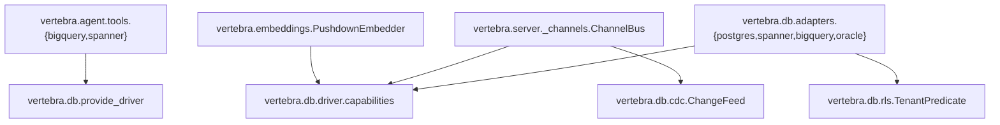

# Flow: Engine Primitives Relocation and SyncQueryPipeline / AsyncQueryPipeline Removal

## 1. Specification & Context

### 1.1 Problem Statement & Objectives

The [database foundation](../../knowledge/domains/data/database-drivers-and-dialers.md) provides `src/py/vertebra/db/adapters/<engine>/`, standalone `vertebra-bigquery` and `vertebra-spanner` PyO3 wheels, `Sync*`/`Async*` capability protocols (`SyncPipelineCapable`, `AsyncPipelineCapable`, `NotificationSource`, `SyncChangeSource`, `AsyncChangeSource`, `QueueStore`, `EmbeddingPushdown`), `provide_driver`, and the upward-import boundary gate. Generic modules across `vertebra.db` and `vertebra.embeddings` still carry engine-specific SQL, dialect-coupled configuration fields, upward `vertebra.agent` imports, and the obsolete CTE `SyncQueryPipeline` / `AsyncQueryPipeline` compilers:

- `src/py/vertebra/db/cdc.py` bundles PostgreSQL logical replication settings (`replication_slot_name`, `publication_name`, `max_slot_wal_keep_size_mb`, `spill_table`), `pg_logical_emit_message($1, $2, $3)`, an unbounded `_spill_store: dict[int, dict[str, Any]]`, swallowed `SyncObjectStore.get` errors in `hydrate_notification()`, and Spanner change-stream polling (`SpannerChildPartition`, `SpannerChangeStreamRecord`, `SyncSpannerChangeStreamSource`, and `AsyncSpannerChangeStreamSource` using `inspect.isawaitable` duck-typing and required `start_timestamp` kwargs on `stream()`).
- `src/py/vertebra/db/channels.py` (`DatabaseChannelBackend`) mixes an in-memory asyncio pub/sub fan-out bus with hardcoded PostgreSQL `pg_notify` and Oracle `DBMS_AQ.ENQUEUE` PL/SQL branches, forcing `vertebra.framework.channels.ChannelBus` and `vertebra.extensions.{litestar,starlette,fastapi,flask}.channels` to inherit a database module.
- `src/py/vertebra/embeddings/{_bigquery,_spanner,_google}.py` embed BigQuery `ML.GENERATE_EMBEDDING`, Spanner `ML.PREDICT`, AlloyDB `embedding()`, and Oracle `DBMS_VECTOR.UTL_TO_EMBEDDING` SQL directly inside `vertebra.embeddings` (with `AlloyDbEmbedder` and `OracleEmbedder` calling a nonexistent `driver.fetch_all` method) rather than adapter-owned `EmbeddingPushdown` implementations consumed via a generic `PushdownEmbedder`.
- `src/py/vertebra/db/mcp_tools.py` imports `vertebra.agent.core.schema.Tool`, `vertebra.agent.runtime.ConfirmationGate`, and `vertebra.framework.security.PermissionDeniedError`, requiring the sole `_TEMPORARY_UPWARD_IMPORT_ALLOWLIST` exemption in `test_native_db_drivers.py`.
- `src/py/vertebra/db/pipeline.py` (`SyncQueryPipeline`, `AsyncQueryPipeline`, `CTEStep`, `RelOverlay`, `PipelineDialect`) compiles multi-statement reads into synthetic CTEs and swallows compilation errors with `with suppress(Exception):` inside `extensions/sqlspec/adapters.py`, whereas Vertebra's pipelining model is wire-level protocol batching via `SyncPipelineCapable.pipeline()` and `AsyncPipelineCapable.pipeline()`.
- `src/py/vertebra/db/rls.py` (`TenantScopeConfig`, `TenantPredicate`) hardcodes PostgreSQL `guc_name`, `$1::uuid` parameter casts, and `SELECT set_config($1, $2, $3)`.

This flow eliminates every engine leak from `vertebra/db/*` (outside `vertebra/db/adapters/` and the narrow `vertebra/db/registry.py` configuration-registration and annotation-only import exceptions specified in `t07`), deletes `DatabaseChannelBackend` and `SyncQueryPipeline` / `AsyncQueryPipeline`, relocates GCP database MCP tools to `vertebra.agent.tools`, and empties `_TEMPORARY_UPWARD_IMPORT_ALLOWLIST`.

Engine purity covers engine-specific SQL construction, runtime adapter imports, and executable engine dispatch. Stable broker dialect IDs and other engine identifiers used for protocol registration remain valid metadata. The gate does not use vocabulary or engine-name scans.

**Explicit Non-Goals:**
- Live Rust wire I/O for PostgreSQL `LISTEN`/`NOTIFY`, Oracle TxEventQ, or Redis/Valkey pub/sub (owned by `native-postgres-driver`, `native-oracle-driver`, and `native-embedded-and-cache-drivers`).
- Litestar / Starlette distributed channel backends over `NotificationSource` and native `QueueStore` backends (owned by `queues-tasks-and-channels`).
- `ToolProvider` protocol unification across `MCPCore` and WebMCP (owned by `mcp-webmcp-core`, which adopts `vertebra.agent.tools.{bigquery,spanner}` cleanly).

### 1.2 Upstream Execution Baseline

- **Branch baseline**: `main @ f741701` + [database foundation](../../knowledge/domains/data/database-drivers-and-dialers.md) (completed).
- **Parent PRD**: [`integration-remediation`](../integration-remediation/spec.md) (Chapter 3), enabled by the completed [database foundation](../../knowledge/domains/data/database-drivers-and-dialers.md) without waiting for `native-postgres-driver` because `execute_stack` dispatches on `isinstance(self.native_driver, SyncPipelineCapable)` (sync) and `isinstance(self.native_driver, AsyncPipelineCapable)` (async).

### 1.3 Code Analysis & Seam Summary

| Area | Files Examined (`path/to/file::Symbol`) | Public Seam, Dependency Category & Integration |
| --- | --- | --- |
| CDC & PostgreSQL `NOTIFY` | `src/py/vertebra/db/cdc.py::{CDCConfig,ChangeEvent,ChangeFeed}`, `src/py/vertebra/extensions/sqlspec/events.py::{ChangeFeedSyncEventBackend,ChangeFeedAsyncEventBackend}` | **Local-substitutable**: Engine-neutral `CDCConfig`/`ChangeEvent`/`ChangeFeed` (bounded `OrderedDict` spill cache, normalized `spill_prefix.rstrip("/")`, propagated `SyncObjectStore.get` errors) in `db/cdc.py`; PostgreSQL logical message + `NOTIFY` builders and `PostgresNotificationSource(NotificationSource)` in `db/adapters/postgres/notify.py`. |
| Spanner change streams | `src/py/vertebra/db/cdc.py::{SpannerChildPartition,SpannerChangeStreamRecord,SyncSpannerChangeStreamSource,AsyncSpannerChangeStreamSource}` | **Local-substitutable**: Moves to `src/py/vertebra/db/adapters/spanner/change_stream.py` with dedicated sync `SyncSpannerChangeStreamSource(SyncChangeSource)` and async `AsyncSpannerChangeStreamSource(AsyncChangeSource)` carrying constructor-bound defaults so `source.stream()` conforms statically and at runtime to `SyncChangeSource` / `AsyncChangeSource` with zero `inspect.isawaitable` branching. |
| Channel bus substrate | `src/py/vertebra/db/channels.py::DatabaseChannelBackend`, `src/py/vertebra/server/_channels.py::ChannelBus`, `src/py/vertebra/framework/channels.py::ChannelBus`, `src/py/vertebra/extensions/{litestar,starlette,fastapi,flask}/channels.py` | **In-process**: Deletes `db/channels.py`; places the engine-neutral `ChannelBus` substrate in `vertebra.server._channels` (respecting the zero-`vertebra.framework` import rule for framework extensions), re-exports `ChannelBus` from `vertebra.framework.channels`, and subclasses `ChannelBus` in `vertebra.extensions.{litestar,starlette}.channels`. |
| Embedding pushdown | `src/py/vertebra/embeddings/{__init__,_base,_bigquery,_spanner,_google}.py` | **Ports & Adapters**: `BigQueryEmbeddingPushdown`, `SpannerEmbeddingPushdown`, `PostgresEmbeddingPushdown`, and `OracleEmbeddingPushdown` in `db/adapters/<engine>/embeddings.py` implementing `EmbeddingPushdown` over `driver.select(...)`; `PushdownEmbedder(Embedder)` in `embeddings/_pushdown.py` overriding `Embedder.__new__` and `_embed_batch_impl`; `lazy_exports` in `embeddings/__init__.py`. |
| GCP database agent tools | `src/py/vertebra/db/mcp_tools.py`, `src/py/vertebra/agent/__init__.py` | **In-process**: Relocates to `src/py/vertebra/agent/tools/{__init__,bigquery,spanner}.py` (`build_bigquery_tools`, `build_spanner_tools`, `register_gcp_database_tools`) using `provide_driver` and `PermissionDeniedError` from `vertebra.agent.core`, lazy-exported on `vertebra.agent` with `if TYPE_CHECKING:` parity, emptying `_TEMPORARY_UPWARD_IMPORT_ALLOWLIST`. |
| Pipeline removal | `src/py/vertebra/db/pipeline.py`, `src/py/vertebra/extensions/sqlspec/{__init__,adapters,bigquery,spanner}.py`, `README.md`, `docs/usage/query-pipelines.md`, `zensical.toml` | **Clean-break removal**: Deletes `db/pipeline.py` (`SyncQueryPipeline`, `AsyncQueryPipeline`) and `docs/usage/query-pipelines.md` (with redirect to `usage/databases.md`), routes multi-operation `execute_stack` through `SyncPipelineCapable.pipeline()` / `AsyncPipelineCapable.pipeline()` when supported, and updates `README.md`, `docs/`, and OKF `sources:`. |
| Dialect-agnostic RLS | `src/py/vertebra/db/rls.py`, `src/py/vertebra/db/adapters/{postgres,oracle}/core.py`, `src/py/vertebra/extensions/sqlspec/{adapters,bigquery,spanner}.py` | **In-process**: Keeps `TenantScopeConfig` and `TenantPredicate` ANSI-neutral in `db/rls.py`, moves PostgreSQL `set_config` / `$N::<cast>` builders to `PostgreSQLCore` and Oracle context builders to `OracleCore`, and removes dead `getattr(self._tenant_predicate, "apply", None)` branches. |

### 1.4 Relevant Patterns, Domain Terms & Knowledge Chapters

- [Product & Engineering Guidelines](../../product/product-guidelines.md) — Clean-break removals without wrapper aliases, leading `Sync*` / `Async*` class splits, `msgspec.Struct(..., frozen=True, gc=False)`, inline field docstrings, centralized JSON helpers (`vertebra.utils.serializers`).
- [Framework Extensions: Litestar, Starlette, FastAPI, Flask, and Django](../../knowledge/domains/extensions/litestar.md) — Enforces zero `vertebra.framework.*` imports inside `vertebra.extensions.*`, sharing substrates through `vertebra.server._*` (`vertebra.server._channels.ChannelBus`).
- [Query Pipelines, Change Feeds, Tenant Predicates & DataFusion](../../knowledge/domains/data/query-pipeline-cdc-and-tenancy.md) — Updated with each owning task: `t01` documents bounded engine-neutral CDC and PostgreSQL notification primitives, `t02` documents relocated Spanner readers, `t06` replaces all CTE compiler prose, links, and provenance with native pipeline capabilities, and `t07` documents dialect-agnostic tenancy and the precise registry import exceptions.
- [Shared-Memory Vector Slabs, Zero-Weight Cloud & SQL Embeddings, and Local Broker](../../knowledge/domains/agent/embeddings-and-vectors.md) — Updated in `t04` and `t07` to document `EmbeddingPushdown` adapter implementations and `PushdownEmbedder`.
- [Agentic Harness, MCP 2026-07-28 & A2A 1.0 Protocols](../../knowledge/domains/agent/mcp-and-a2a-protocol-harness.md) — `Tool`, `ConfirmationGate`, and `PermissionDeniedError` conventions consumed by `vertebra.agent.tools`.
- Domain skills: [`python-framework`](../../../skills/python-framework/SKILL.md), [`pyo3-bridge`](../../../skills/pyo3-bridge/SKILL.md).

## 2. Requirements & Architecture

### 2.1 Functional Requirements

- **R1 (Engine-Neutral `cdc.py` & PostgreSQL `notify.py`)**: Strip PostgreSQL fields (`replication_slot_name`, `publication_name`, `max_slot_wal_keep_size_mb`, `spill_table`) and `build_emit_message_sql` from `src/py/vertebra/db/cdc.py` (`CDCConfig`, `ChangeFeed`) while preserving existing `CDCConfig` defaults (`channel="vertebra_events"`, `spill_threshold_bytes=7500`, `spill_prefix="cdc/spill"`, `max_history_size=1024`, `max_memory_spills=1024`), normalize `spill_prefix.rstrip("/")` when building `SyncObjectStore` keys, bound `ChangeFeed._spill_store` with `collections.OrderedDict` LRU eviction, propagate `SyncObjectStore.get` errors from `ChangeFeed.hydrate_notification` instead of returning `payload=None`, remove `build_emit_message_sql` from `ChangeFeedSyncEventBackend` and `ChangeFeedAsyncEventBackend` (`extensions/sqlspec/events.py`) with dedicated unit coverage, and create `src/py/vertebra/db/adapters/postgres/notify.py` (`PostgresNotifyConfig`, `PostgresNotificationSource(NotificationSource)`).
- **R2 (Spanner Change Stream Relocation & `SyncChangeSource` / `AsyncChangeSource` Conformance)**: Move `SpannerChildPartition`, `SpannerChangeStreamRecord`, `SyncSpannerChangeStreamSource`, and `AsyncSpannerChangeStreamSource` out of `src/py/vertebra/db/cdc.py` into `src/py/vertebra/db/adapters/spanner/change_stream.py` (re-exported on `vertebra.db.adapters.spanner`), with constructor-bound stream defaults on both `SyncSpannerChangeStreamSource(SyncChangeSource)` (`def stream(...) -> Iterator[ChangeEvent]`) and `AsyncSpannerChangeStreamSource(AsyncChangeSource)` (`def stream(...) -> AsyncIterator[ChangeEvent]`) so `source.stream()` accepts zero required arguments and executes with zero `inspect.isawaitable` / `asyncio.iscoroutine` inspection.
- **R3 (`DatabaseChannelBackend` Deletion & `ChannelBus` Substrate)**: Delete `src/py/vertebra/db/channels.py`, implement engine-neutral bounded replay history, asyncio subscriber queues, `ChangeFeed` envelope hydration, and optional `NotificationSource` / `AsyncChangeSource` bridging in `src/py/vertebra/server/_channels.py::ChannelBus` with zero SQL or `vertebra.db.adapters.*` imports, re-export `ChannelBus` from `src/py/vertebra/framework/channels.py`, subclass `ChannelBus` in `vertebra.extensions.{litestar,starlette}.channels` via protected `_register_stream_queue` / `_unregister_stream_queue` hooks, and update `docs/usage/extensions.md` and `.agents/bundles/knowledge/domains/extensions/litestar.md`.
- **R4 (Adapter `EmbeddingPushdown` Implementations & `PushdownEmbedder`)**: Create `src/py/vertebra/db/adapters/{bigquery,spanner,postgres,oracle}/embeddings.py` implementing `EmbeddingPushdown` (`BigQueryEmbeddingPushdown`, `SpannerEmbeddingPushdown`, `PostgresEmbeddingPushdown`, `OracleEmbeddingPushdown`) executing parameterized SQL via `driver.select(...)` (`isinstance(driver, AsyncDatabaseDriver)` vs `asyncio.to_thread(driver.select, ...)`) with dialect-scoped `validate_identifier` enforcement and zero imports from `vertebra.embeddings`; add `src/py/vertebra/embeddings/_pushdown.py::PushdownEmbedder(Embedder)` overriding `Embedder.__new__` (`object.__new__(cls)`), `_embed_single_impl` (delegating `task == "query"` when `title is None` directly to `self._pushdown.embed_query(...)`), `_embed_batch_impl`, and `vector_search`; delete `src/py/vertebra/embeddings/{_bigquery,_spanner}.py` and remove `AlloyDbEmbedder` and `OracleEmbedder` from `src/py/vertebra/embeddings/_google.py`; convert `src/py/vertebra/embeddings/__init__.py` to `lazy_exports`; and update `docs/` and OKF chapters.
- **R5 (Relocate GCP Database Agent Tools & Empty Import Allowlist)**: Relocate `src/py/vertebra/db/mcp_tools.py` to `src/py/vertebra/agent/tools/{__init__,bigquery,spanner}.py` (`GCPDatabaseToolPolicy`, `is_mutating_sql`, `build_bigquery_tools`, `build_spanner_tools`, `register_gcp_database_tools`) using `provide_driver`, lazy-export them with `if TYPE_CHECKING:` parity on `vertebra.agent`, delete `src/py/vertebra/db/mcp_tools.py`, and empty `_TEMPORARY_UPWARD_IMPORT_ALLOWLIST` (established in `db-layout-and-contract:t06`) in `src/py/tests/unit/db/test_native_db_drivers.py`.
- **R6 (`SyncQueryPipeline` / `AsyncQueryPipeline` Removal & `SyncPipelineCapable` / `AsyncPipelineCapable` Dispatch)**: Delete `src/py/vertebra/db/pipeline.py`, remove `SyncQueryPipeline`/`AsyncQueryPipeline`/`CTEStep`/`RelOverlay`/`PipelineDialect` exports and usages across `vertebra.db` and `vertebra.extensions.sqlspec`, update `execute_stack` in `extensions/sqlspec/{adapters,bigquery,spanner}.py` to batch multi-statement stacks via `self.native_driver.pipeline()` when `isinstance(self.native_driver, SyncPipelineCapable)` (sync) or `isinstance(self.native_driver, AsyncPipelineCapable)` (async) and `not continue_on_error`, delete `docs/usage/query-pipelines.md` (redirected in `zensical.toml` to `usage/databases.md`), and update `README.md`, `docs/`, and OKF `sources:`.
- **R7 (Dialect-Agnostic `rls.py` & OKF Knowledge Alignment)**: Refactor `src/py/vertebra/db/rls.py` (`TenantScopeConfig`, `TenantPredicate`) to ANSI-neutral `setting_name`, `tenant_column`, `parameter_cast: str | None = None`, and `to_sql_fragment(placeholder: str = "?")`, move PostgreSQL `build_session_guc_sql` and `build_tenant_predicate_sql` onto `PostgreSQLCore` and Oracle `build_session_context_sql` onto `OracleCore`, update `extensions/sqlspec/{adapters,bigquery,spanner}.py` and `docs/usage/analytics-and-cdc.md`, enforce an AST/source test verifying zero engine leaks in `vertebra/db/*.py` and `vertebra/db/driver/*.py` (permitting only the narrow `registry.py` declarative configuration-registration and annotation-only driver imports specified in `t07`, while rejecting runtime adapter-driver imports and executable engine dispatch), and update OKF chapters.

### 2.2 Public Interfaces, Deep Modules & Seam Contracts

#### CDC & PostgreSQL Notification Primitives (`vertebra.db.cdc` & `vertebra.db.adapters.postgres.notify`)

```python
class CDCConfig(FrozenBaseStruct, frozen=True, gc=False, kw_only=True):
    """Engine-neutral configuration for change-feed history and SyncObjectStore spill hydration."""

    channel: str = "vertebra_events"
    """Logical channel name for emitted CDC events."""
    spill_threshold_bytes: int = 7500
    """Maximum inline payload size in bytes before spilling to SyncObjectStore or bounded memory."""
    spill_prefix: str = "cdc/spill"
    """Object key prefix in SyncObjectStore for spilled CDC payloads."""
    max_history_size: int = 1024
    """Maximum number of events retained in the in-memory replay ring."""
    max_memory_spills: int = 1024
    """Maximum number of unbacked oversized payloads retained in the LRU spill map."""

class PostgresNotifyConfig(FrozenBaseStruct, frozen=True, gc=False, kw_only=True):
    """Configuration for PostgreSQL LISTEN/NOTIFY and logical replication message emission."""

    channel: str = "vertebra_events"
    """Default PostgreSQL LISTEN/NOTIFY channel identifier."""
    spill_threshold_bytes: int = 7500
    """Maximum inline NOTIFY payload bytes before spilling through ChangeFeed."""
    spill_table: str = "vertebra_notify_spill"
    """Relational fallback spill table identifier."""
    spill_prefix: str = "cdc/spill"
    """Object key prefix for spilled notification payloads."""
    replication_slot_name: str = "vertebra_cdc_slot"
    """PostgreSQL logical replication slot identifier."""
    publication_name: str = "vertebra_pub"
    """PostgreSQL logical replication publication identifier."""
    max_slot_wal_keep_size_mb: int = 4096
    """Maximum WAL retention size in megabytes for logical replication slots."""

class PostgresNotificationSource:
    def __init__(
        self,
        driver: AsyncPostgreSQLDriver | SyncPostgreSQLDriver,
        config: PostgresNotifyConfig | None = None,
        *,
        change_feed: ChangeFeed | None = None,
    ) -> None: ...
    @property
    def change_feed(self) -> ChangeFeed | None: ...
    @staticmethod
    def build_emit_message_sql(
        prefix: str, payload: bytes | str, *, transactional: bool = True
    ) -> tuple[str, tuple[bool, str, bytes]]: ...
    @staticmethod
    def build_notify_sql(channel: str, payload: str) -> tuple[str, tuple[str, str]]: ...
    async def publish(self, channel: str, payload: bytes | str) -> None: ...
    async def subscribe(self, channels: Sequence[str]) -> None: ...
    async def unsubscribe(self, channels: Sequence[str]) -> None: ...
    def listen(self) -> AsyncIterator[NotificationEvent]: ...
```

When `change_feed` is attached, `PostgresNotificationSource.publish` wraps payloads via the canonical `ChangeFeed` publish envelope `change_feed.publish_event("PUBLISH", {"channel": channel, "data_b64": base64.b64encode(raw_bytes).decode("ascii")})`; when `change_feed is None`, `str` payloads pass directly to `pg_notify($1, $2)` and raw `bytes` payloads encode as `"b64:" + base64.b64encode(payload).decode("ascii")`. `PostgresNotificationSource.listen()` delegates to `driver.listen_notifications(self._subscribed_channels)` when implemented by the native Rust PostgreSQL driver (`native-postgres-driver`) or a test double, and raises `NotSupportedError` immediately upon iteration otherwise.

#### Spanner Change Streams (`vertebra.db.adapters.spanner.change_stream`)

```python
class SyncSpannerChangeStreamSource:
    def __init__(
        self,
        driver: SyncSpannerDriver,
        stream_name: str,
        *,
        dialect: Literal["googlesql", "spangres"] | None = None,
        start_timestamp: str | None = None,
        end_timestamp: str | None = None,
        partition_token: str | None = None,
        heartbeat_milliseconds: int = 10_000,
        change_feed: ChangeFeed | None = None,
        store: SyncObjectStore | None = None,
        channel: str = "spanner_cdc",
        spill_threshold_bytes: int = 7500,
    ) -> None: ...
    def poll_partition(
        self,
        partition_token: str | None = None,
        *,
        start_timestamp: str | None = None,
        end_timestamp: str | None = None,
        heartbeat_milliseconds: int | None = None,
    ) -> list[ChangeEvent]: ...
    def stream(
        self,
        partition_token: str | None = None,
        *,
        start_timestamp: str | None = None,
        end_timestamp: str | None = None,
    ) -> Iterator[ChangeEvent]: ...

class AsyncSpannerChangeStreamSource:
    def __init__(
        self,
        driver: AsyncSpannerDriver,
        stream_name: str,
        *,
        dialect: Literal["googlesql", "spangres"] | None = None,
        start_timestamp: str | None = None,
        end_timestamp: str | None = None,
        partition_token: str | None = None,
        heartbeat_milliseconds: int = 10_000,
        poll_interval_seconds: float = 0.5,
        change_feed: ChangeFeed | None = None,
        store: SyncObjectStore | None = None,
        channel: str = "spanner_cdc",
        spill_threshold_bytes: int = 7500,
    ) -> None: ...
    async def poll_partition(
        self,
        partition_token: str | None = None,
        *,
        start_timestamp: str | None = None,
        end_timestamp: str | None = None,
        heartbeat_milliseconds: int | None = None,
    ) -> list[ChangeEvent]: ...
    def stream(
        self,
        partition_token: str | None = None,
        *,
        start_timestamp: str | None = None,
        end_timestamp: str | None = None,
        poll_interval_seconds: float | None = None,
    ) -> AsyncIterator[ChangeEvent]: ...
```

#### Engine-Neutral Channel Bus (`vertebra.server._channels` & `vertebra.framework.channels`)

```python
class ChannelBus:
    def __init__(
        self,
        backend: ChannelBus | None = None,
        *,
        history: int = 0,
        notification_source: NotificationSource | None = None,
        change_source: AsyncChangeSource | None = None,
        change_feed: ChangeFeed | None = None,
    ) -> None: ...
    @property
    def backend(self) -> Self: ...
    @property
    def channels(self) -> tuple[str, ...]: ...
    @property
    def notification_source(self) -> NotificationSource | None: ...
    @property
    def change_source(self) -> AsyncChangeSource | None: ...
    @property
    def change_feed(self) -> ChangeFeed | None: ...
    async def on_startup(self) -> None: ...
    async def on_shutdown(self) -> None: ...
    async def publish(self, data: bytes | str, channels: Iterable[str]) -> None: ...
    async def subscribe(self, channels: Iterable[str]) -> None: ...
    async def unsubscribe(self, channels: Iterable[str]) -> None: ...
    def stream_events(self) -> AsyncGenerator[tuple[str, bytes], None]: ...
    async def get_history(self, channel: str, limit: int | None = None) -> list[bytes]: ...
    async def pump_notifications(self, source: NotificationSource | None = None) -> None: ...
    async def pump_change_source(self, source: AsyncChangeSource | None = None, *, channel: str | None = None) -> None: ...
    def _register_stream_queue(self) -> asyncio.Queue[tuple[str, bytes] | None]: ...
    def _unregister_stream_queue(self, queue: asyncio.Queue[tuple[str, bytes] | None]) -> None: ...
```

`ChannelBus` decodes `"PUBLISH"` `ChangeEvent` envelopes (`data_b64`) and `"b64:"`-prefixed `NotificationEvent` payloads back into `bytes`, and suppresses duplicate local fan-in in `publish` when `self._notification_source` is already bound to the same `self._change_feed`.

#### Embedding Pushdown (`vertebra.db.adapters.<engine>.embeddings` & `vertebra.embeddings`)

```python
class BigQueryEmbeddingPushdown:
    def __init__(
        self,
        driver: AsyncBigQueryDriver | SyncBigQueryDriver,
        model: str = "gemini-embedding-001",
        *,
        model_endpoint: str | None = None,
        dimensions: int = 768,
        use_ai_function: bool = False,
        normalize: bool = True,
    ) -> None: ...
    @property
    def driver(self) -> AsyncBigQueryDriver | SyncBigQueryDriver: ...
    @property
    def model_endpoint(self) -> str: ...
    def build_generate_embedding_sql(self) -> str: ...
    def build_vector_search_sql(
        self,
        base_table: str,
        embedding_column: str = "embedding",
        *,
        distance_type: Literal["COSINE", "EUCLIDEAN", "DOT_PRODUCT"] = "COSINE",
    ) -> str: ...
    async def embed_documents(
        self, texts: Sequence[str], *, task: str = "document", dimensions: int | None = None, normalize: bool = True
    ) -> VectorBatchView: ...
    async def embed_query(
        self, text: str, *, dimensions: int | None = None, normalize: bool = True
    ) -> VectorView: ...
    async def similarity_search(
        self,
        query_vector: VectorView | Sequence[float],
        *,
        table: str,
        embedding_column: str = "embedding",
        top_k: int = 10,
        metric: str = "cosine",
    ) -> list[dict[str, Any]]: ...

class SpannerEmbeddingPushdown:
    def __init__(
        self,
        driver: AsyncSpannerDriver | SyncSpannerDriver,
        model: str = "gemini-embedding-001",
        *,
        model_endpoint: str | None = None,
        dimensions: int = 768,
        use_ai_function: bool = False,
        normalize: bool = True,
        approximate: bool = True,
        num_leaves_to_search: int | None = None,
    ) -> None: ...
    @property
    def driver(self) -> AsyncSpannerDriver | SyncSpannerDriver: ...
    @property
    def model_endpoint(self) -> str: ...
    def build_generate_embedding_sql(self) -> str: ...
    def build_vector_search_sql(
        self,
        base_table: str,
        embedding_column: str = "embedding",
        *,
        distance_type: Literal["COSINE", "EUCLIDEAN", "DOT_PRODUCT"] = "COSINE",
        approximate: bool | None = None,
        num_leaves_to_search: int | None = None,
    ) -> str: ...
    async def embed_documents(
        self, texts: Sequence[str], *, task: str = "document", dimensions: int | None = None, normalize: bool = True
    ) -> VectorBatchView: ...
    async def embed_query(
        self, text: str, *, dimensions: int | None = None, normalize: bool = True
    ) -> VectorView: ...
    async def similarity_search(
        self,
        query_vector: VectorView | Sequence[float],
        *,
        table: str,
        embedding_column: str = "embedding",
        top_k: int = 10,
        metric: str = "cosine",
    ) -> list[dict[str, Any]]: ...

class PostgresEmbeddingPushdown:
    def __init__(
        self,
        driver: AsyncPostgreSQLDriver | SyncPostgreSQLDriver,
        model: str = "gemini-embedding-001",
        *,
        dimensions: int = 768,
        normalize: bool = True,
    ) -> None: ...
    @property
    def driver(self) -> AsyncPostgreSQLDriver | SyncPostgreSQLDriver: ...
    @property
    def model(self) -> str: ...
    def sql_expr(self, column: str) -> str: ...
    async def embed_documents(
        self, texts: Sequence[str], *, task: str = "document", dimensions: int | None = None, normalize: bool = True
    ) -> VectorBatchView: ...
    async def embed_query(
        self, text: str, *, dimensions: int | None = None, normalize: bool = True
    ) -> VectorView: ...
    async def similarity_search(
        self,
        query_vector: VectorView | Sequence[float],
        *,
        table: str,
        embedding_column: str = "embedding",
        top_k: int = 10,
        metric: str = "cosine",
    ) -> list[dict[str, Any]]: ...

class OracleEmbeddingPushdown:
    ORACLE_URL_MAX_LEN: ClassVar[int] = 128

    def __init__(
        self,
        driver: AsyncOracleDriver | SyncOracleDriver,
        model: str = "gemini-embedding-001",
        *,
        dimensions: int = 768,
        provider: str = "vertexai",
        project: str | None = None,
        project_number: str | None = None,
        location: str = "us-central1",
        credential_name: str = "VERTEX_CRED",
        endpoint_url: str | None = None,
        token_cache: SyncGcpTokenCache | AsyncGcpTokenCache | None = None,
        normalize: bool = True,
    ) -> None: ...
    @property
    def driver(self) -> AsyncOracleDriver | SyncOracleDriver: ...
    @property
    def resolved_model_parameter(self) -> str: ...
    @property
    def endpoint_url(self) -> str: ...
    @property
    def applied_token_generation(self) -> int: ...
    async def embed_documents(
        self, texts: Sequence[str], *, task: str = "document", dimensions: int | None = None, normalize: bool = True
    ) -> VectorBatchView: ...
    async def embed_query(
        self, text: str, *, dimensions: int | None = None, normalize: bool = True
    ) -> VectorView: ...
    async def similarity_search(
        self,
        query_vector: VectorView | Sequence[float],
        *,
        table: str,
        embedding_column: str = "embedding",
        top_k: int = 10,
        metric: str = "cosine",
    ) -> list[dict[str, Any]]: ...

class PushdownEmbedder(Embedder):
    def __new__(cls, *args: Any, **kwargs: Any) -> PushdownEmbedder: ...
    def __init__(
        self,
        pushdown: EmbeddingPushdown,
        model: str = "gemini-embedding-001",
        *,
        dimensions: int = 768,
        normalize: bool = True,
        cache: VectorCache | None = None,
    ) -> None: ...
    @property
    def pushdown(self) -> EmbeddingPushdown: ...
    @property
    def normalize(self) -> bool: ...
    async def vector_search(
        self,
        query: str | VectorView,
        *,
        table: str,
        embedding_column: str = "embedding",
        top_k: int = 10,
        metric: str = "cosine",
    ) -> list[dict[str, Any]]: ...
```

Note: `SpannerEmbeddingPushdown.driver` is typed strictly as `AsyncSpannerDriver | SyncSpannerDriver`. `PushdownEmbedder` inherits `embed_query`, `embed_query_sync`, `embed_document`, `embed_document_sync`, `embed_many`, `embed_many_sync`, `embed_arrow`, and in-memory SIMD `similarity_search` directly from `Embedder`, overriding `_embed_single_impl` to route `task == "query"` (when `title is None`) directly to `self._pushdown.embed_query(...)` and `_embed_batch_impl` to route batch calls to `self._pushdown.embed_documents(...)` (wrapping `DataError` into `EmbeddingError`).

#### Governed GCP Database Agent Tools (`vertebra.agent.tools`)

```python
class GCPDatabaseToolPolicy(FrozenBaseStruct, frozen=True, gc=False):
    """Governance policy for BigQuery and Cloud Spanner MCP and A2A tools."""

    maximum_bytes_billed: int = 10 * 1024 * 1024 * 1024
    """Hard upper bound on bytes billed per BigQuery query execution (default 10 GiB)."""
    enforce_dry_run_limit: bool = True
    """Whether bigquery_query executes a dry_run preflight before running SELECT queries."""
    read_only_staleness_seconds: float | None = None
    """Optional exact staleness in seconds for lock-free Spanner ReadOnly snapshots."""
    protocol_version: str = "2026-07-28"
    """Target Model Context Protocol specification version."""
    a2a_version: str = "1.0"
    """Target Agent-to-Agent protocol specification version."""

def is_mutating_sql(sql: str) -> bool: ...
def build_bigquery_tools(
    *,
    driver: AsyncBigQueryDriver | SyncBigQueryDriver | None = None,
    config: BigQueryConfig | str | None = None,
    policy: GCPDatabaseToolPolicy | None = None,
    confirmation_gate: ConfirmationGate | None = None,
    registry: DatabaseRegistry | None = None,
) -> dict[str, Tool]: ...
def build_spanner_tools(
    *,
    driver: AsyncSpannerDriver | SyncSpannerDriver | None = None,
    config: SpannerConfig | str | None = None,
    policy: GCPDatabaseToolPolicy | None = None,
    confirmation_gate: ConfirmationGate | None = None,
    registry: DatabaseRegistry | None = None,
) -> dict[str, Tool]: ...
def register_gcp_database_tools(
    target: Any = None,
    *,
    bigquery_driver: AsyncBigQueryDriver | SyncBigQueryDriver | None = None,
    spanner_driver: AsyncSpannerDriver | SyncSpannerDriver | None = None,
    bigquery_config: BigQueryConfig | str | None = None,
    spanner_config: SpannerConfig | str | None = None,
    maximum_bytes_billed: int = 10 * 1024 * 1024 * 1024,
    enforce_dry_run_limit: bool = True,
    read_only_staleness_seconds: float | None = None,
    confirmation_gate: ConfirmationGate | None = None,
    registry: DatabaseRegistry | None = None,
) -> dict[str, Tool]: ...
```

#### Dialect-Agnostic Row-Level Security (`vertebra.db.rls` & `PostgreSQLCore` / `OracleCore`)

```python
class TenantScopeConfig(FrozenBaseStruct, frozen=True, gc=False, kw_only=True):
    """Dialect-agnostic configuration for planner tenant predicates and session context variables."""

    setting_name: str = "app.tenant_id"
    """Session setting or context attribute identifier populated for RLS or VPD enforcement."""
    tenant_column: str = "tenant_id"
    """Column identifier on tenant-scoped tables compared against the bound tenant value."""
    parameter_cast: str | None = None
    """Optional SQL type identifier applied to the bound parameter, never the indexed column."""

class TenantPredicate(FrozenBaseStruct, frozen=True, gc=False, kw_only=True):
    """Tenant predicate preserving index sargability across SQL dialects."""

    table_alias: str = ""
    """Optional table alias prefixing tenant_column in the rendered SQL fragment."""
    tenant_value: Any
    """Bound tenant identifier value passed with the query parameters."""
    config: TenantScopeConfig = TenantScopeConfig()
    """Tenant column, session setting, and optional parameter-cast configuration."""

    def column_reference(self) -> str: ...
    def to_sql_fragment(self, placeholder: str = "?") -> str: ...

class PostgreSQLCore:
    @staticmethod
    def build_session_guc_sql(
        tenant_value: str,
        config: TenantScopeConfig = TenantScopeConfig(),
        *,
        is_local: bool = True,
    ) -> tuple[str, tuple[str, str, bool]]: ...
    @staticmethod
    def build_tenant_predicate_sql(predicate: TenantPredicate, *, param_index: int = 1) -> str: ...

class OracleCore:
    @staticmethod
    def build_session_context_sql(
        tenant_value: str,
        config: TenantScopeConfig = TenantScopeConfig(),
        *,
        namespace: str = "VERTEBRA_CTX",
    ) -> tuple[str, dict[str, str]]: ...
```

`OracleCore.build_session_context_sql` extracts `attribute = config.setting_name.rsplit(".", 1)[-1]`, validates both `namespace` and `attribute` with `validate_identifier(..., allow_dots=False)`, and returns `("BEGIN DBMS_SESSION.SET_CONTEXT(:namespace, :attribute, :value); END;", {"namespace": namespace, "attribute": attribute, "value": tenant_value})`.

### 2.3 Target Architecture & Data Flow



### 2.4 Edge Cases, Failure Modes & Security Invariants

1. **Bounded In-Memory Spill Store & Normalized Spill Keys (`ChangeFeed`)**: `ChangeFeed` normalizes `prefix = self._config.spill_prefix.rstrip("/")` so `SyncObjectStore` keys never contain `"//"`. When no `SyncObjectStore` is attached and notifications exceed `spill_threshold_bytes`, `ChangeFeed._spill_store` evicts the oldest entry via `OrderedDict.popitem(last=False)` once `len(_spill_store) > max_memory_spills`. Hydrating an evicted spill reference raises `KeyError` with a descriptive message rather than returning `payload=None`.
2. **Fail-Loud `SyncObjectStore` Spill Hydration**: `ChangeFeed.hydrate_notification()` propagates `SyncObjectStore.get()` exceptions directly to the caller instead of catching `Exception` and silently substituting `payload=None`.
3. **Identifier Validation Across SQL Builders**: `PostgresNotifyConfig`, `PostgresNotificationSource`, `SyncSpannerChangeStreamSource`, `AsyncSpannerChangeStreamSource`, `TenantScopeConfig`, `TenantPredicate`, and all four `*EmbeddingPushdown` classes validate every interpolated SQL identifier via `vertebra.utils.text.validate_identifier` (`channel`, `spill_table`, `replication_slot_name`, `publication_name`, `stream_name`, `tenant_column`, `parameter_cast`, `table_alias`, `embedding_column` with `allow_dots=False`; BigQuery `model_endpoint` and `table` with `allow_hyphens=True`; Spanner `model_endpoint` after `model.replace("-", "_")` and `table`; Postgres `table`, `embedding_column`, and `sql_expr(column)` while binding `model` as `$1` after non-empty `str` validation; Oracle `table`, `embedding_column`, and `credential_name`/`namespace`/`attribute` with `allow_dots=False` while passing `resolved_model_parameter` inside `JSON(:params)`).
4. **Oracle 128-Byte Provider URL Guard & Token Refresh**: `OracleEmbeddingPushdown` preserves the 128-byte UTF-8 provider URL limit check (`DBMS_VECTOR` descriptor constraint) and `SyncGcpTokenCache` / `AsyncGcpTokenCache` bearer-token rotation without importing `vertebra.embeddings`.
5. **Strict Layering & Extension Substrate Gate**: Zero files in `src/py/vertebra/db/**/*.py` import from `vertebra.{agent,framework,extensions,server,embeddings}`, `_TEMPORARY_UPWARD_IMPORT_ALLOWLIST` is `frozenset()`, zero files in `src/py/vertebra/extensions/**/*.py` import `vertebra.framework.*` (`ChannelBus` lives in `vertebra.server._channels`), and zero files in `src/py/vertebra/db/*.py` or `src/py/vertebra/db/driver/*.py` (apart from `t07`'s narrow registry configuration-registration and annotation-only driver import exceptions) perform runtime `vertebra.db.adapters.*` imports or executable engine-specific class dispatch.

### 2.5 Acceptance Scenarios (Given / When / Then)

1. **Bounded Spill Eviction & Fail-Loud Hydration**
   - **Given** `ChangeFeed(CDCConfig(spill_threshold_bytes=16, max_memory_spills=2))` without a `SyncObjectStore`, or with a `SyncObjectStore` whose `get()` raises an error
   - **When** three oversized notifications are published and hydrated, or `store.get()` fails during `hydrate_notification()`
   - **Then** spill ID `1` is evicted (`KeyError` on hydrate), spill IDs `2` and `3` hydrate intact, and `store.get()` exceptions propagate unmasked instead of returning `payload=None`.
2. **Sync/Async Spanner Change Streams Conforming to `SyncChangeSource` / `AsyncChangeSource`**
   - **Given** `SyncSpannerChangeStreamSource(sync_driver, "orders_stream", start_timestamp="2026-11-03T00:00:00Z")` and `AsyncSpannerChangeStreamSource(async_driver, "orders_stream", start_timestamp="2026-11-03T00:00:00Z")`
   - **When** `for event in sync_source.stream():` or `async for event in async_source.stream():` executes
   - **Then** `SyncSpannerChangeStreamSource` satisfies `isinstance(..., SyncChangeSource)` calling `sync_driver.select(...)` directly, `AsyncSpannerChangeStreamSource` satisfies `isinstance(..., AsyncChangeSource)` awaiting `async_driver.select(...)` directly with zero `inspect.isawaitable` / `asyncio.iscoroutine` inspection, both `stream()` methods accept zero required positional/keyword arguments, and `vertebra.db.cdc` exports zero Spanner symbols.
3. **Adapter-Owned `EmbeddingPushdown` & `PushdownEmbedder`**
   - **Given** `PushdownEmbedder(PostgresEmbeddingPushdown(driver, model="gemini-embedding-001"), dimensions=768)`
   - **When** `await embedder.embed_many(["hello", "world"])` executes
   - **Then** `PushdownEmbedder.__new__` constructs a `PushdownEmbedder` (bypassing `Embedder.__new__`'s `VertexEmbedder` redirect), `PostgresEmbeddingPushdown` executes parameterized `ORDER BY idx` pushdown SQL via `driver.select(...)` returning `VectorBatchView` without importing `vertebra.embeddings`, and `from vertebra.embeddings import AlloyDbEmbedder` raises `ImportError`.
4. **Zero-Allowlist Import Gate & `SyncQueryPipeline` / `AsyncQueryPipeline` Removal**
   - **Given** `src/py/vertebra/db/` after relocating `mcp_tools.py` to `vertebra.agent.tools` and deleting `pipeline.py` and `channels.py`
   - **When** the AST boundary and engine-purity gates run in `test_native_db_drivers.py`
   - **Then** `_TEMPORARY_UPWARD_IMPORT_ALLOWLIST` is empty, `import vertebra.db.pipeline` and `import vertebra.db.channels` raise `ModuleNotFoundError`, and multi-statement `execute_stack` dispatches via `isinstance(self.native_driver, SyncPipelineCapable)` (sync) and `isinstance(self.native_driver, AsyncPipelineCapable)` (async).

### 2.6 Alternatives Considered

1. **Keep thin wrapper classes (`BigQueryEmbedder`, `SpannerEmbedder`, `AlloyDbEmbedder`, `OracleEmbedder`) in `vertebra.embeddings` delegating to adapter pushdowns**: Rejected under Vertebra's clean-break guideline; one `PushdownEmbedder(pushdown)` avoids per-engine wrapper sprawl in `vertebra.embeddings` while inheriting `Embedder` caching, `embed_arrow`, and SIMD `similarity_search`.
2. **Place `ChannelBus` in `vertebra.framework.channels` and import it from `vertebra.extensions.{litestar,starlette}`**: Rejected because `vertebra.extensions.*` must never import `vertebra.framework.*` (`.agents/bundles/knowledge/domains/extensions/litestar.md`); placing the engine-neutral substrate in `vertebra.server._channels.ChannelBus` matches `vertebra.server._routing` and `vertebra.server._fastpath` while letting `vertebra.framework.channels` re-export `ChannelBus`.
3. **Block `db-engine-primitives` on `native-postgres-driver` before deleting `SyncQueryPipeline` / `AsyncQueryPipeline`**: Rejected because `db-layout-and-contract:t05` defines `@runtime_checkable` `SyncPipelineCapable` and `AsyncPipelineCapable`; branching `execute_stack` on those protocols removes `pipeline.py` immediately and activates single-`Sync` wire pipelining automatically when `native-postgres-driver` lands.
4. **Place GCP MCP tools under `vertebra.extensions.agent.tools`**: Rejected because `vertebra.agent` is already a top-level package (`src/py/vertebra/agent/`); placing BigQuery and Spanner tool builders in `src/py/vertebra/agent/tools/{__init__,bigquery,spanner}.py` avoids inventing a redundant `vertebra.extensions.agent` namespace and plugs directly into `mcp-webmcp-core`'s `ToolProvider` registry.

## 3. Requirement-to-Task Traceability Matrix

| Requirement | Covering Tasks | Verification Artifact / Gate |
| --- | --- | --- |
| **R1** (Engine-neutral `cdc.py` & `postgres/notify.py`) | `t01` | `src/py/tests/unit/db/test_pg_dataplane_and_datafusion.py`, `src/py/tests/unit/db/test_pg_gateway.py`, `src/py/tests/unit/extensions/test_data_storage_integrations.py` |
| **R2** (Spanner change stream relocation & `SyncChangeSource` / `AsyncChangeSource`) | `t02` | `src/py/tests/unit/db/test_spanner_queue_and_cdc.py`, `src/py/tests/unit/db/test_native_db_drivers.py::test_dialect_tag_uniqueness_deterministic_file_urls_and_spanner_cdc_protocol` |
| **R3** (`DatabaseChannelBackend` deletion & `server._channels.ChannelBus`) | `t03` | `src/py/tests/unit/db/test_native_db_drivers.py`, `src/py/tests/unit/db/test_spanner_queue_and_cdc.py`, `src/py/tests/unit/extensions/test_{litestar,starlette,fastapi,flask}_plugin.py` |
| **R4** (`EmbeddingPushdown` adapters & `PushdownEmbedder`) | `t04` | `src/py/tests/unit/embeddings/test_google_embedders.py`, `src/py/tests/unit/db/test_bigquery.py`, `src/py/tests/unit/db/test_spanner.py`, `src/py/tests/unit/docs/test_examples.py` |
| **R5** (`vertebra.agent.tools` relocation & empty import allowlist) | `t05` | `src/py/tests/unit/extensions/test_gcp_adapters_and_sqlalchemy.py`, `src/py/tests/unit/db/test_native_db_drivers.py` |
| **R6** (`SyncQueryPipeline` / `AsyncQueryPipeline` deletion, `SyncPipelineCapable` / `AsyncPipelineCapable` stack dispatch & docs) | `t06` | `src/py/tests/unit/db/test_pg_dataplane_and_datafusion.py`, `src/py/tests/unit/extensions/test_{sqlalchemy_and_sqlspec_vtb,sqlspec_bigquery,sqlspec_spanner}.py`, `make docs`, `make review-check` |
| **R7** (Dialect-agnostic `rls.py`, engine-purity gate & OKF chapters) | `t07` | `src/py/tests/unit/db/test_{pg_dataplane_and_datafusion,pg_gateway,enterprise_olap_drivers,native_db_drivers}.py`, `make review-check` |

## 4. Implementation Plan

### Phase 1: CDC, Notification & Channel Decoupling (`t01`–`t03`)
- [x] [6c07c8fe] `db-engine-primitives:t01` — Extract PostgreSQL logical message and `NOTIFY` primitives to `vertebra/db/adapters/postgres/notify.py` and bound `ChangeFeed` (`behavior_tdd`, `depends_on: []`) -> [`tasks/t01-postgres-notify-and-cdc-relocation.md`](tasks/t01-postgres-notify-and-cdc-relocation.md)
- [x] [7cdad03f] `db-engine-primitives:t02` — Relocate Spanner change stream readers to `vertebra/db/adapters/spanner/change_stream.py` with `SyncChangeSource` and `AsyncChangeSource` classes (`behavior_tdd`, `depends_on: [t01]`) -> [`tasks/t02-spanner-change-stream-relocation.md`](tasks/t02-spanner-change-stream-relocation.md)
- [~] `db-engine-primitives:t03` — Delete `vertebra/db/channels.py` and move engine-neutral pub/sub fan-out into `vertebra/server/_channels.py::ChannelBus` (`behavior_tdd`, `depends_on: [t02]`) -> [`tasks/t03-channel-bus-decoupling.md`](tasks/t03-channel-bus-decoupling.md)

**Phase 1 Recovery Checkpoint**: `uv run pytest src/py/tests/unit/db/test_pg_dataplane_and_datafusion.py src/py/tests/unit/db/test_spanner_queue_and_cdc.py src/py/tests/unit/db/test_native_db_drivers.py src/py/tests/unit/db/test_redis_valkey_driver.py src/py/tests/unit/extensions/test_data_storage_integrations.py src/py/tests/unit/extensions/test_litestar_plugin.py src/py/tests/unit/extensions/test_starlette_plugin.py && make lint-all` exits `0`.

### Phase 2: Embeddings, Agent Tools & Pipeline Removal (`t04`–`t06`)
- [~] `db-engine-primitives:t04` — Relocate SQL embedding pushdown builders to `vertebra/db/adapters/<engine>/embeddings.py` and add `PushdownEmbedder` (`behavior_tdd`, `depends_on: [t02]`) -> [`tasks/t04-embedding-pushdown-relocation.md`](tasks/t04-embedding-pushdown-relocation.md)
- [ ] `db-engine-primitives:t05` — Relocate GCP database MCP tools to `vertebra/agent/tools/` and empty the `vertebra/db` upward-import allowlist (`behavior_tdd`, `depends_on: [t03, t04]`) -> [`tasks/t05-relocate-gcp-agent-tools.md`](tasks/t05-relocate-gcp-agent-tools.md)
- [ ] `db-engine-primitives:t06` — Delete `vertebra/db/pipeline.py`, route SQLSpec `execute_stack` via `SyncPipelineCapable` / `AsyncPipelineCapable`, and update documentation (`characterization`, `depends_on: [t03, t04]`) -> [`tasks/t06-delete-query-pipeline.md`](tasks/t06-delete-query-pipeline.md)

**Phase 2 Recovery Checkpoint**: `make py-test && make lint-all && make docs && make review-check` exits `0`, and `_TEMPORARY_UPWARD_IMPORT_ALLOWLIST` in `test_native_db_drivers.py` is empty.

### Phase 3: Dialect-Agnostic RLS, Engine-Purity Gate & OKF Knowledge (`t07`)
- [ ] `db-engine-primitives:t07` — Make `vertebra/db/rls.py` dialect-agnostic, move GUC/context SQL builders to `PostgreSQLCore`/`OracleCore`, enforce generic `vertebra/db` engine purity, and update OKF chapters (`behavior_tdd`, `depends_on: [t05, t06]`) -> [`tasks/t07-dialect-agnostic-rls-and-okf.md`](tasks/t07-dialect-agnostic-rls-and-okf.md)

**Phase 3 Recovery Checkpoint**: `make lint-all && make py-test && make docs && make review-check` exits `0`.

## 5. Continuity Snapshot

- **Active Focus**: Executing `db-engine-primitives:t03`, `db-engine-primitives:t04`.
- **Completed Checkpoints**: None (`state: active`).
- **Key Decisions**:
  - `ChannelBus` lives in `src/py/vertebra/server/_channels.py` (re-exported from `vertebra.framework.channels`) so `vertebra.extensions.{litestar,starlette,fastapi,flask}.channels` share the engine-neutral pub/sub substrate without importing `vertebra.framework.*` or `vertebra.db.channels`.
  - `db/mcp_tools.py` moves to `src/py/vertebra/agent/tools/{__init__,bigquery,spanner}.py` (re-exported lazily on `vertebra.agent` with `if TYPE_CHECKING:` parity) using `provide_driver`.
  - `embeddings/_bigquery.py`, `embeddings/_spanner.py`, and `AlloyDbEmbedder`/`OracleEmbedder` in `embeddings/_google.py` are deleted cleanly without wrapper aliases; `PushdownEmbedder` overrides `Embedder.__new__` and delegates `_embed_batch_impl` and `vector_search` to `EmbeddingPushdown` implementations under `vertebra/db/adapters/{bigquery,spanner,postgres,oracle}/embeddings.py`.
  - `DatabaseChannelBackend` (`db/channels.py`) and `SyncQueryPipeline` / `AsyncQueryPipeline` (`db/pipeline.py`) are deleted cleanly without compatibility shims.
- **Open Blockers**: None. Execution is approved against `954998de`; each worksheet passes preflight before claim.
