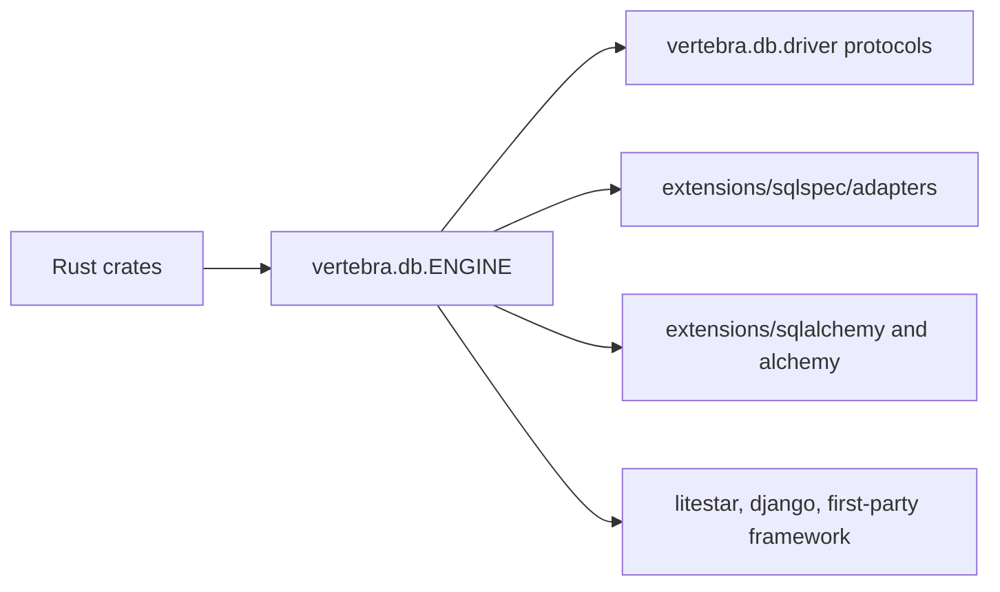

# Master PRD: Vertebra Integration and Quality Remediation

Baseline: `main @ 142cc49` (PRs #64, #65, #66, #69, #70). The verified findings for every chapter live in [research/audit-findings_20261103.md](research/audit-findings_20261103.md).

## 1. North Star Goal & Problem Framing

### Objective
Vertebra's value is its Rust runtime and drivers. Users mostly reach them through SQLAlchemy / Advanced Alchemy, SQLSpec, Litestar, and Django. This initiative makes those integrations correct and feature-complete, keeps the public API small, and removes code that reimplements features the frameworks already ship or that only pretends to work.

### Current state and limits
- **Drivers that don't reach their database.**
  - The Oracle and MSSQL drivers run every query against in-memory SQLite (`db/oracle/driver.py::SyncOracleDriver.__init__`, `db/mssql/driver.py::SyncMSSQLDriver.__init__`).
  - DuckDB falls back to SQLite, and Postgres/MySQL serve `memory://` fake rows.
  - The async Postgres path returns the `asyncpg` module instead of a pool (`db/postgres/driver.py::AsyncPostgreSQLDriver._ensure_async_pool`).
- **Pipelining not exposed.**
  - Postgres and Oracle both support protocol pipelining (as psycopg 3 `pipeline()` and python-oracledb `run_pipeline()` demonstrate). The Vertebra drivers expose neither.
  - Instead it ships `db/pipeline.py::QueryPipeline`, which compiles steps into one CTE. That is a different feature and not what pipelining means.
- **Rust GCP wire format.**
  - BigQuery Storage Read/Write and Spanner Session/ExecuteSql/Transaction/Commit use wrong protobuf field numbers, and the tests mock the same wrong numbers.
  - Commit, DDL, and append can report success without having succeeded.
  - A panic in a spawned task leaves a Python future pending forever.
- **Engine code in generic modules.**
  - `db/cdc.py` mixes Postgres and Spanner change capture.
  - `db/channels.py::DatabaseChannelBackend` hardwires every engine.
  - `db/_registry.py` dispatches through long `isinstance` chains.
  - `db/mcp_tools.py` is GCP-only and imports `vertebra.agent` and `vertebra.framework`.
- **SQLSpec adapters.**
  - The vertebra stores don't subclass sqlspec's bases, and their schemas drift.
  - The base drivers override `execute`/`select`, which bypasses the sqlspec pipeline and drops `**kwargs`.
  - Six engines return no data dictionary.
  - Upstream resolves stores from module paths, so vertebra configs can't reach them ([sqlspec#876](https://github.com/litestar-org/sqlspec/issues/876)).
- **Queues.**
  - The Postgres, Oracle, and Spanner first-party queue backends always run in memory.
  - litestar-queues has the same module-path resolution problem ([litestar-queues#186](https://github.com/cofin/litestar-queues/issues/186)).
- **MCP / WebMCP.**
  - Untagged tools are browser-exposed by default, and `requires_confirmation` is never enforced.
  - The `Mcp-Name` check can be bypassed.
  - Flask and Django carry duplicate dispatchers that report protocol `2024-11-05`.
  - The TS bridge targets `navigator.modelContext.provideContext`.
- **Silent failures.**
  - The RLS `SET` is wrapped in `suppress(Exception)`.
  - `KeyValueStore.delete_all` calls `flushdb()`.
  - Embedders return hash vectors on error and on free-threaded builds.
- **Duplication.**
  - About 3,000 lines across the per-framework fastpaths.
  - Two cron parsers.
  - Python `text`/`humanize` fallbacks shadowing mandatory Rust.

### What is new and why it succeeds
- Each driver package (`vertebra/db/adapters/<engine>/`) talks to its real database through Vertebra's own Rust client (native-data-platform PRD) and exposes small engine-local primitives: native pipeline, notification listener, change source, queue store, embedding pushdown.
- Framework extensions consume those primitives and implement each framework's own contract: sqlspec stores, litestar-queues backends, Django tasks, Litestar channels, SQLAlchemy dialects, MCP tool providers.
- A behavior fix therefore lands in one place, users get upstream-compatible schemas and services, and the public API stays small because AA/SQLA remains the primary path.

### Success metrics
- No production driver class opens SQLite or serves fake rows unless it is the SQLite driver. Each engine passes integration tests against its real database through `pytest-databases`.
- `driver.pipeline()` sends N statements in one round trip on Postgres through the native Rust client. Oracle exposes the same API and executes sequentially until upstream support lands.
- Spanner and BigQuery Storage run on the official Google Cloud Rust crates with no hand-written protobuf left in `vertebra-db`, and every GCP binding raises typed exceptions carrying the gRPC code.
- Vertebra sqlspec adapters pass the upstream ADK, events, and litestar store contracts.
- First-party queues deliver across processes on Postgres, Oracle, Spanner, and Redis.
- An import gate enforces that `vertebra.db` imports nothing from `vertebra.{agent,framework,extensions,server}`.
- MCP conformance for 2026-07-28 passes.

### Risks and mitigations

| Risk | Mitigation |
| --- | --- |
| Upstream sqlspec#876 / litestar-queues#186 land late | Temporary resolver shim in `extensions/sqlspec/_compat.py`, pinned by a test that fails once upstream ships so the shim gets deleted |
| Clean-break renames break users | Pre-1.0 and no aliases (product guideline); the changelog lists the renames |
| Emulators lack features (Spanner multiplexed sessions, BigQuery Storage Write) | Emulator-only failures are marked `xfail(strict=True)` with a reason; behavior tests run against the official crates' `from_stub` ports |
| Real driver I/O exposes latent bugs hidden by the fakes | Each engine is switched over in its own task, with integration tests through `pytest-databases` |

## 2. Locked Architectural Seams & Alternatives Considered

1. **Layering** *(user decision)*.
   - `vertebra.db` holds drivers, configs, and basic engine-local primitives.
   - Framework integrations live in `vertebra.extensions.*` or `vertebra.framework.*` and consume those primitives: sqlspec stores, AA cache, litestar-queues backends, Litestar channels, Django tasks, MCP tool providers.
   - `vertebra.db` never imports upward.
2. **Engine packages** *(user decision)*.
   - Engine code lives in `vertebra/db/adapters/<engine>/{config,core,driver}.py`, plus optional `pipeline.py`, `notify.py`, `change_stream.py`, `queue.py`, and `embeddings.py`.
   - Engine-agnostic code stays directly under `vertebra/db/`: driver bases, capability protocols (`PipelineCapable`, `NotificationSource`, `ChangeSource`, `QueueStore`, `EmbeddingPushdown`), the registry, `ArrowCursor`, the broker client, and the dialers.
   - The [native-data-platform](../native-data-platform/spec.md) PRD (`db-layout-and-contract`) owns this layout.
3. **Driver I/O** *(user decision: required, feature complete)*.
   - Vertebra's own Rust drivers back every engine. The native-data-platform PRD owns this.
   - Any existing AA/SQLAlchemy or SQLSpec config can share one broker-owned pool over the SHM ring (`broker-pool-sharing`).
   - Storage and the other data components are feature complete (`storage-completeness`).
   - No third-party Python DB clients, `memory://` modes, or SQLite stand-ins remain in production drivers.
4. **Native pipelining.**
   - `driver.pipeline()` (sync and async) is implemented in the Rust Postgres client (extended-protocol batch, single `Sync`). Oracle exposes the same API and executes sequentially until the official `oracledb` crate supports 26ai pipelining.
   - The sqlspec adapter `execute_stack` uses it.
   - `db/pipeline.py::QueryPipeline`, `RelOverlay`, `CTEStep`, and the `execute_stack` CTE emulation are deleted (`db-engine-primitives`).
5. **Registry polymorphism.**
   - `BaseDatabaseConfig` gains `url_schemes`, `from_url`, `pool_key`, and `driver_classes`.
   - `DatabaseRegistry` becomes table-driven.
   - `provide_driver(name_or_config, *, sync=False)` replaces the per-engine providers.
   - Owned by native-data-platform `db-layout-and-contract`.
6. **SQLSpec adapter parity** *(user decision: feature-complete like upstream adapters)*.
   - Layout: `extensions/sqlspec/adapters/<engine>/{config,driver,core,data_dictionary,adk/,events/,litestar/}.py`.
   - Drivers implement the `SyncDriverAdapterBase`/`AsyncDriverAdapterBase` dispatch contract.
   - Stores subclass upstream bases and keep upstream DDL.
   - Configs declare `adapter_name: ClassVar[str]`.
7. **Queues** *(user decision: native Vertebra components that plug into the other frameworks; Postgres and Oracle first)*.
   - Native `db/adapters/{postgres,oracle}/queue.py` stores back three integrations, selected by settings:
     - first-party `QueueService`;
     - native litestar-queues `BaseQueueBackend` implementations;
     - a Django `django.tasks` backend.
   - Workers resolve dependencies through `framework/di.py::Container`.
   - Other engines build on these stores later.
8. **MCP** *(user decision)*.
   - One `ToolSpec` (msgspec), a `ToolRegistry` fed by `ToolProvider`s, and a transport-agnostic `MCPCore.handle()` with ASGI, WSGI, and native adapters.
   - The WebMCP manifest is a projection filtered by `exposure`.
   - Litestar apps delegate to litestar-mcp.
9. **Rust GCP clients** *(user decision 2026-11-03: official googleapis crates are cleared when functional, including pre-1.0)*.
   - Spanner and BigQuery Storage Read/Write run on `google-cloud-spanner` / `google-cloud-bigquery` (default features off, rustls + ring) behind `vertebra_db::{SpannerClient, BigQueryClient}`; the hand-written protobuf code and `grpc.rs` are deleted ([research](research/google-cloud-rust_20261103.md)).
   - BigQuery REST and `GcpTokenCache` stay Vertebra code; the cache is bridged into the official clients.
   - Tests use the crates' `from_stub` ports; golden-byte fixtures apply only where hand-written protobuf remains (none after Chapter 2).
   - Emulator-only gaps get `xfail(strict=True)`.

### Alternatives rejected
- **Per-feature subpackages (`db/cdc/{postgres,spanner}.py`).** They split one engine across many packages and lose locality with its driver.
- **Deleting vertebra stores in favor of upstream-only.** The user requires feature-complete vertebra adapters.
- **Native stores without upstream bases.** Schema drift, and they don't work with `SQLSpecSessionService` or the extension migrations.
- **Keeping `QueryPipeline` as "pipelining".** A CTE envelope is not protocol pipelining, can't mix writes safely, and duplicates sqlspec's `StatementStack`.
- **Keeping the hand-written GCP protobuf clients with per-message consts and golden fixtures.** Superseded by the 2026-11-03 decision: the official crates implement the protocol, and the `prost_types::Value` allocation cost is tracked by `make bench-check` in Chapter 8.
- **One MCP core including Litestar.** It would duplicate litestar-mcp, which already conforms to 2026-07-28.

## 3. Master Roadmap (Ordered Child Flows)

| Ch | Flow ID | Title | Key Deliverables | Public Seams | Depends on | State |
| --- | --- | --- | --- | --- | --- | --- |
| 1 | `critical-correctness-fixes` | Silent failure and security fixes | Behavior fixes only; see charter | existing APIs | — | completed |
| 2 | `gcp-wire-protocol-correctness` | Official Google Cloud Rust clients for Spanner and BigQuery Storage | Spanner and BigQuery Storage Read/Write on `google-cloud-spanner`/`google-cloud-bigquery` behind the existing seams, commit/DDL/append verification, hardened Arrow append plan, `grpc.rs` removed | `SpannerClient` (`partitioned_query`), `BigQueryClient` | — | completed |
| 3 | `db-engine-primitives` | Engine primitives relocation and QueryPipeline removal | CDC/notify/change-stream/embedding pushdown moved to `db/adapters/<engine>`, `DatabaseChannelBackend` and `QueryPipeline` deleted, DB tools moved to extension tool providers, RLS stays generic in `db/rls.py` | `vertebra.db.cdc`, `vertebra.db.adapters.*.{notify,change_stream,embeddings}`, `PushdownEmbedder` | 1; native-data-platform Ch1–2 | draft |
| 4 | `sqlspec-adapter-parity` | Feature-complete sqlspec adapters | Per-engine adapter packages, dispatch-contract drivers, upstream-base stores, data dictionaries, resolver shim, shared-pool safety | `<Engine>{Sync,Async}Config`, `adapter_name` | 3 | draft |
| 5 | `queues-tasks-and-channels` | Working queues, tasks, channels, stores | Real `QueueStore`s, settings-driven backends, litestar-queues backend, Django tasks backend, DI, one cron parser, per-engine channels, Valkey store | `QueueService`, `QueueBackend`, `QueueBackendSettings` | 3, 4 | draft |
| 6 | `sqlalchemy-and-django-integration` | SQLAlchemy / AA / Django DB integration | Dialect split + real GCP dialect bases, shared DB-API module, AA dogpile cache backend, real Django backends including Spanner via `django_spanner` | dialect entry points, `create_cache_config`, Django `ENGINE` paths | 3 | draft |
| 7 | `mcp-webmcp-core` | MCP 2026-07-28 core and WebMCP bridge | `ToolSpec`/`ToolRegistry`/`MCPCore`, ASGI/WSGI adapters, litestar-mcp delegation, TS bridge on `document.modelContext`, conformance | `ToolSpec`, `MCPCore`, `registerWebMCPTools` | 1, 3 | draft |
| 8 | `runtime-structure-and-throughput` | Fastpath, Rust modules, helpers | Shared fastpath core + provider registry, table-driven loops, Rust module splits + shared proto/status/retry/auth, copy removal, Vertex HTTP/2 transport, utils fallback removal | `FastPathProvider`, `vertebra.utils.*` (names unchanged) | 2, 3, 9 | draft |
| 9 | `gcp-driver-resilience` | GCP driver resilience and typed errors | Panic-safe/cancellable completion bridge, typed `GoogleCloudError` hierarchy with gRPC codes across sync/async bindings, async gcloud + proxy + explicit scopes, BigQuery REST fixes, GoogleSQL placeholder lexer | `_vertebra.pyi` exceptions, `TaskPanicError`, `GcpTokenCache::from_options` | 2 | planned |

## 4. Global Constraints (Applicable to All Child Flows)

- **Branching.** Planning lives on `chore/integration-remediation-plan`. Each child flow gets its own feature branch and PR. Never commit to `main`; commits are signed and conventional. Push incrementally after `make lint`.
- **Clean break.**
  - No backward-compatibility aliases, re-export shims, or one-time upgrade flags.
  - No `.get()`/`try-except` fallbacks added for synthetic test seeds; fix the tests to the production contract.
  - No emulator hooks or in-memory/SQLite fallbacks in production driver classes.
- **Python style.**
  - `msgspec.Struct(frozen=True, gc=False)` value objects (`array_like=True` on hot wire frames).
  - PEP 585/604/695 types.
  - Google docstrings with no inline `#` comments.
  - Top-level imports only, except `TYPE_CHECKING` and optional-dependency helpers.
  - Class layout: attributes → `__init__` → properties → public → private.
  - JSON goes through `vertebra.utils.serializers`.
  - `@pytest.mark.parametrize` and parameterized fixtures instead of loops in tests.
- **Public helpers.** `vertebra.utils.*` functions are public helpers for users. Having no in-repo importers is not a deletion signal *(user direction)*.
- **Small API surface.** Add new public names only where a framework contract requires them. AA/SQLA is the primary path *(user direction)*.
- **Tests.** Tests go in existing canonical module test files; no `test_*remediation*.py` / `test_*audit*.py`. Every bug fix starts with a failing test (`regression_tdd`).
- **Docs and knowledge.** Each child corrects the `docs/` pages and knowledge chapters it touches. Known drift:
  - `docs/usage/query-pipelines.md`
  - `domains/framework/distributed-queues-and-email.md`
  - `domains/extensions/sqlspec-alchemy-and-dialects.md`
  - `domains/agent/mcp-and-a2a-protocol-harness.md`
  - `domains/agent/embeddings-and-vectors.md`
  - `domains/data/database-drivers-and-dialers.md`
  - `domains/data/query-pipeline-cdc-and-tenancy.md`
- **Gates.** Run `make lint` before each push. A child's checkpoint is `make lint-all` plus the scoped `make rs-test` / `make py-test` / `make ts-test` named in its spec.

## 5. Backlog (Deferred Items)

- Spanner and Redis/Valkey native queue backends, built on the Postgres/Oracle `QueueStore` pattern.
- AWS RDS/Aurora DSQL IAM dialer ([vertebra#67](https://github.com/cofin/vertebra/issues/67)) and Azure Entra ID dialer ([vertebra#68](https://github.com/cofin/vertebra/issues/68)).
- Rust `arrow-ipc` behind a feature flag, if the hardened flatbuffer verifier proves insufficient.
- Removing `extensions/sqlspec/_compat.py` once sqlspec#876 and litestar-queues#186 ship. The pinning test in Chapter 4 tracks this.
- Spanner and BigQuery emulator integration suites through pytest-databases, with emulator-only gaps as `xfail(strict=True)`.
- Python `SpannerTransaction.execute` runs each statement in its own read-write transaction; make it share one transaction.

## Open Questions

- **Resolved Q1** *(user)*: engine code goes in `vertebra/db/adapters/<engine>/`, and engine-agnostic code stays directly under `vertebra/db/`.
- **Resolved Q2** *(user)*: native Vertebra queue backends for Postgres and Oracle first, plugged into first-party queues, litestar-queues, and Django tasks.
- **Resolved Q4** *(user)*: Vertebra's own Rust drivers back every engine, broker pool sharing works for any AA/SQLSpec config, and storage is complete. See [native-data-platform](../native-data-platform/spec.md).
- **Resolved — Google Cloud crates** *(user, 2026-11-03)*: the official `googleapis/google-cloud-rust` crates (Spanner, BigQuery, auth) may replace the hand-written clients wherever they are functional, even pre-1.0. `gcp-wire-protocol-correctness` decides adopt-versus-keep per capability, with evidence, and keeps the hand-written wire fixes only where a crate lacks a needed feature.
- **Resolved Q3** *(user, 2026-11-03)*: Django backends for Postgres/MySQL/Oracle/SQLite subclass Django's built-in backends and use the Vertebra DB-API. Spanner subclasses the official `django_spanner.base.DatabaseWrapper` (googleapis `django-google-spanner`) with the Vertebra Rust-backed DB-API in place of `google.cloud.spanner_dbapi`. The BigQuery Django backend is removed.

## Implementation Plan

- [x] [b61726a] critical-correctness-fixes — Silent failure and security fixes (archived in `log.md`)
- [x] [260ae8d] gcp-wire-protocol-correctness — Official Google Cloud Rust clients for Spanner and BigQuery Storage (archived in `log.md`)
- [ ] gcp-driver-resilience — GCP driver resilience and typed errors (../gcp-driver-resilience/spec.md)
- [ ] db-engine-primitives — Engine primitives relocation and QueryPipeline removal (../db-engine-primitives/spec.md)
- [ ] sqlspec-adapter-parity — Feature-complete sqlspec adapters (../sqlspec-adapter-parity/spec.md)
- [ ] queues-tasks-and-channels — Working queues, tasks, channels, stores (../queues-tasks-and-channels/spec.md)
- [ ] sqlalchemy-and-django-integration — SQLAlchemy / AA / Django DB integration (../sqlalchemy-and-django-integration/spec.md)
- [ ] mcp-webmcp-core — MCP 2026-07-28 core and WebMCP bridge (../mcp-webmcp-core/spec.md)
- [ ] runtime-structure-and-throughput — Fastpath, Rust modules, helpers (../runtime-structure-and-throughput/spec.md)

## Continuity Snapshot

- **Flow ID:** `integration-remediation` (`state: planned`, `plan_revision: 1`, `plan_commit: null`)
- **Key decisions:**
  - Sibling PRD `native-data-platform` owns the layout, the native Rust drivers, broker pool sharing, and storage (2026-11-03).
  - Master PRD with ordered child flows.
  - sqlspec adapters are feature-complete on upstream bases, with a resolver shim until sqlspec#876.
  - Engine primitives live in `db/<engine>`; framework integrations live in the extensions.
  - Queues are real, with litestar-queues and Django tasks backends and DI.
  - MCPCore design, with Litestar delegating to litestar-mcp.
  - Spanner and BigQuery Storage move to the official Google Cloud Rust crates (Chapter 2); resilience and typed errors follow in Chapter 9; emulator gaps are `xfail`.
  - `utils` stays public.
  - Pipelining is native protocol pipelining in the Rust Postgres client, Oracle runs sequentially until upstream supports it, and `QueryPipeline` is deleted.
- **Recent discoveries:**
  - The Oracle and MSSQL drivers are SQLite-backed fakes.
  - The async Postgres pool returns the asyncpg module.
  - Upstream issues filed: sqlspec#876 and litestar-queues#186.
  - `django-google-spanner` is the official Spanner Django backend.
