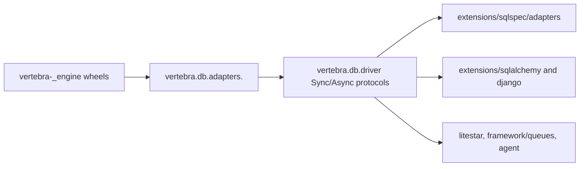

# Master PRD: Vertebra Integration and Quality Remediation

<!-- truth: start -->
- **Architectural Layering**: `vertebra.db` owns drivers, configs, neutral `dbapi/`, and engine-local primitives (`vertebra/db/adapters/<engine>/`) with zero upward imports into `agent`, `framework`, `extensions`, `server`, or `embeddings` [^db-registry].
- **Merged Foundation on `main @ 18baadcd`**: Squash commits `364c7cbe` (`critical-correctness-fixes`), `984ce732` (`gcp-wire-protocol-correctness`), `abd33ab6` (`gcp-driver-resilience`), `80ff8a65` (`db-engine-primitives`), `d2fa5072` (`runtime-structure-and-throughput`), `077a3fe9` (`mcp-webmcp-core`), and `18baadcd` ([PR #118](https://github.com/cofin/vertebra/pull/118): native `ResponseStreamFrame`/`VRSF` stream transport and trusted `AgentContext` propagation) are live on `main` [^fastpath-core].
- **Dual-Mode `Sync*` / `Async*` Contracts**: Every runtime, driver, store, notification, and queue capability splits into leading `Sync<Noun>` and `Async<Noun>` protocols (`SyncNotificationSource` / `AsyncNotificationSource` hoisted into `native-redis-driver`; `SyncQueueStore` / `AsyncQueueStore` in `queues-tasks-and-channels` and `spanner-queue-and-rw-transactions`) with zero aliases or async-only primitives.
- **Complete Planned Portfolio**: Completed `server-runtime-correctness` (`05d88d00`, including [#115](https://github.com/cofin/vertebra/issues/115) standalone skills staging), `gcp-embeddings-and-identity` (`93d7fb1f`, [#113](https://github.com/cofin/vertebra/issues/113) OIDC ID token cache + Vertex/Gemini/SQL/broker parity), `mcp-protocol-completeness` (`54a5103d`, dual-mode MCP sessions/SSE/skills/UI/IAP/OIDC CLI), and `http3-and-http-hygiene` (`f277a29b`, QUIC HTTP/3 UDP listener wiring, `Alt-Svc` gating, `McpStdioBridge` removal, and `--features http3` Make/CI/binary gates), alongside planned flows `sqlspec-adapter-parity` (`sqlspec>=0.71.1`, zero `_compat.py` monkeypatching), `sqlalchemy-and-django-integration`, `queues-tasks-and-channels` (`litestar-queues>=0.14.0`), `spanner-queue-and-rw-transactions`, and `strict-typing-hygiene` ([#59](https://github.com/cofin/vertebra/issues/59)) [^sqlspec-adapters] [^queue-spanner] [^http3-rs].
<!-- truth: end -->

## 1. Specification, Context & Provenance

### 1.1 Baseline & Problem Statement
Baseline is `main @ 18baadcd` ([PR #118](https://github.com/cofin/vertebra/pull/118)), building on merged squash commits `364c7cbe` (`critical-correctness-fixes`), `984ce732` (`gcp-wire-protocol-correctness`), `abd33ab6` (`gcp-driver-resilience`), `f7417015` (`Sync*`/`Async*` split), `21c99f95` (`db-layout-and-contract`), `80ff8a65` (`db-engine-primitives`), `2b737240` (post-merge remediation), `d2fa5072` (`runtime-structure-and-throughput`), `077a3fe9` (`mcp-webmcp-core`), `067fa901` (`storage-completeness` + `storage-remediation`), `af1b3d30` (`driver-fail-loud`), `1b8449fe` (packaging), `14aa83b8` (`vertebra-duckdb`), `e86d8daf` (`vertebra-mysql`), `134546d4` (`vertebra-mssql`), `47da6820` (`vertebra-oracle`), and `c8722c76` (`vertebra-postgres`). Primary-source audit findings live in [research/audit-findings_20261103.md](research/audit-findings_20261103.md) and [research/google-cloud-rust_20261103.md](research/google-cloud-rust_20261103.md).

Vertebra's value is its Rust runtime and standalone per-engine native wheels ([native-data-platform](../native-data-platform/spec.md)), consumed through SQLAlchemy / Advanced Alchemy, SQLSpec, Litestar, Django, native queues/channels, and MCP/A2A. Remaining integration gaps are:
- **Server Runtime & HTTP/3**: Native `VRSF` stream frames, progressive ASGI/RSGI/native `App` streaming ([#81](https://github.com/cofin/vertebra/issues/81)), fail-loud lifespan startup ([#84](https://github.com/cofin/vertebra/issues/84)), `vertebra.supervisor` exports ([#83](https://github.com/cofin/vertebra/issues/83)), `--worker-only` / `vtb workers run` ([#85](https://github.com/cofin/vertebra/issues/85)), wheel-bundled `vertebra-server` ([#82](https://github.com/cofin/vertebra/issues/82)), standalone `.agents/skills` staging ([#115](https://github.com/cofin/vertebra/issues/115)), and `http3.rs` QUIC listener wiring + `--features http3` CI/binary gates are live [^http3-rs].
- **Embeddings & Identity**: `VertexEmbedder` posts Generative Language `BatchEmbedContents` to the Vertex host, `GeminiEmbedder.embed_multimodal` sends text descriptors instead of inline media parts, `EmbeddingBroker` shares `asyncio` primitives across loops, `GemmaEmbedder` drops `precision`, and audience-bound OIDC `SyncGcpIdTokenCache` / `AsyncGcpIdTokenCache` ([#113](https://github.com/cofin/vertebra/issues/113), including `authorized_user` ADC) is not yet built.
- **MCP Completeness**: Trusted `AgentContext` propagation landed in `18baadcd`; guard/confirmation hardening, `Mcp-Param-*` validation, version negotiation with legacy `GET` SSE sessions, `resources/subscribe` ([#112](https://github.com/cofin/vertebra/issues/112)), `capabilities.extensions` skills, MCP Apps UI metadata, Litestar delegation parity, and `vtb ai mcp serve`/`bridge` ([#109](https://github.com/cofin/vertebra/issues/109), [#110](https://github.com/cofin/vertebra/issues/110), [#111](https://github.com/cofin/vertebra/issues/111), [#114](https://github.com/cofin/vertebra/issues/114)) remain in `mcp-protocol-completeness`.
- **SQLSpec, SQLAlchemy/Django & Queues**: `extensions/sqlspec/adapters.py` bypasses SQLSpec's dispatch contract, sets `%s` instead of `?` on MySQL, uses invalid `sqlglot` dialect strings on Spanner, and lacks 6 engine `DataDictionary` classes plus upstream-base ADK/events/Litestar stores [^sqlspec-adapters]. `extensions/sqlalchemy/dialects.py` opens a second `sqlite3` connection and dispatches via `isinstance` [^sa-dbapi]. Queue backends lack built-in `SyncQueueStore` / `AsyncQueueStore` implementations (`PostgreSQLQueueBackend`, `OracleQueueBackend`, `SpannerQueueBackend` whose `CLAIM_SPANNER_JOBS_SQL` call passes 6 args to 3 parameters without interactive `ReadWrite` transactions, and `RedisQueueBackend` / `ValkeyQueueBackend` still importing `redis.asyncio`) [^queue-redis] [^queue-oracle] [^queue-spanner].
- **Strict Typing Hygiene ([#59](https://github.com/cofin/vertebra/issues/59))**: `pyproject.toml` carries `43` redundant `ignore_missing_imports = true` overrides masking `from litestar_queues.records import QueuedTaskRecord`, and `tools/benchmarks` plus `src/py/tests` are excluded from `mypy`.

### 1.2 Non-Goals & Deferred Backlog
- AWS RDS / Aurora DSQL IAM auth ([#67](https://github.com/cofin/vertebra/issues/67)), Azure Entra ID database/cache auth ([#68](https://github.com/cofin/vertebra/issues/68)), dedicated `SyncRedisQueueStore` / `AsyncRedisQueueStore` (`redis-queue-store` over Streams after `native-redis-driver` + `queues-tasks-and-channels`), and optional [#116](https://github.com/cofin/vertebra/issues/116) remain deferred in the backlog until scheduled.

## 2. Requirements, Concrete Contracts & Architecture

- **`R1` Strict Downward Layering**: `vertebra.db` holds drivers, configs, `db/dbapi/`, and engine-local primitives (`pipeline.py`, `notify.py`, `change_stream.py`, `queue.py`, `embeddings.py`, `tools.py` implementing `vertebra.typing.ToolProvider`) and never imports from `agent`, `framework`, `extensions`, `server`, or `embeddings` [^db-registry].
- **`R2` Leading `Sync*` / `Async*` Capability Split (Zero Aliases)**:
  - `SyncPipelineCapable` / `AsyncPipelineCapable`, `SyncChangeSource` / `AsyncChangeSource`, `SyncNotificationSource` / `AsyncNotificationSource` (hoisted into [native-redis-driver](../native-redis-driver/spec.md) `ch03`), and `SyncQueueStore` / `AsyncQueueStore` (defined in [queues-tasks-and-channels](../queues-tasks-and-channels/spec.md) `ch01`) provide dedicated synchronous and asynchronous contracts with plain method names and zero `*_async` suffixes or aliases.
  - Host framework plugins use `VertebraPlugin`, `VertebraConfig`, and `VertebraAppConfig`; SQLAlchemy dialects keep all 36 `+vertebra`/`+vtb`/`+vertebra_async`/`+vtb_async` entry points on `Sync<Engine>Dialect` / `Async<Engine>Dialect` classes; SQLSpec adapters preserve upstream `<Engine>SyncConfig` / `<Engine>AsyncConfig` infix naming inside `vertebra.extensions.sqlspec`.
- **`R3` Direct Upstream SQLSpec & Litestar-Queues Hook Wiring (Zero MyPyC Monkeypatching)**: `sqlspec>=0.71.1` (MyPyC-compiled) and `litestar-queues>=0.14.0` natively support `adapter_name` and explicit `adk_session_store_class`, `adk_memory_store_class`, `events_store_class`, `litestar_store_class`, and `queue_store_class` class attributes. `_compat.py` monkeypatching and cross-adapter shared SQL helper modules are forbidden; each adapter owns its SQL helpers locally and offloads ADK artifacts through `vertebra.storage.ArtifactReference` (`adk = ["google-adk>=1.0.0"]` lazy extra).
- **`R4` Native Queues, Spanner `ReadWrite` Transactions & Channels**: `SyncPostgresQueueStore` / `AsyncPostgresQueueStore`, `SyncOracleQueueStore` / `AsyncOracleQueueStore`, and `SyncSpannerQueueStore` / `AsyncSpannerQueueStore` (backed by multi-statement interactive `ReadWrite` transactions in `vertebra-spanner` tracking `seqno` and `precommit_token`) power first-party `QueueService`, `litestar-queues`, and Django 6.0 `TaskBackend` (`enqueue` via `SyncQueueStore`, `aenqueue` via `AsyncQueueStore`) with DI injection.
- **`R5` Progressive Runtime Streaming, Wheel Binary, HTTP/3 & Strict Typing**: Mounted ASGI/RSGI and native `App` handlers stream via `VRSF` frames, `vtb run` executes a wheel-shipped `vertebra-server` binary, `StandaloneBuilder` stages user `.agents/skills` when present, `vertebra-http` binds its QUIC HTTP/3 endpoint under `--features http3` (and deletes dead `McpStdioBridge`), and `mypy --strict` covers `src/py/vertebra`, `tools/benchmarks`, and `src/py/tests` without blanket `ignore_missing_imports`.

## 3. Documentation & OKF Knowledge Plan

Every child flow synchronizes its affected `docs/` pages (`zensical` build verified via `make docs`) and `.agents/bundles/knowledge/` chapters (`<= 200` lines, `<= 40` truth-block lines, verified via `make review-check`), updating limitations chapters (`server-runtime-limitations.md`, `mcp-limitations.md`, `embeddings-limitations.md`, `database-driver-limitations.md`) in place as gaps close.

## 4. Requirement-to-Task Traceability Matrix

| Requirement | Owning Child Flow(s) | Primary Surface | Verification Gate |
| --- | --- | --- | --- |
| `R1` Downward `vertebra.db` layering & `dbapi/` | `db-engine-primitives` (`80ff8a65`), [`sqlalchemy-and-django-integration`](../sqlalchemy-and-django-integration/spec.md) | `src/py/vertebra/db/**`, `extensions/sqlalchemy/**`, `extensions/django/**` | AST import & engine-purity gates + `pytest` |
| `R2` `Sync*`/`Async*` capabilities & dialects | [`sqlalchemy-and-django-integration`](../sqlalchemy-and-django-integration/spec.md), [`queues-tasks-and-channels`](../queues-tasks-and-channels/spec.md) | `db/driver/capabilities.py`, `extensions/sqlalchemy/dialects.py` | `make lint-all` + dialect/Django unit suites |
| `R3` SQLSpec `0.71.1+` parity & stores | [`sqlspec-adapter-parity`](../sqlspec-adapter-parity/spec.md) | `src/py/vertebra/extensions/sqlspec/**` | SQLSpec driver, `DataDictionary`, ADK, events, Litestar tests |
| `R4` Queues, Django tasks, Spanner RW tx & channels | [`queues-tasks-and-channels`](../queues-tasks-and-channels/spec.md), [`spanner-queue-and-rw-transactions`](../spanner-queue-and-rw-transactions/spec.md) | `src/rs/vertebra-spanner/**`, `db/adapters/*/queue.py`, `framework/queues/**` | `cargo test -p vertebra-spanner` + queue/task/channel suites |
| `R5` Runtime streaming, MCP, embeddings, HTTP/3 & typing | `server-runtime-correctness` (`05d88d00`), `gcp-embeddings-and-identity` (`93d7fb1f`), `mcp-protocol-completeness` (`54a5103d`), `http3-and-http-hygiene` (`f277a29b`), [`strict-typing-hygiene`](../strict-typing-hygiene/spec.md) | `src/rs/vertebra-http/**`, `src/py/vertebra/{server,agent,embeddings,build}/**`, `pyproject.toml` | `make rs-test`, `make py-test`, `make lint-all` |

## 5. Implementation Plan

- [x] [364c7cbe] `critical-correctness-fixes` — Confirmation-gate binding, opt-in WebMCP, prefix-scoped `SCAN`+`UNLINK`, fail-loud embeddings, ASGI batch timeout
- [x] [984ce732] `gcp-wire-protocol-correctness` — Official Google Cloud Rust clients for Spanner and BigQuery Storage
- [x] [abd33ab6] `gcp-driver-resilience` — Panic-safe/cancellable `spawn_rust_db_task`, typed `GoogleCloudError` hierarchy, resilient GCP auth
- [x] [80ff8a65] `db-engine-primitives` — Adapter-local primitives, neutral `ToolProvider`s, native pipeline dispatch, and reset-or-evict tenant scopes
- [x] [d2fa5072] `runtime-structure-and-throughput` — Shared `FastPathProvider`, GCP crate splits, zero-copy Arrow append, HTTP/2 Vertex transport
- [x] [077a3fe9] `mcp-webmcp-core` — Unified `ToolSpec`/`ToolRegistry`, `MCPCore` `2026-07-28`, ASGI/WSGI/native adapters, and WebMCP bridge
- [x] [05d88d00] `server-runtime-correctness` — Progressive Python/ASGI/RSGI/native streaming ([#81](https://github.com/cofin/vertebra/issues/81)), fail-loud lifespan ([#84](https://github.com/cofin/vertebra/issues/84)), supervisor/worker lanes ([#83](https://github.com/cofin/vertebra/issues/83), [#85](https://github.com/cofin/vertebra/issues/85)), relocatable wheel `vertebra-server` ([#82](https://github.com/cofin/vertebra/issues/82)), opt-in standalone `.agents/skills` staging ([#115](https://github.com/cofin/vertebra/issues/115)), and FastPath/native cleanup
- [x] [93d7fb1f] `gcp-embeddings-and-identity` — Audience-bound `SyncGcpIdTokenCache`/`AsyncGcpIdTokenCache` ([#113](https://github.com/cofin/vertebra/issues/113)), Vertex/Gemini wire parity, SQL pushdown parity, and per-loop `EmbeddingBroker`/`GemmaEmbedder` fixes (`ch01`–`ch04`, `15/15` tasks)
- [x] [54a5103d] `mcp-protocol-completeness` — Single-pass guards, `Mcp-Param-*` validation, dual-mode version negotiation + sessions + `GET` SSE, resource subscriptions ([#112](https://github.com/cofin/vertebra/issues/112)), `SKILLS_EXTENSION` + SEP-1865 UI, Litestar `0.20+` parity, `IapIdentitySource`, `OidcTokenSource`, and incremental `vtb ai mcp serve|bridge` ([#109](https://github.com/cofin/vertebra/issues/109), [#110](https://github.com/cofin/vertebra/issues/110), [#111](https://github.com/cofin/vertebra/issues/111), [#114](https://github.com/cofin/vertebra/issues/114)) (`ch01`–`ch07`, `25/25` tasks)
- [x] [f277a29b] `http3-and-http-hygiene` — QUIC `http3.rs` server listener wiring, `Alt-Svc` gating, SSE/QUIC graceful drain, `McpStdioBridge` removal, and `--features http3` Make/CI/binary gates (`t01`–`t03`)
- [ ] [`sqlalchemy-and-django-integration`](../sqlalchemy-and-django-integration/spec.md) — `Sync<Engine>Dialect`/`Async<Engine>Dialect` over `vertebra.db.dbapi`, `dogpile.cache` backend, and native Django `6.0+` backends including Spanner (`ch01`–`ch03`, `12` tasks)
- [ ] [`sqlspec-adapter-parity`](../sqlspec-adapter-parity/spec.md) — `sqlspec>=0.71.1` per-engine adapters, `DataDictionary` classes, and Litestar/events/Google ADK stores with zero `_compat.py` monkeypatching (`ch01`–`ch04`, `15` tasks)
- [ ] [`queues-tasks-and-channels`](../queues-tasks-and-channels/spec.md) — `SyncQueueStore`/`AsyncQueueStore` (`SyncPostgresQueueStore`, `SyncOracleQueueStore`, async pairs), native Redis/Valkey queues, `litestar-queues>=0.14.0`, Django `TaskBackend`, and distributed channels (`ch01`–`ch03`, `12` tasks)
- [ ] [`spanner-queue-and-rw-transactions`](../spanner-queue-and-rw-transactions/spec.md) — Interactive multi-statement Spanner `ReadWrite` transactions and `SyncSpannerQueueStore`/`AsyncSpannerQueueStore` across GoogleSQL and Spangres (`t01`–`t04`, `4` tasks)
- [ ] [`strict-typing-hygiene`](../strict-typing-hygiene/spec.md) — Prune redundant `ignore_missing_imports`, fix `tools/benchmarks`, and enable `mypy` across `src/py/tests` ([#59](https://github.com/cofin/vertebra/issues/59), `t01`–`t04`)

## 6. Current State & Remaining Plan Snapshot

- **Immediate Wave**: `server-runtime-correctness` (`05d88d00`), `gcp-embeddings-and-identity` (`93d7fb1f`), `mcp-protocol-completeness` (`54a5103d`), and `http3-and-http-hygiene` (`f277a29b`) are archived.
- **Post-Driver/Broker Wave**: Once sibling [native-data-platform](../native-data-platform/spec.md) completes `broker-pool-sharing`, `native-sqlite-driver`, and `native-redis-driver` (`native-postgres-driver` and `native-adapter-organization` already complete and archived), execute `sqlalchemy-and-django-integration`, `sqlspec-adapter-parity`, `queues-tasks-and-channels` -> `spanner-queue-and-rw-transactions`, and `strict-typing-hygiene`.

[^db-registry]: `src/py/vertebra/db/registry.py::DatabaseRegistry` — Table-driven database driver and dialer registry.
[^fastpath-core]: `src/py/vertebra/server/_fastpath_core.py` — Shared `FastPathProvider` core across ASGI, WSGI, and native frameworks.
[^sqlspec-adapters]: `src/py/vertebra/extensions/sqlspec/adapters.py` — SQLSpec adapter configuration and driver bindings.
[^sa-dbapi]: `src/py/vertebra/extensions/sqlalchemy/dialects.py::SyncDBAPIConnection` — SQLAlchemy DB-API dialect bindings targeted for neutral `dbapi` extraction.
[^queue-redis]: `src/py/vertebra/framework/queues/redis.py::RedisQueueBackend` — Redis and Valkey queue backends targeted for native wheel cutover.
[^queue-oracle]: `src/py/vertebra/framework/queues/oracle.py::OracleQueueBackend` — Oracle queue backend targeted for `SyncOracleQueueStore` and `AsyncOracleQueueStore`.
[^queue-spanner]: `src/py/vertebra/framework/queues/spanner.py::SpannerQueueBackend` — Spanner queue backend requiring interactive `ReadWrite` transactions.
[^http3-rs]: `src/rs/vertebra-http/src/http3.rs` — Feature-gated QUIC HTTP/3 endpoint awaiting server listener wiring.
