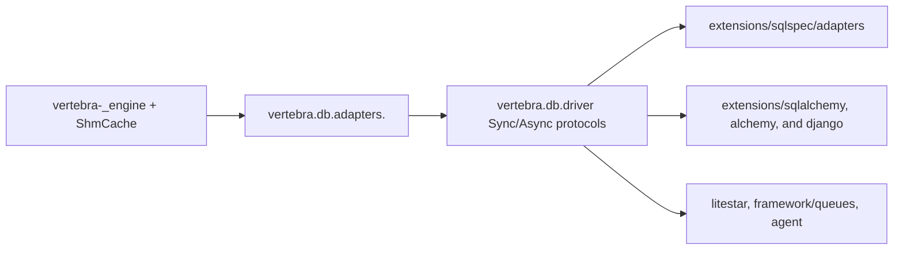

# Master PRD: Vertebra Integration and Quality Remediation

<!-- truth: start -->
- **Architectural Layering**: `vertebra.db` owns drivers, configs, neutral `dbapi/`, and engine-local primitives (`vertebra/db/adapters/<engine>/`) with zero upward imports into `agent`, `framework`, `extensions`, `server`, or `embeddings` [^db-registry].
- **Merged Foundation on `main @ 473e1f2e`**: Squash commits `364c7cbe` (`critical-correctness-fixes`), `984ce732` (`gcp-wire-protocol-correctness`), `abd33ab6` (`gcp-driver-resilience`), `80ff8a65` (`db-engine-primitives`), `d2fa5072` (`runtime-structure-and-throughput`), `077a3fe9` (`mcp-webmcp-core`), `18baadcd` ([PR #118](https://github.com/cofin/vertebra/pull/118)), `05d88d00` (`server-runtime-correctness`), `93d7fb1f` (`gcp-embeddings-and-identity`), `54a5103d` (`mcp-protocol-completeness`), `ff9f78cb` (`http3-and-http-hygiene`), and sibling-PRD commits `7116ba13` (`native-postgres-driver`), `c526639f` (`native-adapter-organization`), and `246d7d0e` (`broker-pool-sharing`) are live [^fastpath-core].
- **Dual-Mode `Sync*` / `Async*` Contracts & Native Caching**: Every runtime, driver, store, cache, notification, and queue capability splits into leading `Sync<Noun>` and `Async<Noun>` contracts (`SyncCacheBackend` / `AsyncCacheBackend` over Rust `ShmCache` + SHM ring-buffer L1 invalidation, `vertebra._valkey`, `vertebra._redis`, `vertebra._storage` `VTBSTORE\x01`, and `memory://` in `sqlalchemy-and-django-integration`; `SyncNotificationSource` / `AsyncNotificationSource` in `native-redis-driver` and `native-valkey-driver`; `SyncQueueStore` / `AsyncQueueStore` in `queues-tasks-and-channels` and `spanner-queue-and-rw-transactions`) with zero aliases [^aa-cache] [^django-cache].
- **Complete Planned Portfolio**: Archived `sqlalchemy-and-django-integration` (`1f0716d1`), `sqlspec-adapter-parity` (`4fad78c5`), `queues-tasks-and-channels` (`1094ca5b`, `litestar-queues>=0.14.0`), and `spanner-queue-and-rw-transactions` (`d8fb3c96`) alongside final child flow `strict-typing-hygiene` ([#59](https://github.com/cofin/vertebra/issues/59)) execute behind archived `native-sqlite-driver` (`49fb8150`), `native-redis-driver` (`58e8db93`), and `native-valkey-driver` (`60ccf36f`) [^sqlspec-adapters] [^queue-spanner] [^http3-rs].
<!-- truth: end -->

## 1. Specification, Context & Provenance

### 1.1 Baseline & Problem Statement
Baseline is `main @ 473e1f2e`, building on merged squash commits `364c7cbe` (`critical-correctness-fixes`), `984ce732` (`gcp-wire-protocol-correctness`), `abd33ab6` (`gcp-driver-resilience`), `f7417015` (`Sync*`/`Async*` split), `21c99f95` (`db-layout-and-contract`), `80ff8a65` (`db-engine-primitives`), `2b737240` (post-merge remediation), `d2fa5072` (`runtime-structure-and-throughput`), `077a3fe9` (`mcp-webmcp-core`), `067fa901` (`storage-completeness` + `storage-remediation`), `af1b3d30` (`driver-fail-loud`), `1b8449fe` (packaging), `14aa83b8` (`vertebra-duckdb`), `e86d8daf` (`vertebra-mysql`), `134546d4` (`vertebra-mssql`), `47da6820` (`vertebra-oracle`), `c8722c76` (`vertebra-postgres`), `05d88d00` (`server-runtime-correctness`), `14b70b07` (`storage-integrity-and-streaming`), `93d7fb1f` (`gcp-embeddings-and-identity`), `54a5103d` (`mcp-protocol-completeness`), `7116ba13` (`native-postgres-driver`), `1b191388` (`driver-conformance-ci`), `c526639f` (`native-adapter-organization`), `ff9f78cb` (`http3-and-http-hygiene`), and `246d7d0e` (`broker-pool-sharing`). Primary-source audit findings live in [research/audit-findings_20261103.md](research/audit-findings_20261103.md) and [research/google-cloud-rust_20261103.md](research/google-cloud-rust_20261103.md).

Vertebra's value is its Rust runtime and standalone per-engine native wheels (`native-data-platform`, archived), consumed through SQLAlchemy / Advanced Alchemy, SQLSpec, Litestar, Django, native queues/channels, and MCP/A2A. Remaining integration gaps are:
- **SQLSpec, SQLAlchemy/Django, Native Caching & Queues**: `extensions/sqlspec/adapters.py` bypasses SQLSpec's dispatch contract, sets `%s` instead of `?` on MySQL, exposes `"googlesql"` (not a `sqlglot` dialect) as the Spanner driver/config `dialect` attribute, and lacks `DataDictionary` classes for 6 engines (12 classes) plus upstream-base ADK/events/Litestar stores [^sqlspec-adapters]. `SyncDBAPIConnection` still carries `_sqlite_conn`, default `sqlite+vtb:///:memory:`, and a hardcoded autocommit-only dialect name set pending `sqlalchemy-and-django-integration` [^sa-dbapi]. `extensions/alchemy/cache.py` (already wiring `region_factory` + `AsyncCacheManager` over Valkey/Redis, with `shm://` as a process-local `OrderedDict`) and the base-less in-memory `extensions/django/cache.py::CacheBackend` lack native `SyncCacheBackend` / `AsyncCacheBackend` (`shm://` POSIX `ShmCache` + SHM ring-buffer L1 invalidation, `valkey://` `vertebra._valkey`, `redis://` `vertebra._redis`, `s3://`/`gs://`/`az://`/`r2://`/`oci://`/`file://` `vertebra._storage` `VTBSTORE\x01`, and `memory://`), zero-dependency `CacheConfig(region_factory=...)` + `AsyncCacheManager` for Advanced Alchemy `1.12.0+`, optional `dogpile.cache` backend plugins, and true async Django `BaseCache` methods [^aa-cache] [^django-cache]. Queue backends lack built-in `SyncQueueStore` / `AsyncQueueStore` implementations (`PostgreSQLQueueBackend`, `OracleQueueBackend`, `SpannerQueueBackend` whose `CLAIM_SPANNER_JOBS_SQL` call passes 6 args to 3 parameters without interactive `ReadWrite` transactions, and `RedisQueueBackend` / `ValkeyQueueBackend`, both in `queues/redis.py`, still lazily loading `redis.asyncio`) [^queue-redis] [^queue-oracle] [^queue-spanner].
- **Strict Typing Hygiene ([#59](https://github.com/cofin/vertebra/issues/59))**: `pyproject.toml` carries `40` redundant `ignore_missing_imports` patterns (of `52`) masking `from litestar_queues.records import QueuedTaskRecord`, and `src/py/tests` is excluded from `mypy` (`tools/benchmarks` is already covered).

### 1.2 Non-Goals & Deferred Backlog
- AWS RDS / Aurora DSQL IAM auth ([#67](https://github.com/cofin/vertebra/issues/67)), Azure Entra ID database/cache auth ([#68](https://github.com/cofin/vertebra/issues/68)), dedicated `SyncRedisQueueStore` / `AsyncRedisQueueStore` (`redis-queue-store` over Streams after `native-redis-driver` + `queues-tasks-and-channels`), and optional [#116](https://github.com/cofin/vertebra/issues/116) remain deferred in the backlog until scheduled.

## 2. Requirements, Concrete Contracts & Architecture

- **`R1` Strict Downward Layering**: `vertebra.db` holds drivers, configs, `db/dbapi/`, and engine-local primitives (`pipeline.py`, `notify.py`, `change_stream.py`, `queue.py`, `embeddings.py`, `tools.py` implementing `vertebra.typing.ToolProvider`) and never imports from `agent`, `framework`, `extensions`, `server`, or `embeddings` [^db-registry].
- **`R2` Leading `Sync*` / `Async*` Capability Split & Native Caching (Zero Aliases)**:
  - `SyncPipelineCapable` / `AsyncPipelineCapable`, `SyncChangeSource` / `AsyncChangeSource`, `SyncNotificationSource` / `AsyncNotificationSource` (hoisted into archived `native-redis-driver` `58e8db93` and `native-valkey-driver` `60ccf36f`), `SyncCacheBackend` / `AsyncCacheBackend` (archived in `sqlalchemy-and-django-integration` `1f0716d1`), and `SyncQueueStore` / `AsyncQueueStore` (archived in `queues-tasks-and-channels` `1094ca5b`) provide dedicated synchronous and asynchronous contracts with plain method names and zero `*_async` suffixes or aliases.
  - `SyncCacheBackend` (implementing Advanced Alchemy `SyncCacheRegionProtocol` directly) and `AsyncCacheBackend` support `shm://<segment>` (`vertebra._vertebra.ShmCache` + `ShmLeaseTable` ring-buffer L1 invalidation), `memory://`, `valkey://` (`vertebra._valkey`), `redis://` (`vertebra._redis`), and `s3://`/`gs://`/`az://`/`r2://`/`oci://`/`file://` (`vertebra._storage` `VTBSTORE\x01`), powering Advanced Alchemy `1.12.0+` `CacheConfig(region_factory=...)` + `AsyncCacheManager` (with optional `dogpile.cache` backend plugins `vertebra.shm`, `vertebra.memory`, `vertebra.valkey`, `vertebra.redis`, `vertebra.storage`), SQLAlchemy `CompiledCache`/`ResultCache`, and Django `6.0+` `CacheBackend(BaseCache)` (`aget`/`aset`/`aadd`/`adelete`/`aget_many`/`aset_many`/`adelete_many`/`aincr`/`adecr`/`atouch`/`ahas_key`/`aclear`/`aclose`) [^aa-cache] [^django-cache].
- **`R3` Direct Upstream SQLSpec & Litestar-Queues Hook Wiring (Zero MyPyC Monkeypatching)**: `sqlspec>=0.71.1` (MyPyC-compiled) and `litestar-queues>=0.14.0` natively support `adapter_name` and explicit `adk_session_store_class`, `adk_memory_store_class`, `events_store_class`, `litestar_store_class`, and `queue_store_class` class attributes. `_compat.py` monkeypatching and cross-adapter shared SQL helper modules are forbidden; each adapter owns its SQL helpers locally and offloads ADK artifacts through `vertebra.storage.ArtifactReference` (`adk = ["google-adk>=1.0.0"]` lazy extra).
- **`R4` Native Queues, Spanner `ReadWrite` Transactions & Channels**: `SyncPostgresQueueStore` / `AsyncPostgresQueueStore`, `SyncOracleQueueStore` / `AsyncOracleQueueStore`, and `SyncSpannerQueueStore` / `AsyncSpannerQueueStore` (backed by multi-statement interactive `ReadWrite` transactions in `vertebra-spanner` tracking `seqno` and `precommit_token`) power first-party `QueueService`, `litestar-queues`, and Django 6.0 `TaskBackend` (`enqueue` via `SyncQueueStore`, `aenqueue` via `AsyncQueueStore`) with DI injection.
- **`R5` Progressive Runtime Streaming, Wheel Binary, HTTP/3 & Strict Typing**: Mounted ASGI/RSGI and native `App` handlers stream via `VRSF` frames, `vtb run` executes a wheel-shipped `vertebra-server` binary, `StandaloneBuilder` stages user `.agents/skills` when present, `vertebra-http` binds its QUIC HTTP/3 endpoint under `--features http3` (and deletes dead `McpStdioBridge`), and `mypy --strict` covers `src/py/vertebra`, `tools/benchmarks`, and `src/py/tests` without blanket `ignore_missing_imports`.

## 3. Documentation & OKF Knowledge Plan

Every child flow synchronizes its affected `docs/` pages (`zensical` build verified via `make docs`) and `.agents/bundles/knowledge/` chapters (`<= 200` lines, `<= 40` truth-block lines, verified via `make review-check`), updating limitations chapters (`server-runtime-limitations.md`, `mcp-limitations.md`, `embeddings-limitations.md`, `database-driver-limitations.md`) in place as gaps close.

## 4. Requirement-to-Task Traceability Matrix

| Requirement | Owning Child Flow(s) | Primary Surface | Verification Gate |
| --- | --- | --- | --- |
| `R1` Downward `vertebra.db` layering & `dbapi/` | `db-engine-primitives` (`80ff8a65`), `sqlalchemy-and-django-integration` (`1f0716d1`) | `src/py/vertebra/db/**`, `extensions/sqlalchemy/**`, `extensions/django/**` | AST import & engine-purity gates + `pytest` |
| `R2` `Sync*`/`Async*` capabilities, native caching & dialects | `sqlalchemy-and-django-integration` (`1f0716d1`), `queues-tasks-and-channels` (`1094ca5b`) | `db/driver/capabilities.py`, `extensions/alchemy/cache.py`, `extensions/django/cache.py` | `make lint-all` + cache/dialect/Django unit suites |
| `R3` SQLSpec `0.71.1+` parity & stores | `sqlspec-adapter-parity` (`4fad78c5`) | `src/py/vertebra/extensions/sqlspec/**` | SQLSpec driver, `DataDictionary`, ADK, events, Litestar tests |
| `R4` Queues, Django tasks, Spanner RW tx & channels | `queues-tasks-and-channels` (`1094ca5b`), `spanner-queue-and-rw-transactions` (`d8fb3c96`) | `src/rs/vertebra-spanner/**`, `db/adapters/*/queue.py`, `framework/queues/**` | `cargo test -p vertebra-spanner` + queue/task/channel suites |
| `R5` Runtime streaming, MCP, embeddings, HTTP/3 & typing | `server-runtime-correctness` (`05d88d00`), `gcp-embeddings-and-identity` (`93d7fb1f`), `mcp-protocol-completeness` (`54a5103d`), `http3-and-http-hygiene` (`ff9f78cb`), [`strict-typing-hygiene`](../strict-typing-hygiene/spec.md) | `src/rs/vertebra-http/**`, `src/py/vertebra/{server,agent,embeddings,build}/**`, `pyproject.toml` | `make rs-test`, `make py-test`, `make lint-all` |

## 5. Implementation Plan

- [x] [364c7cb] t01 — `critical-correctness-fixes` — Confirmation-gate binding, opt-in WebMCP, prefix-scoped `SCAN`+`UNLINK`, fail-loud embeddings, ASGI batch timeout
- [x] [984ce73] t02 — `gcp-wire-protocol-correctness` — Official Google Cloud Rust clients for Spanner and BigQuery Storage
- [x] [abd33ab] t03 — `gcp-driver-resilience` — Panic-safe/cancellable `spawn_rust_db_task`, typed `GoogleCloudError` hierarchy, resilient Google Cloud auth
- [x] [80ff8a6] t04 — `db-engine-primitives` — Adapter-local primitives, neutral `ToolProvider`s, native pipeline dispatch, and reset-or-evict tenant scopes
- [x] [d2fa507] t05 — `runtime-structure-and-throughput` — Shared `FastPathProvider`, Google Cloud crate splits, zero-copy Arrow append, HTTP/2 Vertex transport
- [x] [077a3fe] t06 — `mcp-webmcp-core` — Unified `ToolSpec`/`ToolRegistry`, `MCPCore` `2026-07-28`, ASGI/WSGI/native adapters, and WebMCP bridge
- [x] [05d88d0] t07 — `server-runtime-correctness` — Progressive Python/ASGI/RSGI/native streaming ([#81](https://github.com/cofin/vertebra/issues/81)), fail-loud lifespan ([#84](https://github.com/cofin/vertebra/issues/84)), supervisor/worker lanes ([#83](https://github.com/cofin/vertebra/issues/83), [#85](https://github.com/cofin/vertebra/issues/85)), relocatable wheel `vertebra-server` ([#82](https://github.com/cofin/vertebra/issues/82)), opt-in standalone `.agents/skills` staging ([#115](https://github.com/cofin/vertebra/issues/115)), and FastPath/native cleanup
- [x] [93d7fb1] t08 — `gcp-embeddings-and-identity` — Audience-bound `SyncGcpIdTokenCache`/`AsyncGcpIdTokenCache` ([#113](https://github.com/cofin/vertebra/issues/113)), Vertex/Gemini wire parity, SQL pushdown parity, and per-loop `EmbeddingBroker`/`GemmaEmbedder` fixes (`ch01`–`ch04`, `15/15` tasks)
- [x] [54a5103] t09 — `mcp-protocol-completeness` — Single-pass guards, `Mcp-Param-*` validation, dual-mode version negotiation + sessions + `GET` SSE, resource subscriptions ([#112](https://github.com/cofin/vertebra/issues/112)), `SKILLS_EXTENSION` + SEP-1865 UI, Litestar `0.20+` parity, `IapIdentitySource`, `OidcTokenSource`, and incremental `vtb ai mcp serve|bridge` ([#109](https://github.com/cofin/vertebra/issues/109), [#110](https://github.com/cofin/vertebra/issues/110), [#111](https://github.com/cofin/vertebra/issues/111), [#114](https://github.com/cofin/vertebra/issues/114)) (`ch01`–`ch07`, `25/25` tasks)
- [x] [ff9f78c] t10 — `http3-and-http-hygiene` — QUIC `http3.rs` server listener wiring, `Alt-Svc` gating, SSE/QUIC graceful drain, `McpStdioBridge` removal, and `--features http3` Make/CI/binary gates (`t01`–`t03`)
- [x] [1f0716d] t11 — `sqlalchemy-and-django-integration` — `Sync<Engine>Dialect`/`Async<Engine>Dialect` over `vertebra.db.dbapi`, native `SyncCacheBackend`/`AsyncCacheBackend` (`shm://` Rust `ShmCache` + SHM ring-buffer L1 invalidation, `valkey://`, `redis://`, `s3://`/`gs://`/`az://`/`r2://`/`oci://`/`file://`, `memory://`) with Advanced Alchemy `1.12.0+` `CacheConfig(region_factory=...)` + `AsyncCacheManager` and optional `dogpile.cache` plugins, and native Django `6.0+` database and `CacheBackend(BaseCache)` backends (`ch01`–`ch03`, `12/12` tasks)
- [x] [4fad78c] t12 — `sqlspec-adapter-parity` — `sqlspec>=0.71.1` per-engine adapters, `DataDictionary` classes, and Litestar/events/Google ADK stores with zero `_compat.py` monkeypatching (`ch01`–`ch04`, `15/15` tasks)
- [x] [1094ca5] t13 — `queues-tasks-and-channels` — `SyncQueueStore`/`AsyncQueueStore` (`SyncPostgresQueueStore`, `SyncOracleQueueStore`, async pairs), native Redis/Valkey queues, `litestar-queues>=0.14.0`, Django `TaskBackend`, and distributed channels (`ch01`–`ch03`, `12/12` tasks)
- [x] [d8fb3c9] t14 — `spanner-queue-and-rw-transactions` — Interactive multi-statement Spanner `ReadWrite` transactions and `SyncSpannerQueueStore`/`AsyncSpannerQueueStore` across GoogleSQL and Spangres (`t01`–`t04`, `4/4` tasks)
- [ ] t15 — [`strict-typing-hygiene`](../strict-typing-hygiene/spec.md) — Prune `40` redundant `ignore_missing_imports` patterns, add the `tools/benchmarks` `ServerRunner` regression test, and enable `mypy` across `src/py/tests` ([#59](https://github.com/cofin/vertebra/issues/59), `t01`–`t04`)

## 6. Current State & Remaining Plan Snapshot

- **Immediate Wave**: `server-runtime-correctness` (`05d88d00`), `gcp-embeddings-and-identity` (`93d7fb1f`), `mcp-protocol-completeness` (`54a5103d`), and `http3-and-http-hygiene` (`ff9f78cb`) are archived (`10/15` child flows complete).
- **Post-Driver/Broker Wave**: With sibling Master PRD `native-data-platform` (`15/15` child flows complete and archived through `native-valkey-driver` `60ccf36f`), `sqlalchemy-and-django-integration` (`1f0716d1`), `sqlspec-adapter-parity` (`4fad78c5`), `queues-tasks-and-channels` (`1094ca5b`), and `spanner-queue-and-rw-transactions` (`d8fb3c96`) archived (`14/15` child flows complete), final child flow `strict-typing-hygiene` is ready for execution.

[^db-registry]: `src/py/vertebra/db/registry.py::DatabaseRegistry` — Table-driven database driver and dialer registry.
[^fastpath-core]: `src/py/vertebra/server/_fastpath_core.py` — Shared `FastPathProvider` core across ASGI, WSGI, and native frameworks.
[^sqlspec-adapters]: `src/py/vertebra/extensions/sqlspec/adapters/__init__.py` — SQLSpec adapter configuration and driver bindings.
[^sa-dbapi]: `src/py/vertebra/db/dbapi/_sync.py::SyncDBAPIConnection` — Standalone PEP 249 DB-API connection extracted by broker-pool-sharing pending hardening.
[^aa-cache]: `src/py/vertebra/extensions/alchemy/cache.py` — Advanced Alchemy and SQLAlchemy caching module.
[^django-cache]: `src/py/vertebra/extensions/django/cache.py::CacheBackend` — Django BaseCache backend targeted for SyncCacheBackend and AsyncCacheBackend.
[^queue-redis]: `src/py/vertebra/framework/queues/redis.py::RedisQueueBackend` — Redis and Valkey queue backends targeted for native wheel cutover.
[^queue-oracle]: `src/py/vertebra/framework/queues/oracle.py::OracleQueueBackend` — Oracle queue backend targeted for `SyncOracleQueueStore` and `AsyncOracleQueueStore`.
[^queue-spanner]: `src/py/vertebra/framework/queues/spanner.py::SpannerQueueBackend` — Spanner queue backend requiring interactive `ReadWrite` transactions.
[^http3-rs]: `src/rs/vertebra-http/src/http3.rs` — QUIC HTTP/3 endpoint bound by the server listener under `--features http3`.
