# Removal audit, benchmark comparison check, test tree repair, and knowledge records

<!-- truth: start -->
- The names in the must-be-gone list below have no match in `src/`, `tools/`, `docs/` (outside `docs/changelog/`), or `.agents/bundles/knowledge/`.[^purity-tests]
- A name in the delete-when-unused list is deleted when its only references are its definition, export lines, stub entry, tests, and docs. Otherwise it stays and its caller is recorded.[^driver-common]
- No stubtest allow-list file or `--allowlist` argument exists in the repository after the audit.
- `python -m tools.benchmarks.adapters.sql check --report <path>` exits non-zero when a Vertebra case has a higher median than its comparator and is not on the allow-list.[^bench-sql][^bench-base]
- The allow-list is keyed by Vertebra driver label, and every entry carries a one-line reason. It holds the BigQuery emulator, the Spanner emulator, SQL Server, the two DuckDB drivers, and the two Oracle drivers.
- The DuckDB and Oracle entries are there by user decision: the bundled DuckDB build has no jemalloc, and upstream `oracle/rust-oracledb#101` clears the Oracle statement cache when `AUTH_MAX_OPEN_CURSORS` is absent. No task adds an allow-list entry on its own.
- A Vertebra case that no comparator driver runs is listed in `COMPARATORLESS_CASES` with a reason. `check` prints it as `[SKIP]` and does not fail. An unlisted case with no comparator still fails.
- `check` defaults to `--max-median-ratio 1.0`.
- `capture --engine oracle --oracle-reset-relay off` measures Oracle with `enable_reset_relay=False`.
- The SQLite report holds a like-for-like case, `cursor_point_select_1`: one reused native cursor against one reused `sqlite3` cursor.
- An xdist worker process removes only the shared-memory names the `shm_name` fixture handed out in that test. The controller process runs the broad sweep. Only xdist workers are scoped, and the limit is recorded.[^test-conftest]
- Every test double that stands in for a native client, pool, or driver has the cursor surface the driver calls. No production code changes to make a double pass.[^olap-tests]
- Tests assert the current lease contract: none for embedded engines, one per checkout for network engines, and no shared-memory statement cache entry.
- DuckDB secret tests assert the three refresh points: connection open, a credential rejection, and `refresh_secrets`. A query does not rotate secrets.[^duckdb-error-path]
- `mypy` reports no error in `src/py/tests`.
- The driver limitations chapter holds measured results in place of the gap table, and each leftover gap names its cause.[^knowledge-driver-limitations]
- ADR-006 records the cursor-in-Rust choice, the per-connection lease scope with its idle cost, and the single exception hierarchy with its deviation from PEP 249.[^decisions-index]
- ADR-006 also states that the cursor and the single-call methods share one statement runner.
- User docs describe the cursor and the Oracle relay switch and name no removed symbol.[^user-db-docs]
<!-- truth: end -->

## 1. Specification, Context & Provenance

This chapter is plan step 5 of the root spec. It checks that the earlier chapters deleted what they replaced, keeps the benchmark comparison check usable, repairs the test tree those chapters left behind, and writes the records the root spec assigns here.

The chapter covers root requirements R9, R11, R12, R14, R22, the record for R15, the final run for R13, and the last pass of R8.

Facts read from the working tree on a release build, with tests run in one process:

- 25 unit tests fail in six files. 21 of them hold a double without `cursor()`, or assert per-statement leases, shared-memory statement cache entries, or `last_rewritten_sql`. Four DuckDB secret tests assert rotation as a side effect of a query.[^olap-tests]
- No failure comes from a production defect. The Spanner driver calls `cursor()` on its client, and `AsyncSpannerClientProtocol` declares that method. The DuckDB error handler invalidates a rejected credential and refreshes it before the error propagates.[^duckdb-error-path]
- `mypy` reports 49 errors in nine test files and none in production code.
- `check` prints `[MISSING]` for the `vertebra-async` case `pipeline_select_16` in the PostgreSQL report and exits `1`, because no comparator driver runs that case.[^bench-sql]
- `ruff` reports no finding in `tools/benchmarks` or `src/py/tests/unit/tools`.
- The cursor path costs and the cause of each acceptance gap before `single-call-paths` are in the hot-path research brief.[^hot-path-research]

Scope boundary: this chapter does not add cursor behavior. It does not edit the root spec or sibling chapters. Redis, Valkey, DataFusion, and the SQLSpec proxy and provider paths stay out of scope unless a must-be-gone name appears in them.

## 2. Requirements, Concrete Contracts & Architecture

### Audit lists (R8, R9)

Must be gone. `git grep -nw <name>` over the listed scope prints nothing.

| Name | Scope |
| --- | --- |
| `is_row_returning_sql`, `is_insert_sql`, `_scan_unquoted_sql_tokens`, `_match_dollar_quote_tag`, `_has_tsql_output_clause` | `src tools docs .agents/bundles/knowledge` |
| `coerce_dbapi_rows_and_desc`, `_coerce_column_description`, `_extract_out_bind_vars`, `_populate_out_bind_vars`, `_DBAPIOutBindVar` | same |
| `_ErrorTranslator`, `_translate_errors`, `_TRANSLATE_ERRORS`, `_translate_native_error`, `_translate_vertebra_error` | same |
| `_unwrap_typed_parameters`, `unwrap_typed_parameters`, `_normalize_bound_params`, `_compile_for_native`, `_fetch_rows_with_columns` | same |
| `NATIVE_CURSOR_ENGINES` | same |
| `is_read_only_sql` | `src/py tools docs .agents/bundles/knowledge` (the Rust function of the same name in `vertebra-duckdb` is wire-level and stays) |

Every scope excludes `docs/changelog/` and `.agents/bundles/specs/`.

`_DeferredSyncExceptionHandler` and `_DeferredAsyncExceptionHandler` are not on this list. The SQLSpec bases keep one instance of each per driver. t04 checks that `handle_database_exceptions` builds none per call.

Delete when unused. The rule is the same for each name: run `git grep -nw <name> -- src tools`. When every match is the definition, an `__all__` or re-export line, a `.pyi` entry, a test, or a doc, delete the definition and all of those matches. When a production call site remains, keep the name and record the call site in the task notes.

| Group | Names | Owner |
| --- | --- | --- |
| Lease and statement cache | `_BrokerLeasePlan`, `_lease_plan`, `_lookup_or_cache_statement`, `_acquire_broker_lease`, `_release_broker_lease` in `db/driver/_common.py` | t04 |
| Driver protocol members | `execute_with_description`, `execute_tuples`, `select` on `SyncSQLDriverProtocol` and `AsyncSQLDriverProtocol`; the two protocol classes; `query_with_columns` on the driver bases; any member of `db/driver/capabilities.py` that names one of these method shapes | t04 |
| DB-API cursor classes | `SyncDBAPICursor`, `AsyncDBAPICursor` | t04 |
| Per-engine Python helpers | `normalize_parameters`, `param_len`, `project_query_rows`, `compile_for_driver`, `_prepare_sql`, `split_out_bind_parameters`, `coerce_parameters`, `track_session_context_sql`, `is_dml_or_plsql`, `coerce_result_rows_and_cols` | t04 |
| Python export of a Rust function | `classify_sql_statement` in `vertebra._vertebra` | t05 |
| Native client methods | the per-engine candidates listed in t05 | t05 |

Lease call sites that remain must sit inside a connection checkout, release, open, or close function. A call inside `select`, `select_one`, `execute`, `execute_many`, or `execute_with_description` is a defect, and t04 removes it.

No compatibility alias, re-export, or fallback branch is added to make a check pass.

### Benchmark comparison check (R12, R15)

All names live in `tools/benchmarks/adapters/sql.py`.[^bench-sql]

- `COMPARATOR_PAIRS: Final[dict[str, tuple[str, ...]]]` maps a Vertebra driver label to its comparator labels.
- `COMPARATOR_ALLOW_LIST: Final[dict[str, str]]` maps a Vertebra driver label to a one-line reason.
- `COMPARATORLESS_CASES: Final[dict[tuple[str, str], str]]` maps `(driver, case)` to a one-line reason. Its first entry is `("vertebra-async", "pipeline_select_16")`.
- `ComparatorCheckOutcome` is a frozen `msgspec.Struct`. Its `status` is one of `pass`, `fail`, `allowed`, `missing`, `skipped`.
- `check_report_against_comparators(report, *, max_median_ratio=1.0)` returns one outcome per Vertebra case and comparator.
- The `check` subcommand reads one or more reports and exits `1` on any `fail`, or on any `missing` without `--allow-missing`. A `skipped` outcome never changes the exit code.

A case passes when `vertebra.median_ms / comparator.median_ms <= max_median_ratio`. The default limit is `1.0`.

| Report state for a Vertebra case | Outcome | Output tag |
| --- | --- | --- |
| Comparator present, ratio at or below the limit | `pass` | `[PASS]` |
| Comparator present, ratio above the limit, driver on the allow-list | `allowed` | `[ALLOW]` |
| Comparator present, ratio above the limit, driver not on the allow-list | `fail` | `[FAIL]` |
| No comparator case, `(driver, case)` listed in `COMPARATORLESS_CASES` | `skipped` | `[SKIP]` |
| No comparator case, not listed | `missing` | `[MISSING]` |

The allow-list holds `vertebra-bigquery-sync`, `vertebra-spanner-sync`, `vertebra-mssql-sync`, `vertebra-duckdb-sync`, and `vertebra-sqlspec-duckdb-sync`. The first three are there because the engine round trip is the floor. The two DuckDB entries are there by user decision, because `vertebra-duckdb` keeps the `bundled` build without jemalloc. Both DuckDB rows are still measured and recorded, and they print `[ALLOW]` or `[PASS]`. No task edits the allow-list. A new entry needs the user's approval and a refine of this chapter.

The SQLite report gains the case `cursor_point_select_1`. `vertebra-sqlite-sync` runs `execute` plus `fetchone` on one native cursor from `driver.cursor()`, reused across iterations. `sqlite3` runs the same two calls on one reused `sqlite3` cursor. The existing pair `vertebra-sqlite-sync` to `sqlite3` covers it. Signatures and tests for all of this are in t20.

### Oracle relay capture option (R13)

`capture_oracle_report` takes `enable_reset_relay: bool = True`. The CLI takes `--oracle-reset-relay {on,off}` with default `on`. Driver labels do not change, so one relay-off report feeds the check directly. Details are in t03.

### Test cleanup fix (R11)

All names live in `src/py/tests/conftest.py`.[^test-conftest]

| Process | After each test | At session end |
| --- | --- | --- |
| xdist worker (`PYTEST_XDIST_WORKER` set) | Unlink `/dev/shm/<name>*` for each name `shm_name` handed out in that test | Nothing |
| Controller of an xdist run | No tests run here | Broad sweep of `test-*`, `vtb-*`, `*vertebra*` |
| Single-process run | Broad sweep | Broad sweep |

Only xdist workers are scoped. Two separate `pytest` commands running at once are two controllers and can still collide. t11 records that limit.

### Test tree repair (R22)

Each failing test gets one of three treatments. No task adds a production fallback, a `getattr` probe, or an alias so that a double passes.

- Double updated: the double gains the cursor surface the driver calls. The surface is the root cursor contract: `execute`, `executemany`, `fetchone`, `fetchmany`, `fetchall`, `close`, and the attributes `description`, `rowcount`, `lastrowid`, `arraysize`. The factory takes the keywords the engine's client protocol declares.
- Assertion rewritten: the test asserts the current contract.
- Deleted: the behavior the test pinned is gone, and a named test covers what replaced it.

| Test | Treatment | Task |
| --- | --- | --- |
| `test_sqlite_initialization_pragmas_and_broker_coordination` | Assertion rewritten: zero leases acquired and released | t13 |
| `test_mssql_tds_framing_and_placeholder_rewriter` | Assertion rewritten: keeps the rewriter checks, drops the driver part that read `last_rewritten_sql` | t13 |
| `test_sqlalchemy_dbapi_broker_forwarding` (three cases) | Assertion rewritten for SQLite and DuckDB: zero leases. The SQL Server case is deleted | t13 |
| `test_sync_oracle_driver_uses_common_mixin_broker_and_bytes_statement_cache` and its async form | Deleted. Covered by `test_sync_oracle_driver_lease_unpooled_lifecycle_refusal_and_gc` and `test_async_oracle_driver_lease_unpooled_lifecycle_refusal_and_gc` in `test_oracle_adapter.py` | t13 |
| `test_sync_duckdb_driver_uses_real_lease_broker_and_releases_on_error` and its async form | Deleted. Covered by `test_duckdb_sync_driver_queries_take_no_lease_and_cache_no_statement` and `test_duckdb_async_driver_queries_take_no_lease_and_cache_no_statement` in `test_duckdb_driver.py` | t13 |
| `test_sync_mssql_driver_uses_common_mixin_broker_and_bytes_statement_cache` and its async form | Deleted. Covered by `test_sync_mssql_driver_checkout_lease_lifecycle`, `test_async_mssql_driver_checkout_lease_lifecycle`, and the two `native_cursor_query_matrix` tests in `test_mssql_driver.py` | t13 |
| `test_channel_bus_spanner_source_delivers_once_per_output_channel` (six cases) | Double updated: the client double gains `cursor()` with the keywords of `AsyncSpannerClientProtocol.cursor` | t14 |
| `test_mysql_sync_and_async_engine_initialize_and_isolation` | Double updated: both driver doubles gain `cursor(*, lazy_begin=False)` | t14 |
| `test_postgres_sync_embedding_pushdown_binds_with_native_dollar_pool`, `test_postgres_sync_similarity_search_binds_with_native_dollar_pool` | Double updated: the pool double gains `cursor(*, lazy_begin=False)` | t15 |
| `test_postgres_drivers_discard_statement_plan_and_release_real_broker_leases` | Assertion rewritten: no statement cache entry; one lease per checkout stays | t15 |
| `test_duckdb_multi_session_token_generation_secret_rotation`, `test_async_duckdb_driver_token_generation_rotation` | Assertion rewritten: a query leaves the secret alone; `refresh_secrets` rotates it | t16 |
| `test_duckdb_driver_401_and_403_invalidates_gcs_bearer_secret_providers` (two cases) | Assertion rewritten: the rejected call itself leaves a fresh credential applied | t16 |

### DuckDB secret refresh (R22)

The contract is in the `embedded-cursors` chapter spec. The drivers meet it:[^duckdb-error-path]

- At open, the constructor and `connect` run a forced refresh.
- On an error whose text matches `(HTTP 401)` or `(HTTP 403)`, `_on_native_error` invalidates each tracked generation, runs a forced refresh, and lets the original error propagate. A failed refresh is added to the error as a note.
- `refresh_secrets(force=False)` applies a secret when its interval is due, its provider asks for a refresh, or its provider generation differs from the applied one.
- A successful query never calls a provider.

t16 changes tests only. Every native-driver method that runs a statement keeps its call to `_on_native_error`, and the rewritten tests fail when one loses it.

### Typed test doubles (R22)

| Files | Errors | Fix | Task |
| --- | --- | --- | --- |
| `test_enterprise_olap_drivers.py` | 4 `attr-defined` on `last_rewritten_sql` | Gone with the tests t13 deletes or rewrites | t13 |
| `oracle_test_doubles.py` | 1 `exit-return`, 2 `arg-type` | `__exit__` returns `None`; the keyword dict passed to the cursor double is annotated `dict[str, Any]` | t17 |
| `test_oracle_adapter.py` | 10 `attr-defined` | The stub cursor is named by its stub class through `typing.cast` | t17 |
| `test_sqlspec_vtb_stacks.py` | 2 `override` | The overriding methods take `bool \| None`, as the stub they override does | t17 |
| `test_sqlalchemy_vtb_dialects_and_dbapi.py` | 12 `no-redef`, 1 `override` | Cursor doubles declare their attributes once, at class level; the override takes `bool \| None` | t18 |
| `test_dbapi_standalone.py` | 2 `attr-defined`, 1 `misc` | `Var` is read through `vars(module)`; the config subclass is declared frozen | t18 |
| `test_mssql_driver.py` | 1 `override` | The async broker double stops inheriting from the sync one | t18 |
| `test_gcp_adapters_and_sqlalchemy.py` | 11 `arg-type` | The BigQuery client doubles take `labels: Mapping[str, str] \| None`, and their cursor doubles gain every member of the cursor protocol with the protocol's parameter names | t19 |
| `test_sqlspec_bigquery.py` | 2 `arg-type` | The Arrow client doubles gain `cursor()` with the protocol's keywords | t19 |

No production file changes for a type error in a test.

### Records (R13, R14)

- t07 runs the full adapter matrix and the check, enforces the acceptance rows, then rewrites the gap table with measured numbers.
- t08 to t11 update the knowledge chapters the root spec lists, plus two more that name audited symbols.
- t12 adds ADR-006, which also records the deviation from PEP 249: `InterfaceError` is a subclass of `DatabaseError`, and `Error` is `DatabaseError`.
- t21 records the four single-call methods and their callers, the completed awaitable, and the exact-type bind check.
- t22 records the SQLSpec cache-hit executor and the statement runner shared by the cursor and the single-call methods.
- t06 updates user docs and the changelog.

### Removal audit after the single-call work (R8, R9)

`single-call-paths` moves four native drivers off the cursor, registers the SQLSpec cache-hit executor, and binds the DB-API cursor factory. t23 runs the R9 checks again over what that supersedes, with the decision rule of t04 and t05.

| Group | Rule |
| --- | --- |
| Driver helpers and Rust helpers the single-call worksheets delete | Must be gone |
| Native client and pool methods that lose their last production caller | Delete when unused |
| SQLSpec hook methods and the adapter overrides of them | Keep while upstream calls the hook by name on a path the executor does not serve; record the caller |
| The DB-API connection's cursor method and its old factory attribute | Must be gone |

### Task order

```mermaid
flowchart TD
    T01["t01 shm cleanup scope"] --> T11["t11 testing knowledge"]
    T02["t02 comparison check"] --> T03["t03 oracle relay capture"]
    T03 --> T07["t07 acceptance run and results table"]
    T07 --> T11
    T04["t04 python removal audit"] --> T06["t06 user docs"]
    T05["t05 native removal audit"] --> T06
    T04 --> T07
    T05 --> T07
    T04 --> T08["t08 data knowledge"]
    T04 --> T09["t09 lease and driver knowledge"]
    T04 --> T10["t10 extension knowledge"]
    T04 --> T12["t12 ADR-006"]
    T05 --> T08
    T13["t13 enterprise driver tests"] --> T07
    T14["t14 Spanner and MySQL doubles"] --> T07
    T15["t15 PostgreSQL double and assertions"] --> T07
    T16["t16 DuckDB secret assertions"] --> T07
    T17["t17 typed Oracle doubles"] --> T07
    T18["t18 typed SQLAlchemy, DB-API, SQL Server doubles"] --> T07
    T19["t19 typed BigQuery doubles"] --> T07
    T20["t20 comparator-less cases and SQLite cursor case"] --> T07
    T20 --> T11
    S["single:t27 closes single-call-paths"] --> T21["t21 data and pattern knowledge"]
    S --> T22["t22 extension knowledge and ADR-006"]
    S --> T07
    S --> T23["t23 removal audit after the single-call work"]
    T23 --> T07
    WT["wire:t02, completed or deferred"] --> T07

```

t13 to t20 edit separate files and have no dependency on each other or on another chapter. They run first and finish before any `single-call-paths` task starts, so no ready tasks share a file across the two chapters. The `single-call-paths` tasks own adding the single-call methods to any double they route through.

t07, t21, t22, and t23 name `native-cursor-data-path:single:t27` in `depends_on`. That task closes `single-call-paths`. t07 also names `native-cursor-data-path:wire:t02`, the last task of `wire-parity`, and t23. A `wire` task left `deferred` because its trigger did not fire counts as closed.

## 3. Documentation & OKF Knowledge Plan

| File | Task | Change |
| --- | --- | --- |
| `.agents/bundles/knowledge/domains/data/database-driver-limitations.md` | t07 | Measured results table; leftover gaps with causes; the bundled DuckDB build has no jemalloc, and why |
| `.agents/bundles/knowledge/domains/data/sqlite-limitations.md`, `postgres-limitations.md`, `postgres-native-driver.md` | t08 | Lease scope; bind planning location; removed names |
| `.agents/bundles/knowledge/domains/data/broker-and-shm-leases.md`, `database-drivers-and-dialers.md` | t09 | Per-connection lease scope; uniform driver surface on the cursor |
| `.agents/bundles/knowledge/domains/extensions/sqlspec-limitations.md`, `sqlalchemy-limitations.md`, `sqlspec-alchemy-and-dialects.md` | t10 | Cursor as the single seam under both wrappers; removed layers |
| `.agents/bundles/knowledge/testing/benchmarks-and-free-threaded.md`, `polyglot-test-matrix.md` | t11 | Comparison check, allow-list with the DuckDB entries, `COMPARATORLESS_CASES`, the `cursor_point_select_1` case, relay option; scoped shared-memory cleanup and its limitation |
| `.agents/bundles/knowledge/decisions/adr-006-native-cursor-and-connection-scoped-leases.md`, `decisions/index.md`, `knowledge/index.md` | t12 | Decision record, including the PEP 249 deviation, and its two index entries |
| `.agents/bundles/knowledge/domains/data/database-drivers-and-dialers.md`, `.agents/bundles/knowledge/patterns/rust/ffi-and-gil-discipline.md` | t21 | The four single-call methods and which driver methods use them; the completed awaitable and the exact-type bind check as patterns |
| `.agents/bundles/knowledge/domains/extensions/sqlspec-alchemy-and-dialects.md`, `.agents/bundles/knowledge/decisions/adr-006-native-cursor-and-connection-scoped-leases.md` | t22 | The SQLSpec cache-hit executor; the cursor and the single-call methods share one statement runner |
| `docs/usage/databases.md`, `docs/changelog/index.md` | t06 | Cursor description; relay switch; changelog entries |

Every edited knowledge chapter keeps its truth block at 40 lines or fewer, keeps a footnote for each `sources[]` id, and gains a `verified` entry with the task commit. Text names no workstation paths and no internal tool names. Benchmark text names only comparators already present in `tools/benchmarks/adapters/sql.py`.

`.agents/bundles/index.md` and `.agents/bundles/log.md` are updated by spec sync and closeout, not by a task here.

## 4. Requirement-to-Task Traceability Matrix

| Requirement | Task | Verification |
| --- | --- | --- |
| R8 last pass, Python | `native-cursor-data-path:cleanup:t04` | `git grep` per name; removed-name test; `ruff`; reviewed `vulture` scan |
| R8 last pass, native and stubs | `native-cursor-data-path:cleanup:t05` | `git grep`; `mypy.stubtest` for all extensions; `cargo clippy` |
| R9 Removal audit | `native-cursor-data-path:cleanup:t04`, `native-cursor-data-path:cleanup:t05` | The four checks in R9, with results in the task notes |
| R8 last pass after the single-call work | `native-cursor-data-path:cleanup:t23` | `git grep` per must-be-gone name; each candidate deleted or recorded with its call site |
| R9 Removal audit after the single-call work | `native-cursor-data-path:cleanup:t23` | The four checks in R9 run again, with results in the task notes |
| R11 Parallel test cleanup | `native-cursor-data-path:cleanup:t01` | Regression tests; a four-worker run of the shared-memory tests |
| R12 Benchmark comparison check | `native-cursor-data-path:cleanup:t02` | Unit tests for pass, fail, allow-list, and missing comparator |
| R12 Comparator-less cases | `native-cursor-data-path:cleanup:t20` | Unit tests for a listed skip, an unlisted missing comparator, and the CLI exit codes |
| R13 Oracle relay-off row can be measured | `native-cursor-data-path:cleanup:t03` | Unit test that the option reaches `OracleConfig` |
| R13 Like-for-like SQLite cursor case | `native-cursor-data-path:cleanup:t20` | Capture test asserting the case for both drivers |
| R13 Acceptance table, enforced | `native-cursor-data-path:cleanup:t07` | Captures for every engine plus `check`, including PostgreSQL and Oracle with the relay off |
| R14 Driver limitations results | `native-cursor-data-path:cleanup:t07` | `make review-check`; prose lint |
| R14 Data chapters | `native-cursor-data-path:cleanup:t08`, `native-cursor-data-path:cleanup:t09` | `git grep` of audited names; `make review-check` |
| R14 Extension chapters | `native-cursor-data-path:cleanup:t10` | Same |
| R14 Testing chapters | `native-cursor-data-path:cleanup:t11` | Same |
| R14 Decision record | `native-cursor-data-path:cleanup:t12` | `make review-check`; link resolution |
| R14 User docs | `native-cursor-data-path:cleanup:t06` | `make docs`; `git grep` of audited names in `docs/` |
| R14 Single-call methods and Rust patterns | `native-cursor-data-path:cleanup:t21` | Every named symbol resolves with `git grep`; `make review-check` |
| R14 Cache-hit executor and shared statement runner | `native-cursor-data-path:cleanup:t22` | Same |
| R15 DuckDB allocator record | `native-cursor-data-path:cleanup:t07`, `native-cursor-data-path:cleanup:t11` | Both DuckDB rows recorded with status; allow-list entries and reason documented |
| R22 Doubles and assertions on the cursor contract | `native-cursor-data-path:cleanup:t13`, `native-cursor-data-path:cleanup:t14`, `native-cursor-data-path:cleanup:t15` | The six test files pass in one process |
| R22 DuckDB secret refresh tests | `native-cursor-data-path:cleanup:t16` | `test_gcs_token_refresh.py` passes |
| R22 Typed test doubles | `native-cursor-data-path:cleanup:t13`, `native-cursor-data-path:cleanup:t17`, `native-cursor-data-path:cleanup:t18`, `native-cursor-data-path:cleanup:t19` | `mypy` reports no error |

## 5. Implementation Plan

- [x] t01 — Scope the shared-memory test cleanup by process role (tasks/t01-shm-cleanup-scope.md)
- [x] t02 — Benchmark comparison check and allow-list (tasks/t02-benchmark-comparison-check.md)
- [x] t03 — Oracle relay option on benchmark capture (tasks/t03-oracle-relay-capture-option.md)
- [x] t04 — Removal audit for the Python data path (tasks/t04-python-removal-audit.md)
- [x] t05 — Removal audit for native methods and stubs (tasks/t05-native-removal-audit.md)
- [x] t06 — User docs and changelog for the cursor path (tasks/t06-user-docs-and-changelog.md)
- [x] t07 — Final acceptance run and measured results table (tasks/t07-acceptance-run-and-results.md)
- [x] t08 — Data knowledge chapters: SQLite and PostgreSQL (tasks/t08-data-knowledge-sqlite-postgres.md)
- [x] t09 — Data knowledge chapters: leases and driver surface (tasks/t09-data-knowledge-leases-and-drivers.md)
- [x] t10 — Extension knowledge chapters (tasks/t10-extension-knowledge.md)
- [x] t11 — Testing knowledge chapters (tasks/t11-testing-knowledge.md)
- [x] t12 — ADR-006: native cursor and connection-scoped leases (tasks/t12-adr-native-cursor.md)
- [x] t13 — Enterprise driver tests on the cursor contract (tasks/t13-enterprise-driver-tests-cursor-contract.md)
- [x] t14 — Spanner channel and MySQL dialect doubles gain the cursor surface (tasks/t14-spanner-and-mysql-cursor-doubles.md)
- [x] t15 — PostgreSQL pool double and broker assertions on the cursor contract (tasks/t15-postgres-double-and-lease-assertions.md)
- [x] t16 — DuckDB secret refresh assertions (tasks/t16-duckdb-secret-refresh-assertions.md)
- [x] t17 — Typed Oracle test doubles (tasks/t17-typed-oracle-doubles.md)
- [x] t18 — Typed doubles in the SQLAlchemy, DB-API, and SQL Server tests (tasks/t18-typed-sqlalchemy-dbapi-mssql-doubles.md)
- [x] t19 — Typed BigQuery client doubles (tasks/t19-typed-bigquery-doubles.md)
- [x] t20 — Benchmark check: comparator-less cases and the SQLite cursor case (tasks/t20-benchmark-comparatorless-and-cursor-case.md)
- [x] t21 — Data and pattern knowledge for the single-call methods (tasks/t21-single-call-data-and-pattern-knowledge.md)
- [x] t22 — Extension knowledge and ADR-006 for the single-call path (tasks/t22-single-call-extension-knowledge-and-adr.md)
- [x] t23 — Removal audit after the single-call work (tasks/t23-single-call-removal-audit.md)

### Run order

| Step | Tasks | Waits on |
| --- | --- | --- |
| 1 | t01, t02, t04, t05 | Nothing |
| 2 | t03, t06, t08, t09, t10, t12 | Step 1 |
| 3 | t13, t14, t15, t16, t17, t18, t19, t20 | Nothing. They run now and finish before any `single-call-paths` task starts |
| 4 | t21, t22, t23 | `single:t27` |
| 5 | t07 | Step 3; t23; `single:t27`; `wire:t02`, completed or deferred |
| 6 | t11 | t07 and t20 |

Tasks in one step edit separate files. Up to four workers run at once.

### Checks

| When | Commands |
| --- | --- |
| After each task | The commands in that task's `## Verification` |
| After step 3 | `uv run --no-sync --frozen pytest src/py/tests/unit -p no:xdist -q` with no failure; `uv run --no-sync --frozen mypy` with no error; `make lint-all` |
| After the chapter | `make lint-all`; `uv run --no-sync --frozen pytest src/py/tests/unit/tools/test_adapter_benchmarks_sql.py src/py/tests/unit/test_conftest_shm_cleanup.py src/py/tests/unit/db/test_db_capabilities_and_purity_gates.py -p no:xdist -q` |
| Before finish | The root spec's "Before finish" row |

## 6. Current State & Remaining Plan Snapshot

- Done: t01 to t06, t08 to t10, and t12. The shared-memory cleanup is scoped, the `check` subcommand and its allow-list exist, the Oracle relay capture option exists, both removal audits are closed, and the user docs, data chapters, extension chapters, and ADR-006 are written. The changes are uncommitted on `feat/integrated-benchmarks`.
- Ready now: t13 to t20. They repair the 25 failing tests and the 49 `mypy` errors, and they add the `[SKIP]` outcome and the SQLite cursor case to the benchmark tool. They run now and finish before any `single-call-paths` task starts.
- After `single:t27`: t21 and t22, which record what `single-call-paths` builds, and t23, which audits what it superseded.
- After t23, `single:t27`, and `wire:t02`: t07, the one place the comparison check is enforced on the six blocking acceptance rows. A `wire` task left `deferred` counts as closed.
- Then t11.
- The measured state before `single-call-paths` is in the root spec acceptance table and the hot-path research brief.[^hot-path-research]

[^test-conftest]: `src/py/tests/conftest.py::_cleanup_shm`
[^bench-sql]: `tools/benchmarks/adapters/sql.py::main`
[^bench-base]: `tools/benchmarks/adapters/base.py::AdapterBenchmarkReport`
[^purity-tests]: `src/py/tests/unit/db/test_db_capabilities_and_purity_gates.py::test_notification_source_legacy_symbol_cleanly_removed`
[^driver-common]: `src/py/vertebra/db/driver/_common.py::_BrokerLeasePlan`
[^knowledge-driver-limitations]: `.agents/bundles/knowledge/domains/data/database-driver-limitations.md`
[^decisions-index]: `.agents/bundles/knowledge/decisions/index.md`
[^user-db-docs]: `docs/usage/databases.md`
[^olap-tests]: `src/py/tests/unit/db/test_enterprise_olap_drivers.py`
[^duckdb-error-path]: `src/py/vertebra/db/adapters/duckdb/_sync.py::SyncDuckDBDriver._on_native_error`
[^hot-path-research]: `.agents/bundles/research/native-cursor-hot-paths_20261121.md`
