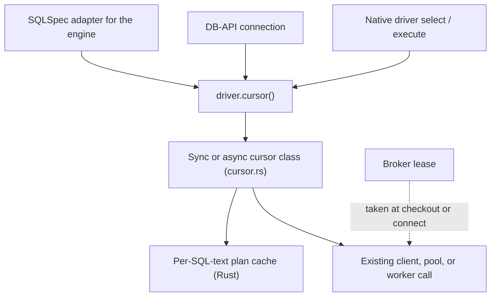

# Native cursor for the six network engines

<!-- truth: start -->
- Each of `vertebra-postgres`, `vertebra-mysql`, `vertebra-mssql`, `vertebra-oracle`, `vertebra-spanner`, and `vertebra-bigquery` ships a sync and an async cursor class with the root spec's PEP 249 shape.[^root-spec]
- Each crate keeps its cursor code in `src/cursor.rs`: one shared `CursorState`, a description builder, a tuple-row builder, and the two classes.
- Cursor methods raise through each crate's existing error conversion, so cursor and non-cursor methods raise the same `vertebra._vertebra` classes. The DB-API names are bindings to those classes.
- PostgreSQL placeholder rewriting and named-parameter ordering live in a Rust bind plan cached per SQL text. `binds.py` calls it and keeps only value normalization.[^pg-binds]
- A PostgreSQL pool creates cursors that run on the one-shot path, so an autocommit statement needs no Python-visible checkout.[^pg-pool]
- Oracle bind coercion, row coercion, statement kind, and out-binds are handled in the worker and the cursor.[^oracle-core]
- `OracleConfig.enable_reset_relay` defaults to `True`. `False` connects without the in-process TNS relay.[^oracle-dialer]
- A broker lease is taken where Python obtains a connection. A Rust guard owned by that connection or client holds it and returns it on drop. No query method takes one. A driver with no broker runs no lease code.[^driver-common]
- Native drivers gain `cursor()`. Their `execute`, `execute_with_description`, `execute_many`, and `select` family call a native cursor.
- Each engine's SQLSpec adapter task adds the engine to `NATIVE_CURSOR_ENGINES`. Those six tasks run one after another because they share `_common.py`.
- The last tasks delete the old DB-API cursor path, the old SQLSpec base hooks, the constant, and `_lookup_or_cache_statement`.[^dbapi-sync][^sqlspec-base]
- The chapter ends with the adapter matrix capture for its six engines. The comparison check on the PostgreSQL and Oracle acceptance rows, and the Oracle relay-off capture flag, belong to `cleanup-and-checks`.
<!-- truth: end -->

## 1. Specification, Context & Provenance

This chapter is plan step 4 of the root spec.[^root-spec] It also deletes the wrapper code that the transition rule keeps alive until the last network engine has a cursor.

The chapter is `empirical_dependent`. Its replan trigger is the three SQLite acceptance rows. The refine that runs when `wrapper-layers` closes checks those rows and confirms the six hand-off assumptions below.

### What the code does today

Counted on the planning commit:

| Engine | Per-statement Python work beyond the native call |
| --- | --- |
| PostgreSQL | `compile_postgres_binds` scans the SQL for placeholders; `project_query_rows` re-tuples rows; with a broker, one statement-cache lookup and one lease per statement. |
| MySQL | `compile_for_driver`, a UTF-8 encode, and `_lookup_or_cache_statement`, at twelve call sites per driver; `_run_with_client` takes a lease per statement. |
| SQL Server | `_prepare_sql` rewrites placeholders in Python and consults the shared-memory statement cache, although the extension rewrites them again; a lease per statement. |
| Oracle | `split_out_bind_parameters`, `coerce_parameters`, `track_session_context_sql`, `is_dml_or_plsql`, `coerce_result_rows_and_cols`, a statement-cache lookup, and a lease, in each of four methods per driver. |
| Spanner | A DDL test on the SQL text, a shared-memory statement-cache lookup inside `_prepare_sql_and_params`, and a dict reply that Python re-tuples. |
| BigQuery | A dict reply that Python re-tuples. |

Two facts shape the plan:

- `RawOracleOptions` is built from full struct literals in four files. The relay switch is therefore a field on `NativeOracleConfig`, set by the constructors after validation, so no literal changes.
- The extensions are built without PyO3's `multiple-pymethods` feature. `client.cursor()` has to be written in the file that holds the client's `#[pymethods]` block.

### Scope boundary

In scope: the six network crates' `src/`, their stubs, `db/adapters/<engine>/`, `extensions/sqlspec/adapters/<engine>/`, `db/driver/_common.py`, the old path in `db/dbapi/` and `extensions/sqlspec/_driver.py`, and the engines' unit test files.

Out of scope: Arrow reads and loads, COPY, pipelines, listeners, replication, queues, mutations, and object-store methods, except where a task removes a per-statement lease or statement-cache call from them; `proxy.py` and `provider.py`; `capabilities.py` and driver protocol members; benchmark code; knowledge chapters and user docs.

### Hand-offs this chapter relies on

These six hand-offs from the first two chapters are confirmed. Three cursor rules refined during `wrapper-layers` also apply to every network cursor:

- `fetchone()` returns `None` and `fetchmany()`/`fetchall()` return `[]` when `description is None` (matching `sqlite3.Cursor` so SQLSpec's direct cache-hit path works on statements without a result set); only a closed cursor raises `InterfaceError`, and negative `fetchmany` size raises `ProgrammingError`.
- Rust parameter extractors unwrap `TypedParameter` (via `.value`) on the slow path after primitive checks fail, so SQLSpec `execute_many` needs no Python unwrap loop.
- Sync cursors implement `__enter__` (returning `self`) and `__exit__` (calling `close()`), so `with_cursor` can return the cursor directly with no Python context-manager wrapper.

| Assumed | Used by |
| --- | --- |
| The DB-API exception names are the `vertebra._vertebra` classes, so an extension raises through its existing error conversion and needs no second error table. | Every cursor core task |
| The SQLite and DuckDB native drivers expose `cursor()` and the wrappers obtain the native cursor through it. | Every driver task |
| `NATIVE_CURSOR_ENGINES` holds the lowercase `dialect` key of each engine's config and is read when a DB-API connection or SQLSpec driver is built. | `t10`, `t14`, `t18`, `t28`, `t32`, `t36` |
| The SQLSpec base lets an adapter override `with_cursor`, and its cache-hit path calls `cursor.execute` then `cursor.fetchall`. | `t28`, `t32`, `t36` |
| Cursor members beyond the root table stay absent on SQLite and DuckDB. `var`, `setinputsizes`, and `setoutputsize` are added to the Oracle cursor only. | `t25` |
| The DB-API connection creates its cursors with `driver.cursor(lazy_begin=True)` when autocommit is off, and it builds a driver with one session for PostgreSQL and Oracle, so that call returns a cursor on that session. | `t07`, `t26`, `t28` |

## 2. Requirements, Concrete Contracts & Architecture

### Cursor module layout

Every crate adds `src/cursor.rs` with the same parts. Names differ only by engine.

| Part | Contract |
| --- | --- |
| `CursorState` | Plain Rust struct. Fields: `rows: Vec<Py<PyTuple>>`, `pos: usize`, `description: Option<Py<PyTuple>>`, `rowcount: i64`, `lastrowid: Option<Py<PyAny>>`, `arraysize: usize`, `executed: bool`, `closed: bool`. `new()` sets `rowcount` to `-1` and `arraysize` to `1`. |
| `CursorState` methods | `store(description, rows, rowcount, lastrowid)`, `fetchone(py)`, `fetchmany(py, size: Option<usize>)`, `fetchall(py)`, `close()`, `ensure_open(py)`. |
| Description builder | One seven-item tuple per column: name, engine type code, then five `None` values unless the engine task says otherwise. |
| Tuple builder | Converts the engine's decoded rows to `Py<PyTuple>` once. |
| Plan cache | Where the wire needs per-statement work: a `std::sync::Mutex` around an LRU keyed by the SQL text. Capacity is `1024` for the PostgreSQL bind plan and `512` elsewhere. |
| Cursor classes | `Sync<Engine>Cursor` and `Async<Engine>Cursor`, each holding the engine handle and a `std::sync::Mutex<CursorState>`. |
| `register` | For crates whose client classes are not in `lib.rs`, or whose core task comes first: `pub(crate) fn register(m)` called from the module init. The core task adds it with an empty body; the pair task fills it. |

State rules, the same for every engine:

- A fetch before any `execute`, or after a statement with no result set, raises `ProgrammingError`.
- Any call other than `close` on a closed cursor raises `InterfaceError`. `close` twice is a no-op.
- `fetchmany(None)` uses `arraysize`. `fetchmany(0)` returns `[]`. Setting `arraysize` below `1` raises `ProgrammingError`, and so does a negative `fetchmany` size. The Python-facing method checks the sign before it converts the size.
- A new `execute` discards unread rows. A failed `execute` or `executemany` clears the result before the error is raised: `description` is `None`, `rowcount` is `-1`, `lastrowid` is `None`, and no rows are buffered.
- On an async cursor, a second `execute` or `executemany` while one is in flight raises `InterfaceError` with the message `cursor is already executing`. A sync cursor serializes calls under the cursor's lock, taken with the interpreter detached.
- Lazy begin follows the root cursor contract. `cursor()` takes keyword-only `lazy_begin: bool = False`. With it set, `execute` and `executemany` open a transaction through the code path the client's `begin()` uses when the session has none open, then run the statement. A failed begin clears the result and raises.
- `TypeError` and `ValueError` raised while converting parameters are re-raised as `InterfaceError`.
- The async cursor returns the crate's `RustDbTaskAwaitable` from `execute`, `executemany`, `fetchone`, `fetchmany`, `fetchall`, and `close`. Parameter work runs on the calling thread before the task starts.

A core task lands before its classes exist. It puts a module-level `allow(dead_code)` attribute on `cursor.rs`, and the pair task removes it. Each pair task checks that the attribute is gone.

### Engine extensions to `execute` and `cursor()`

| Engine | `cursor()` arguments | `execute` extras | Extra members |
| --- | --- | --- | --- |
| PostgreSQL | none; available on client and pool classes | `parameter_oids`, `timeout` keyword-only | none |
| MySQL | none | none | none |
| SQL Server | none | none | none |
| Oracle | `enable_uuid_binary`, `fetch_decimals`, `vector_return_format`, `enable_lowercase_column_names` | `out_binds` keyword-only | `out_binds`, `touches_session_context`, `var`, `setinputsizes`, `setoutputsize`. `var` returns the native class `OracleOutBindVar` |
| Spanner | `staleness_mode`, `staleness_value`, `request_tag`, `transaction_tag`, `param_encoder`; also on read-write transactions | `params` may be encoded JSON text | none |
| BigQuery | `session_id`, `destination_table`, `write_disposition`, `maximum_bytes_billed`, `job_timeout_ms`, `priority`, `labels`, `param_encoder` | `params` may be encoded JSON text | `query_metadata` |

Every `cursor()` in the table also takes `lazy_begin`. A PostgreSQL pool cursor has no session and rejects `lazy_begin=True` with `InterfaceError`. Spanner and BigQuery reject it with `NotSupportedError`.

Spanner and BigQuery send typed parameter JSON. Their cursors accept that JSON as text, which is what their SQLSpec adapters emit. For mappings and sequences they call the `param_encoder` the native driver passes at cursor creation. The encoders stay in Python. Both engines are on the root spec's benchmark allow-list.

### Error classes (R5)

There is one exception hierarchy, as the root spec states. Cursor methods raise engine errors through the conversion each crate's client methods already use.

| Crate | Existing conversion the cursor calls |
| --- | --- |
| `vertebra-postgres` | `postgres_error_to_py` |
| `vertebra-mysql` | `to_py_err` on `MySQLError` |
| `vertebra-mssql` | `mssql_error_to_py` |
| `vertebra-oracle` | `to_py_err` on `OracleError` |
| `vertebra-spanner` | `spanner_error_to_py` |
| `vertebra-bigquery` | `bigquery_error_to_py` |

- No crate adds a second class table, a second conversion function, or an import of the DB-API module for errors.
- Specific subclasses are raised unchanged: `QueryCancelledError`, `SerializationFailure`, `ConnectionFailure`, `PoolExhaustedError`, and `NotFoundError`.
- Spanner raises `SpannerError`, `SpannerAbortedError`, or `GoogleCloudAuthError`. BigQuery raises `BigQueryError`, `BigQueryRowError`, or `GoogleCloudAuthError`. A Spanner or BigQuery constraint or syntax failure is therefore a `DatabaseError` with its `code`, not an `IntegrityError` or `ProgrammingError`.
- The attributes set today (`sqlstate`, `vendor_code`, `is_transient`, `code`, and engine extras) are unchanged, so retry and authentication checks that read attributes keep working.

State errors and parameter conversion errors need two classes by name. Each crate's `cursor.rs` has two `pub(crate)` functions:

| Function | Class | Used for |
| --- | --- | --- |
| `cursor_interface_err(py, message: &str) -> PyErr` | `InterfaceError` | closed cursor, concurrent `execute`, `TypeError` or `ValueError` from parameter conversion |
| `cursor_programming_err(py, message: &str) -> PyErr` | `ProgrammingError` | fetch with no result set, `arraysize` below `1`, negative `fetchmany` size |

Both take the class from the cache the crate's `errors.rs` already resolves from `vertebra._vertebra`. When that cache has no entry for one of the two classes, the core task adds the entry to the same cache. That is the only edit a core task makes to `errors.rs`.

Query methods of the native drivers raise the same classes as before this chapter. Existing error-class assertions in driver tests stay unchanged.

### Lease contract (R6)

The contract is the one in root spec section 2: best-effort acquire, a Rust guard that owns the lease, and release on drop. This section adds only where each engine acquires and which object owns the guard.

| Engine | Acquire in | Guard owned by | Explicit release in |
| --- | --- | --- | --- |
| PostgreSQL | `_acquire_pool_client`, after the pool hands out a client | the checked-out client | `_release_pooled_client` |
| MySQL | `_get_client`, when the client is created or refreshed | the client | `close`, and before a refresh |
| SQL Server | `connect` | the client | `close` |
| Oracle, pooled | `_acquire_pool_client` | the checked-out client | `_release_pool_client` |
| Oracle, single client | `connect` | the client | `close` |
| Spanner, BigQuery | No statement lease. Process leases around commit, mutation, and Storage API calls stay. | | |

Rules:

- `t42` adds the guard type `LeaseGuard` to `vertebra-db` and the driver helper `_attach_checkout_lease`. The cursor pair tasks add `attach_lease(release)` and `release_lease()` to the client classes. The driver tasks call them.
- The driver stores no lease. After a granted acquire it calls `client.attach_lease(...)` once. Where the table names an explicit release, it calls `client.release_lease()`.
- Acquire refused or timed out: nothing is attached and the connection proceeds without a lease.
- A client that is closed, discarded, evicted, or dropped without `close()` releases its lease through the guard's drop. The same holds when a task is cancelled inside a checkout.
- A single-client driver holds its lease for the life of the client. An idle open MySQL, SQL Server, or unpooled Oracle connection occupies a broker slot.
- Each driver decides once, in `__init__`, whether a broker is attached. With none, no lease code runs on any path.
- A PostgreSQL pool cursor takes no lease. With a broker attached, the driver's own query methods check out a client, so the lease surrounds the checkout. The public `cursor()` never takes a lease; the DB-API pool and the SQLSpec proxy manage leases for their connections as they do today.
- Tests assert lease counts with a recording broker double. They expect one acquire and one release per checkout, none per statement inside a transaction, and none at all without a broker. They expect no release when the acquire was refused, and one release when a driver is dropped without `close()`.

### Native driver contract (R1, R2, R7)

Each driver gains `cursor()` and one private helper that runs a statement on a cursor. Public methods keep their signatures and return types:

- `execute` returns `max(cursor.rowcount, 0)`.
- `execute_with_description` returns `(cursor.fetchall(), names)`, or `([], ())` when `cursor.description` is `None`.
- `execute_many` calls `cursor.executemany`.
- The `select` family hydrates from tuple rows and description names.

No query method reads the SQL text, probes the client with `hasattr` or `getattr`, or re-tuples rows.

PostgreSQL named parameters and Oracle out-binds keep working through the native driver. PostgreSQL uses the Rust bind plan. Oracle detects out-bind variables in the cursor and fills them from the reply.

The Oracle out-bind variable is the native class `OracleOutBindVar`, defined in the Oracle extension and stubbed in `src/py/vertebra/_oracle.pyi`. `cursor.var()` returns it. No extension imports a name from the DB-API module. The DB-API module object for the `oracle` dialect exposes the class as `Var`. `_DBAPIOutBindVar` and its helpers in the DB-API module are deleted in `t37`, which removes their last caller.

### Engine switch and old path removal (R8)

- Tasks `t10`, `t14`, `t18`, `t28`, `t32`, `t36` each add one engine to `NATIVE_CURSOR_ENGINES` and remove that engine's SQLSpec adapter hooks. They depend on each other in that order, so `_common.py` has one editor at a time.
- After `t36` the set holds all eight engines. `t38` deletes the old async DB-API cursor and adds the connect-time error mapping. `t37` then deletes the old sync cursor, every helper, the translator, and `_DBAPIOutBindVar`. `t39` deletes the old SQLSpec base hooks. `t40` deletes the constant and `_lookup_or_cache_statement`.
- Each removal task greps for callers first and stops with the path if one remains outside its files. No alias, re-export, or fallback is added.
- Native methods and stub entries that lose their last caller here, other than the PostgreSQL pool `query` methods removed in `t09`, are left for the cleanup chapter's audit and named in commit messages.

### Oracle relay switch (R10)

`t19` adds `enable_reset_relay` to `NativeOracleConfig` and makes the session dialer honor it. `t20` adds the keyword to the four constructors and stubs. `t21` adds `OracleConfig.enable_reset_relay: bool = True` and passes it through `to_client_kwargs` and `resolve_pool_kwargs`.

### Task sizes

| Limit | Value |
| --- | --- |
| Files per task | at most 3 |
| Estimated lines per task | 250 where the module allows; up to 300 for a scanner port or a cursor pair that cannot be split along a file boundary |

## 3. Documentation & OKF Knowledge Plan

This chapter edits no knowledge chapter and no user doc. The cleanup chapter owns them. Tasks here leave what it needs:

- Commit messages name every helper or native method kept because a caller outside the task's files remained.
- `t41` writes its benchmark reports to a temporary directory outside the repository and lists the PostgreSQL and default-config Oracle figures in its result. The cleanup chapter enforces the acceptance rows from its own final run.
- Facts for the decision record on lease scope are in the lease contract above.
- Facts for `postgres-native-driver.md` and `postgres-limitations.md`: bind planning is in `bind_plan.rs`; the pool `query` methods are gone; autocommit statements use a pool cursor.
- Facts for the `OracleConfig` reference: field name, default, and effect, as in `t21`.

## 4. Requirement-to-Task Traceability Matrix

| Requirement | Tasks | Verification |
| --- | --- | --- |
| R1 One primitive | `t04`, `t05`, `t06`, `t12`, `t16`, `t24`, `t30`, `t34` | Cursor tests per engine; `mypy.stubtest` per extension |
| R2 The engine answers | `t03`, `t11`, `t15`, `t22`, `t23`, `t29`, `t33` for reply-driven state; `t07`, `t08`, `t13`, `t17`, `t26`, `t27`, `t31`, `t35` for drivers | Tests for `description`, `rowcount`, `lastrowid`; greps for removed classifiers |
| R3 Wrappers own validation | `t10`, `t14`, `t18`, `t28`, `t32`, `t36` | One native `execute` per SQLSpec cache hit, per engine |
| R4 Per-statement work cached in Rust | `t01`, `t11`, `t15`, `t22`, `t29` | Rust unit tests on each plan cache |
| R5 Errors raised once | `t03`, `t11`, `t15`, `t23`, `t29`, `t33` for the state-error helpers; every pair task; `t37`, `t38` for the translator removal | Exception class per failure kind in each driver test file, equal to the class the client method raises |
| R6 Leases follow connections | `t42` for the guard; `t04`, `t05`, `t12`, `t16`, `t24` for the client methods; `t07`, `t08`, `t13`, `t17`, `t26`, `t27` for the drivers; audited in `t40` | Recording broker double: one lease per checkout, none per statement, refused acquire proceeds, drop without `close()` releases |
| R7 Native-driver conveniences | `t01`, `t02`, `t04` for PostgreSQL named parameters; `t25`, `t26`, `t27` for Oracle out-binds | Named-parameter and out-bind tests through the native drivers |
| R8 Delete what is superseded | `t02`, `t08`, `t09`, `t13`, `t17`, `t27`, `t31` per engine; `t37`, `t38`, `t39`, `t40` for the shared path | `git grep` per removed symbol in each task's verification |
| R10 Oracle relay switch | `t19`, `t20`, `t21` | Rust tests for the relay decision; adapter tests for both values; `make oracle-test` |
| R13 Adapter matrix capture for the six engines | `t41` | Capture reports. The comparison check on the acceptance rows runs in `cleanup-and-checks` |

R9, R11, R12, and R14 belong to `cleanup-and-checks`.

## 5. Implementation Plan

- [x] t01 — PostgreSQL bind plan and placeholder rewriting in Rust (tasks/t01-postgres-bind-plan-rust.md)
- [x] t02 — Move binds.py onto the Rust bind plan and delete the Python scanner (tasks/t02-postgres-binds-python-on-rust-plan.md)
- [x] t03 — PostgreSQL cursor state and state-error helpers in Rust (tasks/t03-postgres-cursor-core.md)
- [x] t04 — SyncPostgresCursor on the synchronous client (tasks/t04-postgres-sync-cursor.md)
- [x] t05 — AsyncPostgresCursor on the asynchronous client (tasks/t05-postgres-async-cursor.md)
- [x] t06 — Pool-backed PostgreSQL cursors over the one-shot path (tasks/t06-postgres-pool-cursors.md)
- [x] t07 — Synchronous PostgreSQL driver on the native cursor with leases at checkout (tasks/t07-postgres-sync-driver-on-cursor.md)
- [x] t08 — Asynchronous PostgreSQL driver on the native cursor with leases at checkout (tasks/t08-postgres-async-driver-on-cursor.md)
- [x] t09 — Remove the superseded PostgreSQL pool query methods (tasks/t09-postgres-remove-pool-oneshot-query.md)
- [x] t10 — PostgreSQL SQLSpec adapter on the native cursor and engine switch (tasks/t10-postgres-sqlspec-adapter-and-switch.md)
- [x] t11 — MySQL cursor state, named-bind plan cache, and state-error helpers in Rust (tasks/t11-mysql-cursor-core.md)
- [x] t12 — SyncMySQLCursor and AsyncMySQLCursor (tasks/t12-mysql-cursor-pair.md)
- [x] t13 — MySQL native drivers on the native cursor with the lease at connect (tasks/t13-mysql-driver-on-cursor.md)
- [x] t14 — MySQL SQLSpec adapter on the native cursor and engine switch (tasks/t14-mysql-sqlspec-adapter-and-switch.md)
- [x] t15 — SQL Server cursor state, statement plan cache, and state-error helpers in Rust (tasks/t15-mssql-cursor-core.md)
- [x] t16 — SyncMSSQLCursor and AsyncMSSQLCursor (tasks/t16-mssql-cursor-pair.md)
- [x] t17 — SQL Server native drivers on the native cursor with the lease at connect (tasks/t17-mssql-driver-on-cursor.md)
- [x] t18 — SQL Server SQLSpec adapter on the native cursor and engine switch (tasks/t18-mssql-sqlspec-adapter-and-switch.md)
- [x] t19 — Oracle relay switch in the native config and dialer (tasks/t19-oracle-relay-switch-rust-config.md)
- [x] t20 — Oracle relay switch on the client and pool constructors (tasks/t20-oracle-relay-switch-constructors.md)
- [x] t21 — OracleConfig.enable_reset_relay (tasks/t21-oracle-config-relay-switch.md)
- [x] t22 — Oracle value coercion and statement kind in the worker (tasks/t22-oracle-worker-coercion-and-statement-kind.md)
- [x] t23 — Oracle cursor state and state-error helpers in Rust (tasks/t23-oracle-cursor-core.md)
- [x] t24 — SyncOracleCursor and AsyncOracleCursor (tasks/t24-oracle-cursor-pair.md)
- [x] t25 — Oracle out-binds on the native cursor (tasks/t25-oracle-cursor-out-binds.md)
- [x] t26 — Synchronous Oracle driver on the native cursor with leases at checkout (tasks/t26-oracle-sync-driver-on-cursor.md)
- [x] t27 — Asynchronous Oracle driver on the native cursor and helper removal (tasks/t27-oracle-async-driver-on-cursor.md)
- [x] t28 — Oracle SQLSpec adapter on the native cursor and engine switch (tasks/t28-oracle-sqlspec-adapter-and-switch.md)
- [x] t29 — Spanner cursor state, statement kind cache, and state-error helpers in Rust (tasks/t29-spanner-cursor-core.md)
- [x] t30 — SyncSpannerCursor and AsyncSpannerCursor (tasks/t30-spanner-cursor-pair.md)
- [x] t31 — Spanner native drivers on the native cursor (tasks/t31-spanner-driver-on-cursor.md)
- [x] t32 — Spanner SQLSpec adapter on the native cursor and engine switch (tasks/t32-spanner-sqlspec-adapter-and-switch.md)
- [x] t33 — BigQuery cursor state and state-error helpers in Rust (tasks/t33-bigquery-cursor-core.md)
- [x] t34 — SyncBigQueryCursor and AsyncBigQueryCursor (tasks/t34-bigquery-cursor-pair.md)
- [x] t35 — BigQuery native drivers on the native cursor (tasks/t35-bigquery-driver-on-cursor.md)
- [x] t36 — BigQuery SQLSpec adapter on the native cursor and engine switch (tasks/t36-bigquery-sqlspec-adapter-and-switch.md)
- [x] t37 — Delete the old synchronous DB-API cursor path, the error translator, and the Python out-bind variable (tasks/t37-dbapi-sync-old-path-removal.md)
- [x] t38 — Delete the old asynchronous DB-API cursor path and map errors at connect time (tasks/t38-dbapi-async-old-path-removal.md)
- [x] t39 — Delete the old SQLSpec adapter base hooks (tasks/t39-sqlspec-base-old-hooks-removal.md)
- [x] t40 — Delete NATIVE_CURSOR_ENGINES and the per-statement cache helper (tasks/t40-driver-common-constant-and-helper-removal.md)
- [x] t41 — Sample the adapter benchmark matrix for the six network engines (tasks/t41-network-engines-benchmark-sample.md)
- [x] t42 — Lease guard in vertebra-db and the driver helper that attaches it (tasks/t42-lease-guard-and-attach-helper.md)

### Run order

Tasks in one step edit separate files and can run at the same time. Up to four workers run at once.

| Step | Tasks |
| --- | --- |
| 1 | `t01`, `t11`, `t15`, `t19`, `t23`, `t29`, `t33`, `t42` |
| 2 | `t02`, `t03`, `t12`, `t16`, `t20`, `t30`, `t34` |
| 3 | `t04`, `t13`, `t17`, `t21`, `t22`, `t31`, `t35` |
| 4 | `t05`, `t24` |
| 5 | `t06`, `t25` |
| 6 | `t07`, `t26` |
| 7 | `t08`, `t27` |
| 8 | `t09` |
| 9 to 14 | `t10`, `t14`, `t18`, `t28`, `t32`, `t36`, one per step |
| 15 | `t38`, `t39` |
| 16 | `t37` |
| 17 | `t40` |
| 18 | `t41` |

### Checks

| When | Commands |
| --- | --- |
| After each task | The commands in its `## Verification` section |
| After the chapter | `make lint-all`; `cargo test` for the six crates; the six engines' unit test files; `mypy.stubtest` for the six extensions |

## 6. Current State & Remaining Plan Snapshot

- Chapter complete (`42` of `42` tasks completed; uncommitted on `feat/integrated-benchmarks`).
- Completed across all six network engines (`postgres`, `mysql`, `mssql`, `oracle`, `spanner`, `bigquery`): sync and async native cursors (`src/cursor.rs` and `.pyi` stubs), PostgreSQL Rust bind plan (`src/rs/vertebra-postgres/src/bind_plan.rs`), `OracleConfig.enable_reset_relay` (default `True`) and `OracleOutBindVar`, and connection-scoped `LeaseGuard` in `vertebra-db`.
- Removed old wrapper paths (`t37`–`t40`): `SyncDBAPICursor`, `AsyncDBAPICursor`, SQL text classifiers, `_ErrorTranslator`, `_DBAPIOutBindVar`, old SQLSpec base hooks, `NATIVE_CURSOR_ENGINES`, and `_lookup_or_cache_statement`.
- Residual test updates flagged in `t40` for follow-up before commit: `11` failing stale assertions in `src/py/tests/unit/db/test_enterprise_olap_drivers.py` and `49` `mypy` errors across `9` test files.
- Pending stamps: task commit SHAs and `last_reviewed_commit` are unrecorded until the branch is committed and reviewed.

[^root-spec]: `.agents/bundles/specs/native-cursor-data-path/spec.md`
[^driver-common]: `src/py/vertebra/db/driver/_common.py::CommonDriverMixin`
[^pg-binds]: `src/py/vertebra/db/adapters/postgres/binds.py::compile_postgres_binds`
[^pg-pool]: `src/rs/vertebra-postgres/src/python_pool.rs::PySyncPostgresPool`
[^oracle-core]: `src/py/vertebra/db/adapters/oracle/core.py::OracleCore`
[^oracle-dialer]: `src/rs/vertebra-oracle/src/dialer.rs::dial_oracledb_inner`
[^dbapi-sync]: `src/py/vertebra/db/dbapi/_sync.py::SyncDBAPICursor`
[^sqlspec-base]: `src/py/vertebra/extensions/sqlspec/_driver.py::BaseSyncDriver`
