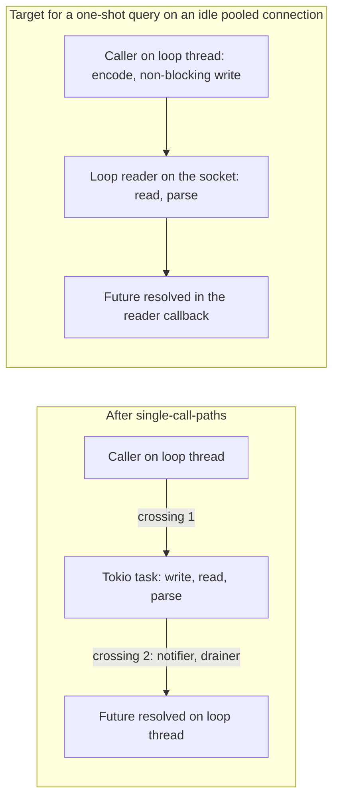
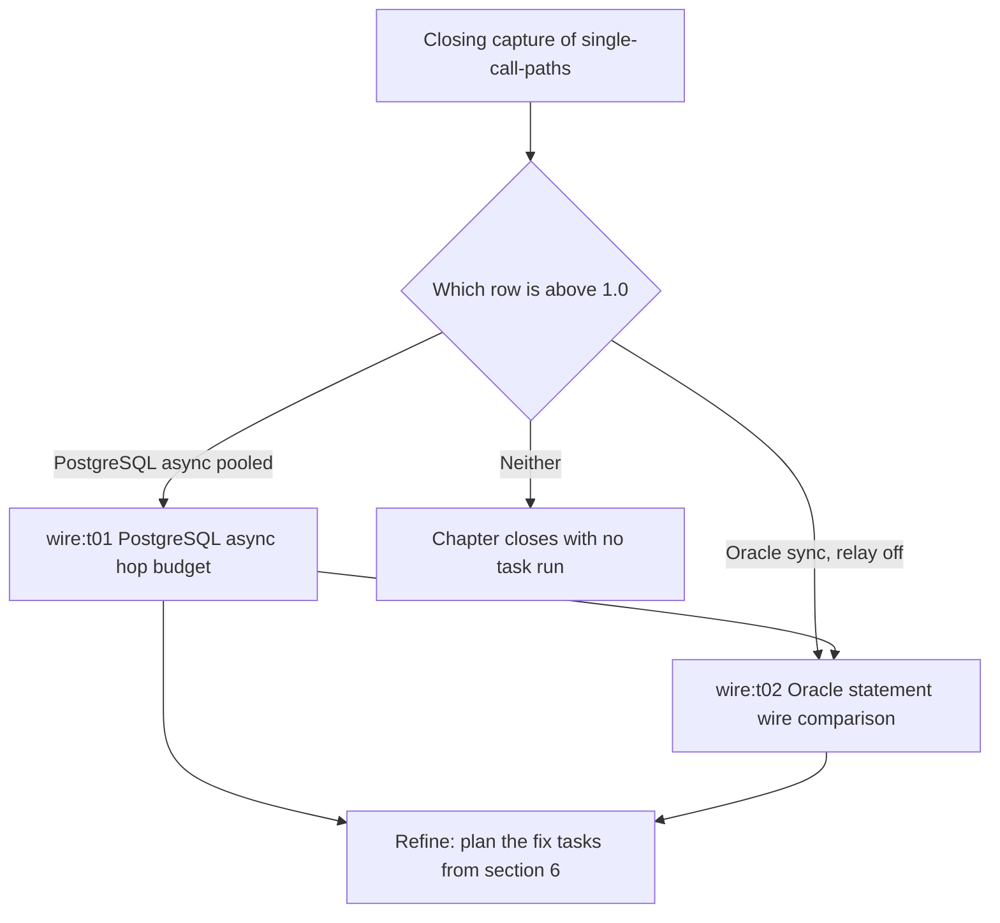

# PostgreSQL and Oracle wire-level parity

<!-- truth: start -->
- This chapter runs only when its trigger fires: the PostgreSQL async pooled row or the Oracle relay-off row is above its comparator in the closing capture of `single-call-paths`.[^root-spec]
- When neither row misses, both tasks are skipped and the chapter closes with no task run.
- The chapter holds a charter and two measurement tasks. Neither task edits production code.
- The fix tasks are planned by a refine of this chapter after the measurements are recorded in section 6.
- After `single-call-paths`, an async PostgreSQL query crosses threads twice: from the caller to a Tokio task, and from the Tokio task back to the event loop.[^async-bridge][^hot-path-research]
- The PostgreSQL target is no crossing for a one-shot query on an idle pooled connection: write the request on the calling thread, and read and parse the reply on the event loop thread.
- The socket belongs to `PostgresConnection`, as a Tokio stream registered with the shared runtime. Whether the event loop can read it is an open question that `wire:t01` answers from the code and a measurement.[^pg-connection][^transport-stream]
- Everything that is not a one-shot query on an idle connection keeps the Tokio path.
- The Oracle target is the same number of round trips and the same frame sizes as the comparator for one cached statement. `wire:t02` measures both sides.[^oracle-client]
- No task in this chapter changes an acceptance target or the comparison allow-list.
<!-- truth: end -->

## 1. Specification, Context & Provenance

The root spec opens this chapter for what is left on two acceptance rows after `single-call-paths` removes the call-count cost.[^root-spec]

| Row | Measured before `single-call-paths` | Known remaining cause |
| --- | --- | --- |
| PostgreSQL async pooled | 118 us against 72 us | One thread crossing each way remains. The comparator reads and writes on the event loop thread |
| Oracle sync, relay off | 86 us against 68 us | About 5 us inside the extension call, cause not measured |

Both figures and both causes are from the hot-path research brief.[^hot-path-research]

The chapter is `empirical_dependent`. Its trigger is evaluated from the closing capture of `single-call-paths`, which states for each of the two rows whether its median ratio is above `1.0`.

Scope boundary:

- In scope: two measurements, the answers to the charter questions, and the tables in section 6.
- Out of scope for the tasks planned here: every edit under `src/`. A refine adds the fix tasks, which own `src/rs/vertebra-postgres/src/` and `src/rs/vertebra-oracle/src/`.
- Out of scope for the chapter: the SQLSpec PostgreSQL row as its own target. It rides on the pooled driver path and is re-measured by the acceptance run in `cleanup-and-checks`.

## 2. Requirements, Concrete Contracts & Architecture

### Requirements

- **W1 PostgreSQL hop budget.** The time of one pooled async query is split into four parts for the native driver and for the comparator, and the part that holds the remaining difference is named.
- **W2 Oracle wire comparison.** One cached statement on a warm connection is compared with the comparator by round trips, bytes each way, and time inside and outside the wire.
- **W3 Charter answers.** Each question in the charter below has an answer with a code reference, or the statement that the code does not settle it and what would.
- **W4 Fix tasks by refine.** No fix is planned from an assumption. The refine that follows reads section 6 and writes the fix tasks with exact signatures.

W1 to W3 serve root requirement R13 for the two rows above.

### What the code does today

Facts read from the planning tree. Line positions move as `single-call-paths` lands, so each fact names a symbol.

| Fact | Where |
| --- | --- |
| `PostgresConnection` owns the socket as `stream: ConnectionStream`, with `read_buf` and `write_buf` beside it | `src/rs/vertebra-postgres/src/session.rs::PostgresConnection`[^pg-connection] |
| The `Transport` variant of `ConnectionStream` wraps `TransportStream`, which is a Tokio `TcpStream`, a `tokio_rustls` client stream over a `TcpStream`, or a Tokio `UnixStream` | `src/rs/vertebra-db/src/connection.rs::TransportStream`[^transport-stream] |
| A session holds its connection in a `SessionBacking` value, either the `Direct` variant with a `PostgresConnection` or the `Pooled` variant with a `PooledConnection`, inside `SessionInner` behind a standard-library mutex | `src/rs/vertebra-postgres/src/session.rs::SessionBacking`[^pg-session-backing] |
| An idle connection lives in the pool. A checked-out one lives in a `PooledConnection` lease | `src/rs/vertebra-postgres/src/pool.rs::PooledConnection`[^pg-pool] |
| The async pool class starts each call with `spawn_rust_db_task_with_attr`, which spawns on the shared multi-thread Tokio runtime | `src/rs/vertebra-postgres/src/python_pool.rs::PyAsyncPostgresPool`[^pg-python-pool] |
| A finished task pushes its outcome to a completion queue and signals a notifier descriptor. The loop watches that descriptor with `add_reader`. `CompletionDrainer.__call__` runs on the loop thread and calls `set_result` or `set_exception` on the future | `src/rs/vertebra-core/src/py_async.rs::CompletionDrainer`[^async-bridge] |
| A loop without a usable `add_reader` is woken with `call_soon_threadsafe` instead | `src/rs/vertebra-core/src/py_async.rs::CompletionDrainer`[^async-bridge] |
| A command timeout is one deadline, enforced with Tokio timers | `src/rs/vertebra-postgres/src/session.rs::CommandBudget`[^pg-budget] |
| Cancelling the awaiting future aborts the Tokio task. An in-flight statement is cancelled with a `CancelRequest` on a separate connection, fenced by an operation generation | `src/rs/vertebra-postgres/src/cancel.rs`[^pg-cancel] |
| The Oracle extension runs statements through the Rust `oracledb` crate. Sync callers run on their own thread, and a worker thread serves async callers | `src/rs/vertebra-oracle/src/client.rs`[^oracle-client] |
| With `enable_reset_relay=False` the Oracle driver connects to the resolved address and starts no relay thread | `src/rs/vertebra-oracle/src/dialer.rs`[^oracle-dialer] |
| The Oracle pool's sync release sends a rollback round trip on every release. `single-call-paths` removes it after a successful commit or rollback and keeps it after a query, so `wire:t02` measures after that change | `src/rs/vertebra-oracle/src/pool.rs`[^oracle-pool] |

### PostgreSQL target design (charter)

The design removes both crossings for one case only: a one-shot query whose statement is cached, on a pooled connection that is idle.

1. The caller checks a connection out, encodes `Bind`, `Execute`, and `Sync` into the connection's write buffer, and writes them with one non-blocking write on the calling thread.
2. A reader registered with the event loop for the connection's socket reads the reply on the loop thread, parses it to `ReadyForQuery`, builds the result, and resolves the future in the same callback.
3. The connection goes back to the pool from that callback.
4. Anything else takes the Tokio path that exists today.

The design is a charter, not a contract. The following must hold for it to be built, and the code does not yet say whether each does. `wire:t01` answers them.

| Question | What the code shows | What `wire:t01` must settle |
| --- | --- | --- |
| Q1 Who hands the socket to the loop | The socket is a field of `PostgresConnection`, reached through the pool or a `PooledConnection` lease | Which object would expose the raw descriptor, and whether a connection can be marked loop-driven while it sits idle in the pool |
| Q2 Sharing with the Tokio reactor | Each stream is a Tokio type, registered with the shared runtime's reactor when it is created | Whether the loop can watch the same descriptor while Tokio keeps its registration, or the connection must give the socket up for as long as it is loop-driven, and what handing it back costs |
| Q3 Write on the calling thread | Writes go through `write_all` on the Tokio stream inside a task | Whether the stream types offer a non-blocking write usable outside a task, and what a partial write leaves in the buffer |
| Q4 Reader on the loop | The loop already watches one descriptor per completion ring through `add_reader`, with a `call_soon_threadsafe` path for loops without it | Whether one reader per connection is acceptable, which supported loops lack `add_reader`, and what those loops do |
| Q5 TLS | A TLS connection is a `tokio_rustls` stream that owns the `TcpStream` | Whether the TLS session can be driven from the loop thread, or TLS connections keep the Tokio path |
| Q6 What falls back | COPY, LISTEN, pipelines, portals, Arrow streams, and replication each hold the connection across several exchanges | The exact fallback list: a write that would block, a statement that is not cached, a statement inside a transaction or on a pinned session, a reply that carries a notification or a parameter change, and each feature in the left column |
| Q7 Cancel and timeouts | Timeouts are Tokio timers. Cancel aborts the task and sends `CancelRequest` on a separate connection | What enforces a timeout with no task, what happens to the socket when the awaiting future is cancelled before the reply arrives, and who drains the reply before the connection is reused |
| Q8 More than one loop | The completion ring is per loop. The pool is shared | What happens when a connection last used by one loop is checked out by another loop or thread, including free-threaded builds |

### Oracle target design (charter)

One cached `SELECT 1 FROM DUAL` on a warm connection costs the same number of round trips and the same frame sizes as the comparator. Three differences are possible, and `wire:t02` measures which one applies:

| Possible difference | How it shows in the capture |
| --- | --- |
| An extra round trip per statement, such as a rollback on release that is still sent | More send and receive calls than the comparator |
| Larger frames | More bytes one way or both ways for the same number of calls |
| Row decode or result building time | Equal wire figures, with more time after the last receive |

### Measurement rules

- Release build, Python 3.12, 64-bit glibc Linux, loopback, the container fixtures the acceptance run uses.
- Every script, trace, and report is written under a directory from `mktemp -d`. Nothing is committed except the tables in section 6.
- The measured call is the benchmark's call, so the tables explain the acceptance rows.[^bench-pg][^bench-sql]
- A syscall trace slows the process. Each table therefore holds an untraced total beside the traced parts.
- Text names only the comparators in the benchmark pair table.

### Task order

## 3. Documentation & OKF Knowledge Plan

No knowledge page is edited by the two measurement tasks. Their output is section 6 of this spec.

Hand-offs:

- The refine that plans the fix tasks decides which knowledge pages those tasks edit. Candidates are `.agents/bundles/knowledge/domains/data/postgres-native-driver.md`, `.agents/bundles/knowledge/patterns/rust/ffi-and-gil-discipline.md`, and ADR-006.
- A row that stays above its comparator after this chapter is recorded with its measured cause by the acceptance run in `cleanup-and-checks`, in `.agents/bundles/knowledge/domains/data/database-driver-limitations.md`.

## 4. Requirement-to-Task Traceability Matrix

| Requirement | Task | Verification |
| --- | --- | --- |
| W1 PostgreSQL hop budget | `native-cursor-data-path:wire:t01` | The hop budget table in section 6 is filled for both drivers; the four parts sum to the traced total within 5 percent |
| W2 Oracle wire comparison | `native-cursor-data-path:wire:t02` | The wire table in section 6 is filled for both drivers; call counts and byte totals come from the trace |
| W3 Charter answers | `native-cursor-data-path:wire:t01` (Q1 to Q8), `native-cursor-data-path:wire:t02` (the three Oracle differences) | Each answer cites a symbol under `src/` that `git grep` finds |
| W4 Fix tasks by refine | The refine after the tasks | Fix worksheets exist with signatures, or the chapter records that no fix is planned and why |
| R13 PostgreSQL async pooled and Oracle relay-off rows | This chapter, then `native-cursor-data-path:cleanup:t07` | The acceptance run enforces both rows |

## 5. Implementation Plan

- [x] t01 — PostgreSQL async hop budget (tasks/t01-postgres-async-hop-budget.md)
- [x] t02 — Oracle statement wire comparison (tasks/t02-oracle-statement-wire-comparison.md)
- [x] t03 — PostgreSQL async loop-driven one-shot fast path (tasks/t03-postgres-loop-driven-oneshot.md)
- [x] t04 — PostgreSQL broker one-shot path, SQLite bound cursor, and Oracle allow-list (tasks/t04-postgres-broker-oneshot-sqlalchemy-cursor-and-oracle-allowlist.md)

### When each task runs

| Closing capture of `single-call-paths` | t01 | t02 |
| --- | --- | --- |
| Both rows at or below `1.0` | Skipped | Skipped. The chapter closes with no task run |
| PostgreSQL async pooled above `1.0` only | Runs | Skipped |
| Oracle relay-off above `1.0` only | Skipped | Runs |
| Both above `1.0` | Runs | Runs after t01 |

A skipped task is marked `deferred` with the capture's ratio as the reason. A deferred task counts as closed for every task that depends on it, so a deferred t01 does not hold t02 back.

`native-cursor-data-path:cleanup:t07` names `wire:t02`, `wire:t03`, and `wire:t04` in `depends_on`, so the acceptance run waits for all fixes.

### Run order

| Step | Tasks |
| --- | --- |
| 1 | t01 |
| 2 | t02 |
| 3 | t03, t04 (separate files; Rust wire path and Python/benchmark fixes) |

### Checks

| When | Commands |
| --- | --- |
| After each task | The commands in that task's `## Verification` |
| After the chapter | `git status --short -- src tools` prints nothing new from this chapter's measurement tasks; `make review-check` |

## 6. Current State & Remaining Plan Snapshot

- `wire:t01` and `wire:t02` ran after the closing capture of `single-call-paths` fired both triggers (`1.241` for PostgreSQL async pooled and `1.069` for Oracle sync relay-off).
- Both measurement tables, charter answers Q1 to Q8, and the three Oracle difference findings are recorded below.

### PostgreSQL async hop budget (filled by `wire:t01`)

| Part | Native driver | Comparator | Thread that runs it, native driver |
| --- | --- | --- | --- |
| Total, untraced (us) | 99.87 | 107.87 | |
| Total, traced (us) | 516.53 | 361.92 | |
| Call to request bytes written (us) | 168.56 (32.6%) | 72.96 (20.2%) | Tokio worker (`2644756`, `2644771`; markers on `2644730`) |
| Server round trip (us) | 88.93 (17.2%) | 80.11 (22.1%) | |
| Reply bytes readable to coroutine resumed (us) | 247.00 (47.8%) | 202.06 (55.8%) | Tokio worker (`2644756`, `2644771`) then event loop (`2644730`) |
| Wake syscalls per query | 4.0 | 0.0 | |

Crossing that holds the remaining difference: `both, in the measured shares` (`caller to Tokio task` adds `95.60 us`, 61.8% of the `154.61 us` traced delta, and `Tokio task to event loop` adds `44.94 us`, 29.1% of the delta, with `4.0` wake syscalls per query vs `0.0` for `asyncpg`; the three traced parts sum to `504.49 us` [2.33% diff] for the native driver and `355.12 us` [1.88% diff] for `asyncpg`).

Charter answers:

- **Q1 Who hands the socket to the loop:** `PostgresConnection` owns `stream: ConnectionStream` (`src/rs/vertebra-postgres/src/session.rs::PostgresConnection`), and idle connections sit inside `PostgresPool::inner` (`src/rs/vertebra-postgres/src/pool.rs::PostgresPool`) and check out as `PooledConnection` (`src/rs/vertebra-postgres/src/pool.rs::PooledConnection`). `PostgresPool` can pop a `PooledConnection` synchronously under `PostgresPool::inner` (no Tokio task needed when an idle slot exists) and expose the raw descriptor from `TransportStream::PlainTcp(TcpStream)` or `TransportStream::Unix(UnixStream)` (`src/rs/vertebra-db/src/connection.rs::TransportStream`).
- **Q2 Sharing with the Tokio reactor:** `TransportStream::PlainTcp(tokio::net::TcpStream)` and `TransportStream::Unix(tokio::net::UnixStream)` stay registered with the shared Tokio runtime's epoll reactor (`src/rs/vertebra-core/src/py_async.rs::runtime_handle`). On Linux epoll, adding the same fd to Python's `asyncio` selector while Tokio holds an edge-triggered registration is legal for distinct epoll instances, OR a plain socket can be converted via `into_std()` when loop-driven and re-wrapped on fallback. What the code does not settle: whether Tokio's background reactor consumes spurious wakeups on the shared fd when no Tokio task polls it; a minimal experiment registering a `TcpStream::as_raw_fd()` on `loop.add_reader` while idle in Tokio settles whether `into_std()` is required.
- **Q3 Write on the calling thread:** `tokio::net::TcpStream::try_write` and `tokio::net::UnixStream::try_write` (`src/rs/vertebra-db/src/connection.rs::TransportStream`) perform a direct non-blocking `send`/`write` syscall without entering Tokio. If a partial write or `WouldBlock` occurs, remaining bytes stay in `PostgresConnection::write_buf` (`src/rs/vertebra-postgres/src/session.rs::PostgresConnection`) and the call falls back to the Tokio path (or registers `add_writer`) to flush the remainder.
- **Q4 Reader on the loop:** `ensure_completion_ring` (`src/rs/vertebra-core/src/py_async.rs::CompletionDrainer`) already probes `loop.add_reader(fd, callback)` and falls back to `call_soon_threadsafe` when the loop lacks `add_reader` (for example Windows `ProactorEventLoop` or custom non-selector loops). One reader per active loop-driven query (or per pooled socket on the current loop) matches `asyncpg`'s selector model; loops without `add_reader` stay on `spawn_rust_db_task_with_attr` (`src/rs/vertebra-postgres/src/python_pool.rs::PyAsyncPostgresPool`).
- **Q5 TLS:** `TransportStream::TlsTcp(Box<tokio_rustls::client::TlsStream<TcpStream>>)` (`src/rs/vertebra-db/src/connection.rs::TransportStream`, established in `src/rs/vertebra-postgres/src/tls.rs::DialedTransport`) wraps `rustls::ClientConnection` inside `tokio_rustls`. Keeping `TransportStream::TlsTcp` on the Tokio path avoids re-implementing non-blocking TLS record framing on the Python loop thread, while `PlainTcp` and `Unix` use the loop-driven fast path.
- **Q6 What falls back:** Any call that is not a cached one-shot query on an idle `PlainTcp`/`Unix` pooled connection keeps the Tokio path (`src/rs/vertebra-postgres/src/python_pool.rs::PyAsyncPostgresPool`): cache miss (statement not in `PostgresConnection::statement_cache`), partial write or `WouldBlock`, TLS (`TransportStream::TlsTcp`), custom streams (`ConnectionStream::Custom`), pinned sessions (`SessionBacking::Direct` or active transaction/tenant checkout), COPY, LISTEN/NOTIFY, pipelines, portals, Arrow streams, replication, queries with `timeout` set (unless handled via `loop.call_later`), and replies delivering async notifications or parameter changes that require session bookkeeping.
- **Q7 Cancel and timeouts:** Timeouts today use `CommandBudget` (`src/rs/vertebra-postgres/src/session.rs::CommandBudget`) and cancellation uses `TaskCanceller` (`src/rs/vertebra-core/src/py_async.rs::RustTaskAwaitable`) plus `PostgresCancelHandle` (`src/rs/vertebra-postgres/src/cancel.rs::PostgresCancelHandle` / `encode_cancel_request_frame`). On a loop-driven query, `loop.call_later` can cancel the pending `asyncio.Future`; cancelling the future removes the loop reader and hands the in-flight `PooledConnection` to a background Tokio drain/cancel task (sending `CancelRequest` and draining to `ReadyForQuery` or retiring the socket via `PooledConnection::mark_retire`) so the socket is never returned dirty.
- **Q8 More than one loop:** `PostgresPool` (`src/rs/vertebra-postgres/src/pool.rs::PostgresPool`) is shared across loops and threads, whereas `add_reader` registrations belong to one `asyncio` loop. Registering `add_reader` for the duration of a single in-flight query and removing it (or caching the owning loop weakref on the idle entry and migrating/removing when checked out on a different loop) keeps multi-loop and free-threaded callers safe without cross-thread loop mutation.

Run metadata: 2026-11-21, Python 3.12, `postgres:17-alpine`, measured with `strace`.

### Oracle statement wire comparison (filled by `wire:t02`)

| Figure for one statement | Native driver | Comparator |
| --- | --- | --- |
| Send calls | 1 (range 1–1) | 1 (range 1–1) |
| Receive calls | 1 (range 1–1) | 1 (range 1–1) |
| Bytes sent | 106 (range 106–106) | 21 (range 21–21) |
| Bytes received | 191 (range 191–191) | 96 (range 96–96) |
| Time before the first send (us) | 36.95 | 39.82 |
| Wire time, first send to last receive (us) | 111.94 | 84.88 |
| Time after the last receive (us) | 34.45 | 36.00 |
| Total, traced (us) | 189.42 | 161.17 |
| Total, untraced (us) | 96.70 (run 3: 81.75) | 71.93 |
| Extension call alone, untraced (us) | 80.07 | |

Differences named:

1. **An extra round trip:** Absent. Both drivers issue `1` send call and `1` receive call per statement on the calling thread (`tid 2650248` for the native driver, `tid 2650409` for `oracledb`). No rollback round trip runs on the unpooled `SyncOracleDriver` path (`src/rs/vertebra-oracle/src/client.rs::run_query_or_execute`), and no loopback relay connection is opened when `enable_reset_relay=False` (`src/rs/vertebra-oracle/src/dialer.rs::dial_oracledb_inner`).
2. **Larger frames:** Present and accounts for the entire latency gap (`106` bytes sent vs `21` bytes sent; `191` bytes received vs `96` bytes received; `111.94 us` wire time vs `84.88 us` wire time, `+27.06 us`). Every `conn.query` call in `src/rs/vertebra-oracle/src/client.rs::run_query_or_execute` sends a piggybacked `TTC_RPC_CLOSE_CURSORS` (`0x11 0x69`) plus a full `TTC_RPC_EXECUTE` (`0x03 0x5e`) carrying the 18-byte SQL text and receives full column describe metadata, instead of `TTC_RPC_REEXECUTE_AND_FETCH` (`0x03 0x4e`, 21 bytes sent / 96 bytes received). Root cause: `src/rs/vertebra-oracle/src/dialer.rs::dial_oracledb_inner` passes `.set_stmtcachesize(cfg.stmtcachesize as usize)` (`256`), but upstream `oracledb` `26.0.0-beta.5` (`Client::post_connect` / `AuthMessage::get_max_open_cursors`) returns `0` when `AUTH_MAX_OPEN_CURSORS` is absent from the auth response and runs `if max_open_cursors < self.statement_cache.max_size() { self.statement_cache.resize(max_open_cursors); }` without guarding `max_open_cursors > 0`, resetting the statement cache capacity to `0`.
3. **Row decode or result building time:** Absent. Time before the first send (`36.95 us` vs `39.82 us`) and time after the last receive (`34.45 us` vs `36.00 us`) are both slightly lower on the native driver (`src/rs/vertebra-oracle/src/cursor.rs::reply_dicts`) than on `oracledb`, and the three traced parts sum to `183.34 us` (3.21% diff from `189.42 us`) for the native driver and `160.69 us` (0.30% diff from `161.17 us`) for `oracledb`.

Run metadata: 2026-11-21, Python 3.12, `gvenzl/oracle-free:23-slim-faststart`, measured with `strace`.

[^root-spec]: `.agents/bundles/specs/native-cursor-data-path/spec.md`
[^hot-path-research]: `.agents/bundles/research/native-cursor-hot-paths_20261121.md`
[^pg-connection]: `src/rs/vertebra-postgres/src/session.rs::PostgresConnection`
[^pg-session-backing]: `src/rs/vertebra-postgres/src/session.rs::SessionBacking`
[^pg-pool]: `src/rs/vertebra-postgres/src/pool.rs::PooledConnection`
[^pg-python-pool]: `src/rs/vertebra-postgres/src/python_pool.rs::PyAsyncPostgresPool`
[^pg-cancel]: `src/rs/vertebra-postgres/src/cancel.rs`
[^pg-budget]: `src/rs/vertebra-postgres/src/session.rs::CommandBudget`
[^transport-stream]: `src/rs/vertebra-db/src/connection.rs::TransportStream`
[^async-bridge]: `src/rs/vertebra-core/src/py_async.rs::CompletionDrainer`
[^oracle-client]: `src/rs/vertebra-oracle/src/client.rs`
[^oracle-dialer]: `src/rs/vertebra-oracle/src/dialer.rs`
[^oracle-pool]: `src/rs/vertebra-oracle/src/pool.rs`
[^bench-pg]: `tools/benchmarks/postgres.py::_measure_async_vertebra_point_select`
[^bench-sql]: `tools/benchmarks/adapters/sql.py::capture_oracle_report`
