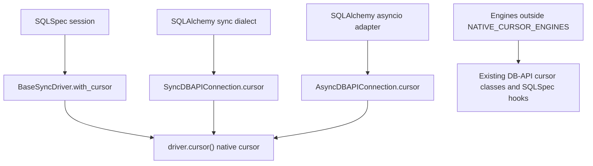

# DB-API module, SQLAlchemy dialect, and SQLSpec adapter base on the native cursor

<!-- truth: start -->
- `NATIVE_CURSOR_ENGINES` lives in `src/py/vertebra/db/driver/_common.py` with the value `{"sqlite", "duckdb"}`. The engine key is the lower-case `dialect` of the native driver config.[^driver-common]
- The engine key is read once, when the driver or connection is constructed, and the answer is stored on the instance. No statement path reads the constant, reads the engine key, or probes the driver.
- For an engine in the set, `connection.cursor()` in the DB-API module returns the object from `driver.cursor()`. No Python cursor class wraps it.[^dbapi-sync-conn][^dbapi-async-conn]
- With autocommit off, the DB-API connections create native cursors with `lazy_begin=True`. The transaction opens inside the extension on the first statement. Python never inspects SQL text on this path.
- A cursor kept across `commit()` or `rollback()` starts a new transaction on its next statement. A standalone async caller does not await `begin()`.[^sa-async-adapter]
- With autocommit on, the DB-API connection creates cursors with `lazy_begin=False` and calls no `begin` and no `commit`. The engine commits each statement.
- `with_cursor` in the SQLSpec bases returns a context manager that yields a native cursor and closes it. A cache hit performs one native `execute`.[^sqlspec-base]
- `collect_rows`, `resolve_rowcount`, `dispatch_execute`, and `dispatch_execute_many` read `cursor.description`, `cursor.rowcount`, and `cursor.lastrowid`. They do not call `statement.returns_rows()`.
- A native-cursor SQLSpec driver reuses one exception handler object for its lifetime.
- The native cursor raises `vertebra._vertebra` classes, and the DB-API names are those same classes. The SQLSpec fallback mapper matches them directly in its class-specific branches and is not edited.
- The SQLite SQLSpec statement config executes with `?` placeholders only, so SQLSpec converts `:name` input once and caches it.[^sqlspec-sqlite]
- The SQLite and DuckDB SQLSpec adapters hold no `unwrap_typed_parameters`, no parameter normalizer, and no override of `_prepare_native_parameters` or `dispatch_execute_many`.[^sqlspec-duckdb]
- Engines outside the set keep the existing DB-API cursor classes and the existing SQLSpec hooks unchanged until `network-engines`.
- `src/py/vertebra/extensions/sqlalchemy/pool.py` is not edited. It does not create or use cursors.[^sa-pool]
- The chapter closes when the SQLSpec SQLite sync row and the SQLAlchemy `sqlite+vtb` row meet their targets in the adapter matrix.[^bench-sql]
<!-- truth: end -->

## 1. Specification, Context & Provenance

This chapter is plan steps 2 and 3 of the root spec. It starts after `embedded-cursors` has closed. It covers root requirement R3, the wrapper share of R2, R5, and R8, and the two SQLite wrapper rows of R13.

Facts read from the tree at `06e99fb`:

- `SyncDBAPIConnection.cursor()` builds a Python `SyncDBAPICursor` for every engine. Its `execute` scans SQL text, wraps the call in `_ErrorTranslator`, probes the driver with `hasattr`, and re-tuples rows.[^dbapi-sync-conn]
- `AsyncDBAPIConnection.cursor()` is a plain method. `begin()`, `commit()`, and `rollback()` are coroutines.[^dbapi-async-conn]
- SQLAlchemy's asyncio cursor base calls `cursor.__aenter__()` when it creates a cursor. The root cursor contract has no `__aenter__`.[^sa-async-adapter]
- `pool.py` has no reference to a cursor, to `execute`, or to any DB-API helper.[^sa-pool]
- `BaseSyncDriver.with_cursor` yields the connection, so upstream SQLSpec skips its direct `cursor.execute` path on every cache hit.[^sqlspec-base]
- SQLSpec returns compiled parameters with no `TypedParameter` wrappers for the SQLite and DuckDB statement configs. It rejects extra named parameters itself.
- The SQLite SQLSpec config allows named execution today. The adapter then rewrites dict keys to `:name` with a regular expression on every call.[^sqlspec-sqlite]
- The DuckDB SQLSpec profile already converts `UUID`, `Decimal`, `date`, and `datetime` values. `normalize_duckdb_scalar` repeats the `UUID` conversion.[^sqlspec-duckdb]
- Six network adapters still call `_compile_for_native`, `_prepare_native_parameters`, and the DB-API classifiers. Those stay.

### Interfaces this chapter consumes from `embedded-cursors`

| Interface | Used by |
| --- | --- |
| `SyncSQLiteDriver.cursor()`, `AsyncSQLiteDriver.cursor()`, `SyncDuckDBDriver.cursor()`, and `AsyncDuckDBDriver.cursor()` return the native cursor from root spec section 2. Each call returns a new cursor on the driver's client. | t01, t03, t05, t06 |
| Each DB-API exception name is the `vertebra._vertebra` class of the same name. `Error` is `DatabaseError`. | t01 to t06 |
| The native cursor raises `vertebra._vertebra` classes through each crate's existing error conversion, including specific subclasses such as `QueryCancelledError`. | t01 to t06 |
| `cursor.execute(sql, ())` and `cursor.execute(sql, [])` run a statement with no parameters. A `list` or `tuple` of positional values binds to `?` placeholders. | t01 to t08 |
| The driver keeps `begin()`, `commit()`, `rollback()`, `in_transaction`, `select_to_arrow`, `stream_arrow_batches`, and `close()`. | t01 to t06 |
| `driver.cursor(lazy_begin=True)` returns a cursor whose `execute` and `executemany` open a transaction in the extension when none is open. `driver.in_transaction` reports it. | t01, t03 |

Each task that depends on a row above starts by running its first listed test. If the interface is missing, the task is set to `blocked` and the chapter goes back to refine. The executor does not add the interface.

This chapter edits no file under `src/py/vertebra/db/adapters/`. All four embedded drivers already have `cursor()` when it starts.

### Scope boundary

In scope: the files in the ownership table in section 2.

Out of scope:

- The DB-API classifiers, tokenizer, row coercion, out-bind helpers, and `_ErrorTranslator`. Six engines still call them. The last `network-engines` task deletes them.
- `_compile_for_native`, `_unwrap_typed_parameters`, `_normalize_bound_params`, `_fetch_rows_with_columns`, and `_prepare_native_parameters` in the SQLSpec bases. Six adapters still call or override them.
- `src/py/vertebra/extensions/sqlspec/proxy.py` and `provider.py`.
- Rust sources and `.pyi` stubs.

## 2. Requirements, Concrete Contracts & Architecture

### Requirements

- **W1 Constant.** `NATIVE_CURSOR_ENGINES: Final[frozenset[str]] = frozenset({"sqlite", "duckdb"})` is defined and exported from `src/py/vertebra/db/driver/_common.py`.
- **W2 Sync DB-API.** `SyncDBAPIConnection.cursor()` returns the native cursor for engines in the set, created with `lazy_begin=True` when autocommit is off.
- **W3 SQLAlchemy asyncio adapter.** The adapter never calls `cursor.__aenter__()`. It is the only file in the SQLAlchemy extension that changes. The sync dialects and `pool.py` are untouched.
- **W4 Async DB-API.** `AsyncDBAPIConnection.cursor()` returns the native async cursor for engines in the set.
- **W5 SQLite execution style.** The SQLite SQLSpec statement config executes with `?` only.
- **W6 SQLSpec sync base.** `BaseSyncDriver` yields a native cursor from `with_cursor` and reads results from cursor attributes.
- **W7 SQLSpec async base.** `BaseAsyncDriver` gets the same change with awaitable calls.
- **W8 SQLite adapter.** The SQLite SQLSpec adapter loses its normalizers and hook overrides.
- **W9 DuckDB adapter.** The DuckDB SQLSpec adapter loses its normalizers and hook overrides.
- **W10 Chapter close.** The removed names have no match in the tree, and the two SQLite wrapper rows meet their targets.

### Engine key

| Reader | Expression evaluated once in `__init__` |
| --- | --- |
| `SyncDBAPIConnection`, `AsyncDBAPIConnection` | `_config_dialect(self._config) in NATIVE_CURSOR_ENGINES` when `self._config` is not `None`, else `False` |
| `BaseSyncDriver`, `BaseAsyncDriver` | `str(getattr(getattr(connection, "config", None), "dialect", "")).lower() in NATIVE_CURSOR_ENGINES` |

A driver object passed in without a config uses the existing path.

Each expression runs once, in `__init__`, and nowhere else. The stored answer is the only thing a statement path reads.

### Transaction rules for the DB-API connection

The DB-API connection keeps begin-on-execute. On a native-cursor engine the begin happens inside the extension.

| Case | Sync and async connection |
| --- | --- |
| Autocommit off, `cursor()` called | Returns `driver.cursor(lazy_begin=True)`. No transaction is opened yet |
| First `execute` or `executemany` on that cursor with no open transaction | The extension opens the transaction, then runs the statement |
| Later statements in the same transaction | No second begin |
| `commit()` or `rollback()` | Ends the transaction through the driver |
| Statement on a cursor created before the last `commit()` or `rollback()` | Opens a new transaction. A following `rollback()` undoes it |
| Async caller that never awaits `begin()` | Same as above. `rollback()` undoes the statement |
| Autocommit on | Returns `driver.cursor(lazy_begin=False)`. No `begin`, no `commit` |
| Autocommit changed after a cursor was created | The cursor keeps the mode it was created with |

The connection's own `_in_transaction` flag is not set by a transaction the extension opens. On a native-cursor engine, `close()` and the `autocommit` setter therefore ask `driver.in_transaction`. `commit()` and `rollback()` already call the driver every time.

### DB-API surface on native-cursor engines

The native cursor has the members in root spec section 2 and no others. On SQLite and DuckDB the DB-API cursor therefore has no `var`, `nextset`, `setinputsizes`, `setoutputsize`, `__enter__`, `__iter__`, or `__aenter__`. SQLAlchemy's SQLite and DuckDB dialects call none of them. These members stay absent on SQLite and DuckDB. Members that Oracle needs are added to the Oracle cursor only, in `network-engines`.

### SQLSpec base contract

| Hook | Native-cursor engine | Other engines |
| --- | --- | --- |
| `with_cursor(connection)` | Returns `_NativeSyncCursorContext(connection)` or `_NativeAsyncCursorContext(connection)`. Enter calls `connection.cursor()`. Exit closes the cursor | Returns `contextlib.nullcontext(connection)`, which yields the connection as before |
| `handle_database_exceptions()` | Clears and returns the handler stored on the driver | Builds a new handler as before |
| `dispatch_execute` | `cursor.execute(sql, params or ())`, then `create_execution_result` from `cursor.description`, `cursor.rowcount`, `cursor.lastrowid`. Rows stay tuples with `row_format="tuple"` | Existing body |
| `dispatch_execute_many` | `cursor.executemany(sql, prepared)`, rowcount from `cursor.rowcount` | Existing body |
| `collect_rows(cursor, fetched)` | `(fetched, [col[0] for col in cursor.description], len(fetched))`, or `([], [], 0)` when `description` is `None` | Existing body |
| `resolve_rowcount(cursor)` | `cursor.rowcount` when positive, else `0` | Existing body |
| `dispatch_select_stream` | Compiles with `_compiled_sql` and passes parameters unchanged | Existing body |

The Arrow, storage, and pipeline methods are not cursor paths. They keep calling `_compile_for_native` for every engine in this chapter. With the adapter overrides gone, that call does no engine-specific work for SQLite and DuckDB. The last `network-engines` task deletes it.

### Error contract

The native cursor raises `vertebra._vertebra` classes. The DB-API names are bindings to those classes, so SQLAlchemy matches them through the DB-API module attributes it already reads. No translator runs between the cursor and the caller.

- `BaseSyncDriver._map_native_database_exception` is not edited. Its entry check and its class-specific branches test the native classes, which are the classes the cursor raises. A cancelled statement reaches its `QueryCancelledError` branch.
- A SQLSpec caller still receives `sqlspec.exceptions` types. The engine mappers `map_sqlite_exception` and `map_duckdb_exception` match on message text and need no change.
- `_ErrorTranslator` stays for the engines on the old path. It passes native errors through untouched.
- Configuration errors become `InterfaceError` when the DB-API connection is built, as today.

### File ownership inside the chapter

Tasks run in the order below. A file listed for two tasks is never edited by two ready tasks, because the later task depends on the earlier one.

| Task | Edits | Test files |
| --- | --- | --- |
| t01 | `src/py/vertebra/db/driver/_common.py`, `src/py/vertebra/db/dbapi/_sync.py` | `src/py/tests/unit/db/test_dbapi_standalone.py` |
| t02 | `src/py/vertebra/extensions/sqlalchemy/async_adapter.py` | `test_sqlalchemy_vtb_dialects_and_dbapi.py` |
| t03 | `src/py/vertebra/db/dbapi/_async.py` | `test_dbapi_standalone.py`, `test_sqlalchemy_vtb_dialects_and_dbapi.py` |
| t04 | `src/py/vertebra/extensions/sqlspec/adapters/sqlite/core.py` | `src/py/tests/unit/extensions/test_sqlspec_sqlite_mysql_mssql_duckdb.py` |
| t05 | `src/py/vertebra/extensions/sqlspec/_driver.py`, `adapters/sqlite/driver.py`, `adapters/duckdb/driver.py` | `src/py/tests/unit/extensions/test_sqlspec_driver_dispatch.py` |
| t06 | `src/py/vertebra/extensions/sqlspec/_driver.py`, `adapters/sqlite/driver.py`, `adapters/duckdb/driver.py` | `test_sqlspec_driver_dispatch.py` |
| t07 | `adapters/sqlite/core.py`, `adapters/sqlite/driver.py` | `test_sqlspec_sqlite_mysql_mssql_duckdb.py`, `test_sqlspec_driver_dispatch.py` |
| t08 | `adapters/duckdb/core.py`, `adapters/duckdb/driver.py`, one knowledge page | `test_sqlspec_sqlite_mysql_mssql_duckdb.py`, `test_sqlspec_driver_dispatch.py` |
| t09 | this chapter spec | none |

The DB-API tasks (t01 to t03) and the SQLSpec tasks (t04 to t08) share no file. One task from each group can run at the same time. t05 waits for t01, which creates `NATIVE_CURSOR_ENGINES`.

Every task leaves the tree passing. t02 lands the adapter change before t03 hands it a native cursor, which has no `__aenter__`. t04 moves SQLite to `?` execution before t05 stops calling the adapter normalizers. t05 and t06 delete the adapter `dispatch_execute_many` overrides in the same task that makes them unusable.

### Symbols removed in this chapter

| Symbol | File | Removed by |
| --- | --- | --- |
| `SQLiteSyncDriver.dispatch_execute_many`, `DuckDBSyncDriver.dispatch_execute_many` | `adapters/sqlite/driver.py`, `adapters/duckdb/driver.py` | t05 |
| `SQLiteAsyncDriver.dispatch_execute_many`, `DuckDBAsyncDriver.dispatch_execute_many` | same files | t06 |
| `unwrap_typed_parameters`, `normalize_sqlite_parameters`, `normalize_sqlite_many_parameters`, `_extract_named_colon_placeholders`, `_QUOTED_SQL_SEGMENT` | `adapters/sqlite/core.py` | t07 |
| `SQLiteSyncDriver._prepare_native_parameters`, `SQLiteAsyncDriver._prepare_native_parameters` | `adapters/sqlite/driver.py` | t07 |
| `unwrap_typed_parameters`, `normalize_duckdb_parameters`, `normalize_duckdb_many_parameters`, `normalize_duckdb_scalar` | `adapters/duckdb/core.py` | t08 |
| `DuckDBSyncDriver._prepare_native_parameters`, `DuckDBAsyncDriver._prepare_native_parameters` | `adapters/duckdb/driver.py` | t08 |

No DB-API symbol is removed in this chapter. Each one still has a caller on the path that serves the six network engines. `_translate_native_error` is already gone: `embedded-cursors` t01 removes it.

## 3. Documentation & OKF Knowledge Plan

- `.agents/bundles/knowledge/domains/extensions/sqlspec-alchemy-and-dialects.md` states that each adapter isolates `unwrap_typed_parameters` in its own `core.py`. t08 rewrites that sentence so it names the six adapters that still do.
- No user doc under `docs/` names a symbol this chapter removes.
- The cursor path description, the limitation pages, and the decision record belong to `cleanup-and-checks`.
- t09 writes the measured benchmark rows into section 6 of this file.

## 4. Requirement-to-Task Traceability Matrix

| Requirement | Root requirement | Task | Verification |
| --- | --- | --- | --- |
| W1 Constant | R8 transition rule | `native-cursor-data-path:wrapper:t01` | Constant test in `test_dbapi_standalone.py` |
| W2 Sync DB-API | R2, R5 | `native-cursor-data-path:wrapper:t01` | Cursor type, rollback, cursor reuse after commit, autocommit, and error class tests in `test_dbapi_standalone.py` |
| W3 SQLAlchemy asyncio adapter | R3 | `native-cursor-data-path:wrapper:t02` | Asyncio engine transaction tests; no `__aenter__` call |
| W4 Async DB-API | R2, R3, R5 | `native-cursor-data-path:wrapper:t03` | Async cursor tests in `test_dbapi_standalone.py`, including execute without an explicit begin; sync and asyncio engine tests in `test_sqlalchemy_vtb_dialects_and_dbapi.py` |
| W5 SQLite execution style | R3 | `native-cursor-data-path:wrapper:t04` | Compile and named-parameter tests in `test_sqlspec_sqlite_mysql_mssql_duckdb.py` |
| W6 SQLSpec sync base | R2, R3, R5 | `native-cursor-data-path:wrapper:t05` | One-execute cache-hit test and result tests in `test_sqlspec_driver_dispatch.py` |
| W7 SQLSpec async base | R2, R3, R5 | `native-cursor-data-path:wrapper:t06` | Async forms of the same tests |
| W8 SQLite adapter | R3, R8 | `native-cursor-data-path:wrapper:t07` | Removed-name and Arrow parameter tests |
| W9 DuckDB adapter | R3, R8 | `native-cursor-data-path:wrapper:t08` | Removed-name, value round-trip, and COPY tests |
| W10 Chapter close | R8, R13 | `native-cursor-data-path:wrapper:t09` | `git grep` per removed name; adapter matrix capture and compare |

## 5. Implementation Plan

- [x] t01 — Sync DB-API connection returns the native cursor (tasks/t01-dbapi-sync-native-cursor.md)
- [x] t02 — SQLAlchemy asyncio adapter stops calling cursor.__aenter__ (tasks/t02-sqlalchemy-async-adapter-begin.md)
- [x] t03 — Async DB-API connection returns the native cursor (tasks/t03-dbapi-async-native-cursor.md)
- [x] t04 — SQLite SQLSpec statement config executes with ? only (tasks/t04-sqlspec-sqlite-qmark-execution.md)
- [x] t05 — SQLSpec sync base on the native cursor (tasks/t05-sqlspec-sync-base-native-cursor.md)
- [x] t06 — SQLSpec async base on the native cursor (tasks/t06-sqlspec-async-base-native-cursor.md)
- [x] t07 — SQLite SQLSpec adapter without normalizers (tasks/t07-sqlspec-sqlite-adapter-cleanup.md)
- [x] t08 — DuckDB SQLSpec adapter without normalizers (tasks/t08-sqlspec-duckdb-adapter-cleanup.md)
- [x] t09 — Chapter close: removal check and SQLite and DuckDB adapter matrix (tasks/t09-chapter-close-matrix.md)

### Run order

| Step | Tasks |
| --- | --- |
| 1 | t01, t04 |
| 2 | t02, t05 |
| 3 | t03, t06 |
| 4 | t07 |
| 5 | t08 |
| 6 | t09 |

### Checks

| When | Commands |
| --- | --- |
| After each task | The commands in the task's `## Verification` section |
| After the chapter | `make lint-all`, then the four test files in the ownership table |

## 6. Current State & Remaining Plan Snapshot

- All 9 tasks complete. `src/py/tests/unit/db/test_dbapi_standalone.py` passes (104 passed) after aligning the two native-cursor `fetchall()` assertions with `sqlite3.Cursor` (`[]` when `description is None`).
- Removal checks passed: removed SQLite/DuckDB normalizer names appear only as string literals in `src/py/tests/unit/extensions/test_sqlspec_sqlite_mysql_mssql_duckdb.py`, `unwrap_typed_parameters` has zero matches under the SQLite and DuckDB SQLSpec adapters, and `NATIVE_CURSOR_ENGINES` matches only in `db/driver/_common.py`, `db/dbapi/_sync.py`, `db/dbapi/_async.py`, and `extensions/sqlspec/_driver.py`.
- `make lint-all` passes Biome, `tsc --noEmit`, Ruff, Mypy, `check_extras.py`, `mypy.stubtest` (13 modules), and `make review-check`; full-workspace Pyright still reports 1 pre-existing environment error in unrelated `src/py/vertebra/_typing.py:360` (missing optional `numpy`).

| Case | Before | Target | Measured (harness) | Measured (tight loop) |
| --- | --- | --- | --- | --- |
| Native SQLite `select_one` (sync) | 2.8 us | at or below `sqlite3` | 5.98 us vs 1.57 us (async: 69.21 us vs `aiosqlite` 84.54 us) | 3.15 us vs 1.29 us (`fetch_all` 1.02 us) |
| SQLSpec SQLite sync | 15.0 us vs 2.75 us | at or below upstream | 5.18 us vs 2.92 us | 4.78 us vs 2.69 us |
| SQLAlchemy `sqlite+vtb` | 36.3 us vs 18.9 us | at or below upstream | 28.98 us vs 26.92 us | 21.48 us vs 19.91 us |
| SQLSpec DuckDB sync | not recorded | allow-listed (jemalloc) | 425.01 us vs 305.48 us (native: 380.72 us vs 263.04 us) | — |

[^dbapi-sync-conn]: `src/py/vertebra/db/dbapi/_sync.py::SyncDBAPIConnection`
[^dbapi-async-conn]: `src/py/vertebra/db/dbapi/_async.py::AsyncDBAPIConnection`
[^driver-common]: `src/py/vertebra/db/driver/_common.py`
[^sa-async-adapter]: `src/py/vertebra/extensions/sqlalchemy/async_adapter.py::AsyncAdapt_vertebra_cursor`
[^sa-pool]: `src/py/vertebra/extensions/sqlalchemy/pool.py::BrokerPool`
[^sqlspec-base]: `src/py/vertebra/extensions/sqlspec/_driver.py::BaseSyncDriver`
[^sqlspec-sqlite]: `src/py/vertebra/extensions/sqlspec/adapters/sqlite/core.py`
[^sqlspec-duckdb]: `src/py/vertebra/extensions/sqlspec/adapters/duckdb/core.py`
[^bench-sql]: `tools/benchmarks/adapters/sql.py::main`
