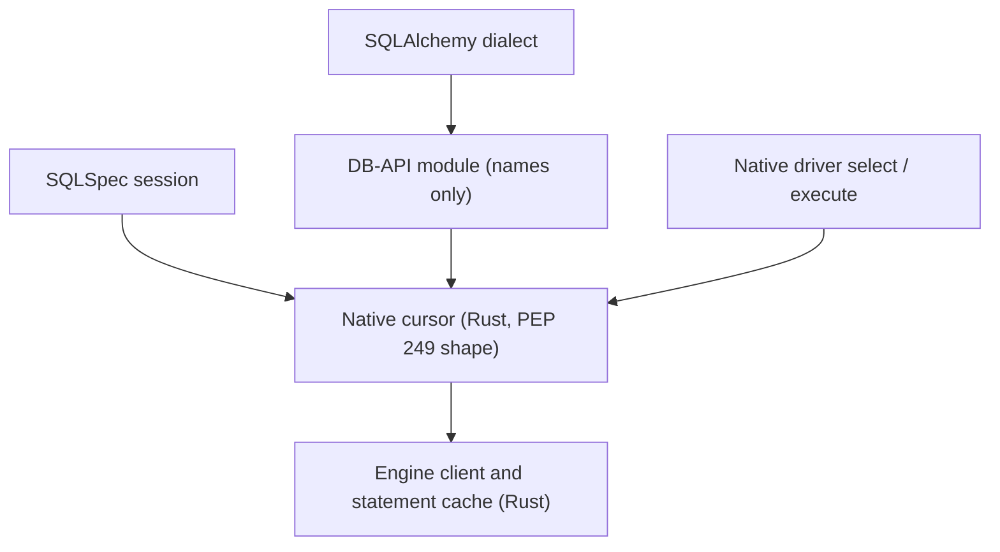

# Thin data path: one native cursor under every wrapper

<!-- truth: start -->
- A query issued through SQLSpec, SQLAlchemy, the DB-API module, or a native driver reaches Rust through one native cursor call per engine.[^sqlspec-base][^dbapi-cursor]
- Each PyO3 extension owns a sync and an async cursor class with the PEP 249 shape. Rows are tuples built once in Rust.[^sqlite-client]
- Whether a statement returned rows is `cursor.description is not None`. `rowcount` and `lastrowid` come from the engine reply. Python does not scan SQL text. DuckDB takes its result kind from statement facts cached in Rust.
- SQLSpec and SQLAlchemy own validation, conversion, and caching. The adapter passes their SQL and parameters through unchanged.
- Placeholder rewriting, bind plans, and statement classification that the wire needs are cached per SQL text inside the extension.
- There is one exception hierarchy. The DB-API module binds its PEP 249 names to the `vertebra._vertebra` classes, and each extension keeps its existing error conversion. No Python translator wraps a call.
- A broker lease is taken at connection checkout and returned at release. Embedded engines take none.[^driver-common]
- A superseded symbol is deleted in the chapter where its last caller moves to the cursor. No alias, re-export, or fallback survives the final chapter.
- `OracleConfig.enable_reset_relay` defaults to `True` and turns the in-process TNS relay off when `False`.[^oracle-dialer]
- A native-driver query method makes one native call, or awaits one awaitable. The cursor and the single-call methods share one statement runner in each extension.[^hot-path-research]
- A cursor fetch that needs no I/O returns an awaitable that is already complete.
- A cached SQLSpec statement runs through a registered cache-hit executor that makes one driver call.
- Chapters run in order: embedded engines, wrappers, network engines, single-call paths, wire parity, then cleanup and checks.
- All work lands on the branch `feat/integrated-benchmarks` and ships in the benchmark pull request.
- The bundled DuckDB engine keeps the `bundled` build without jemalloc. Its two benchmark rows are on the comparison allow-list by user decision.
<!-- truth: end -->

## 1. Specification, Context & Provenance

This spec imports the approved implementation plan "Thin data path: one native cursor under every wrapper". The plan is a conversation artifact and is not stored in the repository. Its step order, design rules, and acceptance table are reproduced here and are authoritative.

All work lands on the existing branch `feat/integrated-benchmarks` and ships in the benchmark pull request.

### Problem

The native extension call is already faster than the standard-library comparator. The time is lost in Python between the wrapper and the extension. Measured on release builds, Python 3.12, in-memory SQLite, one `SELECT 1`:

| Path | Latency | Comparator |
| --- | --- | --- |
| Native extension call (`SyncSQLiteClient.fetch_all`) | 1.0 us | `sqlite3` 1.3 us |
| Native driver `select_one` | 2.8 us | |
| SQLSpec adapter `select_one` | 15.0 us | `sqlspec` SQLite 2.75 us |
| SQLAlchemy `sqlite+vtb` | 36.3 us | `sqlite` dialect 18.9 us |

The benchmark work that precedes this spec measured the layered design and added bypasses around its slowest parts.[^bench-research] The layers remain.

### What each layer does today

SQLSpec adapter, 73 Python calls per query:[^sqlspec-base]

1. `BaseSyncDriver.with_cursor` yields the connection itself. Upstream SQLSpec only takes its direct `cursor.execute` and `cursor.fetchall` cache-hit path when the cursor is a different object from the connection, so every cache hit falls back to `dispatch_execute`.
2. `_compile_for_native` walks bound parameters again through `_unwrap_typed_parameters` and `_normalize_bound_params`.
3. `_fetch_rows_with_columns` probes the driver with `getattr` for three method shapes. `query_with_columns` then builds a `dict` per row, and SQLSpec shapes the result again.
4. `execute_with_description` in the SQLite adapter classifies the SQL text, looks it up in the shared-memory statement cache, and takes a broker lease. SQLite is in-process and needs none of that.
5. A `_DeferredSyncExceptionHandler` is built for every call.

DB-API cursor under SQLAlchemy, 17 us added per query:[^dbapi-cursor]

- `SyncDBAPICursor.execute` scans the SQL text with `is_row_returning_sql`, `is_read_only_sql`, and `is_insert_sql`, backed by `_scan_unquoted_sql_tokens`, `_match_dollar_quote_tag`, and `_has_tsql_output_clause`.
- It inspects parameters with `_extract_out_bind_vars` and `_populate_out_bind_vars`.
- It wraps the call in `_ErrorTranslator`.
- It probes the driver with `hasattr` for `execute_with_description`, `execute_tuples`, or `select`.
- It re-tuples every row and rebuilds the description in `coerce_dbapi_rows_and_desc`.
- It then pays the same statement-cache lookup and broker lease.

Native drivers, Python work per query beyond the native call:

| Adapter | Work |
| --- | --- |
| SQLite | `classify_sql_statement`; with a broker attached, statement-cache lookup plus lease |
| DuckDB | `normalize_parameters`, `param_len`, `_refresh_dynamic_secrets`, `invalidate_rejected_credentials`, statement-cache lookup, lease |
| PostgreSQL | bind plan in `binds.py`, type wrapper checks in `types.py`, `project_query_rows`, pool hand-off |
| MySQL | `compile_for_driver`, SQL encode, statement-cache lookup |
| SQL Server | `_prepare_sql` |
| Oracle | `split_out_bind_parameters`, `coerce_parameters`, `track_session_context_sql`, `is_dml_or_plsql`, `coerce_result_rows_and_cols`, statement-cache lookup, lease |

### Scope boundary

In scope: the completed awaitable in `vertebra-core` with its re-export in `vertebra-db` and its registration in `vertebra-py` and `src/py/vertebra/_vertebra.pyi`, the eight SQL extensions (`vertebra-sqlite`, `vertebra-duckdb`, `vertebra-postgres`, `vertebra-mysql`, `vertebra-mssql`, `vertebra-oracle`, `vertebra-spanner`, `vertebra-bigquery`), their stubs, `src/py/vertebra/db/adapters/<engine>/`, `src/py/vertebra/db/dbapi/`, `src/py/vertebra/db/driver/`, `src/py/vertebra/extensions/sqlalchemy/`, `src/py/vertebra/extensions/sqlspec/`, `tools/benchmarks/adapters/`, `src/py/tests/conftest.py`, and the knowledge chapters named in section 3.

Out of scope: Redis, Valkey, and DataFusion adapters; the SQLSpec proxy and provider lease paths in `extensions/sqlspec/proxy.py` and `provider.py` unless a removed symbol forces an edit.

## 2. Requirements, Concrete Contracts & Architecture

### Requirements

- **R1 One primitive.** Each of the eight extensions exposes a sync and an async native cursor created by `client.cursor()`.
- **R2 The engine answers.** `description`, `rowcount`, and `lastrowid` come from the engine reply. No Python code classifies SQL text on the query path. DuckDB is the one exception to the first sentence. Its result kind comes from statement facts that the extension computes from the SQL text and caches per SQL text in Rust, because the DuckDB Rust binding does not expose the result kind.
- **R3 Wrappers own validation.** The SQLSpec adapter base and the SQLAlchemy dialect pass SQL and parameters through unchanged. A SQLSpec cache hit performs exactly one native `execute`.
- **R4 Per-statement work is cached in Rust.** Placeholder rewriting, bind plans, and wire-level statement classification are computed once per SQL text in the extension's statement cache.
- **R5 Errors are raised once.** There is one exception hierarchy. Each extension raises the `vertebra._vertebra` classes through its existing error conversion, and the DB-API module binds its PEP 249 names to those classes. No per-call translator or exception-handler object is built.
- **R6 Leases follow connections.** Network pools take the broker lease at checkout and return it at release. Embedded engines take none.
- **R7 Native-driver conveniences stay supported.** PostgreSQL named-parameter rewriting and Oracle out-binds move into Rust and keep working through the native driver.
- **R8 Delete what is superseded.** Every Python helper, native method, stub entry, driver protocol member, test, fixture, export, and doc that the cursor supersedes is deleted in the chapter that replaces its last caller. No compatibility alias, re-export, or fallback branch remains after the final chapter.
- **R9 Removal audit.** A final task proves nothing is left: `git grep` per removed symbol returns nothing, `ruff` reports no unused imports or names, `mypy.stubtest` passes with no new allow-list entries, and a `vulture` scan is reviewed.
- **R10 Oracle relay switch.** `OracleConfig` gains a switch that turns the in-process TNS relay off. The default keeps it on.
- **R11 Parallel test cleanup.** The `/dev/shm/vtb-*` cleanup in `src/py/tests/conftest.py` stops deleting segments that belong to other parallel test workers.
- **R12 Benchmark comparison check.** A check in `tools/benchmarks/adapters/` fails when a Vertebra case is slower than its comparator, except for a short allow-list where the engine round trip is the floor. No task adds an allow-list entry on its own. A new entry needs the user's approval.
- **R13 Acceptance table.** The cases in the acceptance table below meet their targets.
- **R14 Knowledge records.** The driver limitations chapter replaces its gap table with measured results and records each leftover gap with its cause. Chapters that name removed symbols are updated.
- **R15 DuckDB allocator.** `vertebra-duckdb` keeps the `duckdb` crate feature `bundled`. The published `libduckdb-sys` package ships no CMake tree, so the jemalloc build is not available from the registry. The two DuckDB benchmark rows are on the comparison allow-list by user decision, and the limitation is recorded.
- **R16 One call per native-driver query.** `select`, `select_one`, `select_one_or_none`, `select_value`, `execute_with_description`, `execute_tuples`, and `execute` on the SQLite, DuckDB, PostgreSQL, and Oracle native drivers make one native call, or await one awaitable. Rows, column names, and row dictionaries are built in Rust. One exception: on a route that holds a broker lease per checkout, a query makes one native statement call plus the checkout and release that R6 requires.
- **R17 Completed awaitables.** `fetchone`, `fetchmany`, `fetchall`, and a `close` with no pending I/O on every async cursor return an awaitable that is already complete. No task is spawned and the event loop is not re-entered.
- **R18 SQLSpec cache-hit executor.** The SQLSpec adapter bases register a cache-hit executor with the upstream driver. A cached statement makes one driver call and builds its result once.
- **R19 Bind fast path.** Parameter extraction in every extension checks the exact type (`tuple`, `list`, `dict`) before any protocol check, and treats an empty container as no parameters.
- **R20 Cursor factory.** The DB-API connections hand out cursors through a callable bound to the native factory. No Python frame of the DB-API module runs per cursor.
- **R21 Cached PostgreSQL statements.** A cached statement sends `Bind`, `Execute`, and `Sync`. It sends no `Describe` and no `Close` for the unnamed portal.
- **R22 Passing test tree.** Every test double and assertion written for the removed per-statement paths is updated to the cursor contract or deleted. `mypy` reports no error in `src/py/tests`.

### Cursor contract (R1, R2)

Class names follow each extension's existing client class with `Client` replaced by `Cursor`. SQLite ships `SyncSQLiteCursor` and `AsyncSQLiteCursor`; DuckDB ships `SyncDuckDBCursor` and `AsyncDuckDBCursor`. The cursor is the only new public class per extension in the stub diff.

| Member | Sync form | Notes |
| --- | --- | --- |
| `execute(sql: str, params: Sequence[Any] \| Mapping[str, Any] = ()) -> Self` | method | Runs the prepared statement, stores tuple rows and the description, sets `rowcount` and `lastrowid`. |
| `executemany(sql: str, seq_of_params: Sequence[Sequence[Any] \| Mapping[str, Any]]) -> Self` | method | `rowcount` is the engine-reported total. `description` is `None`. |
| `fetchone() -> tuple[Any, ...] \| None` | method | `None` when exhausted. |
| `fetchmany(size: int \| None = None) -> list[tuple[Any, ...]]` | method | `size=None` uses `arraysize`. |
| `fetchall() -> list[tuple[Any, ...]]` | method | Returns the remaining rows and leaves the cursor exhausted. |
| `description` | property | `None` when the statement produced no result set; otherwise a tuple of 7-item column tuples. |
| `rowcount` | property | `-1` before any `execute` and when the engine reports no count. |
| `lastrowid` | property | `None` when the engine has no such value. |
| `arraysize` | read-write attribute | Default `1`. |
| `close() -> None` | method | Idempotent. Any later call other than `close` raises `InterfaceError`. |

The async cursor has the same members. `execute`, `executemany`, `fetchone`, `fetchmany`, `fetchall`, and `close` return awaitables. `description`, `rowcount`, `lastrowid`, and `arraysize` stay plain attributes.

Edge cases every engine handles the same way:

- A fetch call before any `execute`, or after a statement with no result set, raises `ProgrammingError`.
- An empty result set returns `[]` from `fetchall` with a non-`None` `description`.
- A new `execute` discards unread rows from the previous one.
- A failed `execute` or `executemany` clears the cursor result before the error is raised: `description` is `None`, `rowcount` is `-1`, `lastrowid` is `None`, and no rows are buffered.
- Setting `arraysize` below `1` raises `ProgrammingError`. A negative `fetchmany` size raises `ProgrammingError`. `fetchmany(0)` returns `[]`.
- DML with a returning clause sets both `description` and `rowcount`.
- The cursor accepts the parameter style the engine's wrappers already emit. It does not convert between styles.
- A second `execute` or `executemany` on an async cursor while one is in flight raises `InterfaceError` with the message `cursor is already executing`. A sync cursor serializes calls under the cursor's lock, so a second thread waits.

Lazy begin. `client.cursor()` and `driver.cursor()` take one keyword-only argument on every engine, `lazy_begin: bool = False`.

- With `lazy_begin=True`, `execute` and `executemany` check inside the extension whether a transaction is open on the cursor's connection. When none is open, they open one through the code path the client's `begin()` uses, then run the statement.
- The DB-API connection passes `lazy_begin=True` when autocommit is off, and `False` when it is on. Native-driver methods and SQLSpec cursors leave it `False`.
- A cursor kept across `commit()` or `rollback()` starts a new transaction on its next statement. A standalone async caller does not await `begin()`.
- A failed begin clears the cursor result and raises. The statement does not run.
- Spanner and BigQuery reject `lazy_begin=True` with `NotSupportedError`, because their DB-API connections require autocommit.

The table above is the whole contract. Optional PEP 249 members such as `nextset`, `setinputsizes`, `setoutputsize`, and the context-manager and iterator methods are absent on SQLite and DuckDB. The Oracle cursor adds `var`, `setinputsizes`, and `setoutputsize`, and only Oracle has them.

### Error contract (R5)

There is one exception hierarchy: the `DatabaseError` tree in `vertebra._vertebra`. `src/py/vertebra/db/dbapi/_sync.py` binds the PEP 249 names to it and defines no exception class of its own except `Warning`.

| DB-API name | Bound to |
| --- | --- |
| `Error`, `DatabaseError` | `vertebra._vertebra.DatabaseError` |
| `InterfaceError`, `DataError`, `OperationalError`, `IntegrityError`, `InternalError`, `ProgrammingError`, `NotSupportedError` | the `vertebra._vertebra` class of the same name |
| `Warning` | a plain `Exception` subclass defined in the DB-API module |

- Extensions keep their existing error conversion. No extension imports the DB-API module, and no extension holds a second error table.
- Specific subclasses are raised unchanged: `QueryCancelledError`, `SerializationFailure`, `ConnectionFailure`, `PoolExhaustedError`, `NotFoundError`, and the Spanner and BigQuery classes. A cancelled statement through the cursor is a `QueryCancelledError`, which is an `OperationalError`.
- Cursor state errors use the same hierarchy: `InterfaceError` for a call on a closed cursor, `ProgrammingError` for a fetch with no result set.
- Every error carries `sqlstate`, `vendor_code`, and `is_transient` as the extension sets them.
- Configuration errors (`ImproperConfigurationError`, `UnsupportedBackendError`, `MissingDependencyError`) become `InterfaceError` when a DB-API connection is built, and nowhere else. Connection construction keeps its two other mappings: any other `VertebraError` becomes `DatabaseError`, and a `ValueError` or `TypeError` from the driver build becomes `InterfaceError`.
- `_translate_native_error` and `_ErrorTranslator` do nothing for a native error. Each is deleted by the task that removes its last caller.
- The SQLSpec exception mapper matches the native classes directly in its class-specific branches.

Recorded deviation from PEP 249: `InterfaceError` is a subclass of `DatabaseError`, and `Error` is the same class as `DatabaseError`. `except dbapi.DatabaseError` therefore also catches interface errors. The decision record in `cleanup-and-checks` states this.

### Lease contract (R6)

Embedded engines (SQLite, DuckDB) never take a broker lease or touch the shared-memory statement cache on the query path. Network engines take one lease where Python obtains a connection and return it where the connection is given back. Fairness between workers is decided at checkout. `_lookup_or_cache_statement`, `_acquire_broker_lease`, and `_release_broker_lease` have no per-query caller after the network chapter.

This contract is stated once, here. The network chapter refers to it.

- Acquire is best effort, as it is today. `_acquire_broker_lease` in `src/py/vertebra/db/driver/_common.py` waits up to `timeout_ms`, default `5000`. It returns `None` when the driver has no broker and when the broker raises `RuntimeError`. With `None`, the connection proceeds without a lease.[^driver-common]
- Hold. The lease is owned by a Rust guard inside the extension. The guard belongs to the checked-out connection for a pooled driver and to the client for a single-client driver.
- Release. The guard's drop returns the lease. Close, return to the pool, an error, task cancellation, and a driver dropped without `close()` all release it. An explicit release is idempotent.
- A single-client driver holds its lease for the life of the client. An idle open connection therefore occupies a broker slot. The decision record states this.

### Transition rule between chapters (R8)

The DB-API module and the SQLSpec adapter base serve all eight engines. The wrapper chapter runs before the network engines have cursors. During that window:

- `src/py/vertebra/db/driver/_common.py` holds one constant, `NATIVE_CURSOR_ENGINES: frozenset[str]`, created in `wrapper-layers` with the value `{"sqlite", "duckdb"}`.
- The engine key is read once, when the driver or connection is constructed. No statement path reads the constant, reads the engine key, or probes the driver.
- Engines in the set use the native cursor. Engines outside it keep the existing path unchanged.
- Each `network-engines` task that lands an engine's cursor adds that engine to the set and deletes the helpers only that engine still used.
- The last `network-engines` task deletes the constant, the branch that reads it, and every helper on the old path. The cleanup chapter audits that the name is gone.

A helper is deleted in `wrapper-layers` only when SQLite and DuckDB were its last callers.

### Oracle relay switch (R10)

`OracleConfig.enable_reset_relay: bool = True` in `src/py/vertebra/db/adapters/oracle/config.py`. The value reaches the existing `enable_reset_relay` argument in the Oracle dialer.[^oracle-dialer] With `False`, the driver connects to the resolved address directly and starts no relay thread or local socket. The benchmark row "Oracle sync, relay off" is measured with `False`.

### Test cleanup fix (R11)

The autouse fixture `_cleanup_shm` unlinks `/dev/shm/test-*`, `/dev/shm/vtb-*`, and `/dev/shm/*vertebra*` after every test in every process.[^test-conftest] Under parallel runs one worker deletes another worker's live segments. The fix scopes the broad cleanup to the controller process. An xdist worker process removes only names it created.

Only xdist workers are scoped. Two separate test commands started at the same time can still delete each other's segments, and the testing knowledge page records that limit.

### Benchmark comparison check (R12, R13)

The check reads a captured adapter matrix report and compares each Vertebra case with its comparator.[^bench-adapters] It exits non-zero when any case outside the allow-list has a higher median. The limit is `--max-median-ratio`, default `1.0`.

The allow-list holds the BigQuery emulator, the Spanner emulator, and SQL Server cases, where the engine round trip is the floor, and the two DuckDB cases, where the bundled build has no jemalloc. Each entry carries its one-line reason in the code.

The check and the Oracle relay-off capture flag are built in `cleanup-and-checks` and enforced there. Each earlier chapter ends by capturing the adapter matrix for the engines it touched, with drivers taking turns. Every capture in every task writes its report to a temporary directory outside the repository.

Acceptance for the whole change. "Measured" is the median of three release captures taken after `network-engines` closed.

| Case | Measured | Target |
| --- | --- | --- |
| SQLSpec SQLite sync | 5.0 us vs 2.9 us | at or below upstream |
| SQLAlchemy `sqlite+vtb` | 28.3 us vs 26.6 us | at or below upstream |
| Native SQLite `select_one` | 3.5 us vs 1.6 us | at or below `sqlite3` |
| PostgreSQL async pooled | 118 us vs 72 us | at or below `asyncpg` |
| SQLSpec PostgreSQL async | 173 us vs 84 us | at or below upstream |
| Oracle sync, relay off | 86 us vs 68 us | at or below `oracledb` |
| Native DuckDB sync | 388 us vs 248 us | recorded; allow-listed |

`single-call-paths` closes the call-count part of every row. `wire-parity` closes what remains on the PostgreSQL and Oracle rows when its trigger fires. The final acceptance task stops and reports when a blocking row still misses.

### Single-call methods (R16)

Each client class of the SQLite, DuckDB, PostgreSQL, and Oracle extensions, and each PostgreSQL and Oracle pool class, has four methods. The async classes return one awaitable from each.

| Method | Returns |
| --- | --- |
| `fetch_rows(sql, params=())` | `(rows, names)`: a list of tuples and a tuple of column names. `([], ())` when the statement has no result set |
| `fetch_dicts(sql, params=())` | a list of `dict[str, Any]`, one per row, keyed by column name |
| `fetch_value(sql, params=())` | the first column of the first row. Raises `NotFoundError` when no row comes back. `None` when the row has no column |
| `execute_dml(sql, params=())` | `(rowcount, lastrowid)`. `rowcount` is `0` when the engine reports none. `lastrowid` is `None` when the engine has no such value |

- Each method takes the same keyword-only options as that engine's cursor: the extras of `execute`, and for Oracle also the value options of `client.cursor()`.
- The native Oracle `execute_dml` returns `(rowcount, lastrowid, out_binds, touches_session_context)`, because a single call has no cursor to read the last two from. The Oracle driver's `execute_dml` returns `(rowcount, lastrowid)`.
- The SQLite client keeps the rowid of the last single-call statement in a read-only getter, `last_statement_rowid`, which backs `driver.lastrowid`.
- Each method runs the statement through the runner the cursor uses. It stores no cursor state.
- Errors are the classes the cursor raises.
- A pool method checks a connection out, runs the statement, and returns the connection inside the extension.
- The native drivers call these methods. With `schema_type` set, a driver calls `fetch_rows` and hydrates in Python. Without it, `select` and `select_one` call `fetch_dicts`.

### Completed awaitables (R17)

`vertebra-core` gains one awaitable class whose `__await__` finishes at once with a stored value or a stored error. Async cursor fetch methods return it. Stub return types stay `Awaitable[T]`.

### SQLSpec cache-hit executor (R18)

Upstream calls a registered executor as `executor(connection, sql, params, cached, statement_config, state)` and expects the result, an awaitable of the result, or `None` to decline.

- `BaseSyncDriver` and `BaseAsyncDriver` set `_cache_hit_executor` and `_cache_hit_state` in `__init__`.
- `state` holds two callables chosen once at construction: a row fetch with the signature of `fetch_rows`, and a statement run with the signature of `execute_dml`.
- For SQLite and DuckDB the callables are the client's native methods. For the network engines they are the native driver's methods, which route to the pinned session or the pool.
- Each adapter supplies its two callables through one method, `_cache_hit_callables`, called once in `__init__`. Oracle, Spanner, and BigQuery supply callables that run on one cursor, so they keep their per-session behavior: out-bind recording, staleness and request tags, and cursor metadata. For those three the executor removes the hook calls and keeps the cursor calls.
- The executor reads `cached.operation_profile.returns_rows`, makes one call, and builds the result with the upstream constructors the upstream executors use.
- A native error is mapped by the adapter's existing mapper and raised with the native error as its cause.
- The hook methods (`with_cursor`, `collect_rows`, `resolve_rowcount`) stay for the paths upstream does not route through the executor.

### Bind fast path (R19) and cursor factory (R20)

- Each extension's parameter extraction tests `PyTuple`, `PyList`, and `PyDict` by exact type first. An empty container returns the no-parameter value without allocating.
- `SyncDBAPIConnection` and `AsyncDBAPIConnection` hold the cursor factory as an instance attribute named `cursor`, bound to the driver's `cursor` method. It is rebuilt when `autocommit` changes. A driver without `cursor()` raises `InterfaceError` when the connection is built.
- PostgreSQL keeps a per-call decision, because its driver accepts `lazy_begin=True` only while a session is pinned. Implicit-transaction behavior does not change on any engine.

### File ownership by chapter

| Chapter | Owns |
| --- | --- |
| `embedded-cursors` | `src/rs/vertebra-sqlite/src/`, `src/rs/vertebra-duckdb/src/`, `src/rs/vertebra-duckdb/Cargo.toml`, `src/rs/Cargo.lock`, `src/py/vertebra/_sqlite.pyi`, `src/py/vertebra/_duckdb.pyi`, `src/py/vertebra/db/adapters/sqlite/{_sync,_async}.py`, `src/py/vertebra/db/adapters/duckdb/{_sync,_async,driver,core}.py`, `src/py/tests/unit/db/test_sqlite_driver.py`, `src/py/tests/unit/db/test_duckdb_driver.py` |
| `wrapper-layers` | `src/py/vertebra/db/dbapi/{_sync,_async}.py`, `src/py/vertebra/extensions/sqlalchemy/async_adapter.py`, `src/py/vertebra/extensions/sqlspec/_driver.py`, `src/py/vertebra/extensions/sqlspec/adapters/{sqlite,duckdb}/`, the `NATIVE_CURSOR_ENGINES` constant in `src/py/vertebra/db/driver/_common.py`, `src/py/tests/unit/db/test_dbapi_standalone.py`, and the SQLSpec and SQLAlchemy extension test files |
| `network-engines` | `src/rs/vertebra-{postgres,mysql,mssql,oracle,spanner,bigquery}/src/`, `src/rs/vertebra-db/src/lease_guard.rs`, their `.pyi` stubs, `src/py/vertebra/db/adapters/{postgres,mysql,mssql,oracle,spanner,bigquery}/`, `src/py/vertebra/extensions/sqlspec/adapters/{postgres,mysql,mssql,oracle,spanner,bigquery}/`, `src/py/vertebra/db/driver/_common.py`, and each engine's unit test files |
| `single-call-paths` | `src/rs/vertebra-core/src/py_async.rs`, the eight extension crates' statement runner, bind, client, pool, and cursor sources, their `.pyi` stubs, `src/py/vertebra/db/adapters/{sqlite,duckdb,postgres,oracle}/{_sync,_async}.py`, `src/py/vertebra/db/driver/{_sync,_async}.py`, `src/py/vertebra/db/dbapi/{_sync,_async}.py`, `src/py/vertebra/extensions/sqlspec/_driver.py`, and the unit test files of each |
| `wire-parity` | `src/rs/vertebra-postgres/src/` and `src/rs/vertebra-oracle/src/`, planned when its trigger fires |
| `cleanup-and-checks` | `src/py/vertebra/db/driver/capabilities.py`, leftover exports and docs, `tools/benchmarks/adapters/`, `src/py/tests/unit/tools/test_adapter_benchmarks_sql.py`, `src/py/tests/conftest.py`, the test files that still hold doubles for the removed paths, and the knowledge chapters in section 3 |

Files edited by more than one chapter. Chapters run in dependency order, so no two ready tasks edit the same file.

| File | Earlier editor | Later editor |
| --- | --- | --- |
| `src/py/vertebra/db/dbapi/_sync.py` | `embedded-cursors` t01: the exception name bindings and the removal of `_translate_native_error` | `wrapper-layers` t01: connection and cursor factory. `network-engines` t37 and t38: old path removal |
| `src/py/tests/unit/db/test_dbapi_standalone.py` | `embedded-cursors` t01: exception binding tests | `wrapper-layers` t01 to t03. `network-engines` t37 and t38 |
| `src/py/vertebra/db/dbapi/_async.py` | `wrapper-layers` t02 and t03 | `network-engines` t38 |
| `src/py/vertebra/db/driver/_common.py` | `wrapper-layers` t01: the constant | `network-engines`: lease helpers, engine additions, and the deletion in t40 |
| `src/py/vertebra/extensions/sqlspec/_driver.py` | `wrapper-layers` t05 and t06 | `network-engines` t39. `single-call-paths` t23 and t24 |
| `src/py/vertebra/db/dbapi/_sync.py`, `_async.py` | `network-engines` t37 and t38 | `single-call-paths` t25 and t26 |
| Extension sources, stubs, and adapter helper modules | the chapter that owns the engine | `cleanup-and-checks` t04 and t05: audit deletions only |

Four edits have exactly one owning task each:

| Edit | Task |
| --- | --- |
| `cursor()` on `SyncSQLiteDriver` and `AsyncSQLiteDriver` | `embedded-cursors` t05 |
| Deleting the sync cursor export from `db/adapters/duckdb/driver.py` | `embedded-cursors` t09 |
| Deleting the async cursor export from `db/adapters/duckdb/driver.py` and the unused helpers from `db/adapters/duckdb/core.py` | `embedded-cursors` t10 |
| The `bundled-cmake` feature in `src/rs/vertebra-duckdb/Cargo.toml` and the lock file update | `embedded-cursors` t11, deferred by user decision |

### Testing rules

New tests go into the existing module test files and assert observable cursor behavior:

- `description` is `None` for statements without a result set.
- `rowcount` and `lastrowid` are correct after DML.
- Rows are tuples.
- Each failure kind raises its exception class.
- A SQLSpec cache hit performs one native `execute`.

Tests that asserted a removed helper are deleted with the helper and replaced by tests on the cursor's results. No task splits code from its tests.

## 3. Documentation & OKF Knowledge Plan

All knowledge edits belong to `cleanup-and-checks` unless a chapter removes a symbol that a page names, in which case that chapter edits the page.

- `.agents/bundles/knowledge/domains/data/database-driver-limitations.md`: replace the adapter throughput gap table with measured results. Record each leftover gap with its cause. Record that the bundled DuckDB build has no jemalloc and why.[^knowledge-driver-limitations]
- `.agents/bundles/knowledge/domains/data/database-drivers-and-dialers.md`: describe the four single-call methods and which driver methods use them.
- `.agents/bundles/knowledge/patterns/rust/ffi-and-gil-discipline.md`: record the completed awaitable and the exact-type bind check as patterns.
- `.agents/bundles/knowledge/domains/extensions/sqlspec-limitations.md` and `sqlalchemy-limitations.md`: remove statements about the deleted layers and describe the cursor path.
- `.agents/bundles/knowledge/domains/extensions/sqlspec-alchemy-and-dialects.md`: describe the native cursor as the single seam under both wrappers.
- `.agents/bundles/knowledge/domains/data/sqlite-limitations.md`, `postgres-limitations.md`, and `postgres-native-driver.md`: update lease scope and the location of bind planning.
- `.agents/bundles/knowledge/testing/benchmarks-and-free-threaded.md`: document the comparison check and its allow-list.
- `.agents/bundles/knowledge/testing/polyglot-test-matrix.md`: document the scoped shared-memory cleanup.
- A new decision record under `.agents/bundles/knowledge/decisions/` for the cursor-in-Rust choice, the per-connection lease scope, and the single exception hierarchy with its deviation from PEP 249. All three are hard to reverse.
- User docs under `docs/` that name a removed symbol, and the `OracleConfig` reference for the relay switch.
- `.agents/bundles/index.md` and `.agents/bundles/log.md` stay in sync with the active spec count.

Repository docs, specs, and commits name no workstation paths and no internal tool names. Benchmark text names only the comparators already present in the benchmark harness.

## 4. Requirement-to-Task Traceability Matrix

Chapter specs map each requirement to task ids of the form `native-cursor-data-path:<prefix>:tNN`. The prefixes are `embedded`, `wrapper`, `network`, `single`, `wire`, and `cleanup`.

| Requirement | Chapter | Verification |
| --- | --- | --- |
| R1 One primitive | `embedded-cursors` (SQLite, DuckDB), `network-engines` (six engines) | `make rs-test`; `mypy.stubtest` per extension; cursor tests in each engine's driver test file |
| R2 The engine answers | `embedded-cursors`, `wrapper-layers`, `network-engines` | Cursor tests for `description`, `rowcount`, `lastrowid`; `git grep` shows no SQL classifier on the query path |
| R3 Wrappers own validation | `wrapper-layers` | SQLSpec test counting one native `execute` per cache hit; SQLAlchemy dialect tests |
| R4 Per-statement work cached in Rust | `embedded-cursors`, `network-engines` | Rust unit tests on the statement cache; PostgreSQL bind tests |
| R5 Errors raised once | `embedded-cursors`, `wrapper-layers`, `network-engines` | Identity test that each DB-API name is the native class; exception class per failure kind in each driver test file |
| R6 Leases follow connections | `embedded-cursors` (none taken), `network-engines` (checkout) | Tests asserting one lease per checkout, none per statement, a refused acquire that proceeds, and a release when a driver is dropped without `close()` |
| R7 Native-driver conveniences | `network-engines` | PostgreSQL named-parameter tests; Oracle out-bind tests |
| R8 Delete what is superseded | every chapter | `make lint-all`; per-chapter `git grep` of the symbols it removed |
| R9 Removal audit | `cleanup-and-checks` | `git grep`, `ruff`, `mypy.stubtest` with unchanged allow-list, reviewed `vulture` scan |
| R10 Oracle relay switch | `network-engines` | Oracle adapter tests for both values; `make oracle-test` |
| R11 Parallel test cleanup | `cleanup-and-checks` | Regression test in the test-infrastructure test file; a parallel `pytest` run of the shared-memory tests |
| R12 Benchmark comparison check | `cleanup-and-checks` | Unit tests in `src/py/tests/unit/tools/test_adapter_benchmarks_sql.py` for pass, fail, and allow-list cases |
| R13 Acceptance table | `embedded-cursors` and `wrapper-layers` (SQLite rows, measured against their comparators), `network-engines` (adapter matrix capture for its engines), `single-call-paths` (capture for every row it changes), `wire-parity` (PostgreSQL and Oracle rows), `cleanup-and-checks` (comparison check on every row, including Oracle with the relay off) | Adapter matrix capture in each chapter; the comparison check in `cleanup-and-checks` |
| R14 Knowledge records | `cleanup-and-checks` | `make review-check`; link resolution; prose lint on each edited page |
| R15 DuckDB allocator | `embedded-cursors` (deferred), `cleanup-and-checks` (record) | Allow-list entries with reasons; limitation recorded in the driver limitations chapter |
| R16 One call per native-driver query | `single-call-paths` | Tests with a counting client double: one native call per driver method; result equality with the cursor path |
| R17 Completed awaitables | `single-call-paths` | Rust and Python tests: awaiting a fetch does not yield to the loop; errors surface on await |
| R18 SQLSpec cache-hit executor | `single-call-paths` | Tests counting one driver call per cached statement, sync and async; error mapping tests |
| R19 Bind fast path | `single-call-paths` | Rust unit tests per extension for tuple, list, dict, empty, and subclass inputs |
| R20 Cursor factory | `single-call-paths` | DB-API tests for autocommit changes and a driver without `cursor()` |
| R21 Cached PostgreSQL statements | `single-call-paths` | Wire-frame tests asserting the frames of a cached statement |
| R22 Passing test tree | `cleanup-and-checks` | `make py-test` with no failure; `mypy` with no error |

## 5. Implementation Plan

- [x] embedded-cursors — Native cursor in the SQLite and DuckDB extensions and their native drivers (chapters/embedded-cursors/spec.md)
- [x] wrapper-layers — DB-API module, SQLAlchemy dialect, and SQLSpec adapter base on the native cursor (chapters/wrapper-layers/spec.md)
- [x] network-engines — Native cursor for PostgreSQL, MySQL, SQL Server, Oracle, Spanner, and BigQuery, per-connection leases, and the Oracle relay switch (chapters/network-engines/spec.md)
- [x] single-call-paths — One native call per query: single-call methods, completed awaitables, the SQLSpec cache-hit executor, and bind fast paths (chapters/single-call-paths/spec.md)
- [x] wire-parity — PostgreSQL and Oracle wire-level parity, planned when its trigger fires (chapters/wire-parity/spec.md)
- [x] cleanup-and-checks — Removal audit, benchmark comparison check, test tree repair, and knowledge records (chapters/cleanup-and-checks/spec.md)

### Chapter scope

**embedded-cursors** (plan step 1)

- Bind the DB-API exception names to the `vertebra._vertebra` classes.
- Add the cursor pair to `vertebra-sqlite` and `vertebra-duckdb`, with stubs.
- Add `cursor()` to the SQLite native drivers. The DuckDB drivers return the native cursor from their existing `cursor()`.
- `select`, `select_one`, `execute`, and `execute_with_description` in the SQLite and DuckDB native drivers call the cursor.
- Remove `classify_sql_statement`, the statement-cache lookup, and the lease from the embedded query path, along with the broker-less SQLite bypass branch.
- The bundled DuckDB build stays on `bundled`. The jemalloc task is deferred by user decision.
- DuckDB secrets refresh at connection open, after a credential rejection, and on `refresh_secrets`. The query path has no time check.
- Ends with the adapter matrix for SQLite and DuckDB. The cursor matches `sqlite3` call for call; the `select_one` row closes in `single-call-paths`.

**wrapper-layers** (plan steps 2 and 3)

- `connection.cursor()` in the DB-API module returns the native cursor for engines in `NATIVE_CURSOR_ENGINES`. Module globals, type objects, constructors, `connect`, and transaction control stay.
- Autocommit is decided from the connection's state. With autocommit off, the DB-API connection creates its cursors with `lazy_begin=True`, so the transaction opens inside the extension on the first statement.
- In the SQLAlchemy extension only `async_adapter.py` changes: it stops calling `cursor.__aenter__()`. The sync dialects and `pool.py` are untouched. They reach the native cursor through the DB-API connection.
- `with_cursor` in the SQLSpec base yields a native cursor. `collect_rows` and `resolve_rowcount` read `cursor.description` and `cursor.rowcount`. `dispatch_execute` becomes `cursor.execute` plus `create_execution_result`. The async base gets the same change.
- The SQLite SQLSpec statement config executes with `?` placeholders only.
- SQLite and DuckDB SQLSpec adapters lose their `unwrap_typed_parameters` copies and hook overrides. Value conversion that SQLSpec does not cover stays as a SQLSpec type converter on the statement config.
- Ends with the adapter matrix for SQLite and DuckDB. The SQLSpec SQLite and SQLAlchemy `sqlite+vtb` rows close in `single-call-paths`.

**network-engines** (plan step 4)

- Add the cursor pair to the six network extensions over the existing client and pool paths, one engine per task group.
- PostgreSQL: placeholder rewriting and the bind plan move into the Rust statement cache. The pooled one-shot path backs `cursor.execute` in autocommit.
- Oracle: out-bind handling, DML and PL/SQL detection, and row coercion move into the worker. Add `enable_reset_relay`. On a pooled driver, `driver.cursor()` outside a transaction raises `InterfaceError`, and `driver.checkout_cursor()` gives a cursor for one checkout.
- Spanner and BigQuery keep their Python parameter encoders and pass them to the cursor as `param_encoder`.
- Take the broker lease at connection checkout or connect, held by a Rust guard that returns it on drop. Remove per-query lease and statement-cache calls from `db/driver/_common.py` callers.
- Each engine joins `NATIVE_CURSOR_ENGINES` as it lands. The last task deletes the constant, the old DB-API cursor path with its tokenizer, classifiers, coercion helpers, out-bind helpers, and `_ErrorTranslator`, and the old SQLSpec base hooks.
- Ends with the adapter matrix capture for the six engines. The comparison check on the PostgreSQL and Oracle acceptance rows is enforced in `cleanup-and-checks`.

**single-call-paths**

- Add the completed awaitable to `vertebra-core` and return it from every async cursor fetch.
- Check exact parameter types first in every extension's bind code.
- Trim the SQLite statement run: borrow the SQL text, take one lock for interrupt bookkeeping, and build rows without a second buffer.
- Add `fetch_rows`, `fetch_dicts`, `fetch_value`, and `execute_dml` to the SQLite, DuckDB, PostgreSQL, and Oracle clients and to the PostgreSQL and Oracle pools.
- Move the four native drivers' query methods onto those methods. Remove the coroutine and context-manager frames they replace.
- Send `Bind`, `Execute`, and `Sync` only for a cached PostgreSQL statement.
- Register the SQLSpec cache-hit executor in both adapter bases.
- Bind the DB-API cursor factory to the native factory.
- Ends with the adapter matrix for every acceptance row.

**wire-parity**

- `planning_status: empirical_dependent`. It is planned when the PostgreSQL async or the Oracle relay-off row is still above its comparator after `single-call-paths` closes.
- PostgreSQL: write the request on the calling thread, then read the reply on the event loop thread, so a query crosses no thread.
- Oracle: compare packets with `oracledb` for one statement and remove the difference.
- When neither row misses, the chapter closes with no task run.

**cleanup-and-checks** (plan step 5)

- Removal audit across `src/py/vertebra/db`, `src/py/vertebra/extensions/sqlspec`, `src/py/vertebra/extensions/sqlalchemy`, `src/rs/`, and tests: superseded native methods and stub entries, Rust functions exported only for removed paths, driver protocol members in `db/driver/capabilities.py` and `SyncSQLDriverProtocol`, `_BrokerLeasePlan` when no caller remains, `__all__` entries, and docs.
- Benchmark comparison check with its allow-list, and the Oracle relay-off capture flag.
- Shared-memory cleanup fix in `src/py/tests/conftest.py`.
- Test tree repair: the 25 failing tests in six files and the 49 `mypy` errors in nine test files, all left by doubles and assertions for the removed paths.
- Knowledge records from section 3 and the final acceptance run, which enforces the comparison check on every acceptance row.

### Checks

| When | Commands |
| --- | --- |
| After each chapter | `make lint-all`, the touched crates' `cargo test`, the touched engines' unit test files, `mypy.stubtest` for the touched extensions |
| Before finish | `make lint`, `make rs-test`, `make py-test`, `make db-conformance` for `sqlite`, `duckdb`, `mysql`, `mssql`, and `oracle`, and the benchmark comparison check |

## 6. Current State & Remaining Plan Snapshot

- 71 tasks are complete: 61 in the first three chapters and 10 in `cleanup-and-checks`. Their changes are uncommitted on `feat/integrated-benchmarks` and are committed and reviewed in bulk before finish.
- The test tree repair tasks `cleanup:t13` to `cleanup:t20` run first. The `single-call-paths` tasks that share a test file with them depend on them.
- `embedded-cursors`, `wrapper-layers`, and `network-engines` are complete. `embedded:t11` is deferred by user decision.
- `single-call-paths` is next. Its first tasks are the completed awaitable and the bind fast paths, which no other task depends on being absent.
- `wire-parity` waits on the closing capture of `single-call-paths`.
- `cleanup-and-checks` holds the test tree repair tasks, which are ready now, and the acceptance run `cleanup:t07` and `cleanup:t11`, which wait on the two chapters before it.
- Measured state after `network-engines`: all six blocking acceptance rows are above their comparators. The cause of each is in the hot-path research brief.[^hot-path-research]
- The unit test tree has 25 failing tests and `mypy` reports 49 errors, all in test files.

[^hot-path-research]: `.agents/bundles/research/native-cursor-hot-paths_20261121.md`

[^sqlspec-base]: `src/py/vertebra/extensions/sqlspec/_driver.py::BaseSyncDriver`
[^dbapi-cursor]: `src/py/vertebra/db/dbapi/_sync.py::SyncDBAPIConnection`
[^driver-common]: `src/py/vertebra/db/driver/_common.py::_BrokerLeasePlan`
[^sqlite-client]: `src/rs/vertebra-sqlite/src/py_client.rs`
[^oracle-dialer]: `src/rs/vertebra-oracle/src/dialer.rs`
[^test-conftest]: `src/py/tests/conftest.py::_cleanup_shm`
[^bench-adapters]: `tools/benchmarks/adapters/sql.py`
[^knowledge-driver-limitations]: `.agents/bundles/knowledge/domains/data/database-driver-limitations.md`
[^bench-research]: `.agents/bundles/research/integrated-benchmarks_20261119.md`
