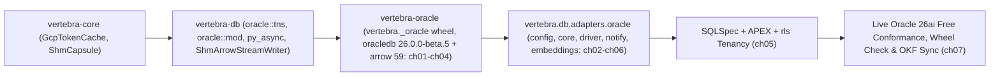

# Specification: Complete Standalone Native Oracle Thin Driver

<!-- truth: start -->
- **Standalone Pure-Rust Optional Wheel**: `src/rs/vertebra-oracle` (`vertebra._oracle`, `vertebra-core[oracle]`) wraps Oracle's official pure-Rust Thin client `oracledb = "=26.0.0-beta.5"` (`features = ["arrow"]`) with `#[pymodule(gil_used = false)]` and zero Oracle Instant Client / ODPI-C / `libclntsh` dependency [^crate-research] [^ora-driver-py].
- **Crate-Local Arrow 59 & Worker-Thread Completion Bridge**: `arrow-array = "59"`, `arrow-buffer = "59"`, `arrow-ipc = "59"`, and `arrow-schema = "59"` stay isolated inside `src/rs/vertebra-oracle/Cargo.toml`, serializing `RecordBatch` streams into `VTBARROW` `ShmCapsule` regions via `construct_py_arrow_cursor` and `ShmArrowStreamWriter` while per-connection Rust worker threads bridge blocking TTC sockets through `SyncCompletionQueue` and `AsyncCompletionQueue` with out-of-band `connection.break_execution()` cancellation [^py-async-rs] [^arrow-shm-rs].
- **26ai Native Codecs, Delayed-Commit Pipelines, & Reset-or-Evict VPD Tenancy**: Full `NUMBER`, `VARCHAR2`, `RAW`, `DATE`/`TIMESTAMP`/`TSTZ`, `BOOLEAN`, inline `CLOB`/`BLOB`, `OSON` (`msgspec`), and `VECTOR` (`VectorView` / `list[float]`) codecs, native `SyncOraclePool`/`AsyncOraclePool` with DRCP and TTC piggyback, delayed-commit `SyncOraclePipeline`/`AsyncOraclePipeline`, and trusted-package + `DBMS_SESSION.SET_IDENTIFIER` tenancy (`vertebra.db.rls`) with mandatory pool reset or physical session eviction ship together in one PR [^ora-core-py] [^ora-rs-codecs] [^db-rls-py] [^sqlspec-py].
- **Nested Chapter Roadmap (`plan_revision: 3`)**: Decomposed into `7` dependency-ordered chapters (`ch01`–`ch07`, `22` vertical-slice tasks, each owning `<= 3` production files) starting from the `driver-fail-loud` (`plan_commit: fd571e3a`) baseline [^fail-loud-baseline].
<!-- truth: end -->

## 1. Specification, Context & Provenance

### 1.1 Problem Statement & Upstream Execution Baseline

This flow delivers the complete standalone native Oracle Thin driver (`src/rs/vertebra-oracle` -> `vertebra._oracle`, `vertebra-core[oracle]`) and cuts over `SyncOracleDriver`, `AsyncOracleDriver`, `SyncOraclePool`, `AsyncOraclePool`, `SyncOraclePipeline`, `AsyncOraclePipeline`, `OracleNotificationSource`, `OracleEmbeddingPushdown`, `OracleSessionManager`, and SQLSpec `OracleSyncDriver` / `OracleAsyncDriver` in one pull request.

Upstream [`driver-fail-loud`](../driver-fail-loud/spec.md) (`plan_commit: fd571e3a`, `ch01`, `ch02`, `ch06`, `ch07`, `ch08`, `ch09`) removes the `sqlite3.connect(":memory:")` stand-in, `set_session_attrs`, `last_piggyback_frame`, and SQLite-only helpers from `src/py/vertebra/db/adapters/oracle/driver.py` and `core.py`, removes dead TNS framing, `OraclePool`, and `OracleWalletMaterial` stubs from `src/rs/vertebra-db/src/oracle/`, and makes `_require_oracle_native()` raise `MissingDependencyError` naming `vertebra-core[oracle]` [^fail-loud-baseline]. This flow starts from that fail-loud baseline, replaces the stubbed `NotImplementedError` driver methods with real Rust-backed Oracle 26ai execution, and re-introduces `set_session_attrs` and `last_piggyback_frame` backed by the native `_oracle` client.

### 1.2 Non-Goals

- Linking C/C++ Oracle Instant Client (`libclntsh`), ODPI-C, or third-party Python `oracledb` / `cx_Oracle` packages.
- Leaking `arrow 59` into `vertebra-core`, `vertebra-db`, `vertebra-bigquery`, or `vertebra-spanner`.
- Implementing the live SQL-backed `OracleQueueStore` for `vertebra.framework.queues.oracle` (owned by sibling flow `queues-tasks-and-channels`).
- Adding Oracle-specific SQL or types into generic `src/py/vertebra/db/*.py` or `src/py/vertebra/db/driver/*.py` modules.

### 1.3 Code Analysis & Seam Summary

| Area | Existing Symbol (`path::Symbol`) | Verified Consequence |
| :--- | :--- | :--- |
| **Rust Codecs & TNS** | [mod.rs](../../../../src/rs/vertebra-db/src/oracle/mod.rs)`::OracleSessionAttrs` [^ora-rs-codecs], [tns.rs](../../../../src/rs/vertebra-db/src/oracle/tns.rs)`::parse_tnsnames_ora` [^ora-rs-tns] | Reuse stateless TTC piggyback (`[0x11, 0x6e, count, ...]`), `OSON`, `VECTOR` (`0xDB 0x01`), and `tnsnames.ora` alias resolution helpers from `vertebra-db::oracle`, while keeping `OracleWalletMaterial` self-contained inside `vertebra-oracle::dialer`. |
| **Async & Arrow SHM** | [py_async.rs](../../../../src/rs/vertebra-db/src/py_async.rs)`::spawn_rust_db_task_with_attr` [^py-async-rs], [arrow_shm.rs](../../../../src/rs/vertebra-db/src/arrow_shm.rs)`::ShmArrowStreamWriter` [^arrow-shm-rs] | Bridge blocking `oracledb` worker threads via `SyncCompletionQueue` and `AsyncCompletionQueue` (`_vertebra_oracle_completion_drainer`) and pass crate-local `arrow-ipc 59` `(ipc_bytes, row_count)` into `construct_py_arrow_cursor`. |
| **Oracle Config & Core** | [config.py](../../../../src/py/vertebra/db/adapters/oracle/config.py)`::OracleConfig.connect_descriptor` [^ora-config-py], [core.py](../../../../src/py/vertebra/db/adapters/oracle/core.py)`::OracleCore.build_session_context_sql` [^ora-core-py] | Fix default `dsn` overriding explicit `host`/`port`/`service_name`; support trusted VPD context package procedures alongside `DBMS_SESSION.SET_IDENTIFIER` so Oracle 26ai never fails with `ORA-01031`. |
| **Python Driver & Pool** | [driver.py](../../../../src/py/vertebra/db/adapters/oracle/driver.py)`::{SyncOracleDriver,AsyncOracleDriver}` [^ora-driver-py] | Back `SyncOracleDriver`, `AsyncOracleDriver`, `SyncOraclePool`, `AsyncOraclePool`, `SyncOraclePipeline`, and `AsyncOraclePipeline` with `vertebra._oracle` (`SyncOracleClient`, `AsyncOracleClient`, `SyncOraclePool`, `AsyncOraclePool`). |
| **Tenancy, SQLSpec & APEX** | [rls.py](../../../../src/py/vertebra/db/rls.py)`::TenantPredicate` [^db-rls-py], [adapters.py](../../../../src/py/vertebra/extensions/sqlspec/adapters.py)`::{OracleSyncDriver,OracleAsyncDriver}` [^sqlspec-py], [session.py](../../../../src/py/vertebra/extensions/apex/session.py)`::OracleSessionManager` [^apex-session-py] | Set `_execution_parameter_style = ParameterStyle.NAMED_COLON` on SQLSpec Oracle drivers; hold pipeline transactions across `results()` until `__exit__`/`__aexit__`; align VPD tenancy and APEX session attach/detach with trusted package / `SET_IDENTIFIER` and reset-or-evict. |
| **Conformance Matrix** | [test_driver_conformance.py](../../../../src/py/tests/integration/db/test_driver_conformance.py)`::ENGINE_SPECS` [^conformance-py] | Provide Oracle-valid `_ORACLE_ITEMS_DDL` (`vtb_conformance_items`) and `_ORACLE_TYPES_DDL` (`vtb_conformance_types`), set `supports_pipeline=True` and `pending_flow_id=None`, and enforce lowercase column projection when `enable_lowercase_column_names=True`. |

### 1.4 Relevant OKF Knowledge, Research & Skills

Read [database-drivers-and-dialers.md](../../knowledge/domains/data/database-drivers-and-dialers.md), [query-pipeline-cdc-and-tenancy.md](../../knowledge/domains/data/query-pipeline-cdc-and-tenancy.md), [connection-pools-and-brokers.md](../../knowledge/domains/data/connection-pools-and-brokers.md), [zero-copy-shm-data-plane.md](../../knowledge/domains/data/zero-copy-shm-data-plane.md), [oracle-apex.md](../../knowledge/domains/extensions/oracle-apex.md), [adr-004-optional-driver-wheels-and-shm-ownership.md](../../knowledge/decisions/adr-004-optional-driver-wheels-and-shm-ownership.md), [rust-driver-crates_20261103.md](../native-data-platform/research/rust-driver-crates_20261103.md), [contracts.md](contracts.md), and the project-local [pyo3-bridge](../../../skills/pyo3-bridge/SKILL.md), [runtime-ipc](../../../skills/runtime-ipc/SKILL.md), and [python-framework](../../../skills/python-framework/SKILL.md) skills.

## 2. Requirements, Concrete Contracts & Architecture

### 2.1 Functional Requirements (`R1`–`R14`)

The [public contracts](contracts.md) define constructor signatures, descriptor precedence, worker-thread completion, `ORA-xxxxx` SQLSTATE mappings, codecs, Arrow 59 SHM transfer, native pools, delayed-commit pipelines, and VPD reset-or-evict tenancy.

- **R1 (Standalone Wheel & Build Matrix)**: Scaffold `src/rs/vertebra-oracle` (`lib.name = "_oracle"`, `#[pymodule(gil_used = false)]`), lock `oracledb = "=26.0.0-beta.5"` (`features = ["arrow"]`) and crate-local `arrow-* = "59"` in `src/rs/Cargo.lock`, and wire `src/py/vertebra/_oracle.pyi`, root `[project.optional-dependencies].oracle`, sibling wheel exclusions, `Makefile` (`dev`, `build`, `lint`, `lint-all`, `py-test`, `oracle-test`, `oracle-wheel-check`), `.github/workflows/release.yaml`, and `.agents/skills/review-core/references/areas.toml`.
- **R2 (Descriptor Precedence, TNS, Wallet mTLS, & Token Auth)**: Fix `OracleConfig.connect_descriptor()` so explicit `host`/`port`/`service_name` override the default `dsn`; resolve Easy Connect Plus, `(DESCRIPTION=...)` (`OracleTopologyConfig.to_tns_descriptor()`), and `tnsnames.ora` aliases; support in-memory Autonomous Database Wallet (`ewallet.pem`, `cwallet.sso`, `.zip`) mTLS, O5LOGON password auth, and IAM/OAuth2 bearer token refresh (`vertebra_core::gcp_auth::GcpTokenCache`).
- **R3 (Worker-Thread Completion Bridge & Out-of-Band Cancellation)**: Run each blocking `oracledb::Connection` on a dedicated Rust worker thread bridged via `SyncCompletionQueue` (`py.detach`) and `AsyncCompletionQueue` (`spawn_rust_db_task_with_attr` with `_vertebra_oracle_completion_drainer`), and wire sync `cancel()` and `asyncio.Future` cancellation to out-of-band `connection.break_execution()` (`ORA-01013` -> `QueryCancelledError`, `sqlstate="57014"`).
- **R4 (`ORA-xxxxx` to SQLSTATE Error Hierarchy)**: Map Oracle server, TNS, and transport errors deterministically in `crate::errors::OracleError` to `vertebra_py::errors::DbExceptionTypes` classes (`IntegrityError`, `SerializationFailure`, `OperationalError`, `ConnectionFailure`, `QueryCancelledError`, `NotFoundError`, `DataError`, `ProgrammingError`, `DatabaseError`) with accurate `sqlstate`, `vendor_code`, and `is_transient`.
- **R5 (Scalar, LOB, 26ai `OSON`, & `VECTOR` Codecs)**: Encode and decode `NUMBER` (`int`, `float`, `Decimal`), `VARCHAR2`/`NVARCHAR2`/`CHAR`, `RAW`, `DATE`/`TIMESTAMP`/`TIMESTAMP WITH TIME ZONE`, `BOOLEAN`, inline `CLOB`/`BLOB`, `OSON` (`msgspec`), and `VECTOR` (`FLOAT32`/`FLOAT64`/`INT8`/`BINARY` magic `0xDB 0x01`).
- **R6 (Positional/Named Binds, `DML RETURNING INTO`, Batching, & Column Casing)**: Support `:1..:n` sequence binds and `:name` mapping binds, single-round-trip `DML ... RETURNING ... INTO` out-binds, `execute_many` batch execution, and `enable_lowercase_column_names` (`True` default) across row dicts, cursor descriptions, and Arrow schemas.
- **R7 (Crate-Local Arrow 59 to `VTBARROW` SHM Data Plane)**: Implement `query_arrow` / `select_to_arrow` / `stream_arrow_batches` using `oracledb` `features = ["arrow"]` and crate-local `arrow-ipc = "59"` into `construct_py_arrow_cursor` (`ArrowCursor` with `used_shm` and `buffer_view()`), plus `load_from_arrow` batch/direct-path ingestion.
- **R8 (Native Rust Connection Pools, DRCP, & TTC Piggyback)**: Export `SyncOraclePool` and `AsyncOraclePool` from `vertebra._oracle` (and Python wrapper facades) with bounded `acquire`/`release`, statement cache sizing, health checks, DRCP `cclass`/`purity` (`SELF` vs `NEW`)/connection tagging, and zero-extra-round-trip TTC piggyback (`[0x11, 0x6e, count, ...]` via `set_session_attrs`) on lease checkout.
- **R9 (Delayed-Commit Sequential Pipelines)**: Implement `SyncOraclePipeline` and `AsyncOraclePipeline` holding an open transaction or `SAVEPOINT _vtb_pipe_<n>` across `results()` and committing only on clean `__exit__`/`__aexit__`, with a tracking test (`ORACLESQL_NATIVE_TTC_PIPELINE_SUPPORTED`) detecting when upstream `oracledb` exposes non-blocking TTC pipelining.
- **R10 (VPD Trusted-Package + `SET_IDENTIFIER` Tenancy & Pool Reset-or-Evict)**: Support configurable trusted context package procedures (`context_namespace`, `context_package_proc`, `context_clear_proc` on `OracleConfig`) alongside `DBMS_SESSION.SET_IDENTIFIER` / `CLEAR_IDENTIFIER` and TTC piggyback in `OracleCore` and `vertebra.db.rls`, and enforce mandatory context reset on lease release with physical connection eviction if reset fails.
- **R11 (SQLSpec & Oracle APEX Integration)**: Set `_execution_parameter_style = ParameterStyle.NAMED_COLON` on `OracleSyncDriver` and `OracleAsyncDriver` in `extensions/sqlspec/adapters.py`, and align `OracleSessionManager` in `extensions/apex/session.py` with trusted-package / `SET_IDENTIFIER` context management and `set_session_attrs` `ECID` propagation.
- **R12 (Live TxEventQ / `DBMS_AQ` Notification Stream & Embedding Pushdown)**: Implement `@runtime_checkable NotificationSource` on `OracleNotificationSource` (`publish`, `subscribe`, `unsubscribe`, `listen() -> AsyncIterator[NotificationEvent]`) in `oracle/notify.py` and extend `OracleEmbeddingPushdown._extract_vector` / `_extract_batch_vectors` in `oracle/embeddings.py` to unwrap native `VectorView` and binary `VECTOR` payloads while preserving existing `EmbeddingPushdown` method signatures.
- **R13 (Live Oracle 26ai Free Conformance & Wheel Isolation Gates)**: Add `_ORACLE_ITEMS_DDL` (`vtb_conformance_items`) and `_ORACLE_TYPES_DDL` (`vtb_conformance_types`) to `test_driver_conformance.py`, set `supports_pipeline=True` and `pending_flow_id=None` on the Oracle `EngineConformanceSpec`, verify live `gvenzl/oracle-free:23-slim` (`127.0.0.1:5531/FREEPDB1`) conformance, and verify outside-checkout wheel isolation and `3.14t`/`3.15t` disabled-GIL import (`make oracle-wheel-check`).
- **R14 (User Documentation & OKF v0.2 Knowledge Synchronization)**: Synchronize `docs/usage/databases.md`, `README.md`, `AGENTS.md`, and OKF v0.2 knowledge chapters (`database-drivers-and-dialers.md`, `query-pipeline-cdc-and-tenancy.md`, `tech-stack.md`).

### 2.2 Cross-Chapter Architecture & Seam Topology

### 2.3 Acceptance Scenarios

| Given | When | Then |
| :--- | :--- | :--- |
| `OracleConfig(host="db.internal", port=1530, service_name="ORCLPDB1")` without explicit `dsn` | `cfg.connect_descriptor()` is called | Returns `"db.internal:1530/ORCLPDB1"` instead of the default `"localhost:1521/FREEPDB1"`. |
| Easy Connect, `tnsnames.ora` alias, or in-memory `.zip` wallet | `SyncOracleClient` / `AsyncOracleClient` connects | Negotiates TCP or TCPS mTLS, authenticates via O5LOGON or IAM token, and applies initial `stmtcachesize`. |
| Running query (`DBMS_SESSION.SLEEP(5)`) on sync or async driver | Caller invokes `cancel()` or cancels the `asyncio.Task` | Out-of-band `connection.break_execution()` aborts the call with `QueryCancelledError` (`sqlstate="57014"`, `vendor_code=1013`) and the connection remains usable. |
| Table with `NUMBER`, `VARCHAR2`, `CLOB`, `RAW`, `TSTZ`, `BOOLEAN`, `JSON` (`OSON`), and `VECTOR(3, FLOAT32)` | `select()` and `select_to_arrow()` execute | `select()` returns typed Python values (`dict`, `VectorView`/`list[float]`) with lowercase column keys; `select_to_arrow()` returns a `VTBARROW` `ArrowCursor` (`cursor.used_shm`) without leaking `arrow 59`. |
| `BaseSyncDriver.execute_stack` / `BaseAsyncDriver.execute_stack` over `driver.pipeline()` | A post-`results()` `one()` cardinality check or DTO hydration raises inside the `with` block | The pipeline transaction (or `SAVEPOINT`) rolls back on `__exit__`/`__aexit__` and zero prior statements in the pipeline persist. |
| Pooled Oracle session leased under tenant scope (`vertebra.db.rls`) or `OracleSyncDriver.apply_tenant_predicate` | Scope exits normally, raises an exception, or reset fails | Trusted clear procedure or `DBMS_SESSION.CLEAR_IDENTIFIER` executes before pool return; if reset fails, the physical session is evicted from the pool. |
| Live `gvenzl/oracle-free:23-slim` container on `127.0.0.1:5531/FREEPDB1` | `make oracle-test` and `make oracle-wheel-check` run | Full conformance matrix (`CRUD`, transactions, savepoints, pipelines, Arrow SHM, OSON, VECTOR, tenancy reset, notifications) and isolated wheel checks exit `0`. |

### 2.4 Alternatives Comparison Summary

| Seam | Chosen Design | Rejected Alternative | Rationale |
| :--- | :--- | :--- | :--- |
| Native Rust boundary (`vertebra._oracle`) | Export `SyncOracleClient`, `AsyncOracleClient`, `SyncOraclePool`, and `AsyncOraclePool` from Rust | Export only single-session clients and pool in Python | Keeps worker-thread management, DRCP tag/purity state, TTC piggyback, and reset-or-evict health checks inside Rust without GIL bounce, matching `vertebra._postgres`. |
| Worker concurrency & Arrow version | Dedicated worker thread per `oracledb::Connection` + crate-local `arrow-ipc = "59"` into `construct_py_arrow_cursor` | Shared `Arc<Mutex<Connection>>` thread pool + workspace Arrow version bump | Avoids mutex contention between socket reads and out-of-band `break_execution()` cancellation, and keeps `arrow 59` isolated from `vertebra-core` (`arrow 58`/`60`). |
| VPD tenancy & pool cleanup | Configurable trusted context package (`context_package_proc` / `context_clear_proc`) + `DBMS_SESSION.SET_IDENTIFIER` fallback + evict-on-failed-reset | Raw `DBMS_SESSION.SET_CONTEXT` without pool reset | Raw `DBMS_SESSION.SET_CONTEXT` fails with `ORA-01031` outside a trusted package on Oracle 26ai, and session-scoped `SYS_CONTEXT`/`CLIENT_IDENTIFIER` survives `ROLLBACK`. |

## 3. Documentation & OKF Knowledge Plan

Progress: `[0/6 files documented]` (owned by [ch07-conformance-and-okf-synthesis](chapters/ch07-conformance-and-okf-synthesis/spec.md) tasks `ch07:t03` and `ch07:t04`).

- `docs/usage/databases.md` (`ch07:t03`) — Document `vertebra-core[oracle]` installation, `OracleConfig` descriptor precedence, Autonomous Wallet mTLS, 26ai `VECTOR` and `OSON` usage, delayed-commit `pipeline()`, VPD trusted-package and `CLIENT_IDENTIFIER` tenancy, and `OracleNotificationSource`.
- `README.md` (`ch07:t03`) — Register `vertebra-oracle` (`_oracle`), the `[oracle]` optional extra, and `oracle-test` / `oracle-wheel-check` Make targets.
- `AGENTS.md` (`ch07:t03`) — Register `vertebra-oracle` (`_oracle`) in the workspace crate and verification command summary within the `<= 100`-line budget.
- `.agents/bundles/knowledge/domains/data/database-drivers-and-dialers.md` (`ch07:t04`) — Document `vertebra-oracle` worker-thread completion bridge, `oracledb =26.0.0-beta.5` + `arrow 59` SHM integration, Autonomous Wallet mTLS, and DRCP pooling.
- `.agents/bundles/knowledge/domains/data/query-pipeline-cdc-and-tenancy.md` (`ch07:t04`) — Document Oracle delayed-commit sequential pipelines, VPD trusted-package + `SET_IDENTIFIER` reset-or-evict lifecycle, and `OracleNotificationSource`.
- `.agents/bundles/product/tech-stack.md` (`ch07:t04`) — Register `vertebra-oracle` (`oracledb =26.0.0-beta.5`, crate-local `arrow 59`) in the Rust workspace and optional wheel catalog.

## 4. Requirement-to-Chapter Traceability Matrix

| Requirement | Owning Chapters & Tasks | Verification Strategy | Canonical Public Seam / Gate |
| :--- | :--- | :--- | :--- |
| R1 | [ch01](chapters/ch01-crate-and-packaging/spec.md) (`ch01:t01`–`t03`) | `static_validation`, `regression_tdd` | `src/py/vertebra/_oracle.pyi`, `src/py/tests/unit/test_freethreaded_gil.py`, `make review-check` |
| R2 | [ch02](chapters/ch02-connect-auth-and-error-hierarchy/spec.md) (`ch02:t01`–`t02`) | `behavior_tdd` | `src/py/tests/unit/db/test_oracle_adapter.py`, `src/rs/vertebra-oracle/src/config.rs` |
| R3 | [ch02](chapters/ch02-connect-auth-and-error-hierarchy/spec.md) (`ch02:t02`–`t03`) | `behavior_tdd` | `src/rs/vertebra-oracle/src/client.rs`, `src/py/tests/unit/db/test_oracle_adapter.py` |
| R4 | [ch02](chapters/ch02-connect-auth-and-error-hierarchy/spec.md) (`ch02:t01`, `ch02:t03`) | `behavior_tdd` | `src/rs/vertebra-oracle/src/errors.rs`, `src/py/tests/unit/db/test_oracle_adapter.py` |
| R5 | [ch03](chapters/ch03-types-bind-and-arrow-shm/spec.md) (`ch03:t01`) | `behavior_tdd` | `src/rs/vertebra-oracle/src/types.rs`, `src/py/tests/unit/db/test_oracle_adapter.py` |
| R6 | [ch03](chapters/ch03-types-bind-and-arrow-shm/spec.md) (`ch03:t02`) | `behavior_tdd` | `src/py/vertebra/db/adapters/oracle/driver.py`, `src/py/tests/unit/db/test_oracle_adapter.py` |
| R7 | [ch03](chapters/ch03-types-bind-and-arrow-shm/spec.md) (`ch03:t03`) | `behavior_tdd` | `src/rs/vertebra-oracle/src/arrow.rs`, `src/py/tests/unit/db/test_oracle_adapter.py` |
| R8 | [ch04](chapters/ch04-pools-drcp-and-session-piggyback/spec.md) (`ch04:t01`–`t03`) | `behavior_tdd` | `src/rs/vertebra-oracle/src/pool.rs`, `src/py/tests/unit/db/test_oracle_adapter.py` |
| R9 | [ch05](chapters/ch05-pipelines-tenancy-and-apex/spec.md) (`ch05:t01`) | `behavior_tdd` | `src/py/vertebra/db/adapters/oracle/driver.py`, `src/py/tests/unit/db/test_oracle_adapter.py` |
| R10 | [ch05](chapters/ch05-pipelines-tenancy-and-apex/spec.md) (`ch05:t02`) | `behavior_tdd` | `src/py/vertebra/db/adapters/oracle/core.py`, `src/py/vertebra/db/rls.py`, `src/py/tests/unit/db/test_oracle_adapter.py` |
| R11 | [ch05](chapters/ch05-pipelines-tenancy-and-apex/spec.md) (`ch05:t03`) | `behavior_tdd` | `src/py/vertebra/extensions/sqlspec/adapters.py`, `src/py/vertebra/extensions/apex/session.py`, `src/py/tests/unit/extensions/test_oracle_apex.py` |
| R12 | [ch06](chapters/ch06-notifications-and-embeddings/spec.md) (`ch06:t01`–`t03`) | `behavior_tdd` | `src/py/vertebra/db/adapters/oracle/notify.py`, `src/py/vertebra/db/adapters/oracle/embeddings.py`, `src/py/tests/unit/db/test_oracle_adapter.py` |
| R13 | [ch07](chapters/ch07-conformance-and-okf-synthesis/spec.md) (`ch07:t01`–`t02`) | `behavior_tdd`, `regression_tdd` | `src/py/tests/integration/db/test_driver_conformance.py`, `tools/scripts/verify_oracle_wheel.py` |
| R14 | [ch07](chapters/ch07-conformance-and-okf-synthesis/spec.md) (`ch07:t03`–`t04`) | `documentation_validation`, `static_validation` | `make docs-check`, `make review-check` |

## 5. Implementation Plan

Every worksheet (`22` total across `7` chapters) executes in one bounded invocation and produces one signed local conventional commit (`<= 3` production files, `read_set <= 6`, `estimated_loc <= 250`).

- [~] ch01-crate-and-packaging — Rust Crate Scaffold, Build Matrix, and Optional Wheel Wiring (chapters/ch01-crate-and-packaging/spec.md)
- [ ] ch02-connect-auth-and-error-hierarchy — TNS/Wallet/Token Dialer, Worker Bridge, and SQLSTATE Error Mapping (chapters/ch02-connect-auth-and-error-hierarchy/spec.md)
- [ ] ch03-types-bind-and-arrow-shm — Type Codecs, Positional/Named Binds, RETURNING, and Arrow 59 SHM Bridge (chapters/ch03-types-bind-and-arrow-shm/spec.md)
- [ ] ch04-pools-drcp-and-session-piggyback — Native Sync/Async Pools, DRCP Purity/Tagging, and TTC Session Piggyback (chapters/ch04-pools-drcp-and-session-piggyback/spec.md)
- [ ] ch05-pipelines-tenancy-and-apex — Transaction/Savepoint Pipelines, VPD Trusted Tenancy, and APEX Session Bridge (chapters/ch05-pipelines-tenancy-and-apex/spec.md)
- [ ] ch06-notifications-and-embeddings — TxEventQ / AQ Notification Stream and Vector Embedding Pushdown (chapters/ch06-notifications-and-embeddings/spec.md)
- [ ] ch07-conformance-and-okf-synthesis — Live Oracle 26ai Free Conformance Suite, Wheel Isolation Gate, and OKF Synthesis (chapters/ch07-conformance-and-okf-synthesis/spec.md)

**Flow Recovery Checkpoint:** `uv lock --check && make lint-all && make rs-test && make py-test && make oracle-test && make oracle-wheel-check && make docs-check && make review-check && make review-route` exits `0` with zero Oracle skips or xfails, followed by clean correctness and fresh independent quality reviews before `/flow:finish native-oracle-driver` and `/flow:archive native-oracle-driver`.

## 6. Current State & Remaining Plan Snapshot

- **Plan Baseline**: `HEAD @ 769302bc`; `state: planned`, `has_chapters: true`, `plan_revision: 3`, `plan_commit: 769302bc`.
- **Upstream Flow Dependency**: [`driver-fail-loud`](../driver-fail-loud/spec.md) (`plan_commit: fd571e3a`) completes before `ch01` starts [^fail-loud-baseline].
- **Active Chapter & Next Task**: [ch01-crate-and-packaging](chapters/ch01-crate-and-packaging/spec.md) (`native-oracle-driver:ch01:t01`); all `7` chapters (`22` vertical-slice tasks) are authored upfront (`0/22` completed).
- **Documentation & OKF Status**: `[0/6 files documented]`, scheduled in [ch07-conformance-and-okf-synthesis](chapters/ch07-conformance-and-okf-synthesis/spec.md) (`ch07:t03`–`t04`).
- **Delivery & Next Action**: Complete single-PR delivery on `feat/native-oracle-driver`.

[^fail-loud-baseline]: `.agents/bundles/specs/driver-fail-loud/spec.md` — Upstream flow removing Oracle `sqlite3` stand-in and dead `vertebra-db` TNS/pool stubs.
[^crate-research]: `.agents/bundles/specs/native-data-platform/research/rust-driver-crates_20261103.md` — Primary-source evaluation of official pure-Rust `oracledb =26.0.0-beta.5` crate.
[^ora-driver-py]: `src/py/vertebra/db/adapters/oracle/driver.py::SyncOracleDriver` — Python `SyncOracleDriver`, `AsyncOracleDriver`, `SyncOraclePool`, and `SyncOraclePipeline` target module.
[^ora-config-py]: `src/py/vertebra/db/adapters/oracle/config.py::OracleConfig` — `OracleConfig`, `OracleWallet`, `OracleDrcpConfig`, and `OracleTopologyConfig` definitions.
[^ora-core-py]: `src/py/vertebra/db/adapters/oracle/core.py::OracleCore` — Oracle codecs, TNS helpers, and VPD session context SQL builders.
[^ora-rs-codecs]: `src/rs/vertebra-db/src/oracle/mod.rs::OracleSessionAttrs` — Shared Rust Oracle TTC piggyback, `OSON`, and `VECTOR` binary codecs.
[^ora-rs-tns]: `src/rs/vertebra-db/src/oracle/tns.rs::parse_tnsnames_ora` — Shared Rust TNS Connect Descriptor parser and alias resolver.
[^py-async-rs]: `src/rs/vertebra-db/src/py_async.rs::spawn_rust_db_task_with_attr` — Shared `AsyncCompletionQueue`, `construct_py_arrow_cursor`, and independent event-loop drainer.
[^arrow-shm-rs]: `src/rs/vertebra-db/src/arrow_shm.rs::ShmArrowStreamWriter` — Shared-memory Arrow IPC stream writer for `VTBARROW` capsules.
[^db-rls-py]: `src/py/vertebra/db/rls.py::TenantPredicate` — Row-level security and session-scoped tenant predicate primitives.
[^sqlspec-py]: `src/py/vertebra/extensions/sqlspec/adapters.py::OracleSyncDriver` — SQLSpec Oracle adapter and stack execution integration seam.
[^apex-session-py]: `src/py/vertebra/extensions/apex/session.py::OracleSessionManager` — Oracle APEX session attachment and VPD context propagation helper.
[^conformance-py]: `src/py/tests/integration/db/test_driver_conformance.py::ENGINE_SPECS` — Cross-engine database driver conformance matrix and pipeline suite.
