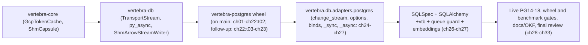

# Specification: Complete Standalone Native PostgreSQL Driver

<!-- truth: start -->
- **Wheel on Main**: [PR #104](https://github.com/cofin/vertebra/pull/104) (squash commit `c8722c76`) ships `src/rs/vertebra-postgres` (`vertebra._postgres`, `vertebra-core[postgres]`) with Protocol 3.0 sockets over `postgres-protocol =0.6.12` and `rustls` (`ring`), SCRAM/PLUS, Cloud SQL and AlloyDB discovery with mTLS and IAM, lossless codecs, pools, statement caches, single-`Sync` pipelines, cancellation, binary `COPY`, `VTBARROW`, `LISTEN`/`NOTIFY`, and `CopyBoth` replication sessions with `pgoutput` relation/insert decoding (`ch01`–`ch21`, `ch22:t01`–`t02`, `80/119` tasks) [^pg-conn-rs] [^pg-core-rs] [^py-async-rs] [^arrow-shm-rs].
- **Split Runtime State on Main**: The Python drivers are not cut over. `SyncPostgreSQLDriver` executes through `psycopg_pool`, `AsyncPostgreSQLDriver` offloads that sync driver with `asyncio.to_thread`, `PostgreSQLQueueBackend` probes `psycopg` when `executor=` is missing, and `pipeline.py` / `arrow.py` are imported only by unit tests; the PR #104 title and body describe a cutover that main does not contain [^pg-driver-py] [^pg-queue-py] [^pg-pipeline-py] [^pg-arrow-py].
- **Follow-Up Pull Request**: `ch22:t03` through `ch33` (`39` tasks) ship together in one follow-up pull request: `pgoutput` transaction envelopes, commit-fenced feedback, resume and bridge, the CAS change source, permanent native drivers, atomic consumer cutover with full `psycopg`/`asyncpg` runtime removal, live PG14–18 conformance, wheel/free-threaded/benchmark gates, and documentation/OKF synchronization [^sqlspec-py].
- **Squash Mapping**: Task `commit:` values and checklist SHAs in `ch01`–`ch22` are pre-squash branch SHAs reachable only through PR #104; all of them map to squash commit `c8722c76` on main, which anchors `plan_commit`, `last_verified_checkpoint`, `last_reviewed_commit`, and every follow-up review range.
- **Fail-Loud Baseline**: `driver-fail-loud` deletes `_in_memory_rows`, every PostgreSQL `memory://` branch, and `vertebra_db::postgres::PostgresPool`; this flow adds no memory or SHM-admission pool paths [^fail-loud-baseline].
<!-- truth: end -->

## 1. Specification, Context & Provenance

### 1.1 Problem Statement & Current Baseline

[PR #104](https://github.com/cofin/vertebra/pull/104) squash-merges the native wheel onto `main` as `c8722c76` with `80` of `119` tasks complete. Every chapter through `ch21` and `ch22:t01`–`t02` is implemented and reviewed. The pre-squash task commits recorded in completed worksheets (for example `62bf91f1` for `ch01` and `64288c63` for `ch22:t02`) are not ancestors of `main`; they remain readable only through the PR #104 branch history, and `c8722c76` is the single `main` commit that contains all of them.

The Python adapter layer on `main` still runs on third-party clients: `src/py/vertebra/db/adapters/postgres/driver.py::SyncPostgreSQLDriver` builds a `psycopg_pool.ConnectionPool`, `AsyncPostgreSQLDriver` wraps that sync driver with `asyncio.to_thread`, `src/py/vertebra/framework/queues/postgres.py::PostgreSQLQueueBackend` probes `psycopg` before raising for a missing `executor=`, `src/py/vertebra/db/dialer/{cloudsql,alloydb}.py` expose `create_psycopg_connect_func` / `create_asyncpg_connect_func`, and `src/py/tests/unit/db/test_postgres_driver.py` exercises `AsyncPostgreSQLDriver` through a SQLite-backed asyncpg pool double (`_SQLiteAsyncPGPool`). `src/py/vertebra/db/adapters/postgres/pipeline.py` and `arrow.py` are complete but imported only by `test_postgres_native_pipeline.py` and `test_postgres_native_data.py` [^pg-driver-py] [^pg-queue-py] [^pg-pipeline-py] [^pg-arrow-py].

The remaining `39` tasks (`ch22:t03`–`ch33:t01`) ship in one follow-up pull request from a branch cut off `main` at `c8722c76`. `ch22:t04` records the split state in the PostgreSQL limitations OKF entry early in that branch; `ch27:t04` removes those caveats once the cutover lands. Hosted writes (push, PR creation, workflow dispatch) require separate explicit user permission.

This flow depends on [`driver-fail-loud`](../../knowledge/domains/data/database-drivers-and-dialers.md), which deletes `_in_memory_rows` and every `memory://` branch from `driver.py` (a `memory://` DSN raises `ImproperConfigurationError`) and deletes `vertebra_db::postgres::PostgresPool` [^fail-loud-baseline].

### 1.2 Non-Goals

- Leaving `psycopg`/`asyncpg` runtime fallbacks, compatibility aliases, or feature flags in any PostgreSQL production path after `ch27`.
- Negotiating PostgreSQL wire protocol `3.2` (Protocol `3.0` governs the entire PostgreSQL `14`–`18` support matrix).
- Implicitly creating or dropping replication slots/publications, automatic initial snapshot backfills, or advancing `confirmed_flush_lsn` before durable checkpoint persistence.
- Engine-specific PostgreSQL imports, SQL strings, or class branches in generic `src/py/vertebra/db/*.py` or `src/py/vertebra/db/driver/*.py` modules.
- Live Google Cloud SQL or AlloyDB credentials in local or default CI runs (cloud paths are proven through deterministic wire/TLS harnesses).
- The native `PostgresQueueStore` executor, settings-driven queue backend registry, `litestar-queues` backend, and Django tasks backend ([`queues-tasks-and-channels`](../queues-tasks-and-channels/spec.md)), and extraction of the shared DB-API package plus `BrokerPool` ([`broker-pool-sharing`](../broker-pool-sharing/spec.md)).

### 1.3 Code Analysis Summary

| Existing symbol | Verified consequence |
| --- | --- |
| `src/rs/vertebra-db/src/connection.rs::TransportStream` [^pg-conn-rs] | Reused transport/TLS. Direct PostgreSQL sends `SSLRequest`; cloud proxy endpoints negotiate immediate mTLS. |
| `src/rs/vertebra-db/src/postgres/mod.rs::encode_query_frame` [^pg-core-rs] | Stateless frame, `JSONB`, `PGCOPY`, and vector helpers only; live connections and server prepared statements belong to `vertebra-postgres`. |
| `src/rs/vertebra-db/src/py_async.rs::spawn_rust_db_task_with_attr` [^py-async-rs] | Completion queues and independent drainer with setup-abort ownership and `PendingDeliveryGuard` stream cancellation safety. |
| `src/rs/vertebra-db/src/arrow_shm.rs::ShmArrowStreamWriter` [^arrow-shm-rs] | Accepts serialized IPC; native builders in `vertebra-postgres` produce the columns. |
| `src/rs/vertebra-postgres/src/replication/pgoutput.rs::PgOutputDecoder` | `decode_next_frame` parses `Relation`, `Type`, and `Insert` only; `ch22:t03` adds `Begin`, `Origin`, `Update`, `Delete`, `Truncate`, `Message`, and `Commit` envelopes and the bounded queue. |
| `src/py/vertebra/db/adapters/postgres/driver.py::{SyncPostgreSQLDriver,AsyncPostgreSQLDriver}` [^pg-driver-py] | `psycopg_pool` execution and `asyncio.to_thread` offload; replaced by permanent `_sync.py` / `_async.py` native drivers (`ch25`) and activated atomically (`ch27`). |
| `src/py/vertebra/db/adapters/postgres/{pipeline,arrow}.py` [^pg-pipeline-py] [^pg-arrow-py] | Test-only today; `ch26:t02` wires `SyncPostgresPipeline`/`AsyncPostgresPipeline` and `ch26:t03` wires `load_arrow_sync`/`load_arrow_async` into the permanent drivers. |
| `src/py/vertebra/framework/queues/postgres.py::PostgreSQLQueueBackend` [^pg-queue-py] | Executor-injected backend; `ch27:t04` swaps the missing-executor `psycopg` probe for `vertebra._postgres`. |
| `src/py/vertebra/extensions/sqlspec/adapters.py::{BaseSyncDriver.execute_stack,BaseAsyncDriver.execute_stack}` [^sqlspec-py] | Caller conversion and strict result validation run inside pipeline context; results cannot commit early. |
| `src/py/vertebra/db/arrow.py::ArrowCursor` [^db-arrow-py] | Public cursor wraps native SHM output; inline IPC tracks explicit native row-count metadata. |
| `src/py/tests/integration/db/test_driver_conformance.py::ENGINE_SPECS` [^conformance-py] | PostgreSQL moves to native type DDL, enabled pipeline acceptance, and strict zero-skip Docker conformance (`VERTEBRA_CONFORMANCE_POSTGRES_REQUIRE_ZERO_SKIPS=1`) in `ch28`. |
| `tools/pgo/rust_pgo.py::discover_extension_manifests` [^pgo-discovery] | Returns `vertebra-py` plus every crate with a crate-local maturin `pyproject.toml`, so `make build-pgo` already profiles `vertebra-postgres`. |
| `src/py/vertebra/db/dialer/cloudsql.py` [^dialer-cloudsql-py], `src/py/vertebra/db/dialer/alloydb.py` [^dialer-alloydb-py] | Cloud dialers keep their native helpers; `create_psycopg_connect_func` and `create_asyncpg_connect_func` are deleted in `ch27:t03`. |

### 1.4 Relevant OKF Knowledge, Research & Glossary

Read [database-drivers-and-dialers.md](../../knowledge/domains/data/database-drivers-and-dialers.md), [query-pipeline-cdc-and-tenancy.md](../../knowledge/domains/data/query-pipeline-cdc-and-tenancy.md), [adr-004-optional-driver-wheels-and-shm-ownership.md](../../knowledge/decisions/adr-004-optional-driver-wheels-and-shm-ownership.md), [ffi-and-gil-discipline.md](../../knowledge/patterns/rust/ffi-and-gil-discipline.md), [pyo3-and-python-runtime.md](../../knowledge/gotchas/pyo3-and-python-runtime.md), [object-storage-limitations.md](../../knowledge/domains/storage/object-storage-limitations.md) (limitations entry format), [protocol-and-execution_20261105.md](research/protocol-and-execution_20261105.md), [cloud-material_20261105.md](research/cloud-material_20261105.md), [contracts.md](contracts.md), [review.md](review.md), and the project-local [pyo3-bridge](../../../skills/pyo3-bridge/SKILL.md), [runtime-ipc](../../../skills/runtime-ipc/SKILL.md), [python-framework](../../../skills/python-framework/SKILL.md), and routed review skills.

`postgres-protocol = "=0.6.12"` owns low-level message framing and SCRAM helpers; `src/rs/vertebra-postgres` owns live connection state. `tokio-postgres = "=0.7.18"` is a dev-only test oracle. Arrow crates are pinned to `60.1.0`; cross-extension transfer uses producer-owned `ShmCapsule` callbacks. A **physical session** is one socket; a **lease** exclusively owns that session; a **portal** pins its lease and transaction; a **checkpoint** records durably acknowledged logical replication progress; the **split state** is `main` carrying the native wheel while Python drivers and the queue guard still use third-party clients.

## 2. Requirements, Concrete Contracts & Architecture

### 2.1 Functional Requirements (`R1`–`R27`)

The [public contracts](contracts.md) freeze constructor options, pool ownership, result/bind shapes, pipeline completion, lossless value policy, Arrow selection/import, event ownership, and checkpointing. Engine values, SQL, and checkpoint protocols stay inside `vertebra-postgres` and `vertebra.db.adapters.postgres`; shared `vertebra-db` and `vertebra.db` code remains engine-agnostic.

- **R1.** Optional standalone wheel, package/build/release registration, and typed exports.
- **R2.** Pure validated connection options, one URL/libpq parser, and lexical bind lowering.
- **R3.** Bounded protocol framing, real TCP/Unix startup, metadata, and total connection deadline.
- **R4.** Direct `SSLRequest`/TLS, verified certificate binding, and service-specific cloud identity.
- **R5.** Trust/password/MD5/SCRAM/PLUS and scope-correct direct/cloud IAM authentication.
- **R6.** Native synchronous client/query/pool surfaces with detached blocking I/O.
- **R7.** Native asynchronous completion, setup-abort ownership, and cancellation-safe publication.
- **R8.** Complete-driver gates and correctness review followed by fresh quality review over `c8722c76..HEAD`.
- **R9.** Automatic Cloud SQL/AlloyDB discovery, issued material, expiry, and refresh.
- **R10.** Owned descriptions/results, affected command counts, and exact core SQLSTATE errors.
- **R11.** Lossless scalar/numeric/temporal/JSON/container/vector values and unknown-type formats.
- **R12.** Simple multi-results and extended single-statement query execution.
- **R13.** Context-owned transactions/savepoints and exclusive physical-session affinity.
- **R14.** Real physical pools with bounded acquisition, reset, shutdown, and configuration isolation.
- **R15.** Per-connection prepared LRU and verified/configured pooler capabilities.
- **R16.** Bounded portals and sync/async stream ownership through exhaustion or abandonment.
- **R17.** Cold/warm one-`Sync`/one-flush pipeline with ordered outcomes and delayed context commit.
- **R18.** Backend-key cancellation, server cleanup, and protection against delayed cross-borrower cancel.
- **R19.** Incremental binary `COPY` input/output and exclusive-mode error recovery.
- **R20.** Native typed Arrow builders/import, exact IPC, threshold/count, and producer-owned capsule lifetime.
- **R21.** Dedicated live notifications, subscription changes, bounded delivery, and cleanup.
- **R22.** Dedicated `pgoutput`-v1 logical replication with relation/type state, ordered transaction envelopes, and independent feedback.
- **R23.** Adapter-owned checkpoint store, stable `int64` replay IDs, and explicit durable-before-feedback ack.
- **R24.** Native Python adapter, queue guard, and SQLSpec/SQLAlchemy/helper cutover with `psycopg`/`asyncpg` deleted from runtime paths, dialer helpers, and driver tests.
- **R25.** Strict PG14–18 native conformance and real `COPY`/Arrow/events/vector/pooler acceptance.
- **R26.** Installed-wheel isolation, namespace/exception identity, and actual free-threaded GIL checks.
- **R27.** Driver-specific performance evidence, public/OKF/skill documentation including the limitations record, and canonical verification.

### 2.2 Non-Functional, Protocol & Safety Constraints

- Every native module declares `gil_used = false`; synchronous network waits detach the GIL (`py.detach(...)`), async workers carry owned Rust data and never attach Python, standard-GIL runtimes verify `FREE_THREADED is _is_free_threaded_runtime()`, and isolated child subprocesses verify disabled-GIL import and concurrent query behavior on Python `3.14t` and `3.15t`.
- One bounded coalesced `read_buf` framing implementation handles standard messages while standalone `replication=database` sessions enable `CopyBoth`. Lengths, counts, and arity are validated before allocation; resource limits fail with typed errors.
- One socket owner services duplex backpressure. Abandoned portals, `COPY` / `copy_from_arrow`, pipeline failures, and cancellations drain to a synchronized protocol boundary or discard the physical socket, while async notification and replication `next()` futures restore popped records on drop via `PendingDeliveryGuard`. Any connection targeted by a possibly sent `CancelRequest` retires before another borrower can acquire it.
- Pool configuration identity includes credentials, TLS, session GUCs, cloud resource/network, IAM options, and preparation policy (`PoolerMode`, `protocol_level_pooler_cache`, `statement_cache_size`). Ordinary driver calls acquire transient leases; transaction, portal, and pipeline scopes pin them with thread/task identity checks, and `DISCARD ALL` resets invalidate prepared statements while retaining `pg_type` catalog entries.
- Cold pipelines use text formats with received descriptors while warm known OIDs use binary and unknown OIDs fall back to text, emitting exactly one `Sync` and one logical flush per batch.
- `Decimal` scale/special values, array lower bounds and `NULL` dimensions, composite attribute order, independent `PgInterval` `(months, days, microseconds)`, and `PgTemporal` ranges remain lossless; ambiguous display `wire_text` is preserved on output and rejected with `DataError` before any typed rebind or binary `COPY`.
- Native Arrow builders, raw client `copy_from_arrow(table_name, first_batch_ipc, *, columns=None, schema_name=None)` writers, and Python driver `load_from_arrow(table_name, data, *, columns=None, schema_name=None)` remain bounded, honor inline vs `VTBARROW` SHM thresholds, preserve nested types and OID metadata, and claim zero-copy only for `ShmCapsule` adoption.
- Notifications and logical replication run on dedicated direct sessions (`direct_dsn` when queries traverse a pooler) tracked via `EventSessionRegistry`. `pgoutput` v1 tails/resumes caller-owned slots and publications in `vertebra.db.adapters.postgres.change_stream` with CAS checkpoint persistence before WAL feedback. After `ch27`, zero third-party Python database clients, SQLite stand-ins, memory executors, or sync offload fallbacks remain in PostgreSQL production paths or driver unit tests (`[dependency-groups].postgres-bench` isolates `python_version == '3.12'` benchmark comparators only).

### 2.3 Cross-Chapter Architecture & Seam Topology

### 2.4 Acceptance Scenarios

| Given | When | Then |
| --- | --- | --- |
| Direct/TLS/Unix or cloud resource config | Both native clients connect | Auth/UTF8/Ready is real; wrong identity/proof/order/expiry fails and closes. |
| Scoped ADC credentials and expiring issued certificate | Concurrent cloud opens | Correct Admin/login scopes and single-flight renewal; no localhost or invented expiry. |
| Full scalar/container values, typed `NULL`, and unknown type | Query/bind/`COPY` | Lossless values and correct type formats; no binary-as-UTF8 or float `Decimal` conversion. |
| Shared driver and saturated native pool | Concurrent calls, nested transaction, or cancelled acquire | Exclusive real leases, bounded capacity, isolated scope, and no dirty reuse. |
| Cold/warm mixed-return pipeline | Middle `Parse`/`Bind`/`Execute` fails or caller conversion raises | One `Sync`/flush batch; ordered failure/skipped outcomes; transaction rolls back. |
| Active query or `COPY`/portal/event stream | Cancel/abandon/close | Original failure preserved; server work cancelled or undelivered event restored; lease recovered or retired. |
| Empty, small, large, or nested Arrow result/input | `select_to_arrow`, batch portal, raw `copy_from_arrow`, or driver `load_from_arrow` | Metadata/counts survive; threshold/schema applies; native IPC/capsule ownership and `CopyFail` abort stay valid. |
| Caller-owned slot/publication and saved checkpoint | Tail, reconnect, and acknowledge | Ordered at-least-once events, stable replay IDs, and durable-store-before-feedback. |
| Public `vertebra.db.adapters.postgres` drivers after `ch27` | Construct, execute, pipeline, queue guard, and missing wheel | Native leases only; `MissingDependencyError` names `vertebra-core[postgres]`; zero `psycopg`/`asyncpg` imports or SQLite doubles remain. |
| Native PostgreSQL 14–18 and SCRAM `PgBouncer` modes | Driver/SQLSpec/SQLAlchemy acceptance (`make postgres-test`) | Native transactions, `$n`/`numeric_dollar` binds, pools, and pipelines pass with zero skips or xfails. |
| Installed optional wheel outside checkout | Import/query/uninstall across supported and free-threaded runtimes | Core identity and namespace survive; every stub in the `Makefile` `lint` stubtest list and `FREE_THREADED` / disabled-GIL states match. |

### 2.5 Mandatory Alternatives Comparison

| Decision | Chosen seam and alternative |
| --- | --- |
| Delivery | The wheel is on `main` (`c8722c76`); the remaining chapters ship in one follow-up PR so the driver cutover, `psycopg`/`asyncpg` deletion, conformance, and docs land together. Merging the cutover piecemeal would leave consumers on mixed backends. |
| Split-state disclosure | A limitations OKF entry (`ch22:t04`) records the split state until `ch27:t04` removes it. Leaving the state implicit lets the PR #104 description mislead readers of `main`. |
| Protocol | Owned state machine over `postgres-protocol` permits single-`Sync` batches and standalone `CopyBoth`. A production `tokio-postgres` `Client` would own `Sync` behavior and prevent that contract. |
| Integration ownership | `vertebra-postgres` and `vertebra.db.adapters.postgres` own native SQL, values, cloud material, and checkpoint protocols. `PostgreSQLQueueBackend` keeps caller-injected `PostgreSQLQueueExecutor`s and guards on `vertebra._postgres`; the native queue store belongs to `queues-tasks-and-channels`, and DB-API extraction belongs to `broker-pool-sharing`. |
| Configuration | Explicit typed native kwargs and one adapter DSN/bind compiler keep validation local. Generic mapping forwarding or duplicate parsers leave runtime decisions unresolved. |
| Results | Owned engine result/column/value records preserve metadata (`PostgresReplicationRecord` omits `gc=False` because payloads hold containers); Python base-driver projections retain established shapes. |
| Pooling | Real Rust pool leases separate session ownership from SHM admission. Reusing admission counters as a pool would not manage sockets. |
| Error policy | Raise the first canonical pipeline error with ordered outcomes. Exception rows or fabricated errors for skipped operations misstate server execution. |
| CDC | Explicit adapter-owned checkpoint store/ack in `change_stream` preserves the generic stream contract. Ack-on-yield would treat delivery as durable application. |
| Arrow | Native typed builders, raw `copy_from_arrow` / driver `load_from_arrow`, and IPC-to-SHM preserve bounded row processing. Python row materialization violates that path. |

## 3. Documentation & OKF Knowledge Plan

Progress: `[0/33 files documented]`. `ch22:t04` creates `postgres-limitations.md` and registers it in both knowledge indexes as an interim split-state record, `ch27:t04` removes the split-state caveats from it, and the final synchronization runs across [ch30-user-and-workflow-docs](chapters/ch30-user-and-workflow-docs/spec.md) (`12` files, `ch30:t01`–`t04`), [ch31-data-and-testing-okf-sync](chapters/ch31-data-and-testing-okf-sync/spec.md) (`12` files, `ch31:t01`–`t04`), and [ch32-ffi-okf-and-review-routing-sync](chapters/ch32-ffi-okf-and-review-routing-sync/spec.md) (`9` files, `ch32:t01`–`t03`). Module, crate, and wheel inventories are enumerated from the `Makefile` `lint` stubtest list and `src/rs/*/Cargo.toml` at execution time rather than hardcoded counts.

- `docs/usage/databases.md` (`ch30:t01`) — Linked `uv`/`pip`/`pdm`/`poetry` `[postgres]` tabs, `$n` vs `E'...'` pyformat lowering, SQLSpec `NUMERIC` and SQLAlchemy `numeric_dollar`, `query_multi`, single-`Sync` `pipeline()`, lossless `Pg*` records, raw native `copy_to`/`copy_from`/`copy_from_arrow` vs driver `load_from_arrow`/`select_to_arrow`/`stream_arrow_batches`/`VTBARROW`, `PgBouncer` modes, `direct_dsn`, and DSN precedence (zero external driver names).
- `docs/usage/analytics-and-cdc.md` (`ch30:t01`) — Unified `$n` PostgreSQL tenant binds (replacing psycopg/asyncpg bind wording), `PostgresNotificationSource`, and `PostgresChangeSource` `pgoutput` v1 CAS checkpointing.
- `docs/reference/database-capabilities.md` (`ch30:t01`) — `heading_level: 4` mkdocstrings blocks across `PostgresChangeConfig`, `PostgresCheckpoint`, `PostgresCheckpointStore`, `MemoryPostgresCheckpointStore`, `PostgresChangeSource`, `PostgresCheckpointConflictError`, `PostgresReplicationGapError`, `PostgresEmbeddingPushdown`, `PostgresNotifyConfig`, and `PostgresNotificationSource`.
- `docs/reference/native-stubs.md` (`ch30:t02`) — `vertebra._postgres` added to the compiled-module enumeration with `heading_level: 4` members.
- `docs/reference/index.md` (`ch30:t02`) — `_postgres` added to the native stub enumeration and PostgreSQL CDC/embedding capabilities.
- `docs/getting-started/installation.md` (`ch30:t02`) — `[postgres]` linked package-manager tabs, `Optional Extras` row, and `vertebra._postgres` under Free-Threaded Python (`3.14t`/`3.15t`).
- `docs/usage/cloud-dialers.md` (`ch30:t03`) — Native `PostgreSQLConfig` Cloud SQL / AlloyDB discovery, mTLS 1.3 renewal, and scoped IAM (`cloud_auth_options`, `iam_auth_options`).
- `docs/usage/packaging-and-deployment.md` (`ch30:t03`) — `_postgres` (`vertebra-core[postgres]`) in the extension inventory and discovery-based PGO through `tools/pgo/rust_pgo.py::discover_extension_manifests`.
- `docs/usage/queues-and-realtime.md` (`ch30:t03`) — `vertebra-core[postgres]` install tabs replacing `psycopg[binary,pool]`, and the caller-injected `PostgreSQLQueueExecutor` (`executor=`) contract.
- `README.md` (`ch30:t04`) — `vertebra-postgres` crate, `_postgres` extension, `[postgres]` extra, and `postgres-*` Make targets.
- `.agents/bundles/knowledge/workflow.md` (`ch30:t04`) — `<= 200`-line workflow reference covering `_postgres`, `[dependency-groups].postgres-bench`, `postgres-*` gates, and `make review-route BASE=c8722c76`.
- `AGENTS.md` (`ch30:t04`) — `<= 100`-line agent instructions covering `vertebra-postgres` (`_postgres`) and `postgres-*` quick verification commands.
- `.agents/bundles/knowledge/domains/data/database-drivers-and-dialers.md` (`ch31:t01`) — `<= 200`-line cross-engine overview linking to `postgres-native-driver.md` and `postgres-limitations.md`.
- `.agents/bundles/knowledge/domains/data/postgres-native-driver.md` (`ch31:t01`) — New `<= 200`-line OKF `Concept` for `vertebra-postgres` sessions, pools, statement caches, SCRAM-SHA-256-PLUS, cloud mTLS+IAM, `pipeline()`, binary `COPY`, `VTBARROW`, `LISTEN`/`NOTIFY`, and `pgoutput` v1.
- `.agents/bundles/knowledge/domains/data/postgres-limitations.md` (`ch22:t04` creates, `ch27:t04` trims, `ch31:t01` completes) — `<= 200`-line OKF `Gotcha` recording the split state until cutover, then single-host DSN/`sslmode=allow` limits, tail-only `pgoutput` v1, non-durable `MemoryPostgresCheckpointStore`, `%s` backslash refusal, `execute` vs `query_multi`, cold pipeline text fallback, `PgBouncer` `statement` and `direct_dsn` boundaries, Ed25519 channel binding, wire-mock cloud CI, and `ch20`–`ch29` runtime caveats.
- `.agents/bundles/knowledge/domains/data/query-pipeline-cdc-and-tenancy.md` (`ch31:t02`) — `$n` `ParameterStyle.NUMERIC`, delayed-commit `pipeline()`, `EventSessionRegistry`, and `change_stream` CAS checkpoint contracts.
- `.agents/bundles/knowledge/index.md` (`ch22:t04` registers `postgres-limitations.md`, `ch31:t02` registers `postgres-native-driver.md`) — Frontmatter-free root knowledge catalog.
- `.agents/bundles/knowledge/domains/index.md` (`ch22:t04`, `ch31:t02`) — Frontmatter-free domain knowledge catalog registering both PostgreSQL chapters.
- `.agents/bundles/knowledge/domains/extensions/sqlspec-alchemy-and-dialects.md` (`ch31:t03`) — `ParameterStyle.NUMERIC` (`$n`) and `default_paramstyle = paramstyle = "numeric_dollar"` `+vtb` dialect contracts.
- `.agents/bundles/knowledge/testing/benchmarks-and-free-threaded.md` (`ch31:t03`) — `_postgres` `gil_used = false`, `[dependency-groups].postgres-bench` `python_version == '3.12'`, `postgres-bench*`, and `FREE_THREADED is _is_free_threaded_runtime()`.
- `.agents/bundles/knowledge/testing/polyglot-test-matrix.md` (`ch31:t03`) — Zero-skip `make postgres-test` (`VERTEBRA_CONFORMANCE_DOCKER=1` + `VERTEBRA_CONFORMANCE_POSTGRES_REQUIRE_ZERO_SKIPS=1`) and `make postgres-wheel-check`, replacing the asyncpg transaction-test references.
- `.agents/bundles/product/tech-stack.md` (`ch31:t04`) — `vertebra-postgres` crate and companion wheel in the workspace inventory.
- `.agents/bundles/product/product.md` (`ch31:t04`) — Native PostgreSQL driver, CDC, and `PostgreSQLQueueBackend` caller-injected executor baseline.
- `.agents/bundles/knowledge/domains/framework/distributed-queues-and-email.md` (`ch31:t04`) — `PostgreSQLQueueBackend` `vertebra-core[postgres]` guard and caller-injected `PostgreSQLQueueExecutor` contract.
- `.agents/bundles/knowledge/patterns/rust/ffi-and-gil-discipline.md` (`ch32:t01`) — `_postgres` FFI pattern, cross-`cdylib` primitive kwargs and `VTBARROW`, and `PendingDeliveryGuard` async drop restoration.
- `.agents/bundles/knowledge/gotchas/pyo3-and-python-runtime.md` (`ch32:t01`) — `_postgres` runtime gotchas, `-m` `maturin`, `[dependency-groups].postgres-bench`, and async drop-loss prevention.
- `.agents/bundles/knowledge/architecture/worker/pyo3-ffi-and-batch-dispatch.md` (`ch32:t01`) — `_postgres.pyi` surface and database extension boundary.
- `.agents/bundles/knowledge/domains/frontend/packaging-and-pgo.md` (`ch32:t02`) — `vertebra-postgres` companion wheel joining discovery-based PGO.
- `.agents/bundles/knowledge/decisions/adr-004-optional-driver-wheels-and-shm-ownership.md` (`ch32:t02`) — ADR-004 optional driver wheel and `VTBARROW` ownership alignment covering `vertebra-postgres`.
- `.agents/skills/pyo3-bridge/SKILL.md` (`ch32:t02`) — `vertebra-postgres` / `_postgres.pyi` in the engineering skill.
- `.agents/skills/review-core/references/areas.toml` (`ch32:t03`) — Verified `src/rs/vertebra-postgres/**` and `src/py/vertebra/_postgres.pyi` globs plus PostgreSQL OKF `knowledge` and `focused_commands`.
- `.agents/skills/review-core/references/checklist.md` (`ch32:t03`) — `_postgres.pyi` stub parity and `[dependency-groups].postgres-bench` performance rule.
- `.agents/skills/review-pyo3-bridge/SKILL.md` (`ch32:t03`) — `vertebra-postgres` and `_postgres.pyi` in the read-only review skill.

## 4. Requirement-to-Chapter Traceability Matrix

| Requirement | Owning Chapters & Tasks | Verification Strategy | Canonical Public Seam / Gate |
| --- | --- | --- | --- |
| R1 | [ch01](chapters/ch01-wheel-scaffold-and-config/spec.md) (`ch01:t01`–`t03`), [ch08](chapters/ch08-constructor-parity-and-wheel-gil/spec.md) (`ch08:t02`–`t04`), [ch30](chapters/ch30-user-and-workflow-docs/spec.md) (`ch30:t02`, `ch30:t04`), [ch31](chapters/ch31-data-and-testing-okf-sync/spec.md) (`ch31:t04`), [ch32](chapters/ch32-ffi-okf-and-review-routing-sync/spec.md) (`ch32:t01`–`t03`) | `regression_tdd`, `documentation_validation`, `static_validation` | `src/py/tests/unit/test_freethreaded_gil.py`, `src/py/vertebra/_postgres.pyi`, `make review-check` |
| R2 | [ch01](chapters/ch01-wheel-scaffold-and-config/spec.md) (`ch01:t04`), [ch06](chapters/ch06-alloydb-keepalive-unix-and-direct-iam/spec.md) (`ch06:t02`–`t03`), [ch08](chapters/ch08-constructor-parity-and-wheel-gil/spec.md) (`ch08:t01`), [ch25](chapters/ch25-dsn-bridge-lexer-and-permanent-drivers/spec.md) (`ch25:t01`–`t02`), [ch26](chapters/ch26-compiler-pipeline-arrow-and-event-hooks/spec.md) (`ch26:t01`) | `behavior_tdd`, `characterization` | `src/rs/vertebra-postgres/tests/postgres_wire_tests.rs`, `src/py/tests/unit/db/test_postgres_options.py`, `src/py/tests/unit/db/test_postgres_binds.py`, `src/py/tests/unit/extensions/test_postgres_compiler_transport.py` |
| R3 | [ch01](chapters/ch01-wheel-scaffold-and-config/spec.md) (`ch01:t04`), [ch02](chapters/ch02-wire-codec-and-session-startup/spec.md) (`ch02:t01`–`t02`), [ch06](chapters/ch06-alloydb-keepalive-unix-and-direct-iam/spec.md) (`ch06:t02`–`t03`) | `behavior_tdd` | `src/rs/vertebra-postgres/tests/postgres_wire_tests.rs` |
| R4 | [ch02](chapters/ch02-wire-codec-and-session-startup/spec.md) (`ch02:t03`), [ch03](chapters/ch03-scram-and-channel-binding/spec.md) (`ch03:t02`), [ch04](chapters/ch04-cloud-material-and-admin-discovery/spec.md) (`ch04:t02`), [ch05](chapters/ch05-cloud-tls-and-scoped-iam/spec.md) (`ch05:t01`) | `behavior_tdd` | `src/rs/vertebra-postgres/tests/postgres_tls_wire_tests.rs`, `src/rs/vertebra-postgres/tests/postgres_cloud_wire_tests.rs` |
| R5 | [ch02](chapters/ch02-wire-codec-and-session-startup/spec.md) (`ch02:t04`), [ch03](chapters/ch03-scram-and-channel-binding/spec.md) (`ch03:t01`–`t03`), [ch04](chapters/ch04-cloud-material-and-admin-discovery/spec.md) (`ch04:t01`), [ch05](chapters/ch05-cloud-tls-and-scoped-iam/spec.md) (`ch05:t02`–`t04`), [ch06](chapters/ch06-alloydb-keepalive-unix-and-direct-iam/spec.md) (`ch06:t01`, `ch06:t04`) | `behavior_tdd`, `regression_tdd` | `src/rs/vertebra-postgres/tests/postgres_auth_wire_tests.rs`, `src/rs/vertebra-postgres/tests/postgres_cloud_wire_tests.rs`, `src/rs/vertebra-core/tests/it/gcp_auth.rs` |
| R6 | [ch07](chapters/ch07-async-bridge-and-client-sessions/spec.md) (`ch07:t02`), [ch08](chapters/ch08-constructor-parity-and-wheel-gil/spec.md) (`ch08:t01`, `ch08:t04`), [ch14](chapters/ch14-physical-pools-and-query-facades/spec.md) (`ch14:t03`–`t04`), [ch15](chapters/ch15-pool-facades-and-single-sync-pipeline/spec.md) (`ch15:t01`), [ch17](chapters/ch17-command-deadlines-portals-and-tz-fallback/spec.md) (`ch17:t01`–`t03`), [ch25](chapters/ch25-dsn-bridge-lexer-and-permanent-drivers/spec.md) (`ch25:t03`) | `behavior_tdd`, `characterization`, `regression_tdd` | `src/py/tests/unit/db/test_postgres_native_queries.py`, `src/py/tests/unit/db/test_postgres_native_pools.py`, `src/py/tests/unit/db/test_postgres_native_portals.py`, `src/py/tests/unit/db/test_postgres_native_adapters.py` |
| R7 | [ch02](chapters/ch02-wire-codec-and-session-startup/spec.md) (`ch02:t02`), [ch07](chapters/ch07-async-bridge-and-client-sessions/spec.md) (`ch07:t01`, `ch07:t03`), [ch08](chapters/ch08-constructor-parity-and-wheel-gil/spec.md) (`ch08:t01`, `ch08:t04`), [ch14](chapters/ch14-physical-pools-and-query-facades/spec.md) (`ch14:t03`–`t04`), [ch15](chapters/ch15-pool-facades-and-single-sync-pipeline/spec.md) (`ch15:t01`), [ch16](chapters/ch16-pipeline-scope-and-cancellation/spec.md) (`ch16:t04`), [ch17](chapters/ch17-command-deadlines-portals-and-tz-fallback/spec.md) (`ch17:t01`–`t03`), [ch21](chapters/ch21-live-notifications/spec.md) (`ch21:t02`), [ch23](chapters/ch23-replication-feedback-resume-and-bridge/spec.md) (`ch23:t03`), [ch25](chapters/ch25-dsn-bridge-lexer-and-permanent-drivers/spec.md) (`ch25:t04`) | `behavior_tdd`, `characterization`, `regression_tdd` | `src/rs/vertebra-db/tests/py_async_cancel_tests.rs`, `src/py/tests/unit/db/test_postgres_native_cancel.py`, `src/py/tests/unit/db/test_postgres_native_adapters.py` |
| R8 | [ch32](chapters/ch32-ffi-okf-and-review-routing-sync/spec.md) (`ch32:t03`), [ch33](chapters/ch33-final-review-and-release-gate/spec.md) (`ch33:t01`) | `static_validation` | `make lint-all`, `make review-check`, `make review-route BASE=c8722c76`, `review.md` |
| R9 | [ch04](chapters/ch04-cloud-material-and-admin-discovery/spec.md) (`ch04:t01`–`t04`), [ch05](chapters/ch05-cloud-tls-and-scoped-iam/spec.md) (`ch05:t01`–`t04`), [ch06](chapters/ch06-alloydb-keepalive-unix-and-direct-iam/spec.md) (`ch06:t01`) | `behavior_tdd`, `regression_tdd` | `src/rs/vertebra-postgres/tests/postgres_cloud_wire_tests.rs`, `src/rs/vertebra-core/tests/it/gcp_auth.rs` |
| R10 | [ch09](chapters/ch09-owned-results-and-numeric-codecs/spec.md) (`ch09:t01`–`t02`), [ch17](chapters/ch17-command-deadlines-portals-and-tz-fallback/spec.md) (`ch17:t01`–`t02`) | `behavior_tdd` | `src/rs/vertebra-postgres/tests/result_contract.rs`, `src/rs/vertebra-postgres/tests/query_protocol.rs` |
| R11 | [ch09](chapters/ch09-owned-results-and-numeric-codecs/spec.md) (`ch09:t01`, `ch09:t03`–`t04`), [ch10](chapters/ch10-temporal-interval-and-json-codecs/spec.md) (`ch10:t01`–`t04`), [ch11](chapters/ch11-type-catalog-arrays-and-composites/spec.md) (`ch11:t01`–`t04`), [ch12](chapters/ch12-pgvector-and-extended-query/spec.md) (`ch12:t01`), [ch14](chapters/ch14-physical-pools-and-query-facades/spec.md) (`ch14:t03`), [ch17](chapters/ch17-command-deadlines-portals-and-tz-fallback/spec.md) (`ch17:t04`) | `behavior_tdd`, `regression_tdd` | `src/py/tests/unit/db/test_postgres_types.py`, `src/rs/vertebra-postgres/tests/scalar_codecs.rs`, `src/rs/vertebra-postgres/tests/numeric_codecs.rs`, `src/rs/vertebra-postgres/tests/temporal_codecs.rs`, `src/rs/vertebra-postgres/tests/vector_codecs.rs`, `src/rs/vertebra-postgres/tests/timezone_text.rs` |
| R12 | [ch09](chapters/ch09-owned-results-and-numeric-codecs/spec.md) (`ch09:t02`), [ch12](chapters/ch12-pgvector-and-extended-query/spec.md) (`ch12:t02`–`t03`), [ch14](chapters/ch14-physical-pools-and-query-facades/spec.md) (`ch14:t04`), [ch17](chapters/ch17-command-deadlines-portals-and-tz-fallback/spec.md) (`ch17:t01`–`t02`), [ch28](chapters/ch28-live-conformance-and-service-acceptance/spec.md) (`ch28:t03`) | `behavior_tdd` | `src/rs/vertebra-postgres/tests/query_protocol.rs`, `src/rs/vertebra-postgres/tests/extended_protocol.rs`, `src/rs/vertebra-postgres/tests/metadata_normalization.rs`, `src/py/tests/integration/db/test_postgres_services.py` |
| R13 | [ch12](chapters/ch12-pgvector-and-extended-query/spec.md) (`ch12:t02`), [ch13](chapters/ch13-transactions-portals-and-statement-cache/spec.md) (`ch13:t01`), [ch14](chapters/ch14-physical-pools-and-query-facades/spec.md) (`ch14:t04`), [ch15](chapters/ch15-pool-facades-and-single-sync-pipeline/spec.md) (`ch15:t02`–`t03`), [ch16](chapters/ch16-pipeline-scope-and-cancellation/spec.md) (`ch16:t01`–`t02`), [ch25](chapters/ch25-dsn-bridge-lexer-and-permanent-drivers/spec.md) (`ch25:t03`–`t04`), [ch26](chapters/ch26-compiler-pipeline-arrow-and-event-hooks/spec.md) (`ch26:t02`) | `behavior_tdd` | `src/rs/vertebra-postgres/tests/transaction_state.rs`, `src/rs/vertebra-postgres/tests/pipeline_scope.rs`, `src/py/tests/unit/db/test_postgres_native_adapter_pipeline.py` |
| R14 | [ch14](chapters/ch14-physical-pools-and-query-facades/spec.md) (`ch14:t01`–`t02`), [ch15](chapters/ch15-pool-facades-and-single-sync-pipeline/spec.md) (`ch15:t01`) | `behavior_tdd` | `src/rs/vertebra-postgres/tests/physical_pool.rs`, `src/rs/vertebra-postgres/tests/pool_reset.rs`, `src/py/tests/unit/db/test_postgres_native_pools.py` |
| R15 | [ch11](chapters/ch11-type-catalog-arrays-and-composites/spec.md) (`ch11:t01`), [ch12](chapters/ch12-pgvector-and-extended-query/spec.md) (`ch12:t02`), [ch13](chapters/ch13-transactions-portals-and-statement-cache/spec.md) (`ch13:t03`), [ch28](chapters/ch28-live-conformance-and-service-acceptance/spec.md) (`ch28:t03`–`t04`) | `behavior_tdd` | `src/rs/vertebra-postgres/tests/statement_cache.rs`, `src/py/tests/integration/db/test_postgres_services.py`, `src/py/tests/integration/db/test_postgres_features.py` |
| R16 | [ch13](chapters/ch13-transactions-portals-and-statement-cache/spec.md) (`ch13:t02`), [ch17](chapters/ch17-command-deadlines-portals-and-tz-fallback/spec.md) (`ch17:t03`), [ch20](chapters/ch20-arrow-copy-import-and-portals/spec.md) (`ch20:t03`–`t04`) | `behavior_tdd` | `src/rs/vertebra-postgres/tests/portal_protocol.rs`, `src/py/tests/unit/db/test_postgres_native_portals.py`, `src/py/tests/unit/db/test_postgres_native_data.py` |
| R17 | [ch15](chapters/ch15-pool-facades-and-single-sync-pipeline/spec.md) (`ch15:t02`–`t04`), [ch16](chapters/ch16-pipeline-scope-and-cancellation/spec.md) (`ch16:t01`–`t02`), [ch26](chapters/ch26-compiler-pipeline-arrow-and-event-hooks/spec.md) (`ch26:t02`) | `behavior_tdd` | `src/rs/vertebra-postgres/tests/pipeline_wire.rs`, `src/rs/vertebra-postgres/tests/pipeline_outcomes.rs`, `src/py/tests/unit/db/test_postgres_native_pipeline.py`, `src/py/tests/unit/db/test_postgres_native_adapter_pipeline.py` |
| R18 | [ch16](chapters/ch16-pipeline-scope-and-cancellation/spec.md) (`ch16:t03`–`t04`), [ch17](chapters/ch17-command-deadlines-portals-and-tz-fallback/spec.md) (`ch17:t01`–`t02`), [ch25](chapters/ch25-dsn-bridge-lexer-and-permanent-drivers/spec.md) (`ch25:t03`–`t04`), [ch28](chapters/ch28-live-conformance-and-service-acceptance/spec.md) (`ch28:t01`) | `behavior_tdd` | `src/rs/vertebra-postgres/tests/cancellation_protocol.rs`, `src/py/tests/unit/db/test_postgres_native_cancel.py`, `src/py/tests/integration/db/test_postgres_native.py` |
| R19 | [ch18](chapters/ch18-binary-copy-streaming/spec.md) (`ch18:t01`–`t03`), [ch28](chapters/ch28-live-conformance-and-service-acceptance/spec.md) (`ch28:t04`) | `behavior_tdd` | `src/rs/vertebra-postgres/tests/postgres_copy_codec_tests.rs`, `src/rs/vertebra-postgres/tests/postgres_copy_wire_tests.rs`, `src/py/tests/integration/db/test_postgres_features.py` |
| R20 | [ch19](chapters/ch19-native-arrow-batches-and-shm/spec.md) (`ch19:t01`–`t04`), [ch20](chapters/ch20-arrow-copy-import-and-portals/spec.md) (`ch20:t01`–`t04`), [ch26](chapters/ch26-compiler-pipeline-arrow-and-event-hooks/spec.md) (`ch26:t03`), [ch28](chapters/ch28-live-conformance-and-service-acceptance/spec.md) (`ch28:t04`) | `behavior_tdd` | `src/rs/vertebra-postgres/tests/postgres_arrow_tests.rs`, `src/rs/vertebra-postgres/tests/postgres_arrow_import_tests.rs`, `src/py/tests/unit/db/test_postgres_native_adapter_arrow.py` |
| R21 | [ch21](chapters/ch21-live-notifications/spec.md) (`ch21:t01`–`t03`), [ch26](chapters/ch26-compiler-pipeline-arrow-and-event-hooks/spec.md) (`ch26:t04`), [ch28](chapters/ch28-live-conformance-and-service-acceptance/spec.md) (`ch28:t04`) | `behavior_tdd` | `src/rs/vertebra-postgres/tests/postgres_notification_wire_tests.rs`, `src/py/tests/unit/db/test_postgres_event_hooks.py` |
| R22 | [ch22](chapters/ch22-copyboth-and-pgoutput-decoding/spec.md) (`ch22:t01`–`t03`), [ch23](chapters/ch23-replication-feedback-resume-and-bridge/spec.md) (`ch23:t01`–`t03`), [ch24](chapters/ch24-change-source-and-checkpoints/spec.md) (`ch24:t01`–`t03`), [ch26](chapters/ch26-compiler-pipeline-arrow-and-event-hooks/spec.md) (`ch26:t04`), [ch28](chapters/ch28-live-conformance-and-service-acceptance/spec.md) (`ch28:t02`) | `behavior_tdd` | `src/rs/vertebra-postgres/tests/postgres_replication_wire_tests.rs`, `src/rs/vertebra-postgres/tests/postgres_pgoutput_tests.rs`, `src/py/tests/integration/db/test_postgres_replication.py` |
| R23 | [ch23](chapters/ch23-replication-feedback-resume-and-bridge/spec.md) (`ch23:t03`), [ch24](chapters/ch24-change-source-and-checkpoints/spec.md) (`ch24:t01`–`t03`), [ch26](chapters/ch26-compiler-pipeline-arrow-and-event-hooks/spec.md) (`ch26:t04`), [ch28](chapters/ch28-live-conformance-and-service-acceptance/spec.md) (`ch28:t02`) | `behavior_tdd` | `src/py/tests/unit/db/test_postgres_change_source.py`, `src/py/tests/unit/db/test_postgres_event_hooks.py`, `src/py/tests/integration/db/test_postgres_replication.py` |
| R24 | [ch25](chapters/ch25-dsn-bridge-lexer-and-permanent-drivers/spec.md) (`ch25:t02`–`t04`), [ch26](chapters/ch26-compiler-pipeline-arrow-and-event-hooks/spec.md) (`ch26:t01`–`t04`), [ch27](chapters/ch27-atomic-cutover-and-legacy-removal/spec.md) (`ch27:t01`–`t04`) | `behavior_tdd`, `characterization` | `src/py/tests/unit/db/test_postgres_driver.py`, `src/py/tests/unit/framework/test_distributed_queues.py`, `src/py/tests/unit/extensions/test_sqlalchemy_and_sqlspec_vtb.py`, `src/py/tests/unit/db/test_pg_dataplane_and_datafusion.py` |
| R25 | [ch28](chapters/ch28-live-conformance-and-service-acceptance/spec.md) (`ch28:t01`–`t04`) | `behavior_tdd` | `VERTEBRA_CONFORMANCE_DOCKER=1 VERTEBRA_CONFORMANCE_POSTGRES_REQUIRE_ZERO_SKIPS=1 make postgres-test`, `src/py/tests/integration/db/test_driver_conformance.py`, `src/py/tests/integration/db/test_postgres_native.py`, `src/py/tests/integration/db/test_postgres_replication.py`, `src/py/tests/integration/db/test_postgres_services.py`, `src/py/tests/integration/db/test_postgres_features.py` |
| R26 | [ch08](chapters/ch08-constructor-parity-and-wheel-gil/spec.md) (`ch08:t02`–`t04`), [ch29](chapters/ch29-wheel-ci-and-benchmarks/spec.md) (`ch29:t01`), [ch30](chapters/ch30-user-and-workflow-docs/spec.md) (`ch30:t02`), [ch32](chapters/ch32-ffi-okf-and-review-routing-sync/spec.md) (`ch32:t02`) | `regression_tdd`, `documentation_validation`, `static_validation` | `tools/scripts/verify_postgres_wheel.py`, `src/py/tests/unit/test_freethreaded_gil.py`, `.github/workflows/ci.yml`, `.github/workflows/release.yaml` |
| R27 | [ch22](chapters/ch22-copyboth-and-pgoutput-decoding/spec.md) (`ch22:t04`), [ch27](chapters/ch27-atomic-cutover-and-legacy-removal/spec.md) (`ch27:t04`), [ch29](chapters/ch29-wheel-ci-and-benchmarks/spec.md) (`ch29:t02`–`t03`), [ch30](chapters/ch30-user-and-workflow-docs/spec.md) (`ch30:t01`–`t04`), [ch31](chapters/ch31-data-and-testing-okf-sync/spec.md) (`ch31:t01`–`t04`), [ch32](chapters/ch32-ffi-okf-and-review-routing-sync/spec.md) (`ch32:t01`–`t03`), [ch33](chapters/ch33-final-review-and-release-gate/spec.md) (`ch33:t01`) | `behavior_tdd`, `documentation_validation`, `static_validation` | `.agents/bundles/knowledge/domains/data/postgres-limitations.md`, `src/py/tests/unit/tools/test_postgres_benchmarks.py`, `src/rs/vertebra-postgres/benches/postgres_native.rs`, `make docs-check`, `make review-check`, `make review-route BASE=c8722c76` |

## 5. Implementation Plan

Every worksheet (`119` total across `33` chapters) executes in one bounded invocation and produces one signed local conventional commit. Each chapter owns `1`–`4` vertical-slice tasks (`<= 3` files per task) in a strict serial chapter dependency chain (`ch01` -> `ch33`). Checklist SHAs for `ch01`–`ch21` are pre-squash PR #104 branch SHAs that all map to `c8722c76` on `main`. See [review.md](review.md) for adjudicated planning decisions.

- [x] [62bf91f1] ch01-wheel-scaffold-and-config — Standalone Optional Wheel Scaffold, Build Matrix, and Validated Connection Options (chapters/ch01-wheel-scaffold-and-config/spec.md)
- [x] [ba367822] ch02-wire-codec-and-session-startup — Bounded Protocol Framing, Trust Lifecycle, SSLRequest TLS, and Cleartext/MD5 Startup (chapters/ch02-wire-codec-and-session-startup/spec.md)
- [x] [2cd7ee0f] ch03-scram-and-channel-binding — Ordered SCRAM-SHA-256, Peer Certificate Binding, and SCRAM-SHA-256-PLUS Negotiation (chapters/ch03-scram-and-channel-binding/spec.md)
- [x] [aa1cfbb1] ch04-cloud-material-and-admin-discovery — Single-Flight Cloud Material Cache, Ephemeral Keys, and Cloud SQL / AlloyDB Admin Discovery (chapters/ch04-cloud-material-and-admin-discovery/spec.md)
- [x] [2bcade62] ch05-cloud-tls-and-scoped-iam — Cloud TLS 1.3 Peer Identities, Static Login Token Contract, Scoped Auth Caches, and Cloud SQL mTLS/IAM (chapters/ch05-cloud-tls-and-scoped-iam/spec.md)
- [x] [2bcade62] ch06-alloydb-keepalive-unix-and-direct-iam — AlloyDB Metadata Exchange, TCP Keepalives, Unix Socket Projection, and Direct-Host IAM Refresh (chapters/ch06-alloydb-keepalive-unix-and-direct-iam/spec.md)
- [x] [adf34226] ch07-async-bridge-and-client-sessions — Setup-Safe Async Worker Bridge and Raw Sync/Async Physical PostgreSQL Client Sessions (chapters/ch07-async-bridge-and-client-sessions/spec.md)
- [x] [adf34226] ch08-constructor-parity-and-wheel-gil — Sync/Async Constructor Parity, Packaging & Stub Exclusions, Outside-Checkout Wheel Bootstrap, and Isolated Free-Threaded GIL Probe (chapters/ch08-constructor-parity-and-wheel-gil/spec.md)
- [x] [ef33a380] ch09-owned-results-and-numeric-codecs — Owned Query Result/Value Records, Simple Query SQLSTATE Mapping, and Scalar/Numeric Codecs (chapters/ch09-owned-results-and-numeric-codecs/spec.md)
- [x] [ef33a380] ch10-temporal-interval-and-json-codecs — Lossless Temporal/Interval Binary and Multi-Style Text Codecs plus JSON/JSONB Codecs (chapters/ch10-temporal-interval-and-json-codecs/spec.md)
- [x] [cae857ba] ch11-type-catalog-arrays-and-composites — Session Type Catalog Discovery, Dimensioned Binary/Text Arrays, and Ordered Composite Codecs (chapters/ch11-type-catalog-arrays-and-composites/spec.md)
- [x] [cae857ba] ch12-pgvector-and-extended-query — Validated pgvector/halfvec/bit Codecs, Cold Parameter/Result Metadata Normalization, and Mixed-Format Extended Query (chapters/ch12-pgvector-and-extended-query/spec.md)
- [x] [e7c0a42f] ch13-transactions-portals-and-statement-cache — Pinned Transaction/Savepoint State, Bounded Portals, and Pooler-Safe Prepared Statement Cache (chapters/ch13-transactions-portals-and-statement-cache/spec.md)
- [x] [e7c0a42f] ch14-physical-pools-and-query-facades — Concrete Rust Physical Connection Pool, Rollback/Drain Lifecycle, and Python Value/Query Facades (chapters/ch14-physical-pools-and-query-facades/spec.md)
- [x] [6d472b86] ch15-pool-facades-and-single-sync-pipeline — Python Pool Facades, SQL-Head Pipeline Guard, Single-Sync Outbound Batching, and Ordered Pipeline Outcomes (chapters/ch15-pool-facades-and-single-sync-pipeline/spec.md)
- [x] [c9f7335e] ch16-pipeline-scope-and-cancellation — Delayed-Commit Pipeline Transaction Scope, Python Pipeline Contexts, and Backend-Key Cancellation Retirement (chapters/ch16-pipeline-scope-and-cancellation/spec.md)
- [x] [f7535c47] ch17-command-deadlines-portals-and-tz-fallback — Native Per-Command I/O Deadlines, Python Portal Facades, and Ambiguous Timezone Text Fallback (chapters/ch17-command-deadlines-portals-and-tz-fallback/spec.md)
- [x] [5bfc7feb] ch18-binary-copy-streaming — Incremental Binary COPY Framing, COPY TO Streaming, and Duplex Backpressured COPY FROM Recovery (chapters/ch18-binary-copy-streaming/spec.md)
- [x] [59a6dc09] ch19-native-arrow-batches-and-shm — Lossless PostgreSQL Arrow Schemas, Bounded Scalar/Nested Batch Builders, and IPC-to-SHM Capsules (chapters/ch19-native-arrow-batches-and-shm/spec.md)
- [x] [40ce977c] ch20-arrow-copy-import-and-portals — Arrow-to-COPY Field Import, Schema-Qualified Streaming Writers, and Sync/Async Arrow Portal Cancellation (chapters/ch20-arrow-copy-import-and-portals/spec.md)
- [x] [b44e28ca] ch21-live-notifications — Dedicated Notification Session Pump, PendingDeliveryGuard Async Bridge, and Python PostgresNotificationSource (chapters/ch21-live-notifications/spec.md)
- [~] ch22-copyboth-and-pgoutput-decoding — Dedicated CopyBoth Sessions, Lossless pgoutput v1 Decoding and Transaction Envelopes, and the Split-State Limitations Record (chapters/ch22-copyboth-and-pgoutput-decoding/spec.md)
- [ ] ch23-replication-feedback-resume-and-bridge — Durable Commit-Boundary Feedback, Checkpoint-Verified Reconnect Resume, and Cancellation-Safe Replication Bridge (chapters/ch23-replication-feedback-resume-and-bridge/spec.md)
- [ ] ch24-change-source-and-checkpoints — PostgresChangeSource, PostgresCheckpointStore, Serialized CAS Ack Reconciliation, and Replay/Shutdown Semantics (chapters/ch24-change-source-and-checkpoints/spec.md)
- [ ] ch25-dsn-bridge-lexer-and-permanent-drivers — URL/libpq Config Bridge, Lexer-Aware Bind Compiler, and Pre-Activation Permanent Sync/Async Drivers (chapters/ch25-dsn-bridge-lexer-and-permanent-drivers/spec.md)
- [ ] ch26-compiler-pipeline-arrow-and-event-hooks — SQLSpec/SQLAlchemy Compiler Boundaries, Driver Wiring of pipeline.py and arrow.py, and EventSessionRegistry Hooks (chapters/ch26-compiler-pipeline-arrow-and-event-hooks/spec.md)
- [ ] ch27-atomic-cutover-and-legacy-removal — Atomic Driver/Embeddings/SQLSpec/SQLAlchemy/Queue-Guard Activation and psycopg/asyncpg Removal (chapters/ch27-atomic-cutover-and-legacy-removal/spec.md)
- [ ] ch28-live-conformance-and-service-acceptance — Zero-Skip Live PG14–18 Conformance, Logical Replication, Multi-Arch pgvector 0.8.1, and SCRAM PgBouncer 1.26.0 Acceptance (chapters/ch28-live-conformance-and-service-acceptance/spec.md)
- [ ] ch29-wheel-ci-and-benchmarks — Outside-Checkout Wheel/GIL Parity, Strict CI/Release Matrix, and Paired PG18 postgres-bench Comparators (chapters/ch29-wheel-ci-and-benchmarks/spec.md)
- [ ] ch30-user-and-workflow-docs — User Guides, Capability & Native Stub References, Cloud/Packaging/Queue Docs, and Workflow/AGENTS Sync (chapters/ch30-user-and-workflow-docs/spec.md)
- [ ] ch31-data-and-testing-okf-sync — PostgreSQL Driver & Limitations OKF, Knowledge Indexes, Extensions/Testing Matrix, and Product/Queue OKF Sync (chapters/ch31-data-and-testing-okf-sync/spec.md)
- [ ] ch32-ffi-okf-and-review-routing-sync — PyO3 FFI OKF, Packaging/ADR-004, pyo3-bridge Skill, and Review Routing Synchronization (chapters/ch32-ffi-okf-and-review-routing-sync/spec.md)
- [ ] ch33-final-review-and-release-gate — Complete-Driver Verification Gates, Routed Correctness Review over c8722c76..HEAD, and Fresh Quality Review (chapters/ch33-final-review-and-release-gate/spec.md)

**Flow Recovery Checkpoint:** `uv lock --check && make lint-all && make rs-test && make py-test && make ts-test && make coverage && VERTEBRA_CONFORMANCE_DOCKER=1 VERTEBRA_CONFORMANCE_POSTGRES_REQUIRE_ZERO_SKIPS=1 make postgres-test && make postgres-wheel-check && make postgres-bench && make postgres-bench-check && make rs-bench && make bench-check && make docs-check && make review-check && make review-route BASE=c8722c76` exits `0` with zero PostgreSQL skips or xfails, followed by clean correctness and fresh independent quality reviews over `c8722c76..HEAD` before `/flow:finish native-postgres-driver` and `/flow:archive native-postgres-driver`.

## 6. Current State & Remaining Plan Snapshot

- **Verified Plan Baseline**: `plan_commit: c8722c76` (`main` and `origin/main`); `state: active`, `has_chapters: true`, `plan_revision: 7`, `last_verified_checkpoint: c8722c76`, `last_reviewed_chapter: ch21-live-notifications` (`last_reviewed_commit: c8722c76`).
- **Squash Mapping**: Completed worksheets keep their pre-squash `commit:` SHAs (for example `ch21` at `b44e28ca`, `ch22:t01` at `81048251`, `ch22:t02` at `64288c63`); those SHAs are reachable only through [PR #104](https://github.com/cofin/vertebra/pull/104) and all map to squash commit `c8722c76` on `main`.
- **Split State on Main**: `vertebra._postgres` is installed by `make dev` / `make build` and checked by `make postgres-test` / `make postgres-wheel-check`, while `SyncPostgreSQLDriver` (`psycopg_pool`), `AsyncPostgreSQLDriver` (`asyncio.to_thread` over the sync driver), `PostgreSQLQueueBackend` (`psycopg` probe), the dialer `create_psycopg_connect_func` / `create_asyncpg_connect_func` helpers, and the SQLite-backed asyncpg test double remain until `ch27`.
- **Downstream Notification Rename**: `queues-tasks-and-channels` t01 splits `NotificationSource` into `SyncNotificationSource` / `AsyncNotificationSource` and renames `PostgresNotificationSource` to `AsyncPostgresNotificationSource` with a new `SyncPostgresNotificationSource` after this flow completes; pending worksheets in `ch26`–`ch31` keep the HEAD names and add no new unprefixed notification protocol, class, or alias.
- **Upstream Flow Dependency**: [`driver-fail-loud`](../../knowledge/domains/data/database-drivers-and-dialers.md) is completed on `main`, deleting PostgreSQL `memory://` execution and `vertebra_db::postgres::PostgresPool` [^fail-loud-baseline].
- **Active Chapter & Next Task**: [ch22-copyboth-and-pgoutput-decoding](chapters/ch22-copyboth-and-pgoutput-decoding/spec.md) (`native-postgres-driver:ch22:t03`, then `ch22:t04`); `21/33` chapters are completed and reviewed, `80/119` tasks are complete, and `39` tasks remain across `ch22:t03`–`t04` and `ch23`–`ch33`.
- **Documentation & OKF Status**: `[0/33 files documented]`; `ch22:t04` and `ch27:t04` maintain the limitations record, and `ch30`–`ch32` complete the synchronization before final verification and `c8722c76..HEAD` review in [ch33-final-review-and-release-gate](chapters/ch33-final-review-and-release-gate/spec.md).
- **Delivery & Next Action**: All remaining chapters ship in one follow-up PR from a branch cut off `main` at `c8722c76`; intermediate chapters never trigger `/flow:finish` or `/flow:archive`. Next canonical command: `/flow:implement native-postgres-driver ch22`.

[^pg-conn-rs]: `src/rs/vertebra-db/src/connection.rs::TransportStream` — Shared TCP, Unix, TLS, and cloud mTLS stream primitives.
[^pg-core-rs]: `src/rs/vertebra-db/src/postgres/mod.rs::encode_query_frame` — Shared stateless PostgreSQL wire frame and codec helpers in `vertebra-db`.
[^fail-loud-baseline]: `.agents/bundles/knowledge/domains/data/database-drivers-and-dialers.md` — Completed upstream flow that deletes PostgreSQL `memory://` paths and `vertebra_db::postgres::PostgresPool`.
[^py-async-rs]: `src/rs/vertebra-db/src/py_async.rs::spawn_rust_db_task_with_attr` — Shared `AsyncCompletionQueue` and independent event-loop drainer.
[^arrow-shm-rs]: `src/rs/vertebra-db/src/arrow_shm.rs::ShmArrowStreamWriter` — Shared-memory Arrow IPC stream writer for `VTBARROW` capsules.
[^pg-driver-py]: `src/py/vertebra/db/adapters/postgres/driver.py::SyncPostgreSQLDriver` — Python `SyncPostgreSQLDriver` (`psycopg_pool`) and `AsyncPostgreSQLDriver` (`asyncio.to_thread` wrapper) targeted for cutover.
[^pg-queue-py]: `src/py/vertebra/framework/queues/postgres.py::PostgreSQLQueueBackend` — PostgreSQL queue backend whose missing-executor guard still probes `psycopg`.
[^pg-pipeline-py]: `src/py/vertebra/db/adapters/postgres/pipeline.py::SyncPostgresPipeline` — Adapter pipeline wrappers imported only by unit tests until the permanent drivers wire them.
[^pg-arrow-py]: `src/py/vertebra/db/adapters/postgres/arrow.py::load_arrow_sync` — Adapter Arrow COPY import helpers imported only by unit tests until the permanent drivers wire them.
[^pgo-discovery]: `tools/pgo/rust_pgo.py::discover_extension_manifests` — PGO extension discovery that includes every crate with a crate-local maturin `pyproject.toml`.
[^sqlspec-py]: `src/py/vertebra/extensions/sqlspec/adapters.py::BaseSyncDriver` — SQLSpec stack execution and PostgreSQL adapter integration seam.
[^db-arrow-py]: `src/py/vertebra/db/arrow.py::ArrowCursor` — Public `ArrowCursor` wrapper over inline IPC and `VTBARROW` `ShmCapsule`.
[^conformance-py]: `src/py/tests/integration/db/test_driver_conformance.py::ENGINE_SPECS` — Cross-engine database driver conformance matrix and pipeline suite.
[^dialer-cloudsql-py]: `src/py/vertebra/db/dialer/cloudsql.py::CloudSQLConfig` — Existing Python Cloud SQL dialer configuration and ephemeral certificate helper.
[^dialer-alloydb-py]: `src/py/vertebra/db/dialer/alloydb.py::AlloyDBConfig` — Existing Python AlloyDB dialer configuration and `MetadataExchange` helper.
