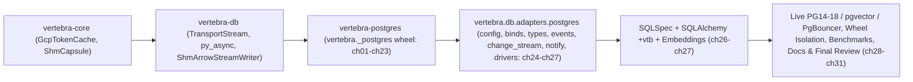

# Specification: Complete Standalone Native PostgreSQL Driver

<!-- truth: start -->
- **Standalone Optional Wheel**: `src/rs/vertebra-postgres` (`vertebra._postgres`, `vertebra-core[postgres]`) owns live PostgreSQL Protocol 3.0 sockets over `postgres-protocol =0.6.12` and `rustls` (`ring`) without linking database clients into `vertebra-core` [^pg-conn-rs] [^pg-core-rs].
- **Complete Single-PR Delivery**: Authentication (`SCRAM-SHA-256`, `SCRAM-SHA-256-PLUS`, Cloud SQL / AlloyDB Admin discovery + mTLS + IAM), lossless codecs, statement caching, single-`Sync` `pipeline()`, binary `COPY`, native `VTBARROW`, `CancelRequest`, `LISTEN`/`NOTIFY`, and `pgoutput` v1 logical replication ship together with full `psycopg`/`asyncpg` removal [^py-async-rs] [^arrow-shm-rs] [^pg-driver-py] [^sqlspec-py].
- **Nested Chapter Roadmap (`plan_revision: 6`)**: All 31 chapters and 111 tasks retain their scope at `plan_commit: 8833b064`; chapter 01 is complete and reviewed at `3d68c853`, and chapter 02 executes SSLRequest/TLS task 03.
<!-- truth: end -->

## 1. Specification, Context & Provenance

### 1.1 Problem Statement & Upstream Execution Baseline

The governing scope rule is: **“Keep the complete driver in one PR.”** All `31` chapters (`111` worksheets) execute on `feat/native-postgres-completion`, stacked above `feat/storage-updates` (`dd432f18` / `cdb978d3`) and `main @ 077a3fe9`. The database foundation ([PR #76](https://github.com/cofin/vertebra/pull/76), `21c99f95`), engine primitives ([PR #77](https://github.com/cofin/vertebra/pull/77), `80ff8a65`), post-merge review remediation ([PR #80](https://github.com/cofin/vertebra/pull/80), `2b737240`), runtime structure ([PR #92](https://github.com/cofin/vertebra/pull/92), `d2fa5072`), and MCP/WebMCP core ([PR #94](https://github.com/cofin/vertebra/pull/94), `077a3fe9`) are squash-merged on `main`; those prior PRs do not validate this driver.

The complete charter decomposes into `31` nested chapters ([chapters/index.md](chapters/index.md)) so every worksheet remains bounded (`<= 3` production files, `<= 250` estimated LOC) and produces one signed local conventional commit without splitting delivery across partial PRs. No chapter constitutes a partial release; atomic Python adapter cutover (`ch27`), strict PG14–18 and live-service conformance (`ch28`), outside-checkout wheel and benchmark gates (`ch29`), user and OKF documentation synchronization (`ch30`), and routed correctness plus fresh quality reviews (`ch31`) are required before `/flow:finish`. No production implementation begins while `plan_commit` is null, and hosted writes require separate explicit user permission.

### 1.2 Non-Goals

- Splitting transport, query, `COPY`/Arrow, replication, or adapter cutover across multiple pull requests or leaving `psycopg`/`asyncpg`/`memory://` fallbacks behind feature flags.
- Negotiating PostgreSQL wire protocol `3.2` (Protocol `3.0` governs the entire PostgreSQL `14`–`18` support matrix).
- Implicitly creating or dropping PostgreSQL replication slots/publications, performing automatic initial table snapshot backfills, or advancing WAL `confirmed_flush_lsn` on stream yield before durable checkpoint persistence.
- Adding engine-specific PostgreSQL imports, SQL strings, or class branches to generic `src/py/vertebra/db/*.py` or `src/py/vertebra/db/driver/*.py` modules.
- Requiring live external Google Cloud SQL or AlloyDB network credentials during local or default CI runs (cloud Admin, mTLS, and IAM paths are proven via deterministic wire/TLS harnesses).

### 1.3 Code Analysis Summary

| Existing symbol | Verified consequence |
| --- | --- |
| `src/rs/vertebra-db/src/connection.rs::TransportStream` [^pg-conn-rs] | Reuse transport/TLS. Direct PostgreSQL sends `SSLRequest` before upgrade; cloud proxy endpoints negotiate immediate mTLS. |
| `src/rs/vertebra-db/src/connection.rs::{Connection,CancelHandle}` [^pg-conn-rs] | Lifecycle traits require real ping/cancel/close implementations. No placeholder success. |
| `src/rs/vertebra-db/src/postgres/mod.rs::PostgresPool` [^pg-core-rs] | SHM admission and compiled-plan metadata do not own live connections or server prepared statements. |
| `src/rs/vertebra-db/src/py_async.rs::spawn_rust_db_task_with_attr` [^py-async-rs] | Reuse completion queues and independent drainer. Add abort ownership across fallible setup before using it for sessions. |
| `src/rs/vertebra-db/src/arrow_shm.rs::ShmArrowStreamWriter` [^arrow-shm-rs] | Accepts serialized IPC; does not build columns. Its padding API cannot receive arbitrary encoder fragments. |
| `src/py/vertebra/db/adapters/postgres/driver.py::{SyncPostgreSQLDriver,AsyncPostgreSQLDriver}` [^pg-driver-py] | Replace Python-client, duck-typed, and memory execution with real native pool leases. Preserve count/tuple/description/hydration contracts. |
| `src/py/vertebra/extensions/sqlspec/adapters.py::{BaseSyncDriver.execute_stack,BaseAsyncDriver.execute_stack}` [^sqlspec-py] | Caller conversion and strict result validation occur inside pipeline context; results cannot commit early. |
| `src/py/vertebra/db/arrow.py::ArrowCursor` [^db-arrow-py] | Public cursor wraps native SHM output; inline IPC needs explicit native row-count metadata without Python rows. |
| `src/py/tests/integration/db/test_driver_conformance.py::ENGINE_SPECS` [^conformance-py] | PostgreSQL needs native type DDL, enabled pipeline acceptance, and removal of pending-flow xfail after cutover. |
| `src/py/vertebra/db/dialer/cloudsql.py` [^dialer-cloudsql-py], `src/py/vertebra/db/dialer/alloydb.py` [^dialer-alloydb-py] | Existing helpers do not complete real discovery/issued-material lifecycle. Native cloud support includes actual APIs and scopes. |

### 1.4 Relevant OKF Knowledge, Research & Glossary

Read [database-drivers-and-dialers.md](../../knowledge/domains/data/database-drivers-and-dialers.md), [query-pipeline-cdc-and-tenancy.md](../../knowledge/domains/data/query-pipeline-cdc-and-tenancy.md), [adr-004-optional-driver-wheels-and-shm-ownership.md](../../knowledge/decisions/adr-004-optional-driver-wheels-and-shm-ownership.md), [ffi-and-gil-discipline.md](../../knowledge/patterns/rust/ffi-and-gil-discipline.md), [pyo3-and-python-runtime.md](../../knowledge/gotchas/pyo3-and-python-runtime.md), [protocol-and-execution_20261105.md](research/protocol-and-execution_20261105.md), [cloud-material_20261105.md](research/cloud-material_20261105.md), [contracts.md](contracts.md), [review.md](review.md), and the project-local [pyo3-bridge](../../../skills/pyo3-bridge/SKILL.md), [runtime-ipc](../../../skills/runtime-ipc/SKILL.md), [python-framework](../../../skills/python-framework/SKILL.md), and routed review skills.

`postgres-protocol = "=0.6.12"` owns low-level message framing and SCRAM helpers; `src/rs/vertebra-postgres` owns live connection state. `tokio-postgres = "=0.7.18"` is a dev-only test oracle. Protocol `3.0` supports PostgreSQL `14`–`18`. Arrow crates are pinned to `60.1.0`; cross-extension transfer uses producer-owned `ShmCapsule` callbacks, never Rust `Arc` or trait-object layouts across `cdylib` boundaries. A **physical session** is one socket; a **lease** exclusively owns that session; a **portal** pins its lease and transaction; a **checkpoint** records durably acknowledged logical replication progress.

## 2. Requirements, Concrete Contracts & Architecture

The codec producer stage uses three exact symbol-level lint expectations until chapter 02 task 02 adds production callers and removes them; all-target Clippy remains mandatory with `-D warnings`.

Read-only `PendingSession::connection()` and `PostgresConnection::tls_server_end_point()` support Rust metadata adoption and channel binding; backend keys stay outside Python. Chapter 01 owns the direct fallible diagnostic-iterator prerequisite and fresh upstream review before chapter 02 resumes.

The connection-publication seam uses owned `Arc<PostgresConfig>` and `Arc<std::sync::Mutex<SessionState>>` shared by cloneable `SessionHandle` values. `BeginConnect`, `ConnectAttempt`, and `PendingSession` have no lifetime parameters; attempts, their `run()` futures, and pending results are `Send + 'static` for the asynchronous completion bridge, with armed rollback on drop and publication only in `commit()`.

### 2.1 Functional Requirements (`R1`–`R27`)

The [public contracts](contracts.md) freeze constructor options, pool ownership, result/bind shapes, pipeline completion, lossless value policy, and checkpointing. Engine values, SQL, tool contracts, and checkpoint protocols stay inside `vertebra-postgres` and `vertebra.db.adapters.postgres`; shared `vertebra-db` and `vertebra.db` code remains engine-agnostic.

- **R1.** Optional standalone wheel, package/build/release registration, and typed exports.
- **R2.** Pure validated connection options, one URL/libpq parser, and lexical bind lowering.
- **R3.** Bounded protocol framing, real TCP/Unix startup, metadata, and total connection deadline.
- **R4.** Direct `SSLRequest`/TLS, verified certificate binding, and service-specific cloud identity.
- **R5.** Trust/password/MD5/SCRAM/PLUS and scope-correct direct/cloud IAM authentication.
- **R6.** Native synchronous client/query/pool surfaces with detached blocking I/O.
- **R7.** Native asynchronous completion, setup-abort ownership, and cancellation-safe publication.
- **R8.** Complete-driver gates and correctness review followed by fresh quality review.
- **R9.** Automatic Cloud SQL/AlloyDB discovery, issued material, expiry, and refresh.
- **R10.** Owned descriptions/results, affected command counts, and exact core SQLSTATE errors.
- **R11.** Lossless scalar/numeric/temporal/JSON/container/vector values and unknown-type formats.
- **R12.** Simple multi-results and extended single-statement query execution.
- **R13.** Context-owned transactions/savepoints and exclusive physical-session affinity.
- **R14.** Real physical pools with bounded acquisition, reset, shutdown, and configuration isolation.
- **R15.** Per-connection prepared LRU and verified/configured pooler capabilities.
- **R16.** Bounded portals and sync/async stream ownership through exhaustion or abandonment.
- **R17.** Cold/warm one-`Sync`/one-flush pipeline with ordered outcomes and delayed context commit.
- **R18.** Backend-key cancellation, server cleanup, and protection against delayed cross-borrower cancel.
- **R19.** Incremental binary `COPY` input/output and exclusive-mode error recovery.
- **R20.** Native typed Arrow builders/import, exact IPC, threshold/count, and producer-owned capsule lifetime.
- **R21.** Dedicated live notifications, subscription changes, bounded delivery, and cleanup.
- **R22.** Dedicated `pgoutput`-v1 logical replication with relation/type state and independent feedback.
- **R23.** Adapter-owned checkpoint store, stable `int64` replay IDs, and explicit durable-before-feedback ack.
- **R24.** Native Python adapter and SQLSpec/SQLAlchemy/helper cutover without old execution fallbacks.
- **R25.** Strict PG14–18 native conformance and real `COPY`/Arrow/events/vector/pooler acceptance.
- **R26.** Installed-wheel isolation, namespace/exception identity, and actual free-threaded GIL checks.
- **R27.** Driver-specific performance evidence, public documentation, and canonical verification.

### 2.2 Non-Functional, Protocol & Safety Constraints

- Every native module declares `gil_used = false`; synchronous network waits detach the GIL (`py.detach(...)`), async workers carry owned Rust data and never attach Python, and an isolated child subprocess verifies actual disabled-GIL import and concurrent query behavior on Python `3.14t` and `3.15t`.
- One bounded framing implementation handles standard messages while replication adds only `CopyBoth`. Lengths, counts, and arity are validated before allocation; resource limits fail with typed errors rather than silent truncation.
- One socket owner services duplex backpressure. Abandoned portals, `COPY`, pipeline failures, and cancellations drain to a synchronized protocol boundary or discard the physical socket. Any connection targeted by a possibly sent `CancelRequest` retires permanently before another borrower can acquire it.
- Pool configuration identity includes credentials, TLS, session GUCs, cloud resource/network, IAM options, and preparation policy. Ordinary driver calls acquire transient leases; transaction, portal, and pipeline scopes pin them with thread/task identity checks, and `DISCARD ALL` session resets invalidate per-session prepared metadata without SQL-classification shortcuts.
- Cold pipelines use text formats with received descriptors while warm known OIDs use binary and unknown OIDs use text, emitting exactly one `Sync` and one logical flush per batch (without inserting hidden discovery round trips or claiming one TCP packet).
- `Decimal` scale/special values, array lower bounds and `NULL` dimensions, composite attribute order, independent `PgInterval` `(months, days, microseconds)`, and `PgTemporal` ranges remain lossless; ambiguous display `wire_text` is preserved on output and rejected with `DataError` before any typed rebind or binary `COPY`.
- Native Arrow builders remain bounded, honor inline vs `VTBARROW` SHM row thresholds, preserve nested types and OID metadata, and claim zero-copy exclusively for `ShmCapsule` adoption.
- Notifications and logical replication run on dedicated direct sessions (`direct_dsn` when queries traverse a transaction pooler). `pgoutput` v1 tails/resumes caller-owned slots and publications in `vertebra.db.adapters.postgres.change_stream` with explicit CAS checkpoint persistence before WAL feedback. Zero third-party Python database clients, SQLite stand-ins, memory executors, or sync offload fallbacks remain in PostgreSQL production paths.

### 2.3 Cross-Chapter Architecture & Seam Topology

### 2.4 Acceptance Scenarios

| Given | When | Then |
| --- | --- | --- |
| Direct/TLS/Unix or cloud resource config | Both native clients connect | Auth/UTF8/Ready is real; wrong identity/proof/order/expiry fails and closes. |
| Scoped ADC credentials and expiring issued certificate | Concurrent cloud opens | Correct Admin/login scopes and single-flight renewal; no localhost or invented expiry. |
| Full scalar/container values, typed `NULL`, and unknown type | Query/bind/`COPY` | Lossless values and correct type formats; no binary-as-UTF8 or float `Decimal` conversion. |
| Shared driver and saturated native pool | Concurrent calls, nested transaction, or cancelled acquire | Exclusive real leases, bounded capacity, isolated scope, and no dirty reuse. |
| Cold/warm mixed-return pipeline | Middle `Parse`/`Bind`/`Execute` fails or caller conversion raises | One `Sync`/flush batch; ordered failure/skipped outcomes; transaction rolls back. |
| Active query or `COPY`/portal stream | Cancel/abandon/close | Original failure preserved; server work cancelled; lease recovered or retired. |
| Empty, small, large, or nested Arrow result | Select, stream, or import | Metadata/counts survive; threshold applies; native IPC/capsule ownership stays valid. |
| Caller-owned slot/publication and saved checkpoint | Tail, reconnect, and acknowledge | Ordered at-least-once events, stable replay IDs, and durable-store-before-feedback. |
| Native PostgreSQL 14–18 and modern `PgBouncer` modes | Driver/SQLSpec/SQLAlchemy acceptance | Actual native transactions, binds, pools, and pipeline behavior pass without PostgreSQL xfails. |
| Installed optional wheel outside checkout | Import/query/uninstall on supported runtimes | Core identity and namespace survive; stubs and real free-threaded GIL state match. |

### 2.5 Mandatory Alternatives Comparison

| Decision | Chosen seam and alternative |
| --- | --- |
| Delivery | One complete PR follows the user instruction. Partial connection PRs are excluded; atomic commits remain review boundaries. |
| Protocol | Owned state machine over `postgres-protocol` permits single-`Sync` batches. A production `tokio-postgres` `Client` would own `Sync` behavior and require changing that contract. |
| Integration ownership | The PostgreSQL adapter/crate owns native SQL, values, cloud material, and checkpoint protocols. Feature-owned vendor packages would split one engine across consumers. |
| Configuration | Explicit typed native kwargs and one adapter DSN/bind compiler keep validation local. Generic mapping forwarding or duplicate parsers leave runtime decisions unresolved. |
| Results | Owned engine result/column/value records preserve metadata; Python base-driver projections retain established shapes. Generic untyped rows lose counts and empty descriptions. |
| Pooling | Real Rust pool leases separate session ownership from SHM admission. Reusing admission counters as a pool would not manage sockets. |
| Error policy | Raise the first canonical pipeline error with ordered outcomes. Exception rows or fabricated errors for skipped operations misstate server execution. |
| CDC | Explicit adapter-owned checkpoint store/ack in `vertebra.db.adapters.postgres.change_stream` preserves the generic stream contract. Ack-on-yield would falsely treat delivery as durable application. |
| Arrow | Native typed builders and IPC-to-SHM preserve bounded row processing. Python row materialization and arbitrary padded IPC fragments violate that path. |

## 3. Documentation & OKF Knowledge Plan

Progress: `[0/11 files documented]` (owned by [ch30-user-and-domain-docs](chapters/ch30-user-and-domain-docs/spec.md) tasks `ch30:t01`–`ch30:t04`).

- `docs/usage/databases.md` (`ch30:t01`) — Document `vertebra-core[postgres]` installation, `$n` passthrough vs `E'...'` pyformat lowering, SQLSpec `NUMERIC` and SQLAlchemy `numeric_dollar`, `query_multi(sql)`, single-`Sync` `pipeline()`, lossless `Pg*` value records, binary `COPY` & `VTBARROW` `ArrowCursor`, `direct_dsn` `PostgresNotificationSource` & `vertebra.db.adapters.postgres.change_stream.PostgresChangeSource`, `PgBouncer` cache rules, DSN precedence, and verification commands.
- `docs/usage/analytics-and-cdc.md` (`ch30:t01`) — Replace stale `%s` `psycopg` tenant-bind and `listen_notifications()` prose with native `$1` numeric tenant binds, `_open_notification_listener` / `PostgresNotificationSource`, and `vertebra.db.adapters.postgres.change_stream.PostgresChangeSource` `pgoutput` v1 checkpointing.
- `docs/reference/database-capabilities.md` (`ch30:t01`) — Expose mkdocstrings API reference blocks for `vertebra.db.adapters.postgres.change_stream` (`PostgresChangeConfig`, `PostgresCheckpoint`, `PostgresCheckpointStore`, `MemoryPostgresCheckpointStore`, `PostgresChangeSource`, `PostgresCheckpointConflictError`, `PostgresReplicationGapError`) and `PostgresEmbeddingPushdown` alongside `PostgresNotifyConfig` and `PostgresNotificationSource`.
- `README.md` (`ch30:t02`) — Synchronize `9` Rust crates (`vertebra-postgres`), `6` PyO3 extensions (`_postgres`), the `[postgres]` extra, and `postgres-test`, `postgres-wheel-check`, `postgres-bench`, and `postgres-bench-check` Make targets.
- `.agents/bundles/knowledge/workflow.md` (`ch30:t02`) — Update polyglot rebuild, test, wheel, and benchmark workflows for `vertebra-postgres` (`_postgres`) within the `<= 200`-line `DOC-08` budget.
- `AGENTS.md` (`ch30:t02`) — Register `vertebra-postgres` (`_postgres`) and canonical `postgres-*` verification targets within the `<= 100`-line `DOC-08` budget.
- `.agents/bundles/knowledge/domains/data/database-drivers-and-dialers.md` (`ch30:t03`) — Curate present-tense `vertebra-postgres` session, pool, SCRAM/channel-binding, Cloud SQL/AlloyDB mTLS+IAM, and `VTBARROW` architecture within `<= 200` lines.
- `.agents/bundles/knowledge/domains/data/query-pipeline-cdc-and-tenancy.md` (`ch30:t03`) — Replace pre-cutover `pyformat`/`psycopg` prose with unified `ParameterStyle.NUMERIC` (`$n`), single-`Sync` `pipeline()` delayed-commit semantics, and `vertebra.db.adapters.postgres.change_stream` `pgoutput` v1 checkpoint contracts within `<= 200` lines.
- `.agents/bundles/knowledge/domains/extensions/sqlspec-alchemy-and-dialects.md` (`ch30:t04`) — Synchronize SQLSpec `ParameterStyle.NUMERIC`, `$N` tenant binds, and SQLAlchemy `numeric_dollar` `+vtb` dialect contracts within `<= 200` lines.
- `.agents/bundles/knowledge/testing/benchmarks-and-free-threaded.md` (`ch30:t04`) — Document `6` `gil_used = false` PyO3 extensions, `[dependency-groups].bench` reference drivers, and `postgres-bench` / `postgres-bench-check` gates within `<= 200` lines.
- `.agents/bundles/product/tech-stack.md` (`ch30:t04`) — Synchronize the `9`-crate Rust workspace and `5` optional companion PyO3 wheels (`vertebra-postgres`, `vertebra-bundler`, `vertebra-storage`, `vertebra-bigquery`, `vertebra-spanner`).

## 4. Requirement-to-Chapter Traceability Matrix

| Requirement | Owning Chapters & Tasks | Verification Strategy | Canonical Public Seam / Gate |
| --- | --- | --- | --- |
| R1 | [ch01](chapters/ch01-wheel-scaffold-and-config/spec.md) (`ch01:t01`–`t03`), [ch08](chapters/ch08-constructor-parity-and-wheel-gil/spec.md) (`ch08:t02`–`t04`) | `regression_tdd`, `static_validation` | `src/py/tests/unit/test_freethreaded_gil.py`, `src/py/vertebra/_postgres.pyi` |
| R2 | [ch01](chapters/ch01-wheel-scaffold-and-config/spec.md) (`ch01:t04`), [ch06](chapters/ch06-alloydb-keepalive-unix-and-direct-iam/spec.md) (`ch06:t02`–`t03`), [ch08](chapters/ch08-constructor-parity-and-wheel-gil/spec.md) (`ch08:t01`), [ch25](chapters/ch25-dsn-bridge-lexer-and-permanent-drivers/spec.md) (`ch25:t01`–`t02`), [ch26](chapters/ch26-compiler-pipeline-arrow-and-event-hooks/spec.md) (`ch26:t01`) | `behavior_tdd`, `characterization` | `src/rs/vertebra-postgres/tests/postgres_wire_tests.rs`, `src/py/tests/unit/db/test_postgres_options.py`, `src/py/tests/unit/db/test_postgres_binds.py`, `src/py/tests/unit/extensions/test_postgres_compiler_transport.py` |
| R3 | [ch01](chapters/ch01-wheel-scaffold-and-config/spec.md) (`ch01:t04`), [ch02](chapters/ch02-wire-codec-and-session-startup/spec.md) (`ch02:t01`–`t02`), [ch06](chapters/ch06-alloydb-keepalive-unix-and-direct-iam/spec.md) (`ch06:t02`–`t03`) | `behavior_tdd` | `src/rs/vertebra-postgres/tests/postgres_wire_tests.rs`, `src/rs/vertebra-db/src/connection.rs` |
| R4 | [ch02](chapters/ch02-wire-codec-and-session-startup/spec.md) (`ch02:t03`), [ch03](chapters/ch03-scram-and-channel-binding/spec.md) (`ch03:t02`), [ch04](chapters/ch04-cloud-material-and-admin-discovery/spec.md) (`ch04:t02`), [ch05](chapters/ch05-cloud-tls-and-scoped-iam/spec.md) (`ch05:t01`) | `behavior_tdd` | `src/rs/vertebra-postgres/tests/postgres_tls_wire_tests.rs`, `src/rs/vertebra-postgres/tests/postgres_cloud_wire_tests.rs` |
| R5 | [ch02](chapters/ch02-wire-codec-and-session-startup/spec.md) (`ch02:t04`), [ch03](chapters/ch03-scram-and-channel-binding/spec.md) (`ch03:t01`–`t03`), [ch04](chapters/ch04-cloud-material-and-admin-discovery/spec.md) (`ch04:t01`), [ch05](chapters/ch05-cloud-tls-and-scoped-iam/spec.md) (`ch05:t02`–`t04`), [ch06](chapters/ch06-alloydb-keepalive-unix-and-direct-iam/spec.md) (`ch06:t01`, `ch06:t04`) | `behavior_tdd`, `regression_tdd` | `src/rs/vertebra-postgres/tests/postgres_auth_wire_tests.rs`, `src/rs/vertebra-postgres/tests/postgres_cloud_wire_tests.rs`, `src/rs/vertebra-core/tests/it/gcp_auth.rs` |
| R6 | [ch07](chapters/ch07-async-bridge-and-client-sessions/spec.md) (`ch07:t02`), [ch08](chapters/ch08-constructor-parity-and-wheel-gil/spec.md) (`ch08:t01`, `ch08:t04`), [ch14](chapters/ch14-physical-pools-and-query-facades/spec.md) (`ch14:t03`–`t04`), [ch15](chapters/ch15-pool-facades-and-single-sync-pipeline/spec.md) (`ch15:t01`), [ch17](chapters/ch17-command-deadlines-portals-and-tz-fallback/spec.md) (`ch17:t01`–`t03`) | `behavior_tdd`, `characterization`, `regression_tdd` | `src/py/tests/unit/db/test_postgres_native_queries.py`, `src/py/tests/unit/db/test_postgres_native_pools.py`, `src/py/tests/unit/db/test_postgres_native_portals.py`, `src/rs/vertebra-postgres/tests/command_deadlines.rs` |
| R7 | [ch02](chapters/ch02-wire-codec-and-session-startup/spec.md) (`ch02:t02`), [ch07](chapters/ch07-async-bridge-and-client-sessions/spec.md) (`ch07:t01`, `ch07:t03`), [ch08](chapters/ch08-constructor-parity-and-wheel-gil/spec.md) (`ch08:t01`, `ch08:t04`), [ch14](chapters/ch14-physical-pools-and-query-facades/spec.md) (`ch14:t03`–`t04`), [ch15](chapters/ch15-pool-facades-and-single-sync-pipeline/spec.md) (`ch15:t01`), [ch16](chapters/ch16-pipeline-scope-and-cancellation/spec.md) (`ch16:t04`), [ch17](chapters/ch17-command-deadlines-portals-and-tz-fallback/spec.md) (`ch17:t01`–`t03`), [ch25](chapters/ch25-dsn-bridge-lexer-and-permanent-drivers/spec.md) (`ch25:t04`) | `behavior_tdd`, `characterization`, `regression_tdd` | `src/rs/vertebra-db/src/py_async.rs`, `src/rs/vertebra-db/tests/py_async_cancel_tests.rs`, `src/py/tests/unit/db/test_postgres_native_cancel.py`, `src/py/tests/unit/db/test_postgres_native_adapters.py` |
| R8 | [ch31](chapters/ch31-final-review-and-release-gate/spec.md) (`ch31:t01`) | `static_validation` | `make lint-all`, `make review-check`, `make review-route`, `review.md` |
| R9 | [ch04](chapters/ch04-cloud-material-and-admin-discovery/spec.md) (`ch04:t01`–`t04`), [ch05](chapters/ch05-cloud-tls-and-scoped-iam/spec.md) (`ch05:t01`–`t04`), [ch06](chapters/ch06-alloydb-keepalive-unix-and-direct-iam/spec.md) (`ch06:t01`) | `behavior_tdd`, `regression_tdd` | `src/rs/vertebra-postgres/tests/postgres_cloud_wire_tests.rs`, `src/rs/vertebra-core/tests/it/gcp_auth.rs` |
| R10 | [ch09](chapters/ch09-owned-results-and-numeric-codecs/spec.md) (`ch09:t01`–`t02`), [ch17](chapters/ch17-command-deadlines-portals-and-tz-fallback/spec.md) (`ch17:t01`–`t02`) | `behavior_tdd` | `src/rs/vertebra-postgres/tests/result_contract.rs`, `src/rs/vertebra-postgres/tests/query_protocol.rs`, `src/py/tests/integration/db/test_postgres_command_deadlines.py` |
| R11 | [ch09](chapters/ch09-owned-results-and-numeric-codecs/spec.md) (`ch09:t01`, `ch09:t03`–`t04`), [ch10](chapters/ch10-temporal-interval-and-json-codecs/spec.md) (`ch10:t01`–`t04`), [ch11](chapters/ch11-type-catalog-arrays-and-composites/spec.md) (`ch11:t01`–`t04`), [ch12](chapters/ch12-pgvector-and-extended-query/spec.md) (`ch12:t01`), [ch14](chapters/ch14-physical-pools-and-query-facades/spec.md) (`ch14:t03`), [ch17](chapters/ch17-command-deadlines-portals-and-tz-fallback/spec.md) (`ch17:t04`) | `behavior_tdd`, `regression_tdd` | `src/py/tests/unit/db/test_postgres_types.py`, `src/rs/vertebra-postgres/tests/scalar_codecs.rs`, `src/rs/vertebra-postgres/tests/numeric_codecs.rs`, `src/rs/vertebra-postgres/tests/temporal_codecs.rs`, `src/rs/vertebra-postgres/tests/vector_codecs.rs`, `src/rs/vertebra-postgres/tests/timezone_text.rs` |
| R12 | [ch09](chapters/ch09-owned-results-and-numeric-codecs/spec.md) (`ch09:t02`), [ch12](chapters/ch12-pgvector-and-extended-query/spec.md) (`ch12:t02`–`t03`), [ch14](chapters/ch14-physical-pools-and-query-facades/spec.md) (`ch14:t04`), [ch17](chapters/ch17-command-deadlines-portals-and-tz-fallback/spec.md) (`ch17:t01`–`t02`), [ch28](chapters/ch28-live-conformance-and-service-acceptance/spec.md) (`ch28:t03`) | `behavior_tdd` | `src/rs/vertebra-postgres/tests/query_protocol.rs`, `src/rs/vertebra-postgres/tests/extended_protocol.rs`, `src/rs/vertebra-postgres/tests/metadata_normalization.rs`, `src/py/tests/integration/db/test_postgres_services.py` |
| R13 | [ch12](chapters/ch12-pgvector-and-extended-query/spec.md) (`ch12:t02`), [ch13](chapters/ch13-transactions-portals-and-statement-cache/spec.md) (`ch13:t01`), [ch14](chapters/ch14-physical-pools-and-query-facades/spec.md) (`ch14:t04`), [ch15](chapters/ch15-pool-facades-and-single-sync-pipeline/spec.md) (`ch15:t02`–`t03`), [ch16](chapters/ch16-pipeline-scope-and-cancellation/spec.md) (`ch16:t01`–`t02`), [ch25](chapters/ch25-dsn-bridge-lexer-and-permanent-drivers/spec.md) (`ch25:t03`–`t04`), [ch26](chapters/ch26-compiler-pipeline-arrow-and-event-hooks/spec.md) (`ch26:t02`) | `behavior_tdd` | `src/rs/vertebra-postgres/tests/transaction_state.rs`, `src/rs/vertebra-postgres/tests/pipeline_scope.rs`, `src/py/tests/unit/db/test_postgres_native_adapter_pipeline.py` |
| R14 | [ch14](chapters/ch14-physical-pools-and-query-facades/spec.md) (`ch14:t01`–`t02`), [ch15](chapters/ch15-pool-facades-and-single-sync-pipeline/spec.md) (`ch15:t01`) | `behavior_tdd` | `src/rs/vertebra-postgres/tests/physical_pool.rs`, `src/rs/vertebra-postgres/tests/pool_reset.rs`, `src/py/tests/unit/db/test_postgres_native_pools.py` |
| R15 | [ch11](chapters/ch11-type-catalog-arrays-and-composites/spec.md) (`ch11:t01`), [ch12](chapters/ch12-pgvector-and-extended-query/spec.md) (`ch12:t02`), [ch13](chapters/ch13-transactions-portals-and-statement-cache/spec.md) (`ch13:t03`), [ch28](chapters/ch28-live-conformance-and-service-acceptance/spec.md) (`ch28:t03`–`t04`) | `behavior_tdd` | `src/rs/vertebra-postgres/tests/statement_cache.rs`, `src/py/tests/integration/db/test_postgres_services.py`, `src/py/tests/integration/db/test_postgres_features.py` |
| R16 | [ch13](chapters/ch13-transactions-portals-and-statement-cache/spec.md) (`ch13:t02`), [ch17](chapters/ch17-command-deadlines-portals-and-tz-fallback/spec.md) (`ch17:t03`), [ch20](chapters/ch20-arrow-copy-import-and-portals/spec.md) (`ch20:t03`–`t04`) | `behavior_tdd` | `src/rs/vertebra-postgres/tests/portal_protocol.rs`, `src/py/tests/unit/db/test_postgres_native_portals.py`, `src/py/tests/unit/db/test_postgres_native_data.py` |
| R17 | [ch15](chapters/ch15-pool-facades-and-single-sync-pipeline/spec.md) (`ch15:t02`–`t04`), [ch16](chapters/ch16-pipeline-scope-and-cancellation/spec.md) (`ch16:t01`–`t02`), [ch26](chapters/ch26-compiler-pipeline-arrow-and-event-hooks/spec.md) (`ch26:t02`) | `behavior_tdd` | `src/rs/vertebra-postgres/tests/pipeline_wire.rs`, `src/rs/vertebra-postgres/tests/pipeline_outcomes.rs`, `src/rs/vertebra-postgres/tests/pipeline_scope.rs`, `src/py/tests/unit/db/test_postgres_native_pipeline.py` |
| R18 | [ch16](chapters/ch16-pipeline-scope-and-cancellation/spec.md) (`ch16:t03`–`t04`), [ch17](chapters/ch17-command-deadlines-portals-and-tz-fallback/spec.md) (`ch17:t01`–`t02`), [ch25](chapters/ch25-dsn-bridge-lexer-and-permanent-drivers/spec.md) (`ch25:t03`–`t04`), [ch28](chapters/ch28-live-conformance-and-service-acceptance/spec.md) (`ch28:t01`) | `behavior_tdd` | `src/rs/vertebra-postgres/tests/cancellation_protocol.rs`, `src/py/tests/unit/db/test_postgres_native_cancel.py`, `src/py/tests/integration/db/test_postgres_native.py` |
| R19 | [ch18](chapters/ch18-binary-copy-streaming/spec.md) (`ch18:t01`–`t03`), [ch28](chapters/ch28-live-conformance-and-service-acceptance/spec.md) (`ch28:t04`) | `behavior_tdd` | `src/rs/vertebra-postgres/tests/postgres_copy_codec_tests.rs`, `src/rs/vertebra-postgres/tests/postgres_copy_wire_tests.rs`, `src/py/tests/integration/db/test_postgres_features.py` |
| R20 | [ch19](chapters/ch19-native-arrow-batches-and-shm/spec.md) (`ch19:t01`–`t04`), [ch20](chapters/ch20-arrow-copy-import-and-portals/spec.md) (`ch20:t01`–`t04`), [ch26](chapters/ch26-compiler-pipeline-arrow-and-event-hooks/spec.md) (`ch26:t03`), [ch28](chapters/ch28-live-conformance-and-service-acceptance/spec.md) (`ch28:t04`) | `behavior_tdd` | `src/rs/vertebra-postgres/tests/postgres_arrow_tests.rs`, `src/rs/vertebra-postgres/tests/postgres_arrow_import_tests.rs`, `src/py/tests/unit/db/test_postgres_native_adapter_arrow.py` |
| R21 | [ch21](chapters/ch21-live-notifications/spec.md) (`ch21:t01`–`t03`), [ch26](chapters/ch26-compiler-pipeline-arrow-and-event-hooks/spec.md) (`ch26:t04`), [ch28](chapters/ch28-live-conformance-and-service-acceptance/spec.md) (`ch28:t04`) | `behavior_tdd` | `src/rs/vertebra-postgres/tests/postgres_notification_wire_tests.rs`, `src/py/tests/unit/db/test_postgres_native_notifications.py` |
| R22 | [ch22](chapters/ch22-copyboth-and-pgoutput-decoding/spec.md) (`ch22:t01`–`t03`), [ch23](chapters/ch23-replication-feedback-resume-and-bridge/spec.md) (`ch23:t01`–`t03`), [ch24](chapters/ch24-change-source-and-checkpoints/spec.md) (`ch24:t01`–`t03`), [ch26](chapters/ch26-compiler-pipeline-arrow-and-event-hooks/spec.md) (`ch26:t04`), [ch28](chapters/ch28-live-conformance-and-service-acceptance/spec.md) (`ch28:t02`) | `behavior_tdd` | `src/rs/vertebra-postgres/tests/postgres_replication_wire_tests.rs`, `src/rs/vertebra-postgres/tests/postgres_pgoutput_tests.rs`, `src/py/tests/integration/db/test_postgres_replication.py` |
| R23 | [ch23](chapters/ch23-replication-feedback-resume-and-bridge/spec.md) (`ch23:t03`), [ch24](chapters/ch24-change-source-and-checkpoints/spec.md) (`ch24:t01`–`t03`), [ch26](chapters/ch26-compiler-pipeline-arrow-and-event-hooks/spec.md) (`ch26:t04`), [ch28](chapters/ch28-live-conformance-and-service-acceptance/spec.md) (`ch28:t02`) | `behavior_tdd` | `src/py/tests/unit/db/test_postgres_change_source.py`, `src/py/tests/unit/db/test_postgres_event_hooks.py`, `src/py/tests/integration/db/test_postgres_replication.py` |
| R24 | [ch25](chapters/ch25-dsn-bridge-lexer-and-permanent-drivers/spec.md) (`ch25:t02`–`t04`), [ch26](chapters/ch26-compiler-pipeline-arrow-and-event-hooks/spec.md) (`ch26:t01`–`t04`), [ch27](chapters/ch27-atomic-cutover-and-legacy-removal/spec.md) (`ch27:t01`–`t04`) | `behavior_tdd`, `characterization` | `src/py/tests/unit/db/test_postgres_driver.py`, `src/py/tests/unit/extensions/test_sqlalchemy_and_sqlspec_vtb.py`, `src/py/tests/unit/db/test_pg_dataplane_and_datafusion.py` |
| R25 | [ch28](chapters/ch28-live-conformance-and-service-acceptance/spec.md) (`ch28:t01`–`t04`) | `behavior_tdd` | `src/py/tests/integration/db/test_driver_conformance.py`, `src/py/tests/integration/db/test_postgres_native.py`, `src/py/tests/integration/db/test_postgres_replication.py`, `src/py/tests/integration/db/test_postgres_services.py`, `src/py/tests/integration/db/test_postgres_features.py` |
| R26 | [ch08](chapters/ch08-constructor-parity-and-wheel-gil/spec.md) (`ch08:t02`–`t04`), [ch29](chapters/ch29-wheel-ci-and-benchmarks/spec.md) (`ch29:t01`) | `regression_tdd`, `static_validation` | `tools/scripts/verify_postgres_wheel.py`, `src/py/tests/unit/test_freethreaded_gil.py`, `.github/workflows/ci.yml`, `.github/workflows/release.yaml` |
| R27 | [ch29](chapters/ch29-wheel-ci-and-benchmarks/spec.md) (`ch29:t02`–`t03`), [ch30](chapters/ch30-user-and-domain-docs/spec.md) (`ch30:t01`–`t04`), [ch31](chapters/ch31-final-review-and-release-gate/spec.md) (`ch31:t01`) | `behavior_tdd`, `documentation_validation`, `static_validation` | `src/py/tests/unit/tools/test_postgres_benchmarks.py`, `src/rs/vertebra-postgres/benches/postgres_native.rs`, `src/py/tests/integration/db/test_postgres_benchmarks.py`, `make docs-check` |

## 5. Implementation Plan

Every worksheet (`111` total across `31` chapters) executes within its bounded ownership. The chapter 01 direct diagnostic-iterator prerequisite pairs the existing task 01 manifest owner and task 02 lockfile owner in one coherent signed source commit, with both receipts bound to its SHA. Other worksheets produce their signed task commits independently. Each chapter owns `1`–`4` vertical-slice tasks (`<= 3` production files per task, zero overlapping `files:` across ready tasks) in a strict serial chapter dependency chain (`ch01` -> `ch31`). See [review.md](review.md) for adjudicated planning decisions.

- [x] [3d68c853] ch01-wheel-scaffold-and-config — Standalone Optional Wheel Scaffold, Build Matrix, and Validated Connection Options (chapters/ch01-wheel-scaffold-and-config/spec.md)
- [~] ch02-wire-codec-and-session-startup — Bounded Protocol Framing, Trust Lifecycle, SSLRequest TLS, and Cleartext/MD5 Startup (chapters/ch02-wire-codec-and-session-startup/spec.md)
- [ ] ch03-scram-and-channel-binding — Ordered SCRAM-SHA-256, Peer Certificate Binding, and SCRAM-SHA-256-PLUS Negotiation (chapters/ch03-scram-and-channel-binding/spec.md)
- [ ] ch04-cloud-material-and-admin-discovery — Single-Flight Cloud Material Cache, Ephemeral Keys, and Cloud SQL / AlloyDB Admin Discovery (chapters/ch04-cloud-material-and-admin-discovery/spec.md)
- [ ] ch05-cloud-tls-and-scoped-iam — Cloud TLS 1.3 Peer Identities, Static Login Token Contract, Scoped Auth Caches, and Cloud SQL mTLS/IAM (chapters/ch05-cloud-tls-and-scoped-iam/spec.md)
- [ ] ch06-alloydb-keepalive-unix-and-direct-iam — AlloyDB Metadata Exchange, TCP Keepalives, Unix Socket Projection, and Direct-Host IAM Refresh (chapters/ch06-alloydb-keepalive-unix-and-direct-iam/spec.md)
- [ ] ch07-async-bridge-and-client-sessions — Setup-Safe Async Worker Bridge and Raw Sync/Async Physical PostgreSQL Client Sessions (chapters/ch07-async-bridge-and-client-sessions/spec.md)
- [ ] ch08-constructor-parity-and-wheel-gil — Sync/Async Constructor Parity, Packaging & Stub Exclusions, Outside-Checkout Wheel Bootstrap, and Isolated Free-Threaded GIL Probe (chapters/ch08-constructor-parity-and-wheel-gil/spec.md)
- [ ] ch09-owned-results-and-numeric-codecs — Owned Query Result/Value Records, Simple Query SQLSTATE Mapping, and Scalar/Numeric Codecs (chapters/ch09-owned-results-and-numeric-codecs/spec.md)
- [ ] ch10-temporal-interval-and-json-codecs — Lossless Temporal/Interval Binary and Multi-Style Text Codecs plus JSON/JSONB Codecs (chapters/ch10-temporal-interval-and-json-codecs/spec.md)
- [ ] ch11-type-catalog-arrays-and-composites — Session Type Catalog Discovery, Dimensioned Binary/Text Arrays, and Ordered Composite Codecs (chapters/ch11-type-catalog-arrays-and-composites/spec.md)
- [ ] ch12-pgvector-and-extended-query — Validated pgvector/halfvec/bit Codecs, Cold Parameter/Result Metadata Normalization, and Mixed-Format Extended Query (chapters/ch12-pgvector-and-extended-query/spec.md)
- [ ] ch13-transactions-portals-and-statement-cache — Pinned Transaction/Savepoint State, Bounded Portals, and Pooler-Safe Prepared Statement Cache (chapters/ch13-transactions-portals-and-statement-cache/spec.md)
- [ ] ch14-physical-pools-and-query-facades — Concrete Rust Physical Connection Pool, Rollback/Drain Lifecycle, and Python Value/Query Facades (chapters/ch14-physical-pools-and-query-facades/spec.md)
- [ ] ch15-pool-facades-and-single-sync-pipeline — Python Pool Facades, SQL-Head Pipeline Guard, Single-Sync Outbound Batching, and Ordered Pipeline Outcomes (chapters/ch15-pool-facades-and-single-sync-pipeline/spec.md)
- [ ] ch16-pipeline-scope-and-cancellation — Delayed-Commit Pipeline Transaction Scope, Python Pipeline Contexts, and Backend-Key Cancellation Retirement (chapters/ch16-pipeline-scope-and-cancellation/spec.md)
- [ ] ch17-command-deadlines-portals-and-tz-fallback — Native Per-Command I/O Deadlines, Python Portal Facades, and Ambiguous Timezone Text Fallback (chapters/ch17-command-deadlines-portals-and-tz-fallback/spec.md)
- [ ] ch18-binary-copy-streaming — Incremental Binary COPY Framing, COPY TO Streaming, and Duplex Backpressured COPY FROM Recovery (chapters/ch18-binary-copy-streaming/spec.md)
- [ ] ch19-native-arrow-batches-and-shm — Lossless PostgreSQL Arrow Schemas, Bounded Scalar/Nested Batch Builders, and IPC-to-SHM Capsules (chapters/ch19-native-arrow-batches-and-shm/spec.md)
- [ ] ch20-arrow-copy-import-and-portals — Arrow-to-COPY Field Import, Streaming Input Bridge, and Sync/Async Arrow Portal Cancellation (chapters/ch20-arrow-copy-import-and-portals/spec.md)
- [ ] ch21-live-notifications — Dedicated Notification Session Pump, Reconnect-Aware Async Bridge, and Python PostgresNotificationSource (chapters/ch21-live-notifications/spec.md)
- [ ] ch22-copyboth-and-pgoutput-decoding — Dedicated CopyBoth Logical Replication Sessions and Lossless pgoutput v1 Relation/Tuple/Transaction Decoding (chapters/ch22-copyboth-and-pgoutput-decoding/spec.md)
- [ ] ch23-replication-feedback-resume-and-bridge — Durable Commit-Boundary Feedback, Checkpoint-Verified Reconnect Resume, and Cancellation-Safe Replication Bridge (chapters/ch23-replication-feedback-resume-and-bridge/spec.md)
- [ ] ch24-change-source-and-checkpoints — PostgresChangeSource, PostgresCheckpointStore, Serialized CAS Ack Reconciliation, and Replay/Shutdown Semantics (chapters/ch24-change-source-and-checkpoints/spec.md)
- [ ] ch25-dsn-bridge-lexer-and-permanent-drivers — URL/libpq Config Bridge, Lexer-Aware Bind Compiler, and Pre-Activation Permanent Sync/Async Drivers (chapters/ch25-dsn-bridge-lexer-and-permanent-drivers/spec.md)
- [ ] ch26-compiler-pipeline-arrow-and-event-hooks — SQLSpec/SQLAlchemy Compiler Boundaries, Transaction-Bound Pipelines, Native Arrow Forwarding, and Dedicated Event Hooks (chapters/ch26-compiler-pipeline-arrow-and-event-hooks/spec.md)
- [ ] ch27-atomic-cutover-and-legacy-removal — Atomic Public Driver/Embeddings/SQLSpec/SQLAlchemy Activation and Legacy Async/Sync Driver Removal (chapters/ch27-atomic-cutover-and-legacy-removal/spec.md)
- [ ] ch28-live-conformance-and-service-acceptance — Live PG14–18 Conformance, Logical Replication, Digest-Pinned pgvector 0.8.1, and PgBouncer 1.26.0 Acceptance (chapters/ch28-live-conformance-and-service-acceptance/spec.md)
- [ ] ch29-wheel-ci-and-benchmarks — Outside-Checkout Wheel Isolation, Strict CI/Release Matrix, and Paired PG18 Reference vs Native Benchmarks (chapters/ch29-wheel-ci-and-benchmarks/spec.md)
- [ ] ch30-user-and-domain-docs — User Guides, Capability References, Repo/Workflow Docs, and OKF v0.2 Domain/Extension/Benchmark/Tech-Stack Synchronization (chapters/ch30-user-and-domain-docs/spec.md)
- [ ] ch31-final-review-and-release-gate — Complete-Driver Verification Gates, Routed Multi-Area Correctness Review, and Fresh Zero-Context Quality Review (chapters/ch31-final-review-and-release-gate/spec.md)

**Flow Recovery Checkpoint:** `uv lock --check && make lint-all && make rs-test && make py-test && make ts-test && make coverage && make postgres-test && make postgres-wheel-check && make postgres-bench && make postgres-bench-check && make rs-bench && make bench-check && make docs-check && make review-check && make review-route` exits `0` with zero PostgreSQL skips or xfails, followed by clean correctness and fresh independent quality reviews before `/flow:finish native-postgres-driver` and `/flow:archive native-postgres-driver`.

## 6. Current State & Remaining Plan Snapshot

- **Verified Baseline**: `HEAD @ be425286`; flow `state: active`, `plan_revision: 6`, `plan_commit: 8833b064`.
- **Progress**: `1/31` chapters and `7/111` tasks are complete; chapter 02 has codec, trust sessions, and TLS verified.
- **Current Chapter & Task**: `ch02-wire-codec-and-session-startup`, `native-postgres-driver:ch02:t04` (password/MD5 authentication).
- **Remaining Plan**: Chapter 02 authentication and chapters 03–31 retain complete blueprints.
- **Documentation**: `[0/11 files documented]`; full driver guides and domain knowledge remain assigned to chapter 30.
- **Next Action**: Continue `/flow:implement native-postgres-driver`.

[^pg-conn-rs]: `src/rs/vertebra-db/src/connection.rs::TransportStream` — Shared TCP, Unix, TLS, and cloud mTLS stream primitives.
[^pg-core-rs]: `src/rs/vertebra-db/src/postgres/mod.rs::PostgresPool` — Shared PostgreSQL wire frame helpers and SHM admission metadata in `vertebra-db`.
[^py-async-rs]: `src/rs/vertebra-db/src/py_async.rs::spawn_rust_db_task_with_attr` — Shared `AsyncCompletionQueue` and independent event-loop drainer.
[^arrow-shm-rs]: `src/rs/vertebra-db/src/arrow_shm.rs::ShmArrowStreamWriter` — Shared-memory Arrow IPC stream writer for `VTBARROW` capsules.
[^pg-driver-py]: `src/py/vertebra/db/adapters/postgres/driver.py::SyncPostgreSQLDriver` — Python `SyncPostgreSQLDriver` and `AsyncPostgreSQLDriver` target cutover module.
[^sqlspec-py]: `src/py/vertebra/extensions/sqlspec/adapters.py::BaseSyncDriver` — SQLSpec stack execution and PostgreSQL adapter integration seam.
[^db-arrow-py]: `src/py/vertebra/db/arrow.py::ArrowCursor` — Public `ArrowCursor` wrapper over inline IPC and `VTBARROW` `ShmCapsule`.
[^conformance-py]: `src/py/tests/integration/db/test_driver_conformance.py::ENGINE_SPECS` — Cross-engine database driver conformance matrix and pipeline suite.
[^dialer-cloudsql-py]: `src/py/vertebra/db/dialer/cloudsql.py::CloudSQLConfig` — Existing Python Cloud SQL dialer configuration and ephemeral certificate helper.
[^dialer-alloydb-py]: `src/py/vertebra/db/dialer/alloydb.py::AlloyDBConfig` — Existing Python AlloyDB dialer configuration and `MetadataExchange` helper.
