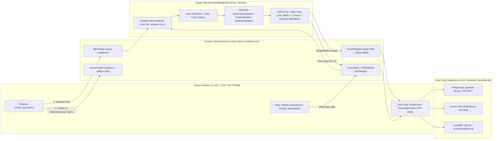

# Primary-Source Audit: High-Speed Shared-Memory Vector & Embedding Architecture

<!-- truth: start -->
- **Multi-Worker Memory & Thread Bottleneck**: Loading embedding models per Python worker multiplies model RAM by worker count (`W x 157 MB–1.5 GB`) and causes `W x N_threads` ONNX/BLAS thread oversubscription; hosting inference behind a shared-memory broker (`ShmRegion`[^shm-region] + `MpmcRing`[^ring-channels]) reduces model footprint to `1x` across all workers.
- **Zero-Copy PEP 3118 Vector Views**: Exposing shared-memory `f32`/`i8`/`u8` embedding slabs via PEP 3118 `Py_buffer` (`Request.__getbuffer__` pattern[^pyo3-request], `format="f"`, shape `(N, D)`) takes `0.312 us` for a `256 x 768` batch vs `4,239 us` (`4.24 ms`) for Python `list[list[float]]` materialization (`13,586x` faster).
- **Binary Database Wire Pushdown**: Encoding a `1 x 768` vector as binary `pgvector` (`1.03 us`) or Oracle 26ai `0xDB` binary `VECTOR` (`21.04 us` `FLOAT32`, `10.59 us` `INT8`, `0.19 us` `BINARY`)[^oracle-vec] eliminates the `349.7 us/vector` text-formatting bottleneck in `Vector.process_bind_param`[^sa-vector-type].
- **Zero-Account Model Distribution & Cloud Run GCS Caching**: Combining `ObjectStoreEngine`[^storage-engine] and `GCSConfig`[^gcs-config] with unauthenticated model mirrors (Qdrant's public GCS bucket, `onnx-community/*`, `litert-community/*`, or private `gs://` buckets via Cloud Run ADC with `RefreshingGcpCredentialProvider`) enables single-fetch model caching directly into shared memory without a Hugging Face account.
<!-- truth: end -->

---

## 1. Problem Framing & Empirical Baseline

When Python web applications generate vector embeddings locally (for semantic search, RAG ingestion, agent memory, or semantic caching), four structural bottlenecks emerge in multi-worker deployments (`vtb run app:app --workers W`):

1. **Per-Worker Model Weight Duplication (`W x Model RAM`)**:
   In standard multi-process servers, each Python worker loads its own copy of the tokenizer and model weights into private heap memory. For `EmbeddingGemma-300M` (`~600 MB` quantized / `1.2 GB` FP32) or `EmbeddingGemma 2` (built on the **Gemma 4** architecture, `740M` total parameters with a `270M` text/code backbone and modular vision/audio encoders), an 8-worker server consumes `4.8 GB–12 GB` of duplicate RAM.
2. **Intra-Op Thread Pool Contention (`W x N_cores`)**:
   ONNX Runtime (`onnxruntime` / `ort`) and PyTorch spawn `N_cores` OpenMP/intra-op threads per process by default. Across 8 workers on an 8-core machine, 64 compute threads contend for 8 physical cores, thrashing L2/L3 caches and spiking tail latency.
3. **The Singular vs. Bulk Execution Paradox**:
   - **Singular online requests** (`await embedder.embed_query("user question")` inside an HTTP or MCP route handler) execute at `batch_size = 1`, under-utilizing CPU AVX-512/AVX2/NEON and GPU tensor units while serializing concurrent requests behind locks or the GIL.
   - **Bulk ingestion jobs** (`await embedder.embed_many(documents)` with `256–10,000` items) monopolize compute threads and starve concurrent low-latency query requests unless isolated by admission control and micro-batch scheduling.
4. **Python `float` Boxing & Text SQL Serialization Overhead**:
   Returning embeddings as Python `list[list[float]]` allocates `N x D` heap `PyFloatObject`s (`28 bytes` each) and `N` list pointers. Furthermore, `Vector.process_bind_param` in [`src/py/vertebra/extensions/sqlalchemy/types.py`](../../../../../src/py/vertebra/extensions/sqlalchemy/types.py)[^sa-vector-type] currently serializes non-Oracle/SQLite vectors via string concatenation (`"[" + ",".join(str(float(x)) for x in value) + "]"`).

### Empirical Microbenchmark on Vertebra (`_vertebra` Native Extension)

Measured on the repository `.venv` (`Python 3.12`, `_vertebra` native Rust extension) for `768`-dimensional vectors (`EmbeddingGemma` / Gemma 4 base dimension) across singular (`1 x 768`) and bulk (`256 x 768` = `196,608` floats = `768 KiB`) workloads:

| Operation | Dimensions & Batch | Measured Latency | Throughput / Speedup |
| :--- | :--- | :--- | :--- |
| Python `list[list[float]]` materialization | `256 x 768` (`f32`) | `4,239.00 us` (`4.24 ms`) | `1.0x` baseline (`196,608` `PyFloatObject` allocations) |
| Dynamic `ArrowCursor.write_ipc_to_shm` + `read_bytes`[^pyo3-db] | `256 x 768` (`f32`) | `1,067.00 us` (`1.07 ms`) | `4.0x` faster (includes `shm_open` + `PyBytes` copy + `unlink`) |
| **Pre-mapped `ShmRegion` PEP 3118 2D `memoryview`** (`shape=(256, 768)`) | `256 x 768` (`f32`) | **`0.312 us` (`312 ns`)** | **`13,586x` faster** (`0` heap copies, direct C-buffer view) |
| Python `list[float]` materialization (singular) | `1 x 768` (`f32`) | `15.95 us` | `1.0x` baseline |
| **Pre-mapped `ShmRegion` PEP 3118 1D `memoryview`** (singular) | `1 x 768` (`f32`) | **`0.212 us` (`212 ns`)** | **`75.2x` faster** |
| `pgvector` text bind formatting (`"[0.01,...]"`)[^sa-vector-type] | `1 x 768` (`f32`) | `349.70 us` (`89.5 ms` / 256) | `1.0x` baseline |
| **`pgvector` binary wire encoding** (`>HH` + big-endian `f32[]`) | `1 x 768` (`f32`) | **`1.03 us`** (`0.26 ms` / 256) | **`339.5x` faster** |
| **Oracle 26ai binary `VECTOR` roundtrip (`FLOAT32`)**[^oracle-vec] | `1 x 768` (`3,072 B`) | **`21.04 us`** | Native `_vertebra.encode_oracle_vector_f32` |
| **Oracle 26ai binary `VECTOR` roundtrip (`INT8`)**[^oracle-vec] | `1 x 768` (`768 B`) | **`10.59 us`** | `4x` smaller wire payload |
| **Oracle 26ai binary `VECTOR` roundtrip (`BINARY`)**[^oracle-vec] | `1 x 768` (`96 B`) | **`0.19 us`** | `32x` smaller wire payload (`110x` faster than `FLOAT32`) |

---

## 2. Candidate Embedding Engines: Speed, Popularity & Packaging Trade-Offs

We evaluated six distinct ways to execute embedding models (`EmbeddingGemma-300M`, Gemma 4 `EmbeddingGemma 2`, BGE, Nomic, E5, MiniLM, Potion) inside Vertebra's Rust + Python architecture across speed, ecosystem adoption, wheel packaging (`cibuildwheel` across `cp312`–`cp315t`), and multi-worker memory:

| Approach | Engine Stack | CPU Latency / Throughput | Ecosystem Popularity | Wheel & Build Impact | Multi-Worker Memory | Best Fit |
| :--- | :--- | :--- | :--- | :--- | :--- | :--- |
| **1. Distilled Static Embeddings (`model2vec-rs` / SHM Static Matrix)** | Pure-Rust token ID lookup + PCA/Zipf matrix in `ShmRegion` | **Fastest Overall (`< 10 us/query`, `8,000–50,000+ docs/s/core`, `100x–500x` vs BERT)** | Viral adoption for edge, semantic routing, and fast RAG (`minishlab/potion-*`) | **Zero external C++ deps** (`< 2 MB` pure Rust; models `8–30 MB`) | **`8–30 MB` total** in a single `ShmRegion` | **L1 semantic routing**, MCP tool discovery, guardrails, ultra-fast CPU search |
| **2. Rust ONNX Runtime (`ort` + `tokenizers` / `fastembed-rs`)** | `ort 2.0` (`load-dynamic`) + HuggingFace `tokenizers` in Rust | **Fastest Contextual CPU (`~3–15 ms`, `3x–5x` faster than PyTorch)** | **#1 CPU ONNX stack** (`fastembed` + `onnxruntime` in Python/Rust) | **Zero core wheel bloat** when `ort` uses `load-dynamic` (`ORT_DYLIB_PATH`) | `1x` model in host / `mmap` shared weights | **Primary production engine** for contextual CPU/CoreML/CUDA inference |
| **3. LiteRT-LM (`litert-lm` `.litertlm` / TFLite XNNPack)** | Google `litert-lm` (`wi4a16` QAT text, `w8a8` vision) | **Fastest Gemma 4 QAT (`8.26 ms` at `seq 128` for `EmbeddingGemma 2`)** | Official Google AI Edge / Gemma 4 on-device & CPU runtime | `157 MB` text-only `.litertlm` bundle (`370 MB` VL, `463 MB` Omni) | `1x` `mmap` bundle in broker process | **Gemma 4 / `EmbeddingGemma 2`** `wi4a16` QAT CPU & multimodal execution |
| **4. Pure-Rust `candle` (`candle-transformers` + `MmapedSafetensors`)** | `candle-core`, `candle-nn`, `candle-transformers`, `memmap2` | **Fastest on GPU/Metal**; moderate on pure CPU without MKL/Accelerate | **#1 pure-Rust ML framework** (powers HuggingFace `text-embeddings-inference`) | Compiles in pure Rust with **zero external `.so`/`.dll` C++ deps** | `1x` OS page-cache `mmap` over `.safetensors` | **Self-contained pure-Rust (`vtb build --onefile`)** & Metal/CUDA |
| **5. Tier-2 Python `sentence-transformers` / `fastembed` SHM Broker** | `sentence-transformers` or `fastembed` hosted in 1 broker worker | `1.0x` PyTorch (`bf16`/`fp32`) or `3x` ONNX (`fastembed`) | **#1 Most Popular Overall** (`sentence-transformers` has millions of monthly downloads) | Zero Rust ML deps; uses existing `ShmRegion`[^shm-region] + `LeaseBroker`[^shm-broker] | `1x` model in broker worker instead of `W` HTTP workers | **Universal compatibility** for day-0 `google/embeddinggemma-2` & custom PyTorch models |
| **6. Async Remote / Cloud Batching (`Vertex AI` / `google-genai`)** | Async HTTP/2 batcher (`gemini-embedding-001`, `text-embedding-005`) | Network-bound (`15–45 ms` RPC), zero local CPU compute | Standard enterprise cloud managed path | Zero local model weights | `0 MB` local model RAM | **Zero-weight Cloud Run** deployments with `GCSConfig`[^gcs-config] ADC |

### Key Insights from Engine Benchmarking

1. **Fastest vs. Most Popular**:
   - **Fastest Overall (`< 10 us`)**: **`model2vec-rs` (Static Distilled Embeddings)** is `100x–500x` faster than transformer models on CPU because it replaces deep self-attention layers with a pre-computed static token matrix (`8–30 MB`) that fits inside a single `ShmRegion`[^shm-region] while retaining ~90% of MTEB retrieval quality.
   - **Fastest Contextual Transformer on CPU (`3–15 ms`)**: **ONNX Runtime (`ort` / `fastembed` with `int8`/`q4`)** and **LiteRT-LM (`wi4a16` QAT)** lead on CPU, running `3x–5x` faster than unquantized PyTorch with `60–80%` lower RAM.
   - **Most Popular**: **`sentence-transformers`** is the universal Python standard (and the official reference library for `google/embeddinggemma-2` and `google/embeddinggemma-300m`), while **`fastembed`** is the most popular lightweight ONNX/CPU alternative in Python and Rust.
2. **Why `ort` (`load-dynamic`) + Brokered Python Beats Static C++ Linking in `vertebra-py`**:
   - Vertebra's CI and release pipeline builds wheels across `cp312`–`cp315t` on Linux `x86_64`, Linux `aarch64`, macOS, and Windows (`--no-default-features`). Statically linking `libonnxruntime` into `_vertebra.so` would add `30–60 MB` to every wheel. Using `ort = { version = "2.0", default-features = false, features = ["load-dynamic"] }` (resolving `libonnxruntime` from the Python `onnxruntime`/`fastembed` wheel at runtime via `ORT_DYLIB_PATH`) or running `fastembed`/`sentence-transformers`/`litert-lm` in a single SHM broker worker keeps `vertebra-core` wheels lean and 100% portable.

---

## 3. Gemma (`EmbeddingGemma-300M` & Gemma 4 `EmbeddingGemma 2`) & Model Distribution

### 3.1 Gemma 4 `EmbeddingGemma 2` Architecture & Variants

`EmbeddingGemma 2` (`google/embeddinggemma-2`) is built on the **Gemma 4** architecture with a `262,144`-token SentencePiece vocabulary, an **`8,192`-token text context window**, and unified `768`-dimensional output embeddings across text, image, audio, and video:

| Variant / Configuration | Modality | Active Parameters | Quantized Bundle / RAM Size | Key Operational Notes |
| :--- | :--- | :--- | :--- | :--- |
| **`EmbeddingGemma-300M` (V1)** | Text-only (`2,048` ctx) | `300M` | `~180 MB` (`q4`) / `~300 MB` (`int8`) / `~600 MB` (`fp16`) | Available as ONNX (`onnx-community/embeddinggemma-300m-ONNX`), LiteRT (`litert-community/embeddinggemma-300m`), GGUF, and Safetensors |
| **`EmbeddingGemma 2` Text-Only** | Text & Code (`8,192` ctx) | **`270M`** (`271,002,624`) | **`157 MB`** (`wi4a16` QAT `.litertlm`) / `~540 MB` (`bf16`) | Pass `config_kwargs={"vision_config": None, "audio_config": None}` in `SentenceTransformer` to skip loading vision/audio encoders (`740M -> 270M`) or use the `270M` text bundle (`8.26 ms` latency at `seq 128`) |
| **`EmbeddingGemma 2` Vision-Language** | Text (`8,192`) + Vision (`70`/`140` tokens) | `435M` | `370 MB` (`wi4a16` text + `w8a8` vision `.litertlm`) | Pass `config_kwargs={"audio_config": None}` when only text + image retrieval is needed |
| **`EmbeddingGemma 2` Omni** | Text + Vision + Audio + Video | `740M` (`744,371,488`) | `463 MB–588 MB` (`.litertlm`) / `~1.5 GB` (`bf16`) | Full multimodal cross-modal embedding into the shared `768d` space |

> [!WARNING]
> **`EmbeddingGemma 2` Precision Constraint (`bf16` / `fp32` / `int8` / `wi4a16` Only — Never `fp16`)**: `EmbeddingGemma 2` intermediate activations are incompatible with IEEE `float16` (`fp16`) and can overflow to `NaN`/`Inf`. Always execute `EmbeddingGemma 2` in `bfloat16` (`bf16`), `float32` (`fp32`), or quantized integer formats (`int8` / `wi4a16` QAT).

### 3.2 Task-Steered Instruction Prefixes (Zero-Alloc Rust Tokenization)

Both `EmbeddingGemma-300M` and `EmbeddingGemma 2` use task-steered instruction prefixes to orient embeddings in the `768`-dimensional space:

| Task Mode (`EmbeddingTask`) | Prefix Template Pre-pended Before Tokenization | Typical Use Case |
| :--- | :--- | :--- |
| `search_query` (`query`) | `"task: search result \| query: {text}"` | Singular user search query (`embed_query`) |
| `search_document` (`document`) | `"title: {title \| none} \| text: {text}"` | Bulk RAG / document indexing (`embed_many`) |
| `question_answering` | `"task: question answering \| query: {text}"` | QA retrieval |
| `fact_verification` | `"task: fact checking \| query: {text}"` | Claim verification |
| `classification` | `"task: classification \| query: {text}"` | Intent / route / guardrail classification |
| `clustering` | `"task: clustering \| query: {text}"` | Topic clustering & deduplication |
| `semantic_similarity` | `"task: sentence similarity \| query: {text}"` | Symmetric similarity comparison |
| `code_retrieval` | `"task: code retrieval \| query: {text}"` | Natural-language-to-code search |

**Vertebra Optimization**: Instead of forcing users to manually format prefix strings in Python (or allocating temporary Python `str` objects for every document in a 10,000-row batch), the Rust tokenizer pre-encodes the static task prefix token IDs once at model initialization and splices them onto the document token IDs in Rust before tensor construction.

### 3.3 Matryoshka Representation Learning (MRL) & Multi-Precision Quantization

Gemma embedding models train nested prefix dimensions via **Matryoshka Representation Learning (MRL)** at **`768d`, `512d`, `256d`, and `128d`**. Truncating a `768d` embedding to `d in {128, 256, 512}` requires slicing the first `d` floats and **re-normalizing to unit L2 length** ($\hat{v} = v_{1..d} / \|v_{1..d}\|_2$).

Combined with post-pooling scalar (`int8`), half-precision (`float16` output storage), and `1-bit binary` quantization in Rust, a single forward pass can populate compact representations directly in shared memory:

| Representation | Bytes per Vector | `256`-Vector Batch Size | Fits in `TieredRingSet`[^tiered-rings] | Storage / Bandwidth Reduction |
| :--- | :--- | :--- | :--- | :--- |
| `768d float32` (Full) | `3,072 B` | `768 KiB` | `small` (`1` vec) / `xlarge` (`256` vecs) | `1.0x` baseline |
| `512d float32` (MRL) | `2,048 B` | `512 KiB` | `small` (`1` vec) / `xlarge` (`256` vecs) | `1.5x` smaller |
| `256d float32` (MRL) | `1,024 B` | `256 KiB` | `small` (`1–3` vecs) / `large` (`255` vecs) | `3.0x` smaller (~95%+ recall retained) |
| `128d float32` (MRL) | `512 B` | `128 KiB` | `small` (`1–7` vecs) / `large` (`256` vecs) | `6.0x` smaller |
| `768d int8` (Scalar Quantized) | `768 B` (+ `4 B` scale) | `193 KiB` | `small` (`1–5` vecs) / `large` (`256` vecs) | `4.0x` smaller |
| `256d int8` (MRL + `int8`) | `256 B` (+ `4 B` scale) | `65 KiB` | `small` (`1–15` vecs) / `large` (`256` vecs) | `12.0x` smaller |
| `768d binary` (`1-bit` packed) | `96 B` | `24 KiB` | `small` (`1–42` vecs) / `medium` (`256` vecs) | **`32.0x` smaller** (oversample + rescore) |

### 3.4 Downloading Models Without a Hugging Face Account & Caching on Cloud Run (GCS)

Official `google/embeddinggemma-*` repositories on Hugging Face require clicking a license gate with a logged-in `HF_TOKEN` (and stale `HF_TOKEN` environment variables cause `401 Unauthorized` errors even on public repos). Vertebra can eliminate Hugging Face account requirements and optimize Cloud Run cold starts by combining [`vertebra.storage.ObjectStore`](../../../../../src/py/vertebra/storage/_store.py)[^storage-engine][^gcs-config] with five unauthenticated/cloud-native sources:

| Model Source | Account / Token Required? | Supported Models | How Vertebra Fetches & Caches It |
| :--- | :--- | :--- | :--- |
| **1. Private or Public GCS Bucket (`gs://...`)** | **No HF account** (uses zero-config Cloud Run ADC via `GCSConfig`[^gcs-config] or `skip_signature=True`) | Any model (`EmbeddingGemma 2`, `EmbeddingGemma-300M`, custom fine-tunes) | `ObjectStore("gs://my-models/...")`[^storage-engine] streams weights at `1–2 GB/s` over Google's internal network directly into `/dev/shm` (`ShmRegion`[^shm-region]) or local cache once on supervisor startup |
| **2. Cloud Run GCS Volume Mount + In-Memory Volume** | **No HF account** (managed Cloud Run GCS FUSE) | Any `.safetensors`, `.onnx`, or `.litertlm` model directory | Mount `gs://my-models` at `/mnt/models` (`--add-volume type=cloud-storage`) and point `specific_model_path="/mnt/models/..."` (`local_files_only=True`), or copy once at startup into an `in-memory` volume |
| **3. Qdrant Public GCS Mirror (`https://storage.googleapis.com/qdrant-fastembed/`)** | **Zero account / Zero token** (public anonymous GCS CDN) | `fast-bge-small-en-v1.5.tar.gz`, `fast-bge-base-en-v1.5.tar.gz`, `fast-all-minilm-l6-v2.tar.gz`, `fast-nomic-embed-text-v1.5.tar.gz`, etc. | Direct HTTP GET via `ObjectStore("https://storage.googleapis.com/qdrant-fastembed")`[^storage-engine] + Rust `zstd`/tar extraction into local cache |
| **4. Non-Gated Community ONNX & LiteRT Repos (`onnx-community/*`, `litert-community/*`, `minishlab/*`)** | **Zero account / Zero token** (pass `token=False` or fetch raw `/resolve/main/` URLs directly) | `onnx-community/embeddinggemma-300m-ONNX` (`fp32`/`int8`/`q4`), `litert-community/embeddinggemma-300m`, `minishlab/potion-base-8M` | Direct anonymous HTTP GET via `ObjectStore("https://huggingface.co")`[^storage-engine] (bypassing `huggingface_hub` token checks) |
| **5. OCI / Artifact Registry (`oci://` / `https://`)** | **No HF account** (uses Cloud Run ADC or OCI credentials) | Model weights packaged as OCI artifacts or in Artifact Registry | Pulled via `vertebra-storage` native `OciObjectStore` / `HTTPConfig`[^storage-engine] |

---

## 4. Shared-Memory & Ring-Buffer Vector Transport Design

Vertebra already possesses all foundational IPC building blocks in [`vertebra-core`](../../../../../src/rs/vertebra-core/src/lib.rs)[^shm-region][^ring-channels][^tiered-rings][^shm-broker] and [`vertebra-db`](../../../../../src/rs/vertebra-db/src/lib.rs)[^duckdb-arrow-shm][^oracle-vec]. We can compose them into a high-speed vector subsystem across four architectural seams:



### 4.1 Token-Budgeted & Length-Sorted Adaptive Micro-Batching Over `MpmcRing` (`embed_query`)

When 50 concurrent HTTP requests or MCP tool calls each invoke `await embedder.embed_query(text)` in separate Python coroutines or worker processes:
1. Each caller writes a compact request frame (`[request_id: u64][model_id: u16][task_tag: u8][target_dim: u16][quant_format: u8][text_len: u32][utf8_bytes]`) into a shared `MpmcRing`[^ring-channels] (or `BatchBridge` in `Topology::Embedded`).
2. The embedding host runs the **double-buffered cooperative drain loop** proven in [`RequestBatcher::run`](../../../../../src/rs/vertebra-http/src/batcher.rs)[^request-batcher], combined with **token-based dynamic batching** (the core throughput optimization in Rust `text-embeddings-inference`):
   - Upon waking on the first item, it drains immediately queued items from `MpmcRing` via non-blocking `try_recv_view` until reaching either `max_batch_requests` (e.g., `64`) or a **strict token ceiling (`max_batch_tokens`, e.g., `16,384` tokens)**, optionally waiting up to `coalesce_window_us` (`250–1,000 us`) when `in_flight > 0`.
   - **Length-Sorted Dynamic Padding**: Within the drained batch, the host sorts inputs by token count and pads each sub-batch only to the **longest sequence in that specific mini-batch** (rather than a static `2,048` or `8,192` ceiling). Short `12`-token queries are never padded to match a `2,000`-token outlier (which otherwise wastes `90%+` of self-attention FLOPs), and original request order is restored during output scatter.
3. The host writes each caller's resulting vector directly into its response slot (`TieredRingSet::small` `4 KiB`[^tiered-rings]) and notifies only sleeping workers via Dekker `consumer_sleeping` handshakes (`0` syscalls when under load).

### 4.2 Zero-Copy `VectorSlab` & `ArrowCursor` for Bulk Vectorization (`embed_many` / `embed_arrow`)

When a user vectorizes `256` to `100,000` documents in bulk:
1. **Input Handoff**:
   - If the input is already an `ArrowCursor`[^pyo3-db], `pyarrow.RecordBatch` / `Table`, or `polars.DataFrame`, the input text column is already in contiguous Arrow `Utf8` / `LargeUtf8` memory (`[offsets][data]`) and is passed zero-copy via `ShmArrowFrameHeader` (`VTBARROW`)[^duckdb-arrow-shm] or the Arrow C Data Interface (`FFI_ArrowArray`).
   - If the input is a Python `Sequence[str]`, a single C-API pass (`PyUnicode_AsUTF8AndSize`) packs `[u32 count][u32 offsets...][utf8 bytes]` directly into an input `ShmRegion` without intermediate `Vec<String>` allocations.
2. **Pre-Allocated Output Matrix in Shared Memory (`VectorSlab`)**:
   - Before running inference, the host allocates (or leases from a slab pool) a single contiguous output `ShmRegion` of size `Header (64 B) + N * row_stride_bytes` (64-byte cache-line aligned rows for AVX-512 / NEON alignment).
   - As worker chunks finish each length-sorted sub-batch, they write the pooled, MRL-sliced, L2-normalized `f32` / `i8` / `u8` vectors **directly into slice `&mut slab[row_idx * stride ..]`**.
   - **Priority Preemption**: Bulk sub-batches yield between chunks to the singular query `MpmcRing` so a 50,000-document background job on `WorkerRunner` never adds more than one sub-batch (`~5–15 ms`) of tail latency to live user `embed_query` calls.

### 4.3 Zero-Copy Python Representation (`VectorView` & `VectorBatchView`)

Following the exact pattern of [`Request.__getbuffer__`](../../../../../src/rs/vertebra-py/src/request.rs)[^pyo3-request] (which anchors `Arc<BatchSnapshot>` inside `Py_buffer` via `PyBuffer_FillInfo` with `#[cfg_attr(not(Py_GIL_DISABLED), pyclass(frozen, freelist = 128, immutable_type))]`):

- **`VectorView` (1D `#[pyclass(frozen, immutable_type)]`)**:
  - Wraps an `Arc<VectorSlab>` (or inline `Bytes` for standalone calls) + row offset + `dims: usize` + `dtype: VectorDtype` (`Float32`, `Float64`, `Float16`, `Int8`, `Binary`).
  - Implements PEP 3118 `__getbuffer__` with `format = c"f"` (or `c"b"` / `c"B"`), `ndim = 1`, `shape = [dims]`, `strides = [elem_size]`, `readonly = 1`.
  - Works out of the box with `memoryview(vec)`, `np.asarray(vec)` (zero-copy!), `vec.to_oracle_bytes()`, `vec.to_pgvector_bytes()`, `vec.to_sqlite_blob()`, and lazy `vec.to_list()` when a plain `list[float]` is explicitly requested.
- **`VectorBatchView` (2D `#[pyclass(frozen, immutable_type)]`)**:
  - Wraps the contiguous `N x D` `ShmRegion` slab.
  - Implements PEP 3118 `__getbuffer__` with `ndim = 2`, `shape = [N, D]`, `strides = [D * elem_size, elem_size]`, `format = c"f"`.
  - `np.frombuffer` / `np.asarray(batch)` produces a 2D `numpy.ndarray` of shape `(N, D)` in **`0.312 us` with zero byte copies**.
  - `batch.to_arrow(column_name="embedding")` wraps the shared-memory buffer directly as an Apache Arrow `FixedSizeListArray<Float32, D>` (or `ArrowCursor`[^pyo3-db]) for zero-copy joins with DuckDB, Polars, or DataFusion.
  - Indexing `batch[i]` returns a zero-copy `VectorView` borrowing row `i` of the same `Arc<VectorSlab>`.

### 4.4 Shared-Memory L1 Vector Index & Pure-Rust SIMD Scanner (`VectorCache`)

Because Vertebra already coordinates cross-worker seqlock-guarded state in [`ShmLeaseTable` and `ShmStatementCache`](../../../../../src/rs/vertebra-core/src/broker.rs)[^shm-broker], we can provide a built-in **Shared-Memory L1 Vector Cache & SIMD Top-K Scanner (`VectorCache`)** directly in `vertebra-core` with **zero C/C++ dependencies** (avoiding C++ HNSW crates like `usearch` so `cargo check --target x86_64-pc-windows-msvc --no-default-features` and `cibuildwheel` remain 100% pure Rust):

1. **Exact Text-Hash Deduplication Ring (Seqlock Set-Associative Cache)**:
   - Hashes `(model_id, task_tag, target_dim, quant_format, fnv1a_64(text))` into a shared-memory cache table. Repeated embeddings of hot search queries, system prompts, or common tags resolve in **`< 200 ns`** directly from shared memory across all workers without invoking the tokenizer or neural network.
2. **Pure-Rust SIMD Shared-Memory Similarity Search (`search_shm_vectors`)**:
   - Stores a flat 64-byte-aligned matrix of `C` vectors (e.g., `4,096` to `65,536` vectors = `4 MiB` to `64 MiB` at `256d f32`, or `384 KiB` to `6 MiB` at `768d binary`) inside a `ShmRegion`.
   - Provides a pure-Rust PyO3 fastpath (`cosine_top_k_shm`, `dot_top_k_shm`, `hamming_top_k_shm` using hardware `u64::count_ones` `POPCNT` and auto-vectorized 8-lane `f32`/`i8` accumulators) that scans `10,000` vectors in **`< 100 us`** off-GIL—ideal for:
     - **Semantic Route & Guardrail Matching** (classifying incoming HTTP/agent requests against canonical examples at ingress),
     - **MCP `2026-07-28` & A2A `1.0` Dynamic Tool Discovery** (finding the top-5 relevant MCP tools out of hundreds of registered tools in sub-millisecond time),
     - **L1 Semantic LLM Response Cache** (before hitting PostgreSQL/Oracle/Valkey).

### 4.5 Direct Binary Database Pushdown (`vertebra-db` + `SQLSpec` + `SQLAlchemy`)

Instead of converting `ShmRegion` vectors to `list[float]` and then formatting them back into strings or bytes in Python:
1. **PostgreSQL (`pgvector` `vector` / `halfvec` / `bit` + `PGCOPY` Binary)**:
   - Implement pgvector's exact binary wire protocol in `src/rs/vertebra-db/src/postgres.rs` and `src/rs/vertebra-py/src/db.rs`:
     - `vector` (`vector_send`/`vector_recv`): `[u16 dim BE][u16 unused=0 BE][f32 BE; dim]` (`4 + 4*dim` bytes — **`1.03 us` vs `349.70 us` text**, **`339.5x` faster**).
     - `halfvec` (`halfvec_send`/`halfvec_recv`, pgvector `0.7+`): `[u16 dim BE][u16 unused=0 BE][f16 BE; dim]` (`4 + 2*dim` bytes).
     - `bit` (`bit_send`/`bit_recv`, binary quantized vectors): `[i32 bit_len BE][u8; ceil(bit_len / 8)]`.
   - Wire `Vector.process_bind_param`[^sa-vector-type] and `encode_pgcopy_binary_rows` to accept `VectorView` / `memoryview` directly.
2. **Oracle 26ai (`0xDB` Binary `VECTOR`)**:
   - Accept `&[f32]` / `PyBuffer` (`VectorView`, `memoryview`, `numpy.ndarray`) directly in `encode_oracle_vector_f32` (`src/rs/vertebra-py/src/db.rs`)[^pyo3-db] without first extracting a Python `Vec<f32>` from a `PyList`, copying directly from the `ShmRegion` slice into the `0xDB` wire frame (or binding `INT8` / `BINARY` directly).
3. **DuckDB, SQLite (`sqlite-vec`), & SQLSpec Arrow Ingestion**:
   - Pass `VectorBatchView` directly as an `ArrowCursor`[^pyo3-db] (`FixedSizeList<Float32, D>`) into `DuckDBDriver.execute_arrow_shm()` or SQLite `BLOB` binds (`memoryview(vec)`).

### 4.6 Google-First Zero-Weight Embedders: Native gRPC (`PredictionService` / `GenerativeService`) & In-Database SQL Pushdown

For Cloud Run, GKE, and Google Cloud users—or any deployment that wants **`0 MB` of local model weights** and **zero extra Python dependencies** in base `vertebra-core`—Vertebra leads with clean, domain-named Google embedders built directly on our existing [`grpc.rs`](../../../../../src/rs/vertebra-http/src/grpc.rs)[^grpc-framing], [`GCSConfig`](../../../../../src/py/vertebra/storage/_store.py)[^gcs-config], and [`AlloyDbDialer`](../../../../../src/rs/vertebra-db/src/dialer.rs)[^alloydb-dialer]:

| Embedder | Wire Protocol & Endpoint | Payload & Parsing Overhead | Key Advantage |
| :--- | :--- | :--- | :--- |
| **1. `VertexEmbedder` / `GeminiEmbedder` (Default Zero-Weight)** | HTTP/2 + 5-byte LPM gRPC (`application/grpc+proto`)[^grpc-framing] to `PredictionService/EmbedContent` (`aiplatform.googleapis.com`) or `GenerativeService/BatchEmbedContents` (`generativelanguage.googleapis.com`) | **`6x` smaller than REST JSON** (`3.0 MB` vs `~18 MB` for `250 x 3,072` floats); **zero ASCII float parsing** (`memcpy` packed IEEE-754 little-endian `f32` bytes directly from `GrpcFrame` into `VectorSlab`) | Coalesces 100s of concurrent requests across all Python workers over `MpmcRing`[^ring-channels] into **1 multiplexed HTTP/2 gRPC batch call**; auto-authenticates via cached/auto-refreshing Cloud Run Metadata Server & ADC (`GCSConfig`[^gcs-config]) or `GEMINI_API_KEY` |
| **2. `AlloyDbEmbedder` & `OracleEmbedder` (In-Database Pushdown — Fastest Overall in GCP)** | Native PostgreSQL wire (`AlloyDbDialer` `:5433` mTLS)[^alloydb-dialer] or Oracle 26ai TTC wire (`oracle.rs`)[^oracle-vec] | **`0` vector bytes over the application network** — embeddings are generated and searched inside the database engine | Pushes `embedding('gemini-embedding-001', $1)::vector` (or `text-embedding-005` / `semantic-ranker-fast-004`) into AlloyDB AI (`google_ml_integration`) or `DBMS_VECTOR.UTL_TO_EMBEDDING(..., '{"provider":"vertexai","model":"gemini-embedding-001:predict"}')` into Oracle 26ai |
| **3. `RemoteEmbedder` (Self-Hosted Cluster Pool)** | Bidirectional streaming gRPC (`@grpc_method` + `GrpcServiceRegistry`)[^grpc-registry] over `h2c` / mTLS (`application/grpc+proto` or `application/grpc+msgpack`) | Raw binary `VectorSlab` frame transfer between stateless Cloud Run web instances and a dedicated GPU/CPU `vtb` embedding pool | Lets 50 stateless web containers share a single autoscaled GPU/CPU `EmbeddingGemma 2` service over persistent HTTP/2 streams |

#### Why Native gRPC (`application/grpc+proto`) Beats REST/JSON for `VertexEmbedder` & `GeminiEmbedder`

1. **Zero-Parse Packed Float Extraction (`6x` Wire Reduction)**:
   - In Protobuf v3 (`google.cloud.aiplatform.v1.EmbedContentResponse` / `google.ai.generativelanguage.v1beta.BatchEmbedContentsResponse`), the embedding values field (`repeated float values = 1 [packed = true]`) is encoded on the wire as `tag 0x0A` (`field 1, wire type 2`) + `varint byte_length` + **contiguous little-endian IEEE-754 `f32` bytes**.
   - We do not need `tonic`, `prost-build`, or `protoc` in the Cargo build: an ~80-line pure-Rust wire encoder/decoder on top of [`encode_grpc_frame` and `decode_grpc_frames`](../../../../../src/rs/vertebra-http/src/grpc.rs)[^grpc-framing] frames the request and **`memcpy`s the packed `f32` byte slice straight from the HTTP/2 `GrpcFrame` into the 64-byte-aligned `VectorSlab`** (or runs SIMD MRL L2 normalization in place).
2. **Automatic Fix for `gemini-embedding-001` Matryoshka Normalization**:
   - When callers request reduced dimensions (`output_dimensionality = 768`, `512`, or `256`) from `gemini-embedding-001` (`3,072d` base), the remote API returns the truncated prefix slice **unnormalized**, which degrades retrieval accuracy on dot-product and Euclidean indexes unless the caller manually L2-normalizes the truncated slice.
   - `VertexEmbedder` and `GeminiEmbedder` automatically run Rust SIMD L2 normalization ($\hat{v} = v_{1..d} / \|v_{1..d}\|_2$) as they write the gRPC frame into `VectorSlab`, guaranteeing unit-norm vectors across every model and dimension.

### 4.7 Active ADC Credential Caching, Proactive Refresh & Generation Tracking (`vertebra-storage` & `vertebra-db`)

Inspecting [`src/rs/vertebra-storage/src/store.rs`](../../../../../src/rs/vertebra-storage/src/store.rs)[^storage-engine] and [`src/py/vertebra/storage/_store.py`](../../../../../src/py/vertebra/storage/_store.py)[^gcs-config] reveals three critical credential lifecycle gaps that must be closed alongside the vector and model storage pipeline:

1. **Replacing `StaticCredentialProvider` with `RefreshingGcpCredentialProvider`**:
   - Currently, [`ObjectStoreEngine::new`](../../../../../src/rs/vertebra-storage/src/store.rs)[^storage-engine] wraps `access_token` in `object_store::StaticCredentialProvider::new(GcpCredential { bearer: token })`, and [`GCSConfig.to_url_and_options()`](../../../../../src/py/vertebra/storage/_store.py)[^gcs-config] resolves the token only once at initialization. Because Google OAuth2 access tokens expire after `3,600 s` (1 hour), long-lived servers or background workers fail with `401 Unauthorized` after 60 minutes, and `object_store`'s built-in `GoogleCloudStorageBuilder::from_env()` does not handle local `gcloud auth application-default login` (`authorized_user` + `x-goog-user-project`) or keyless `target_service_account` (`:generateAccessToken`) refresh flows out of the box.
2. **Shared TTL Cache with Proactive Refresh Skew (`300 s`) & Single-Flight Deduplication**:
   - Parse `expires_in` (from `http://metadata.google.internal/computeMetadata/v1/instance/service-accounts/default/token` and `https://oauth2.googleapis.com/token`) and `expireTime` (from IAM `:generateAccessToken`), storing `(access_token, expires_at_epoch_ms, generation: u64)` in a shared cache (shared across workers via seqlock in `/dev/shm` and across threads via `ArcSwap` / `RwLock`).
   - Proactively refresh tokens when `now >= expires_at - 300s` (5-minute safety margin before expiration) under a single-flight lock so concurrent requests across workers or `3.14t`/`3.15t` threads never stampede the metadata server or IAM endpoint, and force an immediate refresh on HTTP `401` responses.
3. **Per-Session `token_generation` Tracking for DuckDB `httpfs` & Pooled Clients**:
   - When `DuckDBDriver` queries `gs://` buckets via core `httpfs` (`CREATE OR REPLACE SECRET ... (TYPE gcs, BEARER_TOKEN ?)` with `SET httpfs_connection_caching = true; SET enable_http_metadata_cache = true;`), gating secret rotation on a global `cache.needs_refresh()` boolean causes a multi-session race where only the first session updates its secret and subsequent sessions skip rotation. Tracking `applied_token_generation: u64` against the cache's monotonic `generation: u64` ensures every session and `ObjectStoreEngine` instance immediately adopts rotated tokens.

### 4.8 Free-Threaded Python (`3.14t` / `3.15t`, `Py_GIL_DISABLED`) Execution Model

In free-threaded Python `3.14t` and `3.15t`, Vertebra defaults to single-process `Topology::Embedded` with $N$ parallel [`EventLoopPool`](../../../../../src/py/vertebra/server/_loops.py) shard threads:
1. **Zero-IPC In-Process `Arc<VectorSlab>` & `Arc<VectorCache>`**: All $N$ Python event-loop threads share the same virtual address space as the Rust Tokio runtime. `VectorView` and `VectorBatchView` are declared with `#[pyclass(frozen, immutable_type)]` (`Sync + Send`) and expose read-only (`readonly = 1`) PEP 3118 `Py_buffer` views over `Arc<VectorSlab>`, avoiding cross-thread reference-count contention or `PyMutex` critical sections on `PyFloatObject`s.
2. **GIL Re-Enablement Quarantine via `EmbeddingBroker`**: In `3.14t`/`3.15t`, importing any third-party C/C++ ML extension that has not declared `Py_MOD_GIL_NOT_USED` causes CPython to globally re-enable the GIL across all HTTP threads (detected by [`GilAuditReport`](../../../../../src/py/vertebra/server/_gil_audit.py)). Pure-Rust embedders (`VertexEmbedder`, `GeminiEmbedder`, `AlloyDbEmbedder`, `OracleEmbedder`, `RemoteEmbedder`, `StaticEmbedder`) run 100% in-process with `py.detach(|| ...)` while keeping `sys._is_gil_enabled() == False`; if a local Python ML library lacks `Py_MOD_GIL_NOT_USED`, isolating `EmbeddingBroker` in a sidecar subprocess over `/dev/shm` (`MpmcRing` + `VectorSlab`) preserves 100% GIL-free execution in the main `3.14t`/`3.15t` server process.

---

## 5. Proposed User-Facing API, `vtb ai` CLI & Optional Packaging

### 5.1 Clean Domain-Named Python API (`vertebra.embeddings`)

Following Vertebra's clean-break domain naming rules (`PY-07`—state *what* the domain concept is, with zero `*Bridge` or `*Grpc*` implementation suffixes), each provider is a direct `Embedder` class (`VertexEmbedder`, `GeminiEmbedder`, `GemmaEmbedder`, `AlloyDbEmbedder`, `OracleEmbedder`, `FastEmbedder`, `StaticEmbedder`, `RemoteEmbedder`), and calling `Embedder()` defaults to `VertexEmbedder("gemini-embedding-001", dimensions=768)`:

```python
from vertebra.embeddings import (
    AlloyDbEmbedder,
    Embedder,
    FastEmbedder,
    GeminiEmbedder,
    GemmaEmbedder,
    OracleEmbedder,
    RemoteEmbedder,
    StaticEmbedder,
    VectorBatchView,
    VectorView,
    VertexEmbedder,
)
from vertebra.framework import Controller, Inject, get, post

embedder = VertexEmbedder("gemini-embedding-001", dimensions=768)

multimodal_embedder = GeminiEmbedder("gemini-embedding-2", dimensions=768)

gemma_embedder = GemmaEmbedder(
    "embeddinggemma-300m-q8",
    dimensions=768,
    source="gs://my-models/vertebra/embeddinggemma-300m-q8",
)

alloy_embedder = AlloyDbEmbedder("gemini-embedding-001", dimensions=768)

oracle_embedder = OracleEmbedder("gemini-embedding-001", dimensions=768)

fast_embedder = FastEmbedder("BAAI/bge-small-en-v1.5")

static_embedder = StaticEmbedder("minishlab/potion-base-8M")

remote_embedder = RemoteEmbedder("grpc://embeddings.internal:8443")


class SearchController(Controller):
    path = "/search"

    @get("/")
    async def search(self, q: str, emb: Inject[Embedder]) -> dict[str, object]:
        query_vec: VectorView = await emb.embed_query(q)
        return {"dims": len(query_vec), "norm": query_vec.norm()}

    @post("/ingest")
    async def ingest(self, docs: list[str], emb: Inject[Embedder]) -> dict[str, object]:
        batch: VectorBatchView = await emb.embed_documents(docs, titles=None)
        mv: memoryview = memoryview(batch)
        arrow_cursor = batch.to_arrow_shm(column="embedding")
        return {"count": batch.count, "dimensions": batch.dimensions, "shm_bytes": batch.nbytes}
```

### 5.2 `vtb ai` CLI Cleanup, Co-Located Workers in `vtb run` & Zero-Bloat Optional Packaging (`vertebra-core[embeddings]`)

To ensure base `vertebra-core` never suffers dependency or binary bloat:
- **Base `vertebra-core` (Zero New Dependencies)**: Includes `VectorSlab`, `VectorView`, `VectorBatchView`, `VectorCache` (pure-Rust SIMD), `VertexEmbedder` / `GeminiEmbedder` (native Rust HTTP/2 gRPC + `RefreshingGcpCredentialProvider`), `AlloyDbEmbedder`, `OracleEmbedder`, `RemoteEmbedder`, `StaticEmbedder` (pure-Rust static matrices), binary `pgvector`/`Oracle 26ai` wire pushdown, and the `vtb ai` CLI.
- **Optional `pip install vertebra-core[embeddings]` (`uv add vertebra-core --extra embeddings`)**: Pulls in `fastembed` (`onnxruntime` + `tokenizers`) for local CPU/GPU transformer inference (`GemmaEmbedder`, `FastEmbedder`) inside the single-instance `EmbeddingBroker`.

We also consolidate the CLI around **`vtb ai`** (`models` + `mcp`) and configurable background queue workers in **`vtb run` / `vtb dev`**:

| CLI Command | Action |
| :--- | :--- |
| `vtb ai models list` | Lists supported Google (`gemini-embedding-001`, `gemini-embedding-2`, `text-embedding-005`, `embeddinggemma-2-270m`, `embeddinggemma-300m`) and open-weights (`bge-small-en-v1.5`, `nomic-embed-text-v1.5`, `potion-base-8M`) models, dimensions, quantizations, and cache status |
| `vtb ai models pull <model> [--quant int8\|q4\|fp32]` | Downloads model weights + `tokenizer.json` from non-gated mirrors (`onnx-community/*`, `litert-community/*`, `storage.googleapis.com/qdrant-fastembed/`) into local cache using [`ObjectStore`](../../../../../src/py/vertebra/storage/_store.py)[^storage-engine] with **zero Hugging Face account/token** |
| `vtb ai models stage <model> --to gs://<bucket>/<prefix>` | Pulls the model and uploads it with a verified SHA-256 `manifest.json` to Google Cloud Storage (or `s3://` / `r2://` / `oci://`) via `ObjectStore.put_multipart`[^storage-engine][^gcs-config] for Cloud Run deployments |
| `vtb ai models warm <model> [--from gs://<bucket>/<prefix>] [--shm]` | Pre-fetches staged model files from GCS at `1–2 GB/s` directly into `/dev/shm` (`ShmRegion`[^shm-region]) or a Cloud Run `in-memory` mount on container startup before workers spawn |
| `vtb ai mcp serve \| bridge` | Moves top-level `vtb mcp` under `vtb ai mcp` alongside `vtb ai models` |
| `vtb run <app> [--with-workers] [--queues default,embed]` | Runs the HTTP/gRPC server and optionally co-locates background `WorkerRunner` queue lanes in the same deployment (configurable via CLI flags or `[tool.vertebra.workers]` in `pyproject.toml`), while `vtb workers run <app>` remains available for dedicated worker-only pods |

### 5.3 Synchronous, Asynchronous & Streaming Convenience Methods

| Method | Input | Output | Underlying SHM Path |
| :--- | :--- | :--- | :--- |
| `embed_query(text)` / `embed_query_sync(text)` | `str` | `VectorView` | L1 `VectorCache` lookup &rarr; `MpmcRing` token-budgeted micro-batcher &rarr; `TieredRingSet::small` |
| `embed_document(text, *, title=None)` | `str` | `VectorView` | Document prefix `"title: ... \| text: ..."` &rarr; `MpmcRing` micro-batcher &rarr; `TieredRingSet::small` |
| `embed_many(texts, *, task="document", titles=None)` | `Sequence[str]` | `VectorBatchView` | Packed UTF-8 `ShmRegion` &rarr; length-sorted chunked inference &rarr; contiguous `(N, D)` `VectorSlab` |
| `embed_arrow(table_or_cursor, *, text_col="text")` | `ArrowCursor \| pa.Table \| pl.DataFrame` | `ArrowCursor` | Zero-copy `VTBARROW` input &rarr; appends `FixedSizeList<Float32, D>` embedding column in `ShmRegion` |
| `similarity_search(query_or_vec, candidates, *, top_k=10)` | `str \| VectorView` | `list[SimilarityMatch]` | Off-GIL pure-Rust SIMD cosine/dot/Hamming top-k scan directly over `VectorSlab` |

---

## 6. Recommended Best Path for Vertebra's Supported Setup

Given Vertebra's current build and runtime matrix (`Python 3.12–3.15` + free-threaded `3.14t`/`3.15t`, `cibuildwheel` across Linux `x86_64`/`aarch64`, macOS, and Windows MSVC `--no-default-features`, `vertebra-core` SHM rings, `vertebra-storage` `ObjectStore`, and `vertebra-db` two-tier drivers), **the best path is a Google-First Two-Tier Shared-Memory Vector Architecture**:

1. **Tier 1 — Always-On Pure-Rust SHM Vector Primitives & Google Zero-Weight Embedders (`vertebra-core` + `vertebra-http` + `vertebra-db` + `vertebra-py` + `vertebra-storage`, Zero New C/C++ or Python Dependencies)**:
   - **`VectorSlab` & PEP 3118 `VectorView` / `VectorBatchView`**: Cache-line aligned `(N, D)` vector matrices in `ShmRegion`[^shm-region] exposed to Python via zero-copy `Py_buffer` (`0.212 us` singular, `0.312 us` batch, `0` copies to `numpy`, `memoryview`, and `ArrowCursor`[^pyo3-db]).
   - **`VertexEmbedder` & `GeminiEmbedder` (Default Google-First Zero-Weight)**: Uses native HTTP/2 5-byte LPM gRPC framing[^grpc-framing] + `RefreshingGcpCredentialProvider` Cloud Run ADC[^gcs-config] to coalesce cross-worker requests over `MpmcRing`[^ring-channels] into batched `PredictionService` / `GenerativeService` gRPC calls (`gemini-embedding-001`, `gemini-embedding-2`, `text-embedding-005`) and copy packed `f32` bytes straight into `VectorSlab` with automatic SIMD L2 renormalization.
   - **In-Database SQL Pushdown (`AlloyDbEmbedder` & `OracleEmbedder`)**: Pushes `embedding('gemini-embedding-001', text)::vector` into AlloyDB[^alloydb-dialer] and `DBMS_VECTOR.UTL_TO_EMBEDDING` into Oracle 26ai[^oracle-vec] alongside binary `pgvector` (`vector`, `halfvec`, `bit` + `PGCOPY` binary) and zero-copy `PyBuffer` Oracle 26ai `0xDB` codecs.
   - **Pure-Rust SIMD Kernel, `VectorCache` & `StaticEmbedder`**: MRL slicing (`768d -> 512d/256d/128d`) + L2 renormalization, `int8` and `1-bit` binary quantization, Gemma task-prefix builder, seqlock FNV-1a exact deduplication cache, off-GIL SIMD top-k (`cosine`, `dot`, `hamming`), and `< 10 us` static token-matrix embeddings (`model2vec` format) in pure Rust.
   - **`vtb ai models` CLI (`pull`, `stage`, `warm`, `list`)**: Built on `ObjectStoreEngine`[^storage-engine] + `GCSConfig`[^gcs-config] for zero-HF-account model pulling and Cloud Run GCS/`/dev/shm` staging.
2. **Tier 2 — Optional Local `EmbeddingBroker` (`pip install vertebra-core[embeddings]`)**:
   - Coordinates cross-worker singular requests over `MpmcRing`[^ring-channels] (with **token-budgeted, length-sorted dynamic padding**) and bulk jobs over `VectorSlab` so local model weights are loaded **only once per host**:
     - **`GemmaEmbedder`**: Runs `EmbeddingGemma-300M` (`int8`/`q4`/`fp32` ONNX) and `EmbeddingGemma 2` (`270M` text-only in `bf16` or `157 MB` `.litertlm` QAT bundle, or `740M` multimodal) in the single broker worker.
     - **`FastEmbedder`**: Runs open-weights ONNX models (`BAAI/bge-small-en-v1.5`, `nomic-embed-text-v1.5`) from `ObjectStore` model cache (`specific_model_path`, `local_files_only=True`).
     - **`RemoteEmbedder`**: Streams batches over `@grpc_method`[^grpc-registry] (`h2c` / mTLS) to a remote Vertebra GPU/CPU embedding pool.

---

## Provenance Footnotes

[^shm-region]: `src/rs/vertebra-core/src/shm.rs::ShmRegion` — Cross-platform shared memory region allocation (`memfd_create`, `shm_open`, `/tmp/vtb-*` overflow fallback).
[^ring-channels]: `src/rs/vertebra-core/src/channel.rs::MpmcRing` — Lock-free `SpscRing` (`SlotView`) and `MpmcRing` (`MpmcSlotView`) shared-memory rings.
[^tiered-rings]: `src/rs/vertebra-core/src/tiered_ring.rs::TieredRingConfig` — Four-tier response ring slot capacities (`small` 4 KiB, `medium` 32 KiB, `large` 256 KiB, `xlarge` 2 MiB).
[^shm-broker]: `src/rs/vertebra-core/src/broker.rs::ShmLeaseTable` — Cross-process SHM connection lease broker and seqlock-guarded `ShmStatementCache`.
[^request-batcher]: `src/rs/vertebra-http/src/batcher.rs::RequestBatcher` — Double-buffered cooperative request batching and burst draining.
[^duckdb-arrow-shm]: `src/rs/vertebra-db/src/duckdb_engine.rs::write_shm_arrow_frame` — Shared-memory `VTBARROW` Arrow IPC framing and zero-copy slice borrowing.
[^oracle-vec]: `src/rs/vertebra-db/src/oracle.rs::encode_oracle_vector_f32` — Oracle 26ai `0xDB` binary `VECTOR` (`FLOAT32`, `FLOAT64`, `INT8`, `BINARY`) wire codecs.
[^pyo3-db]: `src/rs/vertebra-py/src/db.rs::ArrowCursor` — PyO3 bindings for `ArrowCursor` and native database wire codecs.
[^pyo3-request]: `src/rs/vertebra-py/src/request.rs::Request` — Anchored PEP 3118 `Py_buffer` zero-copy `memoryview` implementation.
[^sa-vector-type]: `src/py/vertebra/extensions/sqlalchemy/types.py::Vector` — SQLAlchemy 2.1 `Vector` column type and `VectorDistanceExpr` compiler.
[^genai-telemetry]: `src/py/vertebra/telemetry/genai.py::GenAiUsage` — OpenTelemetry GenAI semantic conventions and metrics.
[^storage-engine]: `src/rs/vertebra-storage/src/store.rs::ObjectStoreEngine` — Multi-cloud Rust `ObjectStoreEngine` with native GCS, S3, Azure, OCI, R2, and HTTP backends.
[^gcs-config]: `src/py/vertebra/storage/_store.py::GCSConfig` — Zero-config Google Cloud Storage Application Default Credentials (ADC) and metadata-server token resolution.
[^grpc-framing]: `src/rs/vertebra-http/src/grpc.rs::encode_grpc_frame` — Native 5-byte Length-Prefixed Message (LPM) HTTP/2 gRPC wire framing and status codes.
[^grpc-registry]: `src/py/vertebra/extensions/grpc/__init__.py::GrpcServiceRegistry` — Native `@grpc_method` and `GrpcServiceRegistry` supporting unary and streaming gRPC.
[^alloydb-dialer]: `src/rs/vertebra-db/src/dialer.rs::AlloyDbDialer` — Native AlloyDB (`:5433` mTLS) and Cloud SQL (`:3307`) database dialers.
