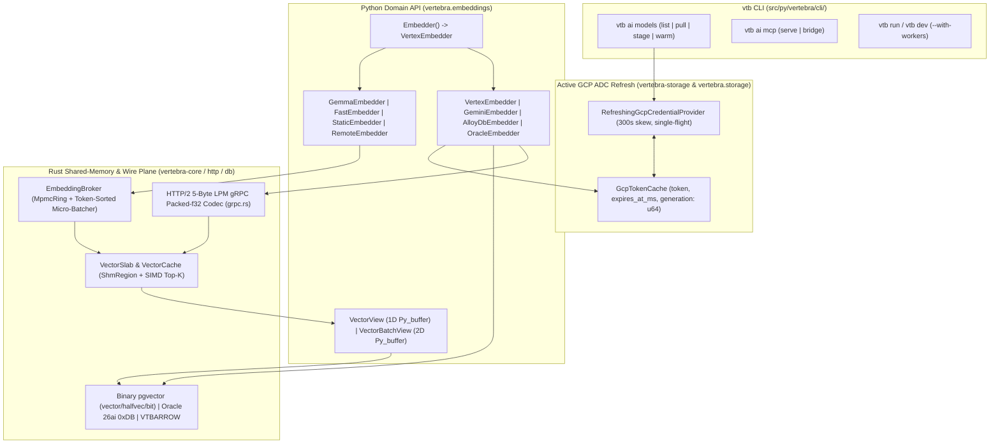

# Shared-Memory Vector, Embedding, Active ADC Credential Refresh & `vtb ai` CLI

<!-- truth: start -->
- **Clean Domain Naming (`PY-07`)**: Every embedder and shared-memory vector primitive uses a direct domain class name with zero `*Bridge`, `*Grpc*`, `Shm*`, `Vertebra*`, or `Native*` implementation prefixes (`Embedder`, `VertexEmbedder`, `GeminiEmbedder`, `GemmaEmbedder`, `AlloyDbEmbedder`, `OracleEmbedder`, `FastEmbedder`, `StaticEmbedder`, `RemoteEmbedder`, `VectorSlab`, `VectorCache`, `VectorView`, `VectorBatchView`, `EmbeddingBroker`).
- **Active GCP ADC Credential Caching & Proactive Refresh**: `RefreshingGcpCredentialProvider` and `GcpTokenCache` replace static `access_token` injection in `vertebra-storage`[^storage-engine] and `GCSConfig`[^gcs-config], proactively refreshing tokens `300s` before expiry under a single-flight lock and propagating monotonic `generation: u64` rotation across `ObjectStoreEngine`, `SyncDuckDBDriver` / `AsyncDuckDBDriver` `httpfs` secrets, `VertexEmbedder`, and `AlloyDbDialer`.
- **Zero-Copy Shared-Memory Vector Views & `1x` Model RAM**: `VectorView` (1D) and `VectorBatchView` (2D) expose 64-byte-aligned `ShmRegion`[^shm-region] vector slabs via PEP 3118 `Py_buffer` (`#[pyclass(frozen, immutable_type)]`), while `EmbeddingBroker` coordinates singular and bulk inference over `MpmcRing`[^ring-channels] so multi-worker (`--workers N`) and free-threaded `3.14t`/`3.15t` deployments load local model weights only once (`1x` RAM).
- **Consolidated `vtb ai` CLI & Co-Located Workers**: Top-level `vtb mcp` moves under `vtb ai mcp` alongside `vtb ai models` (`list`, `pull`, `stage`, `warm`), and `vtb run` / `vtb dev` gain configurable co-located background `WorkerRunner` execution (`--with-workers`, `--queues`, `--lane-concurrency`, `[tool.vertebra.workers]`).
<!-- truth: end -->

---

## 1. Specification & Context

### 1.1 Overview & Goals

This specification defines Vertebra's end-to-end vector, embedding, cloud credential refresh, and AI CLI subsystem, grounded in the promoted research audit ([`research/shm_vector_embeddings_20261101.md`](research/shm_vector_embeddings_20261101.md)):

1. **Active GCP ADC Credential Caching, Proactive Refresh & Generation Tracking (`vertebra-storage`, `vertebra-db`, `vertebra.storage`)**:
   - Replace `object_store::StaticCredentialProvider` in [`src/rs/vertebra-storage/src/store.rs`](../../../../src/rs/vertebra-storage/src/store.rs)[^storage-engine] and one-shot token resolution in [`src/py/vertebra/storage/_store.py`](../../../../src/py/vertebra/storage/_store.py)[^gcs-config] with `RefreshingGcpCredentialProvider` backed by a shared `GcpTokenCache` (`access_token`, `expires_at_unix_ms`, `generation: u64`, `quota_project_id`).
   - Support GCE/Cloud Run Metadata Server, local `gcloud auth application-default login` (`authorized_user` refresh token + `x-goog-user-project`), `service_account` JSON keys, and keyless `target_service_account` IAM `:generateAccessToken` impersonation.
   - Proactively refresh tokens `300s` (5 minutes) prior to expiration under a single-flight lock and track per-session `applied_token_generation: u64` in [`src/py/vertebra/db/duckdb.py`](../../../../src/py/vertebra/db/duckdb.py) (`SyncDuckDBDriver` / `AsyncDuckDBDriver` executing `CREATE OR REPLACE SECRET ... (TYPE gcs, BEARER_TOKEN ?)` with `SET httpfs_connection_caching = true; SET enable_http_metadata_cache = true;`), `ObjectStoreEngine`, `VertexEmbedder`, and `AlloyDbDialer`.
2. **Pure-Rust Shared-Memory Vector Primitives & PEP 3118 Views (`vertebra-core`, `vertebra-py`)**:
   - Implement `VectorSlab` (64-byte cache-line aligned `(N, D)` matrix in `ShmRegion`[^shm-region] supporting `Float32`, `Float64`, `Float16`, `Int8`, and packed 1-bit `Binary`), `VectorCache` (seqlock FNV-1a exact text-hash deduplication cache + off-GIL SIMD `cosine_top_k`, `dot_top_k`, and `POPCNT` `hamming_top_k`), Matryoshka (`MRL`) truncation (`768d -> 512d/256d/128d`) + SIMD L2 renormalization, Gemma task-prefix token splicer, and pure-Rust `StaticEmbedder` (`model2vec` static token matrix in `ShmRegion`).
   - Expose `VectorView` (1D) and `VectorBatchView` (2D) in `vertebra-py` as `#[pyclass(frozen, immutable_type)]` with anchored PEP 3118 `__getbuffer__` (`readonly = 1`) following [`Request.__getbuffer__`](../../../../src/rs/vertebra-py/src/request.rs)[^pyo3-request].
3. **Binary Database Wire Codecs (`vertebra-db`, `vertebra-py`, `vertebra.extensions.sqlalchemy`)**:
   - Add binary `pgvector` wire codecs (`encode_pgvector_f32` / `decode_pgvector_f32`, `encode_pgvector_f16` / `decode_pgvector_f16`, `encode_pgvector_bit` / `decode_pgvector_bit`) in [`src/rs/vertebra-db/src/postgres.rs`](../../../../src/rs/vertebra-db/src/postgres.rs)[^pg-wire], upgrade Oracle 26ai `0xDB` codecs[^oracle-vec] in [`src/rs/vertebra-py/src/db.rs`](../../../../src/rs/vertebra-py/src/db.rs)[^pyo3-db] to read zero-copy `PyBuffer` (`VectorView`, `memoryview`, `numpy.ndarray`), add `VectorBatchView.to_arrow_shm()` returning `ArrowCursor`[^duckdb-arrow-shm], and wire [`Vector.process_bind_param`](../../../../src/py/vertebra/extensions/sqlalchemy/types.py)[^sa-vector-type].
4. **Google-First Zero-Weight Embedders & Clean `vertebra.embeddings` Hierarchy (`vertebra-core`, `vertebra-http`, `vertebra-py`, `vertebra.embeddings`)**:
   - Add compact Protobuf v3 wire helpers (`encode_batch_embed_grpc_request` and `decode_batch_embed_grpc_response_into_slab`) in `vertebra-core::vector` (shared by both [`src/rs/vertebra-http/src/grpc.rs`](../../../../src/rs/vertebra-http/src/grpc.rs)[^grpc-framing] and `vertebra-py::vector` without cyclic crate dependencies) for Vertex AI (`google.cloud.aiplatform.v1.PredictionService/EmbedContent`) and Gemini (`google.ai.generativelanguage.v1beta.GenerativeService/BatchEmbedContents`), extracting packed IEEE-754 little-endian `f32` slices directly into `VectorSlab` with SIMD L2 renormalization.
   - Implement `vertebra.embeddings` (`Embedder`, `VertexEmbedder`, `GeminiEmbedder`, `AlloyDbEmbedder`, `OracleEmbedder`, `RemoteEmbedder`, `GemmaEmbedder`, `FastEmbedder`, `StaticEmbedder`, `EmbeddingBroker`, `EmbeddingTask`, `VectorDtype`, `SimilarityMatch`) where `Embedder()` defaults to `VertexEmbedder("gemini-embedding-001", dimensions=768)`.
5. **Single-Instance `EmbeddingBroker`, Local Models & Free-Threaded `3.14t`/`3.15t` Quarantine**:
   - Implement `EmbeddingBroker` coordinating cross-worker singular requests over `MpmcRing`[^ring-channels] (with token-budgeted, length-sorted dynamic padding) and bulk `embed_many` / `embed_arrow` requests over `VectorSlab` so multi-worker deployments load local weights (`GemmaEmbedder`, `FastEmbedder`) only once (`1x` RAM).
   - Enforce `EmbeddingGemma 2` precision safety (`bf16`/`fp32`/`int8`/`q4` only; reject `fp16` with `ValueError`) and isolate non-`Py_MOD_GIL_NOT_USED` C-extensions in a broker subprocess on Python `3.14t`/`3.15t` so the main HTTP server stays 100% GIL-disabled.
6. **`vtb ai` CLI Consolidation & Co-Located `WorkerRunner` in `vtb run` / `vtb dev`**:
   - Create `src/py/vertebra/cli/ai.py` (`vtb ai models list|pull|stage|warm` and `vtb ai mcp serve|bridge`), removing top-level `vtb mcp` from [`src/py/vertebra/cli/__init__.py`](../../../../src/py/vertebra/cli/__init__.py)[^cli-root].
   - Add `--with-workers`, `--queues`, and `--lane-concurrency` (plus `[tool.vertebra.workers]` in `pyproject.toml`) to `vtb run` and `vtb dev` to co-locate background `WorkerRunner` lanes in the same server process/supervisor[^server-lanes], and add `--oneshot` to `vtb workers run`.

### 1.2 Non-Goals & Scope Boundaries

- **Zero Core Wheel Bloat**: Base `vertebra-core` must not add `onnxruntime`, `torch`, `sentence-transformers`, `huggingface-hub`, `tonic`, or C++ HNSW libraries (`usearch`, `faiss`) to core Cargo or Python dependencies. Local ONNX/transformer inference lives strictly under optional `[project.optional-dependencies] embeddings` (`fastembed>=0.6.0`).
- **Clean-Break CLI & Naming (`PY-07`)**: Top-level `vtb mcp` is replaced by `vtb ai mcp` without leaving deprecated command aliases or `*Bridge` / `Shm*` class shims.

---

## 2. Requirements & Architecture

### 2.1 Functional Requirements

- **REQ-01 (Active GCP ADC Credential Caching & Generation Refresh)**: `GcpTokenCache` and `RefreshingGcpCredentialProvider` in `vertebra-storage` and `GCSConfig` in `vertebra.storage` MUST cache `(access_token, expires_at_unix_ms, generation: u64, quota_project_id)`, proactively refresh `300s` before expiry under a single-flight lock across metadata server, `authorized_user` refresh token, `service_account` JWT, and `target_service_account` IAM `:generateAccessToken` flows, and rotate DuckDB `httpfs` `TYPE gcs` secrets per session using `applied_token_generation: u64`.
- **REQ-02 (Shared-Memory `VectorSlab`, `VectorCache`, SIMD Post-Processing & PEP 3118 Views)**: `vertebra-core` and `vertebra-py` MUST provide 64-byte-aligned `VectorSlab`, seqlock `VectorCache` (exact FNV-1a lookup + SIMD `cosine_top_k`, `dot_top_k`, `hamming_top_k`), MRL truncation + SIMD L2 normalization, scalar `int8` / 1-bit `binary` quantization, Gemma task-prefix token splicer, pure-Rust `StaticEmbedder`, and `#[pyclass(frozen, immutable_type)]` `VectorView` (1D) and `VectorBatchView` (2D) implementing PEP 3118 `__getbuffer__` (`readonly = 1`).
- **REQ-03 (Binary Database Wire Codecs & Zero-Copy Arrow Handoff)**: `vertebra-db` and `vertebra-py` MUST implement binary `pgvector` codecs (`vector`, `halfvec`, `bit`), zero-copy `PyBuffer` input in Oracle 26ai `0xDB` `encode_oracle_vector_*` codecs, `VectorBatchView.to_arrow_shm(column="embedding")` returning `ArrowCursor`, and binary/buffer fastpaths in `vertebra.extensions.sqlalchemy.types.Vector`.
- **REQ-04 (Google-First Zero-Weight gRPC & SQL Pushdown Embedders)**: `vertebra-http` and `vertebra.embeddings` MUST provide native HTTP/2 5-byte LPM gRPC packed-`f32` framing for `VertexEmbedder` (`PredictionService/EmbedContent`) and `GeminiEmbedder` (`GenerativeService/BatchEmbedContents`) with automatic MRL L2 renormalization, SQL pushdown `AlloyDbEmbedder` (`embedding()`) and `OracleEmbedder` (`DBMS_VECTOR.UTL_TO_EMBEDDING`), cluster-streaming `RemoteEmbedder`, and `Embedder()` defaulting to `VertexEmbedder("gemini-embedding-001", dimensions=768)`.
- **REQ-05 (`1x` RAM `EmbeddingBroker`, `GemmaEmbedder`, `FastEmbedder` & `3.14t`/`3.15t` Quarantine)**: `EmbeddingBroker` MUST coalesce singular requests over `MpmcRing` (with token-budgeted, length-sorted dynamic padding) and execute bulk requests over `VectorSlab` with priority preemption between chunks, load local models (`GemmaEmbedder`, `FastEmbedder`) once per host (`1x` RAM), reject `fp16` on `EmbeddingGemma 2`, and isolate non-`Py_MOD_GIL_NOT_USED` extensions in a subprocess on free-threaded Python `3.14t`/`3.15t`.
- **REQ-06 (`vtb ai` CLI Consolidation & Co-Located Workers in `vtb run` / `vtb dev`)**: `vtb ai` MUST group `vtb ai models` (`list`, `pull`, `stage`, `warm` using `ObjectStore` without requiring a Hugging Face account) and `vtb ai mcp` (`serve`, `bridge`, replacing top-level `vtb mcp`), while `vtb run` and `vtb dev` MUST support `--with-workers`, `--queues`, `--lane-concurrency`, and `[tool.vertebra.workers]` config, and `vtb workers run` MUST support `--oneshot`.
- **REQ-07 (Documentation, Example Application & OKF Knowledge Sync)**: User documentation (`docs/usage/embeddings-and-vectors.md`, `docs/reference/cli.md`), runnable example (`docs/examples/embeddings_app.py`), `zensical.toml`, and OKF v0.2 knowledge chapters MUST be updated and verified via `make docs` and `make review-check`.

### 2.2 Non-Functional Requirements

- **NFR-01 (Hot-Path Latency & Zero-Copy Invariants)**: PEP 3118 `memoryview(VectorBatchView)` creation MUST complete in `< 5 us` with `0` byte copies; binary `pgvector` encoding for `768d f32` MUST complete in `< 10 us`; L1 `VectorCache` exact hits MUST complete in `< 1 us`.
- **NFR-02 (Cross-Platform & Free-Threaded Build Integrity)**: All Rust crates MUST compile cleanly under `cargo check --target x86_64-pc-windows-msvc --no-default-features` and `Py_GIL_DISABLED` (`3.14t`/`3.15t`), and `mypy.stubtest` MUST pass with `0` errors on `vertebra._vertebra` and `vertebra._storage`.

### 2.3 Architecture Diagram

---

## 3. Requirement-to-Task Traceability Matrix

| Requirement | Description | Implementing Task(s) | Verification Gate |
| :--- | :--- | :--- | :--- |
| **REQ-01** | Active GCP ADC credential caching, `300s` proactive refresh, single-flight lock, and per-session `generation: u64` rotation (`ObjectStoreEngine`, `GCSConfig`, `SyncDuckDBDriver`, `AsyncDuckDBDriver`) | [`t01-gcp-adc-token-cache-and-refresh`](tasks/t01-gcp-adc-token-cache-and-refresh.md) | `cargo test -p vertebra-storage` + `pytest src/py/tests/unit/storage/test_gcs_token_refresh.py` |
| **REQ-02** | `VectorSlab`, `VectorCache`, SIMD MRL/quantization/top-k, Gemma prefix splicer, `StaticEmbedder`, and PEP 3118 `VectorView` / `VectorBatchView` | [`t02-shm-vector-slab-cache-and-views`](tasks/t02-shm-vector-slab-cache-and-views.md) | `cargo test -p vertebra-core` + `pytest src/py/tests/unit/embeddings/test_vector_views.py` + `stubtest` |
| **REQ-03** | Binary `pgvector` (`vector`, `halfvec`, `bit`), zero-copy `PyBuffer` Oracle 26ai `0xDB` codecs, `VectorBatchView.to_arrow_shm()`, and `SQLAlchemy` `Vector` bind pushdown | [`t03-binary-vector-db-wire-codecs`](tasks/t03-binary-vector-db-wire-codecs.md) | `cargo test -p vertebra-db` + `pytest src/py/tests/unit/db/test_vector_wire_codecs.py` |
| **REQ-04** | Native HTTP/2 gRPC packed-`f32` framing (`PredictionService` / `GenerativeService`) and `vertebra.embeddings` (`Embedder`, `VertexEmbedder`, `GeminiEmbedder`, `AlloyDbEmbedder`, `OracleEmbedder`, `RemoteEmbedder`) | [`t04-google-grpc-and-sql-pushdown-embedders`](tasks/t04-google-grpc-and-sql-pushdown-embedders.md) | `cargo test -p vertebra-core -p vertebra-http` + `pytest src/py/tests/unit/embeddings/test_google_embedders.py` |
| **REQ-05** | `EmbeddingBroker` (`1x` model RAM, token-budgeted length-sorted batching, `3.14t`/`3.15t` GIL quarantine), `GemmaEmbedder`, `FastEmbedder`, and `[project.optional-dependencies] embeddings` | [`t05-shm-embedding-broker-and-local-models`](tasks/t05-shm-embedding-broker-and-local-models.md) | `pytest src/py/tests/unit/embeddings/test_embedding_broker.py` + `review_setup validate` |
| **REQ-06** | `vtb ai` CLI (`vtb ai models list\|pull\|stage\|warm`, `vtb ai mcp serve\|bridge`), co-located `WorkerRunner` in `vtb run` / `vtb dev`, `--oneshot` in `vtb workers run`, and CLI doc generator sync | [`t06-vtb-ai-cli-and-colocated-workers`](tasks/t06-vtb-ai-cli-and-colocated-workers.md) | `pytest src/py/tests/unit/cli/test_ai_cli.py src/py/tests/unit/cli/test_run_with_workers.py` + `generate_cli_docs.py --check` |
| **REQ-07** | Documentation guide (`docs/usage/embeddings-and-vectors.md`), runnable example (`docs/examples/embeddings_app.py`), `zensical.toml`, and OKF v0.2 knowledge chapters | [`t07-docs-examples-and-okf-sync`](tasks/t07-docs-examples-and-okf-sync.md) | `make docs` + `make review-check` |

---

## 4. Implementation Plan

- [x] [`t01-gcp-adc-token-cache-and-refresh`](tasks/t01-gcp-adc-token-cache-and-refresh.md) — Active GCP ADC Credential Caching, Proactive Refresh & Per-Session Generation Rotation (`depends_on: []`)
- [x] [`t02-shm-vector-slab-cache-and-views`](tasks/t02-shm-vector-slab-cache-and-views.md) — Shared-Memory `VectorSlab`, `VectorCache`, SIMD Kernels, `StaticEmbedder` & PEP 3118 Views (`depends_on: []`)
- [x] [`t03-binary-vector-db-wire-codecs`](tasks/t03-binary-vector-db-wire-codecs.md) — Binary `pgvector` Wire Codecs, Zero-Copy `PyBuffer` Oracle 26ai `0xDB`, `to_arrow_shm` & SQLAlchemy Pushdown (`depends_on: [t02-shm-vector-slab-cache-and-views]`)
- [x] [`t04-google-grpc-and-sql-pushdown-embedders`](tasks/t04-google-grpc-and-sql-pushdown-embedders.md) — Native HTTP/2 gRPC Packed-Float Codec & Google-First Zero-Weight Embedders (`depends_on: [t01-gcp-adc-token-cache-and-refresh, t02-shm-vector-slab-cache-and-views, t03-binary-vector-db-wire-codecs]`)
- [x] [`t05-shm-embedding-broker-and-local-models`](tasks/t05-shm-embedding-broker-and-local-models.md) — Single-Instance `EmbeddingBroker`, `GemmaEmbedder`, `FastEmbedder` & Free-Threaded `3.14t`/`3.15t` Quarantine (`depends_on: [t02-shm-vector-slab-cache-and-views, t04-google-grpc-and-sql-pushdown-embedders]`)
- [~] [`t06-vtb-ai-cli-and-colocated-workers`](tasks/t06-vtb-ai-cli-and-colocated-workers.md) — `vtb ai` (`models` + `mcp`) CLI Consolidation & Co-Located `WorkerRunner` in `vtb run` / `vtb dev` (`depends_on: [t01-gcp-adc-token-cache-and-refresh, t05-shm-embedding-broker-and-local-models]`)
- [ ] [`t07-docs-examples-and-okf-sync`](tasks/t07-docs-examples-and-okf-sync.md) — Embeddings Documentation, Runnable Example & OKF v0.2 Knowledge Base Sync (`depends_on: [t04-google-grpc-and-sql-pushdown-embedders, t05-shm-embedding-broker-and-local-models, t06-vtb-ai-cli-and-colocated-workers]`)

---

## 5. Continuity Snapshot

- **Active Phase**: Planned (`plan_revision: 2`, `state: planned` at commit `d3d5f8b`).
- **Next Action**: Run `/flow:implement` starting with [`t01-gcp-adc-token-cache-and-refresh`](tasks/t01-gcp-adc-token-cache-and-refresh.md) and [`t02-shm-vector-slab-cache-and-views`](tasks/t02-shm-vector-slab-cache-and-views.md).

---

## Provenance Footnotes

[^shm-region]: `src/rs/vertebra-core/src/shm.rs::ShmRegion` — Cross-platform shared memory region allocation and overflow fallback.
[^ring-channels]: `src/rs/vertebra-core/src/channel.rs::MpmcRing` — Lock-free `SpscRing` and `MpmcRing` shared-memory slot views.
[^tiered-rings]: `src/rs/vertebra-core/src/tiered_ring.rs::TieredRingConfig` — Four-tier response ring slot capacities (4 KiB to 2 MiB).
[^shm-broker]: `src/rs/vertebra-core/src/broker.rs::ShmLeaseTable` — Cross-process SHM connection lease broker and seqlock statement cache.
[^grpc-framing]: `src/rs/vertebra-http/src/grpc.rs::encode_grpc_frame` — Native 5-byte Length-Prefixed Message (LPM) HTTP/2 gRPC framing in `vertebra-http`.
[^storage-engine]: `src/rs/vertebra-storage/src/store.rs::ObjectStoreEngine` — Multi-cloud Rust `ObjectStoreEngine` with native GCS, S3, Azure, OCI, R2, and HTTP backends.
[^gcs-config]: `src/py/vertebra/storage/_store.py::GCSConfig` — Zero-config Google Cloud Storage ADC and metadata-server credential resolution.
[^duckdb-arrow-shm]: `src/rs/vertebra-db/src/duckdb_engine.rs::write_shm_arrow_frame` — Shared-memory `VTBARROW` IPC framing in `vertebra-db`.
[^oracle-vec]: `src/rs/vertebra-db/src/oracle.rs::encode_oracle_vector_f32` — Oracle 26ai binary `VECTOR` (`FLOAT32`, `FLOAT64`, `INT8`, `BINARY`) wire codecs.
[^pg-wire]: `src/rs/vertebra-db/src/postgres.rs::encode_pgcopy_binary_rows` — PostgreSQL wire framing and `PGCOPY` binary row encoding.
[^pyo3-db]: `src/rs/vertebra-py/src/db.rs::ArrowCursor` — PyO3 bindings for `ArrowCursor` and database wire codecs.
[^pyo3-request]: `src/rs/vertebra-py/src/request.rs::Request` — Anchored PEP 3118 `Py_buffer` zero-copy `memoryview` implementation.
[^sa-vector-type]: `src/py/vertebra/extensions/sqlalchemy/types.py::Vector` — SQLAlchemy 2.1 `Vector` column type and `VectorDistanceExpr` compiler.
[^cli-root]: `src/py/vertebra/cli/__init__.py::cli` — Vertebra `vtb` CLI entrypoint and subcommand registration.
[^server-lanes]: `src/py/vertebra/server/lanes.py::WorkerRunner` — Multi-lane background queue worker runner and `LaneConfig`.
