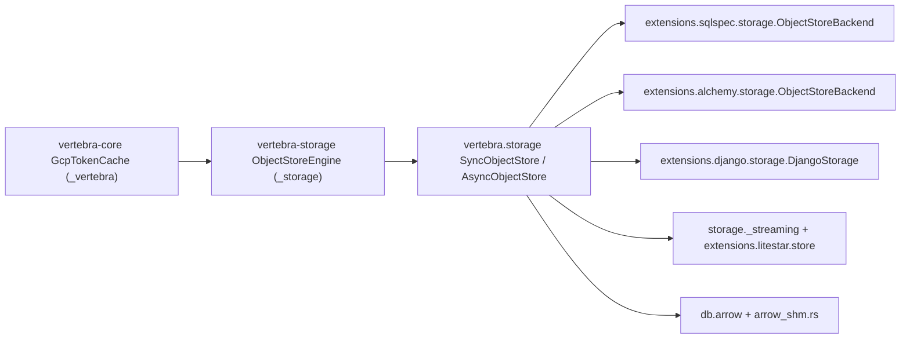

# Feature-Complete Storage

<!-- truth: start -->
- **Canonical Engine Seam**: `vertebra-storage` (`vertebra._storage`, `vertebra-core[storage]`) provides `SyncObjectStore`, `AsyncObjectStore`, `SyncReadableFile`, and `AsyncReadableFile` over `gs`, `s3`, `r2`, `oci`, `az`, `file`, and explicit test-only `memory` backends [^rs-storage-engine] [^py-storage-facade].
- **Async & Optional Wheel Invariants**: `vertebra._storage` resolves lazily via `import_optional("vertebra._storage")` and fails closed with `MissingDependencyError(..., extra="storage")` or `ImproperConfigurationError`; `src/py/vertebra/storage/_store.py` contains zero `asyncio.to_thread` calls and zero `self._memory` fallback dicts [^py-storage-facade].
- **Unified GCP Auth**: Python storage and presigning callers consume `vertebra._vertebra.{SyncGcpTokenCache, AsyncGcpTokenCache, GcpTokenSnapshot}` backed by `vertebra_core::gcp_auth::GcpTokenCache`, removing duplicate token classes from `vertebra._storage` and pure-Python OAuth fetchers from `storage/_store.py` [^core-gcp-auth].
- **Framework & Data-Plane Contracts**: SQLSpec `ObjectStoreBackend`, Advanced Alchemy `ObjectStoreBackend` (via `StorageRegistry` without monkeypatching `storages.get`), `@deconstructible` Django `Storage`, Litestar `Store` / static-files / RFC 9110 `206` & `416` streaming, and strict `allocate_shm_region` / Arrow IPC cursors operate without silent in-memory fallback; required named SHM allocation errors propagate without Python anonymous-SHM fallback [^arrow-shm-alloc].
<!-- truth: end -->

## 1. Specification, Context & Provenance

### 1.1 Problem Statement & Objectives

`vertebra-storage` compiles as a standalone optional PyO3 extension (`vertebra._storage`) with `AbortHandle` and `TaskPanicError` completion delivery, incremental streaming/multipart sessions, unified `vertebra._vertebra` GCP token caches, and fail-closed `SyncObjectStore` / `AsyncObjectStore` facades [^rs-storage-engine] [^py-storage-facade] [^core-gcp-auth], and its SQLSpec, Advanced Alchemy, and Django adapters implement their upstream storage contracts over paired native stores. Litestar Store/static integration and HTTP Range streaming are implemented, as are strict named Arrow SHM allocation and bounded storage codecs [^arrow-shm-alloc] [^py-storage-facade]. SQLSpec codec delegation and the consumer storage/auth guides remain planned in `ch05`.

### 1.2 Non-Goals

- Relocating `build_duckdb_gcs_secret_sql` from `src/py/vertebra/extensions/sqlspec/storage.py` onto `DuckDBCore` (owned by sibling flow [native-duckdb-driver](../native-duckdb-driver/spec.md)).
- Migrating SQLSpec broker RPC result frames to `VTBARROW` across worker pools (owned by [broker-pool-sharing](../broker-pool-sharing/spec.md) and [sqlspec-adapter-parity](../sqlspec-adapter-parity/spec.md)).
- Multipart `multipart/byteranges` HTTP responses; `StreamingStorageResponse` implements RFC 9110 single-range `206 Partial Content` and `416 Range Not Satisfiable`.

### 1.3 Upstream Execution Baseline

Anchored at `HEAD @ cdb978d3` above `main @ 077a3fe9` (incorporating `db-layout-and-contract` [`21c99f95`], `db-engine-primitives` [`80ff8a65`], `runtime-structure-and-throughput` [`d2fa5072`], and `mcp-webmcp-core` [`077a3fe9`]). Chapters cataloged in [chapters/index.md](chapters/index.md).

### 1.4 Code Analysis & Seam Summary

| Existing Seam | Verified Present-State Architecture |
| --- | --- |
| `src/rs/vertebra-storage/src/{lib.rs,store.rs,r2.rs}` [^rs-storage-engine] | Provides incremental `MultipartUploadSession` (uniform `8 MiB` R2/OCI parts), `PySyncStreamReader` / `PyAsyncStreamReader` (`get_stream`), conditional `put_opts`, `list_page`, `list_with_delimiter`, and `rename`. |
| `src/rs/vertebra-storage/src/{lib.rs,gcp_auth.rs,signing.rs,oci.rs}` [^core-gcp-auth] | Consumes `vertebra_core::gcp_auth::GcpTokenCache` via `vertebra._vertebra.{SyncGcpTokenCache, AsyncGcpTokenCache, GcpTokenSnapshot}`, with `RefreshingGcpCredentialProvider` and native `sign_oci_par_url` / GCS V4 IAM / S3 SigV4 / Azure SAS / HMAC signing. |
| `src/py/vertebra/storage/_store.py` [^py-storage-facade] | Enforces fail-closed `MissingDependencyError` / `ImproperConfigurationError` construction, zero `self._memory` fallback dicts or Python `urllib` OAuth fetchers, and shared `.to_async()` / `.to_sync()` engine and token-cache handles. |
| `src/py/vertebra/extensions/{sqlspec,alchemy,django}/storage.py` | SQLSpec exposes exact protocol methods plus native stream/page/reader extensions; Advanced Alchemy registers the concrete `ObjectStoreBackend` without registry monkeypatches; Django provides deconstructible `Storage` with seekable `File` handles. All require explicit targets and share paired native stores. |
| `src/py/vertebra/extensions/litestar/` | Provides `ObjectStoreLitestarStore`, async static-files integration, and RFC 9110 `Range` / `416` streaming. |
| `src/rs/vertebra-db/src/arrow_shm.rs` & `src/py/vertebra/db/arrow.py` [^arrow-shm-alloc] | Named allocation errors propagate; `ArrowCursor.from_rows` requires real PyArrow IPC and the native writer when SHM is selected. Storage codecs use bounded native stream/range/multipart I/O with per-demand SyncPool steps. |

### 1.5 Relevant OKF Knowledge Chapters & Skills

- Knowledge: [object-storage.md](../../knowledge/domains/storage/object-storage.md), [sqlspec-alchemy-and-dialects.md](../../knowledge/domains/extensions/sqlspec-alchemy-and-dialects.md), [litestar.md](../../knowledge/domains/extensions/litestar.md), [adr-004-optional-driver-wheels-and-shm-ownership.md](../../knowledge/decisions/adr-004-optional-driver-wheels-and-shm-ownership.md), [ffi-and-gil-discipline.md](../../knowledge/patterns/rust/ffi-and-gil-discipline.md).
- Project-local skills: [pyo3-bridge](../../../skills/pyo3-bridge/SKILL.md), [runtime-ipc](../../../skills/runtime-ipc/SKILL.md), [python-framework](../../../skills/python-framework/SKILL.md) (plus external Litestar plugin skills for `sqlspec`, `advanced-alchemy`, and `litestar`).

The active storage-integration contract baseline is SQLSpec `0.71.1`, Advanced Alchemy `1.12.0`, and Django `6.1.3`. SQLSpec reader factories retain native sync metadata lookup and lazy async read timing. Chapter `ch02` worksheets cite their installed protocol/base-class sources, preserve concrete public adapter names, and declare callable omission/error semantics. `ObjectMeta` is the native metadata type.

Django modification time comes from native `ObjectMeta.last_modified`. Creation/access timestamps are unavailable and their Django hooks raise `NotImplementedError`.

Django's `Storage` base is checked through the `django-stubs` lint dependency; its lockfile is part of `ch02:t03`.

Django File handles reopen through the native store, including real `FieldFile` reuse. Provider configuration types participate in Django's public migration serializer registry so migration expressions preserve their constructor fields.

## 2. Requirements, Concrete Contracts & Architecture

### 2.1 Functional Requirements

- **R1 (Streaming & Conditional Native Engine)**: Implement `get_stream` (`StorageBuffer` chunk iterators), byte-range reads, `put_opts` (`if_not_exists`, `if_match`, `if_none_match`, `content_type`, `attributes`), incremental `MultipartUploadSession` (`put_stream` without whole-payload `Vec<Bytes>` buffering, including uniform 8 MiB R2/OCI part chunking), `list_page`, `list_with_delimiter`, and `rename` across `SyncObjectStore`, `AsyncObjectStore`, `SyncReadableFile`, and `AsyncReadableFile`.
- **R2 (Unified GCP Auth & Multi-Cloud Signing)**: Support presigned URLs across GCS V4 (local `GOOG4-RSA-SHA256` and IAM `signBlob`), S3 SigV4, Azure SAS, and OCI PAR; remove duplicate `SyncGcpTokenCache`, `AsyncGcpTokenCache`, and `GcpTokenSnapshot` PyO3 classes from `vertebra._storage` and delete pure-Python OAuth token fetchers from `storage/_store.py` in favor of `vertebra._vertebra.{SyncGcpTokenCache, AsyncGcpTokenCache, GcpTokenSnapshot}`.
- **R3 (Fail-Closed Construction)**: Reject missing `vertebra._storage` with `MissingDependencyError(..., extra="storage")` and omitted/empty `uri`/`config`/`store` arguments with `ImproperConfigurationError`, removing `self._memory` dicts and implicit `"memory://"` defaults while keeping explicit `MemoryConfig()` and `"memory://..."` URIs supported for tests.
- **R4 (SQLSpec ObjectStoreProtocol)**: Complete sync and async `ObjectStoreProtocol` methods (exact `*_sync` / `*_async` protocol signatures plus native `get_stream_*`, `put_stream_*`, `list_page_*`, and `open_*` adapter extensions) on `vertebra.extensions.sqlspec.storage.ObjectStoreBackend`, preserving `build_duckdb_gcs_secret_sql`.
- **R5 (Advanced Alchemy StorageBackend)**: Complete the existing concrete `vertebra.extensions.alchemy.storage.ObjectStoreBackend` and explicit `register_storage_backend` forms through Advanced Alchemy `StorageRegistry.register_backend` / `get_backend`, using upstream `get_content[_async]` signatures without monkeypatching `storages.get` or defaulting to `memory://`.
- **R6 (Django Storage Subclass)**: Make `vertebra.extensions.django.storage.DjangoStorage` a `@deconstructible` subclass of `django.core.files.storage.Storage` returning `django.core.files.base.File` from `_open`/`open`/`aopen` and implementing `_save`/`save`/`asave`, `delete`/`adelete`, `exists`/`aexists`, `size`/`asize`, `listdir`, `url`/`aurl`, `path`, `get_available_name`, `generate_filename`, `get_valid_name`, `get_accessed_time`, `get_created_time`, `get_modified_time`, and `get_alternative_name`.
- **R7 (Litestar Store, Static Adapter, & HTTP Range Streaming)**: Implement RFC 9110 byte-range parsing (`200 OK`, `206 Partial Content`, `416 Range Not Satisfiable`) and non-blocking `to_fastpath_tuple` in `vertebra.storage._streaming.StreamingStorageResponse`, plus `ObjectStoreLitestarStore` (`litestar.stores.base.Store`) and `ObjectStoreFileSystemAdapter` in `vertebra.extensions.litestar.store`.
- **R8 (Strict Arrow SHM & Streaming Parquet/Arrow Storage)**: Propagate named allocation failures through native allocation and threshold-selected Python ArrowCursor paths without anonymous fallback; preserve `from_rows(rows, columns=None, *, threshold_rows=256)`, `buffer_view`, and `to_arrow_table`, with real IPC only. Implement `iter_arrow_batches`, `iter_parquet_batches`, `write_arrow`, and `write_parquet` on both stores through SyncPool codec adapters and native async I/O, with Parquet batch prefetch bounded by default (`pre_buffer=False`). Explicit SQLSpec `pre_buffer=True` remains supported and opts out of the bounded-prefetch guarantee; full-Table reads preserve caller options. Preserve SQLSpec public read/write/stream methods and synchronize the complete storage/auth/OKF documentation manifest in `ch05`.

### 2.2 Cross-Chapter Public Contracts & Integration Map

- **Rust/FFI Boundary (`ch01`)**: `vertebra._storage` exports `StorageBuffer`, `RustTaskAwaitable`, `ObjectMeta` (with `content_type: str | None` and `attributes: dict[str, str]`), `tuple[list[ObjectMeta], str | None]` (`list_page`) / `tuple[list[ObjectMeta], list[str]]` (`list_with_delimiter`), `SyncStreamReader`, `AsyncStreamReader`, `SyncMultipartUpload`, `AsyncMultipartUpload`, `SyncObjectStore`, `AsyncObjectStore`, and signing functions (`py_sign_gcs_v4_iam_url`, `py_sign_gcs_v4_iam_url_async`, `build_gcs_v4_canonical_request`, `assemble_gcs_iam_v4_url`, `py_sign_s3_v4_url`, `py_verify_s3_v4_url`, `py_sign_aws_sigv4_headers`, `py_sign_azure_sas_url`, `sign_oci_par_url`, `py_sign_oci_cavage_headers`, `py_sign_hmac_url`, `py_verify_hmac_url`).
- **ORM & SQL Boundary (`ch02`)**: Consumes `ch01` `SyncObjectStore` / `AsyncObjectStore` and `SyncReadableFile` / `AsyncReadableFile` with zero `self._memory` access and fail-closed `ImproperConfigurationError` validation.
- **HTTP & Litestar Boundary (`ch03`)**: Consumes `ch01` `AsyncObjectStore.get_stream`, `get_range`, `head`, `put` (`attributes` TTL metadata), and `list_page`.
- **Arrow/SHM Boundary (`ch04`)**: Hardens the private normalized-name/aligned-size allocator and existing ArrowCursor APIs; read and write codecs run per demand through existing SyncPool workers while remote native async stream/range/multipart I/O stays on the caller loop.
- **SQLSpec & Docs Boundary (`ch05`)**: Preserves public Table/None/Iterator/AsyncIterator contracts, patterns and format options while delegating bounded storage batches; synchronizes original docs and OKF targets.

### 2.3 Edge-Case, Failure-Mode & Invariant Matrix

| Boundary / Failure Mode | Required Deterministic Behavior |
| --- | --- |
| `vertebra._storage` wheel absent at runtime | Module import succeeds; instantiating `SyncObjectStore` or `AsyncObjectStore` raises `MissingDependencyError("vertebra._storage", install_package="vertebra-core[storage]", extra="storage")`. |
| Omitted `uri=None` / `config=None` / `store=None` | Raises `ImproperConfigurationError` immediately; explicit `MemoryConfig()` or `"memory://bucket"` succeeds. |
| Conditional `put(if_not_exists=True)` or `if_match="etag"` mismatch | Raises `FileExistsError` / `PreconditionError` (`StoragePermissionError` / `OSError` subclass) mapped from `object_store::Error::AlreadyExists` / `Precondition`. |
| Multipart upload stream raises mid-transfer | Calls `MultipartUpload::abort()` in Rust/Python `finally` path so orphan parts do not remain uncommitted. |
| Unsatisfiable HTTP `Range: bytes=9999-10000` on 128-byte object | Returns `416 Range Not Satisfiable` with `Content-Range: bytes */128` and empty body `b""`. |
| `ShmRegion::create_named` fails on Unix | `allocate_shm_region` returns `Err(ArrowShmError)` containing segment name and OS error; never falls back to anonymous `ShmRegion::create`. |

### 2.4 Acceptance Scenarios

| Given | When | Then |
| --- | --- | --- |
| Multi-megabyte chunked upload via `AsyncObjectStore.put_stream` and range/stream read via `get_stream` / `get_range` | Executed against local, memory, or S3/R2/GCS backends | Streams through `MultipartUpload` without buffering all chunks in `Vec<Bytes>` and yields zero-copy `StorageBuffer` chunks; `put(..., if_not_exists=True)` rejects overwrites. |
| `GCSConfig` token refresh and URL presigning (`gs`, `s3`, `az`, `oci`) | Exercised from sync and async callers | Uses `vertebra._vertebra.{SyncGcpTokenCache, AsyncGcpTokenCache}`; `vertebra._storage` exposes zero duplicate token classes and `storage/_store.py` contains zero `urllib` OAuth helpers. |
| SQLSpec `ObjectStoreBackend`, Advanced Alchemy `ObjectStoreBackend`, Django `DjangoStorage`, and Litestar `ObjectStoreLitestarStore` / `StreamingStorageResponse` | Instantiated without config vs. exercised with valid `MemoryConfig` / `LocalConfig` | Unconfigured constructors raise `ImproperConfigurationError`; configured adapters pass full protocol, deconstruction, TTL store, static-file, `206`, and `416` suites. |
| `ArrowCursor.from_rows` and `allocate_shm_region` | Tested with valid rows, missing `pyarrow`, and failing named SHM | `from_rows` emits valid Arrow IPC frames (or raises `MissingDependencyError`), and `allocate_shm_region` returns `Err(ArrowShmError)`. |

### 2.5 Mandatory Alternatives Comparison

| Decision | Chosen Architecture | Rejected Alternative & Why Rejected |
| --- | --- | --- |
| GCP OAuth token caching | Reuse `vertebra_core::gcp_auth::GcpTokenCache` via `vertebra._vertebra.{SyncGcpTokenCache, AsyncGcpTokenCache}` | Keeping duplicate PyO3 classes in `vertebra._storage` + Python `urllib` OAuth fetchers in `storage/_store.py` — duplicates ~500 LOC and splits token single-flight caches across extensions. |
| Multipart upload buffering | Stateful Rust `MultipartUploadSession` enforcing uniform 8 MiB R2/OCI part chunks incrementally | Collecting all parts into `Vec<Bytes>` before `put_multipart` — causes O(object size) RSS spikes on multi-hundred-MB Parquet/Arrow exports. |
| Missing storage config behavior | Fail closed with `ImproperConfigurationError` unless `MemoryConfig()` / `"memory://"` is passed explicitly | Defaulting `uri=None` to `"memory://"` — silently discards uploaded artifacts in misconfigured production workers. |

## 3. Documentation & OKF Knowledge Plan

Progress: `[3/5 files documented]`. Storage knowledge covers native storage and implemented adapters; the Litestar knowledge chapter covers Store/static/Range consumers; the technology matrix covers Django typing. Both user guides remain planned in `storage-completeness:ch05:t02`.

* `docs/usage/storage.md` — Document `get_stream`, `put_stream`, conditional `put`, `list_page`, `list_with_delimiter`, `rename`, fail-closed construction, `ObjectStoreLitestarStore`, `ObjectStoreFileSystemAdapter`, and RFC 9110 `Range` / `416` streaming.
* `docs/usage/storage-auth-and-signing.md` — Document unified `vertebra._vertebra.{SyncGcpTokenCache, AsyncGcpTokenCache, GcpTokenSnapshot}` usage and GCS V4, IAM `signBlob`, S3 SigV4, Azure SAS, and OCI PAR presigning.
* `.agents/bundles/knowledge/domains/storage/object-storage.md` — Documents native streaming, signing, unified GCP caches, fail-closed construction, SQLSpec protocol/extensions, Advanced Alchemy registry/FileObject behavior, and Django Storage/File contracts. Litestar/Range, strict Arrow SHM, and bounded storage codec contracts are documented; final SQLSpec codec and consumer-guide synchronization remains owned by `ch05:t02`.
* `.agents/bundles/knowledge/domains/extensions/litestar.md` — Documents persistent object-store TTL envelopes, hierarchical namespaces, virtual static GET/HEAD serving, lazy exports, and the explicit Range Stream bridge.
* `.agents/bundles/product/tech-stack.md` — Documents `django-stubs>=6.1.2` as a lint development dependency for the real Django base and `File[bytes]` typing.

## 4. Requirement-to-Task Traceability Matrix

| Requirement | Owning Chapter / Tasks | Verification Strategy | Canonical Test / Doc Gate |
| --- | --- | --- | --- |
| R1 | [ch01](chapters/ch01-native-engine-and-auth/spec.md) (`ch01:t01`, `ch01:t02`); [ch04](chapters/ch04-arrow-shm-and-docs/spec.md) (`ch04:t04`) | `behavior_tdd` | `src/rs/vertebra-storage/tests/storage_engine_tests.rs`, `src/py/tests/unit/storage/test_multicloud_storage.py`, `src/py/tests/unit/storage/test_storage_store.py` |
| R2, R3 | [ch01](chapters/ch01-native-engine-and-auth/spec.md) (`ch01:t03`, `ch01:t04`) | `behavior_tdd` | `src/py/tests/unit/storage/test_gcs_token_refresh.py`, `src/py/tests/unit/storage/test_signing.py`, `src/py/tests/unit/storage/test_storage_store.py` |
| R4 | [ch02](chapters/ch02-orm-and-sql-storage-contracts/spec.md) (`ch02:t01`) | `behavior_tdd` | `src/py/tests/unit/extensions/test_data_storage_integrations.py` |
| R5 | [ch02](chapters/ch02-orm-and-sql-storage-contracts/spec.md) (`ch02:t02`) | `behavior_tdd` | `src/py/tests/unit/extensions/test_data_storage_integrations.py` |
| R6 | [ch02](chapters/ch02-orm-and-sql-storage-contracts/spec.md) (`ch02:t03`) | `behavior_tdd` | `src/py/tests/unit/extensions/test_django_plugin.py`, `src/py/tests/unit/extensions/test_data_storage_integrations.py` |
| R7 | [ch03](chapters/ch03-litestar-and-range-streaming/spec.md) (`ch03:t01`, `ch03:t02`) | `behavior_tdd` | `src/py/tests/unit/server/test_zero_copy_buffer.py`, `src/py/tests/unit/extensions/test_litestar_plugin.py` |
| R8 | [ch04](chapters/ch04-arrow-shm-and-docs/spec.md) (`ch04:t01`–`ch04:t04`); [ch05](chapters/ch05-sqlspec-arrow-and-docs/spec.md) (`ch05:t01`, `ch05:t02`) | `behavior_tdd` + `documentation_validation` | `src/rs/vertebra-db/src/arrow_shm.rs`, `src/py/tests/unit/db/test_pg_dataplane_and_datafusion.py`, `src/py/tests/unit/storage/test_storage_store.py`, `src/py/tests/unit/extensions/test_data_storage_integrations.py`, `src/py/tests/unit/tools/test_docs_tooling.py` |

## 5. Implementation Plan

- [x] [dc2c2053] ch01-native-engine-and-auth — Native Rust Storage Engine, GCP Auth Unification, and Fail-Closed Facade (chapters/ch01-native-engine-and-auth/spec.md)
- [x] [62b19c5c] ch02-orm-and-sql-storage-contracts — SQLSpec, Advanced Alchemy, and Django Storage Contracts (chapters/ch02-orm-and-sql-storage-contracts/spec.md)
- [x] [50e9c631] ch03-litestar-and-range-streaming — HTTP Range Streaming and Litestar Store/Static Integration (chapters/ch03-litestar-and-range-streaming/spec.md)
- [~] ch04-arrow-shm-and-docs — Strict Arrow SHM and Bounded Storage Codecs (chapters/ch04-arrow-shm-and-docs/spec.md)
- [ ] ch05-sqlspec-arrow-and-docs — SQLSpec Batch Consumers and Storage Documentation (chapters/ch05-sqlspec-arrow-and-docs/spec.md)

**Flow Recovery Checkpoint:** `make lint-all && make rs-test && make py-test && make docs` exits `0`, followed by independent `@code-reviewer` and `@quality-reviewer` passes on `feat/storage-updates` before `/flow:finish`.

## 6. Current State & Remaining Plan Snapshot

- Chapters ch01 through ch03 are reviewed and complete; ch04 has four completed tasks and awaits independent correctness and fresh quality reviews.
- Progress is 3/5 chapters and 13/15 tasks complete. Two tasks remain in ch05: SQLSpec Arrow delegation and storage/auth documentation.
- Active ch04 and planned ch05 own revision 10 at `78293774`; completed earlier chapters/tasks retain their recorded owned revisions.
- Documentation is 3/5 targets complete; both consumer guides remain scheduled in ch05:t02.
- Native async I/O stays on the caller loop, codecs use bounded SyncPool operations, and S3/B2 multipart parts coalesce incrementally to 8 MiB.

[^rs-storage-engine]: `src/rs/vertebra-storage/src/store.rs::ObjectStoreEngine` — Native Rust storage engine over `object_store`.
[^py-storage-facade]: `src/py/vertebra/storage/_store.py::SyncObjectStore` — Python sync/async object store facade and backend configs.
[^core-gcp-auth]: `src/rs/vertebra-core/src/gcp_auth.rs::GcpTokenCache` — Shared single-flight GCP OAuth2 token cache exposed on `vertebra._vertebra`.
[^arrow-shm-alloc]: `src/rs/vertebra-db/src/arrow_shm.rs::allocate_shm_region` — Named shared-memory allocator for `VTBARROW` IPC buffers.
