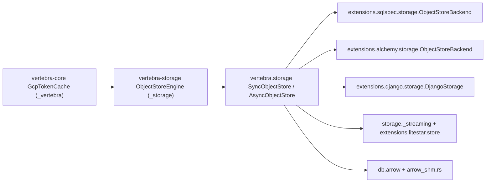

# Feature-Complete Storage

<!-- truth: start -->
- **Canonical Engine Seam**: `vertebra-storage` (`vertebra._storage`, `vertebra-core[storage]`) provides `SyncObjectStore`, `AsyncObjectStore`, `SyncReadableFile`, and `AsyncReadableFile` over `gs`, `s3`, `r2`, `oci`, `az`, `file`, and explicit test-only `memory` backends [^rs-storage-engine] [^py-storage-facade].
- **Async & Optional Wheel Invariants**: `vertebra._storage` resolves lazily via `import_optional("vertebra._storage")` and fails closed with `MissingDependencyError(..., extra="storage")` or `ImproperConfigurationError`; `src/py/vertebra/storage/_store.py` contains zero `asyncio.to_thread` calls and zero `self._memory` fallback dicts [^py-storage-facade].
- **Unified GCP Auth**: Python storage and presigning callers consume `vertebra._vertebra.{SyncGcpTokenCache, AsyncGcpTokenCache, GcpTokenSnapshot}` backed by `vertebra_core::gcp_auth::GcpTokenCache`, removing duplicate token classes from `vertebra._storage` and pure-Python OAuth fetchers from `storage/_store.py` [^core-gcp-auth].
- **ORM & SQL Contracts**: SQLSpec `ObjectStoreBackend` preserves canonical `*_sync` / `*_async` methods and unsupported-signing `NotImplementedError`; Advanced Alchemy `ObjectStoreBackend(StorageBackend)` registers through `StorageRegistry`; Django `DjangoStorage` is deconstructible and returns Django `File` handles. All three require explicit storage configuration [^sqlspec-storage] [^alchemy-storage] [^django-storage].
- **Remaining HTTP & Data-Plane Work**: `ch03` implements Litestar stores/static files and RFC 9110 `206` / `416` streaming; `ch04` completes strict named-SHM allocation and Arrow/Parquet streaming [^arrow-shm-alloc].
<!-- truth: end -->

## 1. Specification, Context & Provenance

### 1.1 Problem Statement & Objectives

`vertebra-storage` compiles as a standalone optional PyO3 extension (`vertebra._storage`) with `AbortHandle` and `TaskPanicError` completion delivery, incremental streaming/multipart sessions, unified `vertebra._vertebra` GCP token caches, and fail-closed `SyncObjectStore` / `AsyncObjectStore` facades [^rs-storage-engine] [^py-storage-facade] [^core-gcp-auth], with fail-closed SQLSpec, Advanced Alchemy, and Django adapters [^sqlspec-storage] [^alchemy-storage] [^django-storage]. Litestar integration, HTTP range responses, and the Arrow shared-memory data plane remain in `ch03` and `ch04` [^arrow-shm-alloc]. This flow completes zero-copy sync and async object storage across all four framework integrations and hardens the Arrow/Parquet and `VTBARROW` shared-memory data plane.

### 1.2 Non-Goals

- Relocating `build_duckdb_gcs_secret_sql` from `src/py/vertebra/extensions/sqlspec/storage.py` onto `DuckDBCore` (owned by sibling flow [native-duckdb-driver](../native-duckdb-driver/spec.md)).
- Migrating SQLSpec broker RPC result frames to `VTBARROW` across worker pools (owned by [broker-pool-sharing](../broker-pool-sharing/spec.md) and [sqlspec-adapter-parity](../sqlspec-adapter-parity/spec.md)).
- Multipart `multipart/byteranges` HTTP responses; `StreamingStorageResponse` implements RFC 9110 single-range `206 Partial Content` and `416 Range Not Satisfiable`.

### 1.3 Upstream Execution Baseline

Anchored at `HEAD @ cdb978d3` above `main @ 077a3fe9` (incorporating `db-layout-and-contract` [`21c99f95`], `db-engine-primitives` [`80ff8a65`], `runtime-structure-and-throughput` [`d2fa5072`], and `mcp-webmcp-core` [`077a3fe9`]). Chapters cataloged in [chapters/index.md](chapters/index.md).

### 1.4 Code Analysis & Seam Summary

| Existing Seam | Verified Present-State Architecture |
| --- | --- |
| `src/rs/vertebra-storage/src/{lib.rs,store.rs,oci.rs}` [^rs-storage-engine] | Provides incremental `MultipartUploadSession` (OCI uniform `8 MiB` ownership is assigned to ch08), `PySyncStreamReader` / `PyAsyncStreamReader` (`get_stream`), conditional `put_opts`, `list_page`, `list_with_delimiter`, and `rename`. |
| `src/rs/vertebra-storage/src/{lib.rs,gcp_auth.rs,signing.rs,oci.rs}` [^core-gcp-auth] | Consumes `vertebra_core::gcp_auth::GcpTokenCache` via `vertebra._vertebra.{SyncGcpTokenCache, AsyncGcpTokenCache, GcpTokenSnapshot}`, with `RefreshingGcpCredentialProvider` and native `sign_oci_par_url` / GCS V4 IAM / S3 SigV4 / Azure SAS / HMAC signing. |
| `src/py/vertebra/storage/_store.py` [^py-storage-facade] | Enforces fail-closed `MissingDependencyError` / `ImproperConfigurationError` construction, zero `self._memory` fallback dicts or Python `urllib` OAuth fetchers, and shared `.to_async()` / `.to_sync()` engine and token-cache handles. |
| `src/py/vertebra/extensions/{sqlspec,alchemy,django}/storage.py` | SQLSpec provides canonical protocol methods plus native streaming, pagination, and readable-file extensions; Advanced Alchemy uses `ObjectStoreBackend(StorageBackend)` and `StorageRegistry.register_backend` / `get_backend`; deconstructible Django `Storage` returns `File` handles and preserves naming, local paths, URLs, and metadata. All require explicit targets [^sqlspec-storage] [^alchemy-storage] [^django-storage]. |
| `src/py/vertebra/extensions/litestar/store.py` & `src/py/vertebra/storage/_streaming.py` | Pending `ch03`: `ObjectStoreLitestarStore`, an async static-files adapter, and RFC 9110 `Range` / `416` streaming. |
| `src/rs/vertebra-db/src/arrow_shm.rs` & `src/py/vertebra/db/arrow.py` [^arrow-shm-alloc] | Pending `ch04`: `allocate_shm_region` still falls back to anonymous `ShmRegion::create` when `ShmRegion::create_named` fails; `ArrowCursor.from_rows` still falls back to JSON bytes when `pyarrow` is absent. |

### 1.5 Relevant OKF Knowledge Chapters & Skills

- Knowledge: [object-storage.md](../../knowledge/domains/storage/object-storage.md), [sqlspec-alchemy-and-dialects.md](../../knowledge/domains/extensions/sqlspec-alchemy-and-dialects.md), [litestar.md](../../knowledge/domains/extensions/litestar.md), [adr-004-optional-driver-wheels-and-shm-ownership.md](../../knowledge/decisions/adr-004-optional-driver-wheels-and-shm-ownership.md), [ffi-and-gil-discipline.md](../../knowledge/patterns/rust/ffi-and-gil-discipline.md).
- Project-local skills: [pyo3-bridge](../../../skills/pyo3-bridge/SKILL.md), [runtime-ipc](../../../skills/runtime-ipc/SKILL.md), [python-framework](../../../skills/python-framework/SKILL.md) (plus external Litestar plugin skills for `sqlspec`, `advanced-alchemy`, and `litestar`).

## 2. Requirements, Concrete Contracts & Architecture

### 2.1 Functional Requirements

- **R1 (Streaming & Conditional Native Engine)**: Implement `get_stream` (`StorageBuffer` chunk iterators), byte-range reads, `put_opts` (`if_not_exists`, `if_match`, `if_none_match`, `content_type`, `attributes`), incremental `MultipartUploadSession` (`put_stream` without whole-payload `Vec<Bytes>` buffering, including uniform 8 MiB OCI part chunking), `list_page`, `list_with_delimiter`, and `rename` across `SyncObjectStore`, `AsyncObjectStore`, `SyncReadableFile`, and `AsyncReadableFile`.
- **R2 (Unified GCP Auth & Multi-Cloud Signing)**: Support presigned URLs across GCS V4 (local `GOOG4-RSA-SHA256` and IAM `signBlob`), S3 SigV4, Azure SAS, and OCI PAR; remove duplicate `SyncGcpTokenCache`, `AsyncGcpTokenCache`, and `GcpTokenSnapshot` PyO3 classes from `vertebra._storage` and delete pure-Python OAuth token fetchers from `storage/_store.py` in favor of `vertebra._vertebra.{SyncGcpTokenCache, AsyncGcpTokenCache, GcpTokenSnapshot}`.
- **R3 (Fail-Closed Construction)**: Reject missing `vertebra._storage` with `MissingDependencyError(..., extra="storage")` and omitted/empty `uri`/`config`/`store` arguments with `ImproperConfigurationError`, removing `self._memory` dicts and implicit `"memory://"` defaults while preserving upstream `NotImplementedError` for unsupported SQLSpec signing and keeping explicit `MemoryConfig()` and `"memory://..."` URIs supported for tests.
- **R4 (SQLSpec ObjectStoreProtocol)**: Complete sync and async `ObjectStoreProtocol` methods (`read_bytes_sync` / `read_bytes_async`, `write_bytes_sync` / `write_bytes_async`, `list_objects_sync` / `list_objects_async`, `copy_sync` / `copy_async`, `move_sync` / `move_async`, and `sign_sync` / `sign_async`) plus paired `get_stream`, `put_stream`, `list_page`, and `open` extensions using `_sync` / `_async` suffixes on `vertebra.extensions.sqlspec.storage.ObjectStoreBackend`, preserving `build_duckdb_gcs_secret_sql`.
- **R5 (Advanced Alchemy StorageBackend)**: Implement `vertebra.extensions.alchemy.storage.ObjectStoreBackend` as an upstream `StorageBackend` subclass and `register_storage_backend` through `StorageRegistry.register_backend` / `get_backend` without monkeypatching `storages.get` or defaulting to `memory://`.
- **R6 (Django Storage Subclass)**: Make `vertebra.extensions.django.storage.DjangoStorage` a `@deconstructible` subclass of `django.core.files.storage.Storage` returning `django.core.files.base.File` from `_open`/`open`/`aopen` and implementing `_save`/`save`/`asave`, `delete`/`adelete`, `exists`/`aexists`, `size`/`asize`, `listdir`, `url`/`aurl`, `path`, `get_available_name`, `generate_filename`, `get_valid_name`, `get_accessed_time`, `get_created_time`, `get_modified_time`, and `get_alternative_name`.
- **R7 (Litestar Store, Static Adapter, & HTTP Range Streaming)**: Implement RFC 9110 byte-range parsing (`200 OK`, `206 Partial Content`, `416 Range Not Satisfiable`) and non-blocking `to_fastpath_tuple` in `vertebra.storage._streaming.StreamingStorageResponse`, plus `ObjectStoreLitestarStore` (`litestar.stores.base.Store`) and `ObjectStoreFileSystemAdapter` in `vertebra.extensions.litestar.store`.
- **R8 (Strict Arrow SHM & Streaming Parquet/Arrow Storage)**: Make `allocate_shm_region` return `Err(ArrowShmError)` when `ShmRegion::create_named` fails, ensure `ArrowCursor.from_rows` always produces valid Arrow IPC streams (never JSON bytes), and wire streaming `write_arrow`, `read_arrow`, `write_parquet`, `read_parquet`, and `ObjectStoreBackend._iter_arrow_async`.

- **R9 (Native Publication Repair)**: Preserve raw key identity, typed CAS errors, real Memory Create/Update, physical-target Local cross-process locking across all Vertebra mutations, metadata-bearing S3 conditional CompleteMultipartUpload, Azure conditional PutBlockList, GCS pinned-source generation rewrite and ordinary generation CAS, OCI conditional commit and 8 MiB/10000-part limits, actual final ETag/version and abort/cancellation ownership. Retain concrete SDK handles and configured transport/credential refresh without SDK forks or custom auth.
- **R10 (First-Class R2 Withdrawal)**: Remove public R2Config/from_r2, r2:// scheme handling, native backend/module/helper/stub, framework classifiers, staging recognition, fixtures/tests and supported-provider docs/product/knowledge claims. Unsupported r2:// fails explicitly and never resolves as local disk. Generic S3 custom endpoints remain supported without hostname blacklist, alias or shim.
- **R11 (Adapter Correctness Repair)**: Django collision retries retain per-call max_length and rewind replayable content; non-replayable input preserves the collision error. SQLSpec signing maps unsupported capability to NotImplementedError while configured validation and provider failures propagate. These adapter contracts do not establish native atomic multipart publication.

### 2.2 Cross-Chapter Public Contracts & Integration Map

- **Raw-key grammar**: Object keys are nonempty relative raw identities with no boundary/repeated slash, backslash, literal dot segment or outer whitespace. Preserve Unicode and literal `%`, `%2F`, `%252F` without decoding. Retain the existing strict literal/encoded parent-segment guard (`..`, `%2e%2e`, `.%2e`, `%2e.` case insensitive). Validate before native `Path::parse`, which itself strips boundary slashes; never use `Path::from` to re-encode raw identity or unquote returned metadata.
- **Prefix grammar**: None, empty string and `/` mean root; a relative `logs/` prefix remains valid for list/list_page/list_with_delimiter and removes only one trailing slash before native parsing. Invalid leading slash except root, repeated separators, whitespace, backslash/dot/guarded parent segments reject before effects.
- **Qualified adapter inputs**: SQLSpec classifies an explicit URI or absolute local Path first, verifies matching scheme/bucket/authority or configured local-root containment, derives its residual relative key, then applies raw grammar. Matching file:// and configured-root Path stay supported; mismatched qualification and invalid source/destination operands fail before mutation. Alchemy and facade preserve raw relative identity at their existing public seams.
- **Conditional conflicts**: `vertebra._storage.PreconditionError(PermissionError)` represents both native precondition error forms and has an exact TYPE_CHECKING reexport plus lazy runtime `vertebra.storage.PreconditionError`. Native-wheel absence preserves import laziness; genuine IO PermissionDenied stays built-in PermissionError and create-only conflicts stay FileExistsError.

- **Rust/FFI Boundary (`ch01`)**: `vertebra._storage` exports `StorageBuffer`, `RustTaskAwaitable`, `ObjectMeta` (with `content_type: str | None` and `attributes: dict[str, str]`), `tuple[list[ObjectMeta], str | None]` (`list_page`) / `tuple[list[ObjectMeta], list[str]]` (`list_with_delimiter`), `SyncStreamReader`, `AsyncStreamReader`, `SyncMultipartUpload`, `AsyncMultipartUpload`, `SyncObjectStore`, `AsyncObjectStore`, and signing functions (`py_sign_gcs_v4_iam_url`, `py_sign_gcs_v4_iam_url_async`, `build_gcs_v4_canonical_request`, `assemble_gcs_iam_v4_url`, `py_sign_s3_v4_url`, `py_verify_s3_v4_url`, `py_sign_aws_sigv4_headers`, `py_sign_azure_sas_url`, `sign_oci_par_url`, `py_sign_oci_cavage_headers`, `py_sign_hmac_url`, `py_verify_hmac_url`).
- **ORM & SQL Boundary (`ch02`)**: Consumes `ch01` `SyncObjectStore` / `AsyncObjectStore` and `SyncReadableFile` / `AsyncReadableFile` with zero `self._memory` access and fail-closed `ImproperConfigurationError` validation.
- **HTTP & Litestar Boundary (`ch03`)**: Consumes `ch01` `AsyncObjectStore.get_stream`, `get_range`, `head`, `put` (`attributes` TTL metadata), and `list_page`.
- **Arrow/SHM & Docs Boundary (`ch04`)**: Hardens `vertebra_db::arrow_shm::allocate_shm_region` and `ArrowCursor.from_rows`, wires `pyarrow.parquet` / `pyarrow.ipc` batch streaming over `SyncReadableFile` / `AsyncReadableFile` and `put_stream`, and updates docs + OKF chapters.

- **Native publication boundary**: ObjectStoreEngine keeps Arc<dyn ObjectStore> plus private PublicationBackend concrete Arc/resolved configuration. Private conditional.rs/cloud_request.rs consume public SDK HttpConnector/HttpClient/HttpRequest and authorizers. Low-level MultipartStore IDs/PartIds remain SDK-owned transport artifacts. Generic copy-create cannot replace update publication or final PutResult.
- **Provider predicates**: S3 metadata-bearing initiation plus conditional completion parses Error XML even on 200;409 returns honest typed conflict/abort with no hidden replay. Azure commits SDK block IDs with attributes/tags and conditions. GCS stages MPU then rewrite pins source generation and destination CAS across rewriteTokens, returning final resource ETag/generation. OCI uses existing signed transport and native conditional commit. Arbitrary negative ETags resolve HEAD then Create/Update CAS with bounded re-evaluation; never HEAD→Overwrite.
- **Local concurrency**: Lock physical parent directories via persistent SDK-illegal .vtb-cas-lock#0 across independently configured overlapping roots and independent processes, acquire deduplicated two-directory locks in physical-ID order, and cover put/delete/copy/rename plus multipart publication. Native platform behavior and private artifact placement are explicit acceptance obligations; direct uncooperative OS writers are excluded.

### 2.3 Edge-Case, Failure-Mode & Invariant Matrix

| Boundary / Failure Mode | Required Deterministic Behavior |
| --- | --- |
| `vertebra._storage` wheel absent at runtime | Module import succeeds; instantiating `SyncObjectStore` or `AsyncObjectStore` raises `MissingDependencyError("vertebra._storage", install_package="vertebra-core[storage]", extra="storage")`. |
| Omitted `uri=None` / `config=None` / `store=None` | Raises `ImproperConfigurationError` immediately; explicit `MemoryConfig()` or `"memory://bucket"` succeeds. |
| Conditional `put(if_not_exists=True)` or `if_match="etag"` mismatch | Raises `FileExistsError` / `PreconditionError` (native `PreconditionError(PermissionError)`, lazily reexported as `vertebra.storage.PreconditionError`; genuine PermissionDenied remains built-in PermissionError) mapped from `object_store::Error::AlreadyExists` / `Precondition`. |
| Multipart upload stream raises mid-transfer | Calls `MultipartUpload::abort()` in Rust/Python `finally` path so orphan parts do not remain uncommitted. |
| Unsatisfiable HTTP `Range: bytes=9999-10000` on 128-byte object | Returns `416 Range Not Satisfiable` with `Content-Range: bytes */128` and empty body `b""`. |
| `ShmRegion::create_named` fails on Unix | `allocate_shm_region` returns `Err(ArrowShmError)` containing segment name and OS error; never falls back to anonymous `ShmRegion::create`. |

### 2.4 Acceptance Scenarios

| Given | When | Then |
| --- | --- | --- |
| Multi-megabyte chunked upload via `AsyncObjectStore.put_stream` and range/stream read via `get_stream` / `get_range` | Executed against local, memory, or S3/GCS backends | Streams through `MultipartUpload` without buffering all chunks in `Vec<Bytes>` and yields zero-copy `StorageBuffer` chunks; `put(..., if_not_exists=True)` rejects overwrites. |
| `GCSConfig` token refresh and URL presigning (`gs`, `s3`, `az`, `oci`) | Exercised from sync and async callers | Uses `vertebra._vertebra.{SyncGcpTokenCache, AsyncGcpTokenCache}`; `vertebra._storage` exposes zero duplicate token classes and `storage/_store.py` contains zero `urllib` OAuth helpers. |
| SQLSpec `ObjectStoreBackend`, Advanced Alchemy `StorageBackend`, Django `DjangoStorage`, and Litestar `ObjectStoreLitestarStore` / `StreamingStorageResponse` | Instantiated without config vs. exercised with valid `MemoryConfig` / `LocalConfig` | Unconfigured constructors raise `ImproperConfigurationError`; configured adapters pass full protocol, deconstruction, TTL store, static-file, `206`, and `416` suites. |
| `ArrowCursor.from_rows` and `allocate_shm_region` | Tested with valid rows, missing `pyarrow`, and failing named SHM | `from_rows` emits valid Arrow IPC frames (or raises `MissingDependencyError`), and `allocate_shm_region` returns `Err(ArrowShmError)`. |

### 2.5 Mandatory Alternatives Comparison

| Decision | Chosen Architecture | Rejected Alternative & Why Rejected |
| --- | --- | --- |
| GCP OAuth token caching | Reuse `vertebra_core::gcp_auth::GcpTokenCache` via `vertebra._vertebra.{SyncGcpTokenCache, AsyncGcpTokenCache}` | Keeping duplicate PyO3 classes in `vertebra._storage` + Python `urllib` OAuth fetchers in `storage/_store.py` — duplicates ~500 LOC and splits token single-flight caches across extensions. |
| Multipart upload buffering | Stateful Rust `MultipartUploadSession` enforcing uniform 8 MiB OCI part chunks incrementally | Collecting all parts into `Vec<Bytes>` before `put_multipart` — causes O(object size) RSS spikes on multi-hundred-MB Parquet/Arrow exports. |
| Missing storage config behavior | Fail closed with `ImproperConfigurationError` unless `MemoryConfig()` / `"memory://"` is passed explicitly | Defaulting `uri=None` to `"memory://"` — silently discards uploaded artifacts in misconfigured production workers. |

## 3. Documentation & OKF Knowledge Plan

Progress: `[0/9 files documented]` for final repair/HTTP/Arrow acceptance. Existing baseline prose is not final evidence for the repaired guarantees.

| File | Owning task | Final content |
| --- | --- | --- |
| docs/usage/storage.md | ch04:t03 | Supported providers, raw keys, conditional multipart, local guarantee, framework/HTTP/Arrow examples. |
| docs/usage/storage-auth-and-signing.md | ch04:t03 | Shared GCP auth and provider signing; no first-class R2 claim. |
| docs/index.md | ch09:t01 | Supported object-storage overview. |
| docs/usage/index.md | ch09:t01 | Supported provider navigation description. |
| docs/reference/storage.md | ch09:t01 | Exact public config and exception symbols. |
| docs/architecture/pyo3-and-workers.md | ch09:t02 | Actual native provider and signing capabilities. |
| .agents/bundles/product/product.md | ch09:t02 | Supported provider product contract. |
| .agents/bundles/knowledge/domains/index.md | ch09:t02 | Current object-storage catalog. |
| .agents/bundles/knowledge/domains/storage/object-storage.md | ch09:t03 then ch04:t03 | Evidence-backed native repair semantics, followed by HTTP/Arrow consumer contracts and provenance. |

## 4. Requirement-to-Task Traceability Matrix

| Requirement | Owning Chapter / Tasks | Verification Strategy | Canonical Test / Doc Gate |
| --- | --- | --- | --- |
| R1 | [ch01](chapters/ch01-native-engine-and-auth/spec.md) (`ch01:t01`, `ch01:t02`) | `behavior_tdd` | `src/rs/vertebra-storage/tests/storage_engine_tests.rs`, `src/py/tests/unit/storage/test_multicloud_storage.py`, `src/py/tests/unit/storage/test_storage_store.py` |
| R2, R3 | [ch01](chapters/ch01-native-engine-and-auth/spec.md) (`ch01:t03`, `ch01:t04`) | `behavior_tdd` | `src/py/tests/unit/storage/test_gcs_token_refresh.py`, `src/py/tests/unit/storage/test_signing.py`, `src/py/tests/unit/storage/test_storage_store.py` |
| R4 | [ch02](chapters/ch02-orm-and-sql-storage-contracts/spec.md) (`ch02:t01`) | `behavior_tdd` | `src/py/tests/unit/extensions/test_data_storage_integrations.py` |
| R5 | [ch02](chapters/ch02-orm-and-sql-storage-contracts/spec.md) (`ch02:t02`) | `behavior_tdd` | `src/py/tests/unit/extensions/test_data_storage_integrations.py` |
| R6 | [ch02](chapters/ch02-orm-and-sql-storage-contracts/spec.md) (`ch02:t03`) | `behavior_tdd` | `src/py/tests/unit/extensions/test_django_plugin.py`, `src/py/tests/unit/extensions/test_data_storage_integrations.py` |
| R7 | [ch03](chapters/ch03-litestar-and-range-streaming/spec.md) (`ch03:t01`, `ch03:t02`) | `behavior_tdd` | `src/py/tests/unit/server/test_zero_copy_buffer.py`, `src/py/tests/unit/extensions/test_litestar_plugin.py` |
| R8 | [ch04](chapters/ch04-arrow-shm-and-docs/spec.md) (`ch04:t01`, `ch04:t02`, `ch04:t03`) | `behavior_tdd` + `documentation_validation` | `src/rs/vertebra-db/src/arrow_shm.rs`, `src/py/tests/unit/db/test_pg_dataplane_and_datafusion.py`, `src/py/tests/unit/tools/test_docs_tooling.py` |

| Requirement | Repair chapter/tasks | Strategy | Canonical evidence |
| --- | --- | --- | --- |
| R1, R9 raw identity and conflicts | ch05:t01–t03 | regression_tdd | Native engine tests, facade/adapter tests and PyO3 mapping units. |
| R4/R6, R11 adapter repairs | ch06:t01–t02 | regression_tdd | Django consumed-source producer collisions using native create-only puts; SQLSpec native HMAC expiry, local IAM HTTP failure and scalar/list GET/PUT signing. |
| R10 R2 withdrawal | ch07:t01–t03, ch08:t01–t03, ch09:t01–t03 | regression_tdd/documentation_validation | Public config/classifier/staging/native parity tests and docs gates. |
| R1/R9 boundary and ownership | ch10:t01–t04 | regression_tdd | Configured SDK transport/credential fixtures and complete-error/cancellation abort tests. |
| R1/R9 Local atomicity | ch11:t01–t04 | integration_acceptance | Independent-process overlapping-root lock/publication/list regressions. |
| R1/R9 S3/Azure/GCS/OCI | ch12:t01–t04, ch13:t01–t02, ch14:t01–t03, ch15:t01–t02 | regression_tdd | Provider HTTP completion predicates, metadata/results,409/200 Error, rewrite tokens, limits and cleanup. |
| Original ch01/ch02 reclosure | ch16:t01–t02 | integration_acceptance | Complete native matrix, adapter suite, correctness review then fresh quality review. |
| R8 bounded codecs and sync facade | ch17:t01–t02 | behavior_tdd | Actual IPC dictionaries, Parquet rowgroups/projection, lazy producer and reader ownership. |
| R8 native async I/O bridge | ch18:t01–t03 | behavior_tdd | Owning-loop barriers, bounded cache/jobs, backpressure, cancellation/cleanup and exact decoded values. |
| R4/R8 SQLSpec Arrow streaming | ch19:t01–t02 then original ch04:t02 | integration_acceptance | Canonical SQLSpec sync/async consumer signatures and lazy batch/output behavior. |

## 5. Implementation Plan

- [~] ch01-native-engine-and-auth — Chapter 01: Native Rust Storage Engine, GCP Auth Unification, and Fail-Closed Facade (chapters/ch01-native-engine-and-auth/spec.md)
- [~] ch02-orm-and-sql-storage-contracts — Chapter 02: SQLSpec, Advanced Alchemy, and Django Storage Contracts (chapters/ch02-orm-and-sql-storage-contracts/spec.md)
- [ ] ch03-litestar-and-range-streaming — Chapter 03: HTTP Range Streaming and Litestar Store/Static Integration (chapters/ch03-litestar-and-range-streaming/spec.md)
- [ ] ch04-arrow-shm-and-docs — Chapter 04: Strict Arrow SHM Allocation, Parquet Streaming, and OKF Sync (chapters/ch04-arrow-shm-and-docs/spec.md)
- [x] [0bce1806] ch05-key-identity-and-preconditions — Raw Object Identity and Typed Conditional Conflicts (chapters/ch05-key-identity-and-preconditions/spec.md)
- [~] ch06-adapter-correctness — Django Collision Length and SQLSpec Signing Errors (chapters/ch06-adapter-correctness/spec.md)
- [ ] ch07-remove-r2-python — Withdraw First-Class R2 Python APIs (chapters/ch07-remove-r2-python/spec.md)
- [ ] ch08-remove-r2-native — Move OCI Chunk Ownership and Remove Native R2 (chapters/ch08-remove-r2-native/spec.md)
- [ ] ch09-r2-docs-and-knowledge — Synchronize Supported Providers and Native Guarantees (chapters/ch09-r2-docs-and-knowledge/spec.md)
- [ ] ch10-publication-boundary-and-lifecycle — Native Publication Boundary and Cleanup Ownership (chapters/ch10-publication-boundary-and-lifecycle/spec.md)
- [ ] ch11-local-atomic-publication — Local Cross-Process Conditional Publication (chapters/ch11-local-atomic-publication/spec.md)
- [ ] ch12-s3-conditional-multipart — S3 Metadata Multipart and Conditional Completion (chapters/ch12-s3-conditional-multipart/spec.md)
- [ ] ch13-azure-conditional-block-list — Azure Conditional Multipart Block Commit (chapters/ch13-azure-conditional-block-list/spec.md)
- [ ] ch14-gcs-conditional-rewrite — GCS Generation CAS and Staged Rewrite Publication (chapters/ch14-gcs-conditional-rewrite/spec.md)
- [ ] ch15-oci-conditional-multipart — OCI Conditional Commit and Multipart Limits (chapters/ch15-oci-conditional-multipart/spec.md)
- [ ] ch16-native-acceptance-and-reclosure — Native Acceptance and Original Chapter Reclosure (chapters/ch16-native-acceptance-and-reclosure/spec.md)
- [ ] ch17-arrow-sync-codecs — Bounded Arrow and Parquet Encoding and Sync Storage (chapters/ch17-arrow-sync-codecs/spec.md)
- [ ] ch18-arrow-async-bridge — Bounded PyArrow Worker and Native Async I/O Bridge (chapters/ch18-arrow-async-bridge/spec.md)
- [ ] ch19-sqlspec-arrow-streaming — SQLSpec Lazy Arrow and Parquet Integration (chapters/ch19-sqlspec-arrow-streaming/spec.md)

**Flow Recovery Checkpoint:** `/flow:implement storage-completeness` follows the current task pointer and approved ready worksheet. Repair tasks use baseline artifacts without requiring reopened ch01 completion. Native acceptance and reviews reclose ch01, then ch02/HTTP and Arrow acceptance proceeds. The final gate is `CARGO_TARGET_DIR="$PWD/../vertebra/src/rs/target" PYO3_PYTHON="$PWD/.venv/bin/python3.12" flock /tmp/vertebra-flow-shm-tests.lock make lint-all rs-test py-test ts-test docs`; it precedes finish/archive and protects shared SHM from concurrent flow suites.

## 6. Current State & Remaining Plan Snapshot

- Verified functional source baseline: `5fe477fa`; revision 4 has approved key/error and adapter-repair frontiers. Additional bounded repair chapters retain their own independent plan-review requirements.
- ch05 is completed and reviewed through `0bce1806`: all three raw-key, public-qualification and typed-conflict tasks are committed and verified, knowledge is synchronized, and correctness plus fresh quality reviews report no findings. All five native extensions are rebuilt with these contracts; Local and cloud atomic publication remains pending.
- ch06 adapter tasks are completed at signed `cd7e5563` and `45b068e2`; knowledge is synchronized and the combined current-source storage/Django/data integration checkpoint passes 88 tests. Correctness and fresh quality reviews remain pending. Consumed-source recovery tests report native create-only conflicts from the producer; native multipart-completion acceptance remains in its repair chapters.
- Original ch01:t01 is blocked; chapter review stamp is clear. Repair tasks use its committed functional artifacts directly, avoiding a dependency cycle.
- ch02 original commits remain recorded and correctness approval is absent. ch06 repairs and native acceptance precede fresh correctness and quality review.
- Native-dependent original ch03/ch04:t02 are blocked with explicit unblock conditions. HTTP coordinator owns ch03 detail and its integration evidence.
- The next execution frontier is ch07 Python R2 withdrawal, followed by ch08 native helper/module removal; generic S3 endpoint capability is preserved. ch06 remains active for independent reviews.
- ch10–ch15 cover native publication and lifecycle; ch11 uses persistent SDK-illegal .vtb-cas-lock#0 per physical parent directory and same-parent numeric-# stage names, with physical-directory-ID lock ordering and payload staging outside locks.
- S3 direct completion returns honest typed 409 conflict/abort; GCS source-generation-pinned rewrite is backend-specific staging.
- Original Arrow/SHM and user guides remain full scope. ch17–ch19 provide bounded sync codecs, typed per-batch PyArrow worker/native async I/O bridge and lazy SQLSpec integration; original ch04:t02 retains integration acceptance.
- Final docs/OKF acceptance is `[0/9 files documented]`; correctness review then fresh quality review is mandatory before finish/archive.

[^rs-storage-engine]: `src/rs/vertebra-storage/src/store.rs::ObjectStoreEngine` — Native Rust storage engine over `object_store`.
[^py-storage-facade]: `src/py/vertebra/storage/_store.py::SyncObjectStore` — Python sync/async object store facade and backend configs.
[^core-gcp-auth]: `src/rs/vertebra-core/src/gcp_auth.rs::GcpTokenCache` — Shared single-flight GCP OAuth2 token cache exposed on `vertebra._vertebra`.
[^arrow-shm-alloc]: `src/rs/vertebra-db/src/arrow_shm.rs::allocate_shm_region` — Named shared-memory allocator for `VTBARROW` IPC buffers.
[^sqlspec-storage]: `src/py/vertebra/extensions/sqlspec/storage.py::ObjectStoreBackend` — SQLSpec storage protocol and native extensions.
[^alchemy-storage]: `src/py/vertebra/extensions/alchemy/storage.py::ObjectStoreBackend` — Advanced Alchemy storage backend and registry helper.
[^django-storage]: `src/py/vertebra/extensions/django/storage.py::DjangoStorage` — Deconstructible Django Storage implementation.
