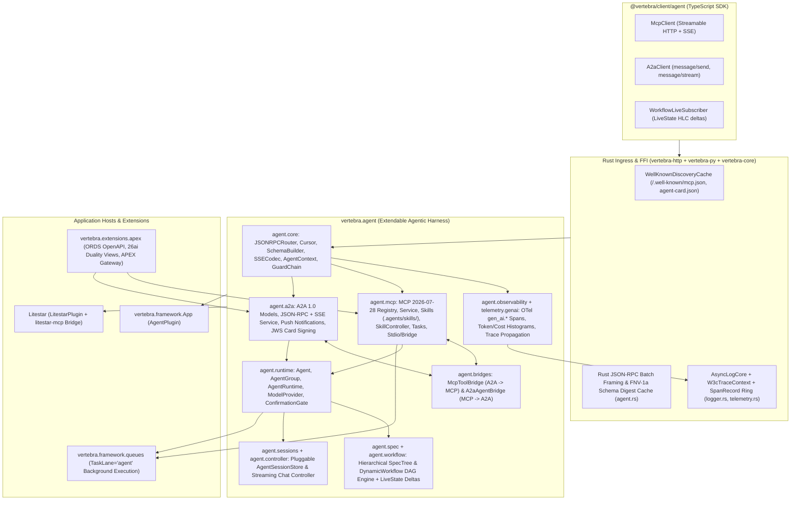
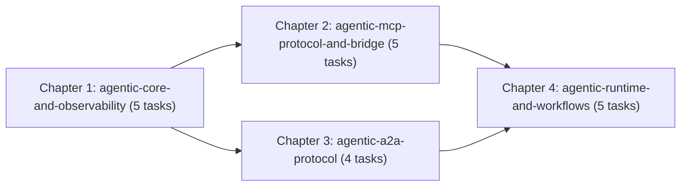

# Master PRD: Vertebra Extendable Agentic Harness

**Flow ID:** `vertebra-agentic-harness`

## Context & Problem Statement

Vertebra currently contains disconnected protocol stubs in `src/py/vertebra/framework/mcp/__init__.py` (232 lines; unmounted `McpServer` supporting only 4 methods on outdated `2025-03-26`), `src/py/vertebra/framework/a2a/__init__.py` (167 lines; pre-1.0 `AgentCard`, unbounded in-memory task dict, no streaming), `src/py/vertebra/cli/mcp.py` (113 lines; blocking `urllib` loop that corrupts SSE), and `src/py/vertebra/extensions/litestar/ecosystem.py` (93 lines; `attach_litestar_ecosystem_bridges` silently no-ops on real Litestar `State` objects). Meanwhile, `litestar-mcp` (`github.com/cofin/litestar-mcp`) proved the architecture for unified `@tool` descriptors, signature-derived `msgspec` JSON schemas, `PromptController`/`SkillController` class-based grouping, `.agents/skills/` progressive disclosure with SHA-256 integrity checks, A2A `1.0` JSON-RPC + SSE streaming, `AgentRuntime`, `DynamicWorkflow` DAG waves, and background queue execution, while Vertebra's Rust runtime (`vertebra-core`, `vertebra-http`, `vertebra-py`) provides zero-GIL `AsyncLogCore` (`src/rs/vertebra-core/src/logger.rs`), `W3cTraceContext` and `SpanRecord` (`src/rs/vertebra-core/src/telemetry.rs`), `WellKnownDiscoveryCache` (`src/rs/vertebra-http/src/discovery.rs`), and `LiveState` HLC binary delta rooms (`src/py/vertebra/framework/live/__init__.py`).

Rather than treating MCP and A2A as thin pass-throughs or leaving native `vertebra.framework.App` applications without an agentic stack, this Master PRD designs **`vertebra.agent`**: a first-class, framework-agnostic, Rust-accelerated **Extendable Agentic Harness** that runs identically on native `vertebra.framework.App` and on **Litestar** (via `vertebra.extensions.litestar.LitestarPlugin` and full `litestar-mcp` interoperability), with automatic OpenTelemetry `gen_ai.*` spans, token/cost/latency histograms, W3C trace context propagation, and `AsyncLogCore` structured audit events across every tool invocation, skill load, prompt render, resource read, MCP/A2A message, agent turn, and workflow DAG node.

## Architecture Overview

## Global Constraints

1. **Dual-Host Parity (`vertebra.framework.App` + `Litestar`):** Every capability in `vertebra.agent` works without Litestar installed on native `vertebra.framework.App` (`AgentPlugin`), and integrates natively with Litestar (`LitestarPlugin` + `litestar-mcp` controller/decorator/DI discovery) when `litestar` is present.
2. **Telemetry of Everything (`gen_ai.*` + Rust `AsyncLogCore`):** Every JSON-RPC dispatch, tool call (`gen_ai.tool.call`), resource read (`mcp.resource.read`), prompt render (`mcp.prompt.get`), skill load (`mcp.skill.load`), model generation (`gen_ai.chat`), agent turn (`gen_ai.agent.turn`), `SpecTree` node transition (`gen_ai.spectree.node`), `DynamicWorkflow` step (`gen_ai.workflow.step`), and A2A task transition (`a2a.task.transition`) automatically records an OpenTelemetry `SpanData` record, updates `GenAiRecorder` token/cost/duration histograms, propagates `W3cTraceContext` (`traceparent` / `_meta.traceparent`), and emits a non-blocking JSON audit event through Rust `AsyncLogCore`.
3. **Python & Rust Coding Standards:** All value objects, wire envelopes, configuration types, and state records use `msgspec.Struct(..., frozen=True, gc=False)` (`array_like=True` on hot-path frames). All JSON and MessagePack encoding routes exclusively through `vertebra.utils.serializers`. Modules follow strict top-down layout (module docstring, top-level imports, `__all__`, public classes/functions, private helpers), zero inline `#` comments, Google-style docstrings, and PEP 585/604/695 typing.
4. **Zero Legacy Stubs:** `src/py/vertebra/framework/mcp/__init__.py`, `src/py/vertebra/framework/a2a/__init__.py`, and `src/py/vertebra/extensions/litestar/ecosystem.py` are replaced cleanly with no backward-compatibility shims or aliases.

## Requirements

| ID | Requirement |
| --- | --- |
| AH-R1 | **Core JSON-RPC, Schema, Context & Guards:** Provide a shared JSON-RPC 2.0 router (`parse_request`, batch dispatch, notification suppression, `-32603` type-only error masking), URL-safe cursor pagination, signature-to-JSON-Schema 2020-12 builder (`msgspec.Struct`, dataclasses, `TypedDict`, `Annotated`, universal DI stripping), SSE frame codec, `AgentContext` (extracting caller identity from mTLS client certs, JWT claims, XFCC/IAP headers, or Litestar `ASGIConnection`), cooperative cancellation tokens, progress reporter, and hierarchical `GuardChain` inheritance. |
| AH-R2 | **Universal Agentic Telemetry & Rust FFI Acceleration:** Connect `vertebra.telemetry` (using Rust `NativeLogSink` and `parse_traceparent`/`format_traceparent` from `4.10`) to `vertebra.agent.telemetry` (`AgentTelemetryRecorder`), add Rust JSON-RPC frame classification and schema digest caching in `src/rs/vertebra-py/src/agent.rs`, and instrument every MCP, A2A, tool, skill, agent turn, `SpecTree`, and `DynamicWorkflow` operation with `gen_ai.*` spans, token/cost/latency metrics, and W3C trace propagation. |
| AH-R3 | **Full MCP `2026-07-28` Server, Skills, Tasks & Transports:** Implement the complete MCP `2026-07-28` specification (`initialize`, `ping`, `tools/list`, `tools/call` with binary/resource links & `structuredContent`, `resources/list`, `resources/read`, `resources/templates/list`, `resources/subscribe`, `resources/directory/read`, `prompts/list`, `prompts/get`, `skills/list`, `skills/get`, `tasks/get`, `tasks/result`, `tasks/update`, `tasks/cancel`, `tasks/list`, `completion/complete`, `logging/setLevel`), `.agents/skills/` progressive disclosure with SHA-256 verification, `SkillController` and `PromptController`, `QueueService` (`TaskLane="agent"`) integration, Streamable HTTP + SSE + stdio transports, `vtb mcp bridge`, Rust `.well-known/mcp.json` discovery offload, and executable ORDS/APEX/ORDS tool synthesis. |
| AH-R4 | **Full A2A `1.0` Protocol, JWS Card Signing & Bidirectional Bridges:** Implement A2A `1.0` frozen `msgspec.Struct` models (`Task`, `TaskState`, `TaskStatus`, `Message`, `Part`, `Artifact`, `AgentCard`, `AgentInterface`, `AgentSkill`, `PushNotificationConfig`), JSON-RPC + SSE methods (`message/send`, `message/stream`, `tasks/get`, `tasks/cancel`, `tasks/resubscribe`, `tasks/pushNotificationConfig/{set,get,list,delete}`, `agent/authenticatedExtendedCard`), RFC 7515 JWS Agent Card signing/verification, and bidirectional `McpToolBridge` (A2A remote agents as MCP tools) and `A2aAgentBridge` (MCP tools/skills as A2A `1.0` agents). |
| AH-R5 | **Extendable `AgentRuntime`, `SpecTree`, `DynamicWorkflow`, Sessions & SDK:** Provide `Agent`, `AgentGroup` (with synthesized `transfer_to_agent`), pluggable `ModelProvider` protocol, `AgentRuntime` with parallel tool execution, retry/backoff, `TurnBudget`, and human-in-the-loop `ConfirmationGate`, hierarchical `SpecTree` task decomposition, `DynamicWorkflow` topological wave DAG engine streaming real-time HLC `StateDeltaFrame` updates over `vertebra.framework.live`, pluggable `AgentSessionStore` (`Memory`, `ResponseCacheStore`, `SQLSpec`, `Alchemy`, `ObjectStore`), unified `AgentPlugin` / `LitestarPlugin` mounting, and the TypeScript `@vertebra/client/agent` SDK subpath. |

## Child Chapters

| # | Chapter (`flow_id`) | Tasks | Depends On | Delivers |
| --- | --- | --- | --- | --- |
| 1 | [`agentic-core-and-observability`](../agentic-core-and-observability/spec.md) | `1.1`–`1.5` | — | JSON-RPC 2.0 router, cursor pagination, signature schema builder, SSE frame codec, `AgentContext` (mTLS/JWT/IAP identity), `GuardChain`, `vertebra.telemetry.genai` + `vertebra.agent.telemetry` (`gen_ai.*` spans, token/cost histograms, `LogSink` audit logging), and Rust `vertebra-py/src/agent.rs` frame classification & schema digest cache. |
| 2 | [`agentic-mcp-protocol-and-bridge`](../agentic-mcp-protocol-and-bridge/spec.md) | `2.1`–`2.5` | Chapter 1 | Full MCP `2026-07-28` registry and service, `.agents/skills/` progressive disclosure catalog, `SkillController` & `PromptController`, durable `tasks/*` backed by `QueueService(lane="agent")`, Streamable HTTP/SSE/stdio transports, async `vtb mcp bridge`, Rust `.well-known/mcp.json` offload, and executable ORDS/26ai Duality View/APEX tool synthesis. |
| 3 | [`agentic-a2a-protocol`](../agentic-a2a-protocol/spec.md) | `3.1`–`3.4` | Chapter 1, Chapter 2 (`2.1`, `2.2`) | Full A2A `1.0` `msgspec.Struct` models, JSON-RPC + SSE streaming (`message/send`, `message/stream`, `tasks/*`, `pushNotificationConfig/*`, `agent/authenticatedExtendedCard`), JWS Agent Card signing, and bidirectional `McpToolBridge` <-> `A2aAgentBridge`. |
| 4 | [`agentic-runtime-and-workflows`](../agentic-runtime-and-workflows/spec.md) | `4.1`–`4.5` | Chapter 2, Chapter 3 | `AgentRuntime` (`ModelProvider`, `TurnBudget`, `ConfirmationGate`), hierarchical `SpecTree` planner, `DynamicWorkflow` DAG engine with `LiveState` HLC delta broadcasting, pluggable `AgentSessionStore` (5 backends) + streaming chat controller, unified `vertebra.framework.App` + `LitestarPlugin` mounting, and `@vertebra/client/agent` TypeScript SDK. |

## Requirement-to-Chapter Trace

| Requirement | Chapter | Tasks | Verification |
| --- | --- | --- | --- |
| AH-R1 | `agentic-core-and-observability` | `1.1`, `1.2`, `1.5` | `uv run pytest src/py/tests/unit/agent/test_core_and_observability.py -q` |
| AH-R2 | `agentic-core-and-observability` | `1.3`, `1.4`, `1.5` | `make rs-test && make dev && uv run pytest src/py/tests/unit/agent/test_core_and_observability.py -q` |
| AH-R3 | `agentic-mcp-protocol-and-bridge` | `2.1`, `2.2`, `2.3`, `2.4`, `2.5` | `uv run pytest src/py/tests/unit/agent/test_mcp_conformance.py src/py/tests/unit/cli/test_mcp_cli.py src/py/tests/unit/agent/test_mcp_enterprise_tools.py -q` |
| AH-R4 | `agentic-a2a-protocol` | `3.1`, `3.2`, `3.3`, `3.4` | `uv run pytest src/py/tests/unit/agent/test_a2a_protocol.py -q` |
| AH-R5 | `agentic-runtime-and-workflows` | `4.1`, `4.2`, `4.3`, `4.4`, `4.5` | `uv run pytest src/py/tests/unit/agent/test_runtime_and_workflows.py -q && bun run --cwd src/ts/vertebra-client test` |

## Audit Finding Resolution Trace

| Finding | Summary | Owning Task |
| --- | --- | --- |
| `MCP-01` | Replace unmounted partial `framework.mcp.McpServer` with full MCP `2026-07-28` stack | `agentic-mcp-protocol-and-bridge:2.1`, `agentic-runtime-and-workflows:4.4` |
| `MCP-02` | Unify `MCP_PROTOCOL_VERSION = "2026-07-28"` across Python and Rust discovery | `agentic-mcp-protocol-and-bridge:2.1`, `2.4` |
| `MCP-03` | Replace blocking `urllib` CLI bridge and dead `mcp_bridge.rs` with async SSE/session-aware bridge | `agentic-mcp-protocol-and-bridge:2.4` |
| `MCP-04` | Replace pre-1.0 unmounted `framework.a2a.A2AServer` with owner-scoped A2A `1.0` | `agentic-a2a-protocol:3.1`, `3.2`, `agentic-runtime-and-workflows:4.4` |
| `MCP-05` | Replace broken `LitestarEcosystemBridge` state dict check with real plugin mounting | `agentic-runtime-and-workflows:4.4` |
| `MCP-06` | Unify `@tool`, `@resource`, `@prompt` descriptors with signature-derived schemas | `agentic-core-and-observability:1.1`, `agentic-mcp-protocol-and-bridge:2.1` |
| `MCP-07` | Wire `WellKnownDiscoveryCache` to dynamic MCP/A2A discovery payloads and configurable prefixes | `agentic-mcp-protocol-and-bridge:2.4`, `agentic-a2a-protocol:3.2` |
| `MCP-08` | Remove eager `mcp`/`a2a` imports from `vertebra.framework` root | `agentic-runtime-and-workflows:4.4` |
| `MCP-09` | Synthesize executable MCP tools and A2A `1.0` skills in `ApexOpenAPIGenerator` (`ords.py`) and `ApexGateway` | `agentic-mcp-protocol-and-bridge:2.5` |
| `MCP-10` | Replace fake-state unit tests with full wire-level MCP `2026-07-28` and A2A `1.0` conformance suites | `agentic-mcp-protocol-and-bridge:2.5`, `agentic-a2a-protocol:3.4` |

## Implementation Plan

- [x] 1 [`agentic-core-and-observability`](../agentic-core-and-observability/spec.md)
- [x] 2 [`agentic-mcp-protocol-and-bridge`](../agentic-mcp-protocol-and-bridge/spec.md)
- [x] 3 [`agentic-a2a-protocol`](../agentic-a2a-protocol/spec.md)
- [x] 4 [`agentic-runtime-and-workflows`](../agentic-runtime-and-workflows/spec.md)

## Continuity Snapshot

- Active flow: `vertebra-agentic-harness` (Master PRD), state `closed`. All 4 child chapters and 19 tasks completed and verified.
- Plan identity: `plan_revision: 2`, `plan_commit: ""`. State identity: `state_revision: 1`.
- Blockers: none.
- Knowledge paths: `.agents/bundles/product/product-guidelines.md`, `.agents/bundles/knowledge/workflow.md`, `.agents/bundles/knowledge/patterns/python/module-and-class-layout.md`, `.agents/bundles/knowledge/patterns/rust/ffi-and-gil-discipline.md`.
