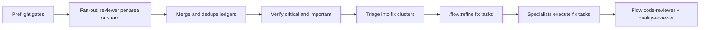

# Agentic Review Infrastructure: Source Pattern and Vertebra Design

Read-only research synthesized against branch `feat/stack-followups` (commit `edceea6`).

---

## Source pattern (generic)

A reference multi-domain repository runs domain-segmented agentic review with three cooperating layers: (a) review capability skills, (b) paired custom subagents, and (c) a structural validator wired into pre-commit and the pytest suite. A root registration file feeds an on-prem GitHub AI review bot; that part is host-specific and does **not** apply to Vertebra (`github.com`).

### File structure

```text
<repo>/
├── .agents/
│   ├── AGENTS.md
│   ├── skills/
│   │   ├── index.md                       # tables: lawbooks, workflow skills, domain→skill→reviewer→specialist→FP range
│   │   ├── <domain>-engineering/          # "engineering lawbook" per domain (or <stack>-framework)
│   │   │   ├── SKILL.md                   # ≤200 lines, truth block ≤40 lines
│   │   │   └── references/*.md            # deep topic references
│   │   ├── review-<domain>/               # review capability skill per domain
│   │   │   ├── SKILL.md
│   │   │   └── references/
│   │   │       ├── checklist.md
│   │   │       └── false-positive-suppressions.md
│   │   ├── flow-memory-keeper/            # OKF + Flow closeout protocol, preloaded by every agent
│   │   │   ├── SKILL.md
│   │   │   └── references/okf-and-flow-state-contract.md
│   │   └── <review-manager>/              # operational skill owning the validator and FP playbook
│   │       ├── SKILL.md
│   │       ├── references/false-positive-suppression-playbook.md (+ telemetry/eval guides)
│   │       └── scripts/validate_agentic_review.py
│   └── agents/
│       ├── <domain>-reviewer.md           # read-only
│       └── <domain>-specialist.md         # write-enabled
├── .pre-commit-config.yaml                # local hook runs the validator
└── src/py/tests/unit/<repo-guard-test>.py # imports validator, asserts zero errors
```

Each domain has one review skill, one reviewer, one specialist, one rulebook source, and one false-positive catalog.

### Skill frontmatter and body schema

```yaml
---
name: review-<domain>          # must equal directory name
description: <one sentence: scope and paths>
---
```

Body layout of a review skill (≈55–70 lines):

1. `<!-- truth: start -->` … `<!-- truth: end -->` block directly after frontmatter: 4–6 bold-led bullets summarizing the non-negotiable domain rules, last bullet "Respect `FP-<D>-01`..`FP-<D>-NN` in `references/false-positive-suppressions.md`".
2. H1 title, then "Use this skill when reviewing changes under `<paths>`".
3. `## Review Process` with fixed steps:
   - Step 1 **Check design and data model first** (evaluate against repo design rules before trusting the PR description).
   - Step 2 **Verify external facts before flagging** (before claiming an API does not exist or is unsafe, verify with `search_web` / `moma_search` / `code_search` / `skill_search`).
   - Step 3 **Check domain rules** (bulleted concrete rules with file paths).
   - Step 4 **Evaluate test quality**: explicit "Good tests" vs "Bad tests to flag" bullets.
4. `## References & False-Positive Suppressions`: link to checklist, link to FP catalog, and a one-line index of every FP ID (`FP-<D>-NN`: short title).

### False-positive catalog format

```markdown
# <Domain> False-Positive Suppressions (`FP-<D>-*`)

Consult this catalog before posting any comment under `review-<domain>`. If a candidate finding matches an `FP-<D>-*` entry below, do not flag it.

---

### `FP-<D>-01`: <Title>
- **Do not flag**: <exact pattern or claim the reviewer wrongly makes, with paths/symbols>
- **Why**: <technical reason with repository file paths / primary sources>
```

Entries are separated by `---`. IDs are two digits (`\d{2,3}` accepted), never renumbered.

### Suppression workflow (playbook)

Triage tree:
1. Genuine defect → fix in the PR, reply on the thread with the fix commit.
2. Review false positive caused by generic defaults or an intentional design choice → add `### FP-<D>-NN` to the owning skill's catalog (owner chosen by path→domain map), index the ID in `SKILL.md`, run the validator.
3. Static-lint false positive → hierarchy: fix or promote to a primitive/variant > config-level allowance once > single-line disable directive whose justification cites the FP ID > baseline ratchet file that may only shrink.

### Improvements in the Vertebra adaptation

- Stable checklist IDs (`<PREFIX>-<NN>`), explicit severity scale (`critical`, `important`, `minor`), and a machine-validated finding ledger grammar so baseline and branch reviews can be deduplicated, tracked, and cross-referenced by `FP-*` entries.
- Each `FP-*` entry links explicitly via `Applies to:` to the checklist IDs it suppresses.
- Domain rules live in Vertebra's `.agents/bundles/knowledge/` chapters; review skills link to those chapters rather than duplicating rules across three files per domain.
- `areas.toml` is a single manifest driving path routing, expected skill/agent sets, preloads, and allowed/forbidden reviewer commands.

---

## Vertebra review setup design

### Constraints discovered in Vertebra

- `.gitignore` ignores `.agents/*` except `bundles/`, `skills/`, `config.json`. **`.agents/agents/` would be ignored**; add `!.agents/agents/` and `!.agents/agents/**`.
- `.agents/skills/` currently holds only `flow-memory-keeper` (no truth block, name/description frontmatter only). Do not retrofit it; the validator applies line and truth-block budgets only to `review-*` skills.
- Ruff/format in the `Makefile` covers only `src/py/vertebra src/py/tests`; mypy `files = ["src/py/vertebra"]`. A validator in `tools/scripts/` is unlinted unless the targets are extended.
- `tools/scripts/` has no `__init__.py`; `tools/__init__.py` exists.
- `msgspec` is a core dependency (use `msgspec.Struct(frozen=True, gc=False)` for validator value objects); PyYAML is only transitive in `uv.lock`, so parse frontmatter with a small stdlib parser.
- CI `lint` job runs `make lint-all`; `test-python` runs `make py-test`.
- `make rs-test` runs `rm -rf /dev/shm/test-* /dev/shm/*vertebra*` before `cargo test`, and `make py-test` depends on `make dev` (rewrites `.so` files in `.venv`). Concurrent reviewers running these targets will corrupt each other's runs.
- 273 `unsafe {` blocks vs ~36 `// SAFETY:` comments in the stack tree: an `unsafe` documentation rule must be scoped to changed code, with a ratchet for the baseline.
- Vertebra is public: the forbidden-term list must not itself contain private names. Committed patterns stay generic; private terms come from a gitignored file or env var.

### File tree to add

```text
.gitignore                                         # + !.agents/agents/ and !.agents/agents/**
.pre-commit-config.yaml                            # + local hook: review-setup
Makefile                                           # + review-check, review-route; lint-all calls validator
pyproject.toml                                     # [tool.pytest.ini_options] pythonpath = ["."]
tools/scripts/__init__.py
tools/scripts/review_setup.py                      # ReviewManifest, ReviewSetupValidator, ReviewRouter, LedgerValidator; CLI: validate | route | ledger
src/py/tests/unit/test_review_setup.py             # mirrors tools/scripts/review_setup.py
.agents/
├── agents/
│   ├── runtime-ipc-reviewer.md         runtime-ipc-specialist.md
│   ├── http-ingress-reviewer.md        http-ingress-specialist.md
│   ├── pyo3-bridge-reviewer.md         pyo3-bridge-specialist.md
│   ├── python-framework-reviewer.md    python-framework-specialist.md
│   ├── typescript-client-reviewer.md   typescript-client-specialist.md
│   ├── performance-reviewer.md         performance-specialist.md
│   ├── tests-reviewer.md               tests-specialist.md
│   └── docs-okf-reviewer.md            docs-okf-specialist.md
└── skills/
    ├── index.md                                   # area → skill → reviewer → specialist → checklist prefix → FP range → knowledge chapters
    ├── review-core/
    │   ├── SKILL.md                               # finding format, severity, ledger, process, command policy
    │   └── references/
    │       ├── areas.toml                         # manifest: areas, prefixes, path globs, shards, knowledge links, agent/tool policy
    │       ├── checklist.md                       # shared checklist, stable IDs per area
    │       ├── false-positive-suppressions.md     # shared FP catalog, FP-<PREFIX>-NN linked to checklist IDs
    │       ├── test-strength.md                   # strong vs weak test criteria, per language
    │       ├── ledger-format.md                   # finding block grammar + statuses
    │       └── suppression-playbook.md            # triage tree, FP authoring, lint suppression hierarchy
    ├── review-runtime-ipc/SKILL.md     + references/memory-ordering.md
    ├── review-http-ingress/SKILL.md    + references/protocol-limits.md
    ├── review-pyo3-bridge/SKILL.md     + references/free-threaded-314t.md
    ├── review-python-framework/SKILL.md + references/layout-and-serializers.md
    ├── review-typescript-client/SKILL.md + references/codegen-parity.md
    ├── review-performance/SKILL.md     + references/benchmark-protocol.md
    ├── review-tests/SKILL.md           (uses review-core/references/test-strength.md)
    └── review-docs-okf/SKILL.md        + references/okf-frontmatter.md
```

Design decisions:

- **One shared checklist and one shared FP catalog** in `review-core`. Area skills index the IDs they own; they never restate checklist text. This removes three-way prose duplication.
- **No separate lawbook skills.** Vertebra's `.agents/bundles/knowledge/{patterns,gotchas,testing,architecture}` chapters are the lawbook. `areas.toml` lists each area's chapters; area skills link them; the validator checks the links resolve.
- **Manifest-driven validation and routing.** `areas.toml` is the single registry for areas, prefixes, owned paths, shards, required preloads, and tool policy.
- **Severity aligned with the existing Flow `code-reviewer` gate**: `critical`, `important`, `minor`.
- **Flow relation**: Flow's `code-reviewer` and `quality-reviewer` remain the mandatory lifecycle gates. Area reviewers are domain lenses: invoked by the baseline procedure, by `/flow:review` fan-out, or directly on a branch diff routed by `review_setup.py route`.

### `areas.toml` schema

```toml
schema_version = 1

[agents]
model = "pro"
common_preload = ["review-core", "flow-memory-keeper"]
valid_tools = ["call_mcp_tool", "code_search", "edit_file", "find_by_name", "grep_search", "list_dir", "list_resources", "moma_search", "multi_replace_file_content", "read_file", "read_resource", "replace_file_content", "run_command", "search_web", "send_message", "skill_search", "view_file", "write_file", "write_to_file"]
write_tools = ["edit_file", "multi_replace_file_content", "replace_file_content", "write_file", "write_to_file"]
reviewer_required_tools = ["read_file", "view_file", "grep_search", "find_by_name", "list_dir", "code_search", "run_command", "search_web", "moma_search", "skill_search", "call_mcp_tool", "list_resources", "read_resource", "send_message"]
specialist_extra_tools = ["edit_file", "write_file"]
reviewer_forbidden_commands = ['\bmake\s+lint\b(?!-all)', '\bmake\s+(dev|install|rs-test|py-test|test|check|build)\b', '--fix\b', '--write\b', '\bcargo\s+(fmt(?!.*--check)|clippy\s+--fix)', '\bgit\s+(commit|push|reset|checkout|switch|stash|rebase|merge|tag|clean)\b', '\brm\s+-', '\b(bun|npm|uv)\s+(install|add|remove|sync)\b', '\bmaturin\s+develop\b']

[policy]
max_review_skill_lines = 200
max_truth_lines = 40
okf_reserved = ["index.md", "log.md"]
privacy_scan = ["AGENTS.md", ".agents/skills/**/*.md", ".agents/agents/*.md", ".agents/bundles/**/*.md", "docs/**/*.md"]
forbidden_patterns = ['/(?:home|Users)/[^/\s`]+/', '/usr/local/\w+/home/', '\bya29\.', '\b\d+-(?:Layer|Point|Stage|Tier|Way|Pillar|Term|Step)\b']
forbidden_terms_env = "VERTEBRA_REVIEW_FORBIDDEN_TERMS"
forbidden_terms_file = ".agents/scratch/forbidden-terms.txt"
prohibition_line_markers = ["never use", "never refer", "do not use", "forbidden"]

[areas.runtime-ipc]
prefix = "RT"
title = "Rust runtime and IPC"
paths = ["src/rs/vertebra-core/**", "src/rs/vertebra-storage/src/**", "src/rs/vertebra-db/src/**"]
knowledge = [
  ".agents/bundles/knowledge/patterns/rust/lock-free-shm-and-sharding.md",
  ".agents/bundles/knowledge/gotchas/shm-and-cross-platform-ipc.md",
  ".agents/bundles/knowledge/architecture/ipc/ring-buffers-and-shm.md",
  ".agents/bundles/knowledge/architecture/ipc/tiered-rings-and-batch-bridge.md",
  ".agents/bundles/knowledge/architecture/runtime/shm-supervision-and-recovery.md",
]
focused_commands = ["cargo test -p vertebra-core --test test_ring", "cargo test -p vertebra-core --test test_mpmc", "cargo test -p vertebra-core --test test_shm"]

[[areas.runtime-ipc.shards]]
name = "rings"
paths = ["src/rs/vertebra-core/src/channel.rs", "src/rs/vertebra-core/src/ipc.rs", "src/rs/vertebra-core/src/tiered_ring.rs", "src/rs/vertebra-core/src/buffer.rs"]

[[areas.runtime-ipc.shards]]
name = "platform-and-transport"
paths = ["src/rs/vertebra-core/src/platform/**", "src/rs/vertebra-core/src/transport/**", "src/rs/vertebra-core/src/shm.rs", "src/rs/vertebra-core/src/notify.rs", "src/rs/vertebra-core/src/sync.rs", "src/rs/vertebra-core/src/cleanup.rs", "src/rs/vertebra-core/src/process.rs"]

[areas.http-ingress]
prefix = "HTTP"
paths = ["src/rs/vertebra-http/**"]

[areas.pyo3-bridge]
prefix = "FFI"
paths = ["src/rs/vertebra-py/**", "src/rs/vertebra-bundler/src/lib.rs", "src/py/vertebra/_vertebra.pyi", "src/py/vertebra/_bundler.py"]

[areas.python-framework]
prefix = "PY"
paths = ["src/py/vertebra/**/*.py"]

[areas.typescript-client]
prefix = "TS"
paths = ["src/ts/vertebra-client/**", "src/rs/vertebra-bundler/**", "src/py/vertebra/build/**"]

[areas.performance]
prefix = "PERF"
paths = ["src/rs/*/benches/**", "tools/benchmarks/**", "tools/pgo/**", "src/rs/Cargo.toml"]
cross_cutting = true

[areas.tests]
prefix = "TEST"
paths = ["src/py/tests/**", "src/rs/*/tests/**", "src/ts/vertebra-client/tests/**"]
cross_cutting = true

[areas.docs-okf]
prefix = "DOC"
paths = [".agents/bundles/**", ".agents/skills/**", ".agents/agents/**", "AGENTS.md", "docs/**", "README.md"]
```

### Shared checklist (`review-core/references/checklist.md`)

Grammar (validator-parsed):

```markdown
## RT: Rust runtime and IPC
- **RT-01**: <rule>. Verify: <command, grep, or code location that proves pass/fail>.
- ~~**RT-13**~~: retired (<reason>); ID never reused.
```

IDs are `<PREFIX>-<NN>`, never renumbered or reused. New items append the next number. A finding that matches no item is recorded as `<PREFIX>-NEW` and triage either adds an item or drops the finding.

#### RT: Rust runtime and IPC (`vertebra-core`, unsafe and atomics in `vertebra-storage`/`vertebra-db`)

- **RT-01**: Every new or modified `unsafe` block or `unsafe impl` carries a `// SAFETY:` comment naming the invariant it relies on. Verify: diff hunks containing `unsafe`; baseline count is a ratchet, not a failure.
- **RT-02**: Every slice built from SHM (`std::slice::from_raw_parts[_mut]`) is preceded by checked bounds validation (`offset.checked_add(len)` ≤ `data_len`, `slot_len <= max_payload`). Verify: grep `from_raw_parts` in `channel.rs`, `ipc.rs`, `tiered_ring.rs`, `buffer.rs`, `transport/`.
- **RT-03**: Sleeper/waker handshakes keep the order: publish cursor (`Release`) → unconditional `SeqCst` RMW on the wait word → `SeqCst` load of `send_waiters`/`recv_waiters` → `futex_wake`. No downgrade to `Acquire`/`Release`. Verify: `SlotView::release`, `wait_read_ptr`/`wait_write_ptr` call sites.
- **RT-04**: Each atomic ordering is justified by its pairing; `Relaxed` only for statistics or values never used to publish data. Verify: every changed `Ordering::` has a matching acquire/release partner.
- **RT-05**: Borrowed ring slots (`SlotView`, `try_send_with` closures) are released on every path, including early return and error; no double release. Verify: `?` and `return` inside slot scopes; `Drop` impl behavior.
- **RT-06**: `MpmcRing` capacity checks use the slot sequence (`seq as i64 - tail as i64 >= 0`), never SPSC index arithmetic. Verify: `channel.rs` `has_capacity`.
- **RT-07**: SHM header layout stays `#[repr(C)]`; producer cursor, consumer cursor, and waiter words sit on separate cache lines (`align(64)` / `align(128)`); layout changes update a version/magic constant and carry a `const` size/offset assertion. Verify: `buffer.rs` `ShmHeader`.
- **RT-08**: Platform code honors OS contracts: macOS `shm_open` names ≤ 31 bytes; `__ulock_wait` with `ULF_NO_ERRNO` treats `rc >= 0` as success; Linux futex handles `EAGAIN`/`EINTR`/`ETIMEDOUT`; non-Linux notifiers inherit both pipe ends. Verify: `platform/macos.rs`, `platform/linux.rs`, `transport/ring_pair.rs`.
- **RT-09**: SHM segment lifecycle: names unique per pid/seq/attempt, unlinked on drop and on supervisor recovery, no leaked fds across `fork`/spawn beyond the inherited set. Verify: `shm.rs`, `cleanup.rs`, `process.rs`.
- **RT-10**: No blocking syscall, futex wait, or `std::sync::Mutex` guard held across `.await`; spin waits are bounded and back off (`spin_wait`). Verify: async fns touching `sync.rs`/`notify.rs`.
- **RT-11**: `BufferPool` / `BatchBufferPool` acquire/release pairs are balanced and free-list claims are race-free. Verify: `buffer.rs` / `transport/mod.rs` tests.
- **RT-12**: Sharded structures use power-of-two masks only when `is_power_of_two()` holds, with a fallback; no new single global lock on the per-request path.

#### HTTP: HTTP ingress (`vertebra-http`)

- **HTTP-01**: Request body and multipart limits are enforced before buffering; streaming bodies are bounded per chunk and in total. Verify: `payload.rs`, `multipart.rs`, `streaming_body_tests.rs`.
- **HTTP-02**: Every bounded queue/ring on ingress has explicit full behavior (shed with `503` + `Retry-After`, or await a permit); no `unbounded_channel` on the request path. Verify: `backpressure.rs`, `collector.rs`, `dispatcher/`.
- **HTTP-03**: Correlation slots (`InFlightRequests`) are freed on client disconnect, timeout, worker death, and shutdown. Verify: `correlation.rs` exit paths; test that drops the client mid-request.
- **HTTP-04**: h2/h2c/h3 honor protocol flow control and settings; h2c prior-knowledge detection matches the exact connection preface; `Upgrade: h2c` only when enabled. Verify: `h2c.rs`, `http3.rs`, `h2c_and_mtls_tests.rs`.
- **HTTP-05**: gRPC framing: 5-byte prefix (flag byte + big-endian `u32` length), length capped by max message size before allocation, `grpc-status`/`grpc-message` trailers on every outcome including errors. Verify: `grpc.rs`, `grpc_wire_tests.rs`.
- **HTTP-06**: mTLS/identity: client-cert verification configured as documented; inbound `X-Forwarded-Client-Cert`/IAP identity headers are stripped from untrusted requests before injection. Verify: `tls.rs`, identity extraction.
- **HTTP-07**: Secrets: token comparisons are constant-time (`profile.rs`); access logs never emit authorization headers, cookies, or query secrets. Verify: `access_log.rs`.
- **HTTP-08**: CORS regex origins are anchored; preflight validates method and requested headers; responses set `Vary: Origin`. Verify: `cors.rs`.
- **HTTP-09**: Compression skips already-compressed types, tiny bodies, `q=0` encodings, and SSE unless flushed per event. Verify: `compression.rs`.
- **HTTP-10**: Route normalization and FNV-1a handler ids stay identical between `vertebra-http/src/router.rs` and `vertebra/framework/_router.py`; matchit 0.9 `{name}`/`{*rest}` syntax via `normalize_typed_path`. Verify: paired tests on both sides.
- **HTTP-11**: SSE/WebSocket/pubsub: per-subscriber buffers bounded, slow consumers evicted or dropped by policy, heartbeats configured, graceful shutdown drains. Verify: `sse.rs`, `ws_mount.rs`, `pubsub.rs`.
- **HTTP-12**: Feature-gated modules compile alone and together (`tls`, `compression`, `http3`). Verify: `cargo check -p vertebra-http --no-default-features --features <f>`.

#### FFI: PyO3 bridge (`vertebra-py`, PyO3 surfaces of bundler/storage/db)

- **FFI-01**: Every `#[pymodule]` declares `gil_used = false`. Verify: `rg '#\[pymodule' src/rs`.
- **FFI-02**: Blocking waits, bulk copies, file I/O, subprocess waits, Oxc builds, and QuickJS renders run inside `py.detach(...)`. Verify: `get_batch`, `submit_*`, `Bundler::build`, `SsrPool::render`, RSGI file I/O.
- **FFI-03**: No `Python<'_>`, `Bound`, or borrowed Python data crosses into a `py.detach` closure; no `unsafe impl Send/Sync` added to bypass that. Verify: closures and `unsafe impl`.
- **FFI-04**: Zero-copy views (`PyBuffer`, `body_view`, memoryviews over SHM) never outlive the slot or owner; views over released slots are invalidated or copied. Verify: `request.rs`, `batch.rs`, WSGI input.
- **FFI-05**: Free-threaded safety: `#[pyclass]` with mutable state uses `frozen` + atomics/`Mutex`, never relies on the GIL for exclusion; no `static mut`; `OnceLock`/`PyOnceLock` used correctly under 3.14t.
- **FFI-06**: No `unwrap`/`expect` on caller-controlled data in `#[pyfunction]`/`#[pymethods]`; errors map to typed `PyErr`. Verify: grep `unwrap()` in `vertebra-py/src`.
- **FFI-07**: Long-lived `Py<T>` held in Rust structs have a defined drop path; `clone_ref` is deliberate; no reference leak in loops (checked with `sys.getrefcount` in tests when refs are created per call).
- **FFI-08**: Hot attribute/key names use `intern!`; no per-call `PyString::new` inside per-request loops.
- **FFI-09**: `_vertebra.pyi` matches every added or changed `#[pyfunction]`/`#[pymethods]` signature and return type. Verify: diff Rust signatures vs stub; `uv run mypy src/py/vertebra`.
- **FFI-10**: Embedding registers `_vertebra` via `pyo3::append_to_inittab!(_vertebra)` before `Python::initialize()`.

#### PY: Python framework and server (`src/py/vertebra`)

- **PY-01**: Module layout: docstring → grouped top-level imports → `if TYPE_CHECKING:` → `__all__` → public classes/functions → module-scoped `_...` helpers only when shared by several definitions.
- **PY-02**: Zero inline `#` comments in `.py`; intent lives in Google-style docstrings. Verify: `tokenize` COMMENT tokens in changed files (shebang/encoding excluded).
- **PY-03**: PEP 695/604/585 typing, no `typing_extensions`; `uv run mypy src/py/vertebra` (strict) passes.
- **PY-04**: Config, metadata, spec, and frame value objects are `msgspec.Struct(..., frozen=True, gc=False)` (`array_like=True` on hot-path wire frames), not `@dataclass`.
- **PY-05**: JSON encode/decode goes through `vertebra.utils.serializers` (`encode_json`, `encode_json_bytes`, `encode_json_into`, `format_json`, `decode_json`); no direct `msgspec.json.*`, `json.dumps/loads` elsewhere. Verify: `rg 'msgspec\.json\.|json\.(dumps|loads)' src/py/vertebra`.
- **PY-06**: Package `__init__.py` files use PEP 562 lazy `__getattr__`; no eager submodule imports; `__all__` and `TYPE_CHECKING` imports list every lazy export. Verify: `uv run python -X importtime -c "import vertebra"`.
- **PY-07**: Canonical domain names; no brand-prefixed or implementation-leaking names, aliases, re-export shims, or compatibility wrappers.
- **PY-08**: Imports at module top level; optional third-party imports only via `TYPE_CHECKING` or `vertebra.utils.module_loader`; no function-scoped imports.
- **PY-09**: Class order: `__slots__`/class attributes → `__init__` → properties → public → private; single-class helpers are private methods; loose functions that belong to a domain class become static/class methods.
- **PY-10**: Hot path: no `inspect.signature` per request, one loop wake per batch, no per-request `asyncio.create_task` unless the direct-drive path cannot apply.
- **PY-11**: Async code never blocks the loop (file/network/subprocess via anyio or thread offload); worker shutdown cancels and awaits tasks.
- **PY-12**: Public API changes update `__all__`, `.pyi` stubs, and knowledge `domains/` chapters in the same change.

#### TS: TypeScript client and bundler (`@vertebra/client`, `vertebra-bundler`, Python codegen)

- **TS-01**: Root `index.ts` exports only canonical domain symbols; framework adapters only via `package.json` `exports` subpaths.
- **TS-02**: Core has zero runtime dependencies; framework libraries are optional `peerDependencies`.
- **TS-03**: `strict` + `noUncheckedIndexedAccess` hold; no `any`, `as unknown as`, or non-null assertions on network data.
- **TS-04**: Route contract changes update `RouteResponse`/client types and Python codegen (`_typescript.py`, `zod.py`, `_manifest.py`) together, with tests on both sides.
- **TS-05**: Realtime clients (`RealtimeChannel`/`WebSocketClient`, SSE, live state) use bounded backoff with jitter (`computeBackoffDelay`), remove listeners and timers on close, and resubscribe after reconnect.
- **TS-06**: Package stays tree-shakeable: ESM, `sideEffects: false`, one `tsup` entry per subpath, no top-level side effects in adapters.
- **TS-07**: Bundler/HMR/SSR: HMR messages typed end-to-end (`ServerMessage`), Oxc/rolldown config changes covered by Rust tests, SSR render runs off the GIL (see FFI-02).
- **TS-08**: Biome clean (`bunx biome check .`); Vitest tests use fake timers, not real sleeps.

#### PERF: Performance

- **PERF-01**: A change on a hot path (rings, dispatch, batching, codec, router, `_native.py`, `_asgi/_runner.py`) includes before/after numbers from `cargo bench -- --save-baseline`/`--baseline` or `make bench` + `make bench-diff` on the same machine.
- **PERF-02**: No new per-request heap allocation (`Vec`, `String`, `Box`, `format!`, Python list/dict churn) where a pool, arena, or reusable buffer exists.
- **PERF-03**: No added cross-thread wakeup or lock acquisition per request; batch granularity preserved.
- **PERF-04**: No added copy across SHM or FFI (`try_send_with`, `try_recv_with`, `body_view` remain zero-copy).
- **PERF-05**: `import vertebra` stays within the documented in-process budget. Verify: `-X importtime`.
- **PERF-06**: Benchmark-only packages stay in `[dependency-groups].bench`; every `make bench*` passes `--group bench`.
- **PERF-07**: Free-threaded mode: changes to dispatch, locks, or shared state are checked with `make bench-ft` or reasoned explicitly for 3.14t contention.
- **PERF-08**: Benchmarks are valid: warmup, fixed iterations or duration, results recorded with machine/commit metadata under `tools/benchmarks/results/`, no cross-machine comparisons.
- **PERF-09**: Release profile (`lto = true`, `codegen-units = 1`, `opt-level = 3`) and PGO tooling are not regressed.

#### TEST: Tests

- **TEST-01**: New behavior or a defect fix has a test that fails without the change; red/green evidence is recorded in the task notes.
- **TEST-02**: Tests live in the canonical module for the unit (`src/py/tests/unit/<pkg>/test_<module>.py`, `src/rs/<crate>/tests/*.rs`, `src/ts/vertebra-client/tests/unit/*.test.ts`); no `test_*_fix.py`, `*remediation*`, `*audit*`, or stage-numbered files.
- **TEST-03**: Assertions target observable behavior and named fields; no mock-echo assertions; `is not None`/`hasattr`/import-only assertions are never the sole check.
- **TEST-04**: Concurrency tests use real threads/processes, cross ring wrap-around and full/empty boundaries, and synchronize with barriers/channels, never sleeps.
- **TEST-05**: Negative paths covered: timeouts, full rings, oversized payloads, malformed frames, disconnects, shutdown during work.
- **TEST-06**: SHM tests use unique names and clean up, and pass under default parallel `cargo test` threads.
- **TEST-07**: Async Python tests use `@pytest.mark.anyio` (no pytest-asyncio).
- **TEST-08**: `#[cfg]`, `#[ignore]`, and `skipif` gates state a reason and never skip every assertion on a CI platform.
- **TEST-09**: No weakened assertions or deleted tests without an affected-coverage comparison.
- **TEST-10**: Free-threaded behavior covered where relevant (`test_freethreaded_gil.py`: `sys._is_gil_enabled()` stays `False` after importing the extensions).
- **TEST-11**: Tests do not pin incidental configuration (ports, private helper names, prompt phrases) without an operational contract.

#### DOC: Docs and OKF

- **DOC-01**: Every non-reserved `.agents/bundles/**/*.md` has OKF v0.2 frontmatter: non-empty `type`, `title`, `description`; `status ∈ {draft, stable, deprecated}`; lowercase-hyphenated `tags`; root index declares `okf_version: "0.2"`.
- **DOC-02**: Truth blocks are bounded and match the cited source (code excerpts compile against current signatures).
- **DOC-03**: Relative links and `sources: - resource:` paths resolve.
- **DOC-04**: Architecture, contract, command, or module-map changes update the owning knowledge chapter in the same change.
- **DOC-05**: Knowledge prose is current-state only; history goes in `log.md`.
- **DOC-06**: No internal names, private paths, or count-prefixed labels in public docs (enforced by the validator's privacy rule).
- **DOC-07**: `specs/` and `research/` stay lazy; no completed spec resident.
- **DOC-08**: `AGENTS.md` and `workflow.md` commands match real `Makefile` targets.
- **DOC-09**: User-facing docs (`docs/`, `README.md`) updated for public API or configuration changes.

### Shared FP catalog (`review-core/references/false-positive-suppressions.md`)

Grammar (validator-parsed):

```markdown
### FP-RT-01: SeqCst on futex wait words
- **Applies to**: RT-03, RT-04
- **Scope**: `src/rs/vertebra-core/src/channel.rs`, `src/rs/vertebra-core/src/ipc.rs`
- **Do not flag**: Suggestions to weaken `Ordering::SeqCst` on `wait_read_ptr`/`wait_write_ptr`/`send_waiters`/`recv_waiters` to `Acquire`/`Release`.
- **Why**: Store-load reordering between the cursor publish and the waiter load drops futex wakeups; see [shm gotchas](../../../bundles/knowledge/gotchas/shm-and-cross-platform-ipc.md).
```

Seed entries (each verified against current code before committing):

| ID | Applies to | Do not flag |
|---|---|---|
| FP-RT-01 | RT-03, RT-04 | `SeqCst` on futex wait words and waiter counters |
| FP-RT-02 | RT-01, PY-02 | `//` and `// SAFETY:` comments in Rust (the zero-inline-comment rule is Python-only) |
| FP-RT-03 | RT-08 | `rc >= 0` success check for `__ulock_wait` with `ULF_NO_ERRNO` |
| FP-HTTP-01 | HTTP-10 | matchit 0.9 `{name}`/`{*rest}` syntax |
| FP-FFI-01 | FFI-02 | `py.detach` (PyO3 0.30 name; do not suggest `allow_threads`) |
| FP-FFI-02 | FFI-05 | `#[pyclass(from_py_object)]` on `Clone` types (PyO3 0.30 opt-in) |
| FP-PY-01 | PY-02 | Absence of inline `#` comments; never suggest `# noqa`/`# type: ignore` |
| FP-PY-02 | PY-06, PY-08 | Imports inside PEP 562 `__getattr__` with `globals()[name] = value` caching |
| FP-PY-03 | PY-10 | ASGI direct drive without `asyncio.Task` when `VERTEBRA_ASGI_DIRECT_SEND=1` |
| FP-PERF-01 | PERF-02 | Module-level `@functools.lru_cache(maxsize=512)` in `_handler_dispatch_spec` |
| FP-TS-01 | TS-02 | Hand-rolled retry/backoff instead of a runtime dependency |
| FP-TEST-01 | TEST-07 | `@pytest.mark.anyio` with no pytest-asyncio |
| FP-DOC-01 | DOC-02 | KaTeX (`$\rightarrow$`) in knowledge prose |

### Severity and finding format (`review-core/references/ledger-format.md`)

| Severity | Use for |
|---|---|
| `critical` | UB, data race, deadlock or missed wakeup, memory corruption, use-after-release of SHM/FFI views, security exposure, data loss, wire-protocol violation, GIL re-enable on 3.14t |
| `important` | Correctness bug on an edge path, leak (slot, fd, segment, refcount), unbounded resource, measured perf regression, missing test for changed behavior, contract drift (stub, codegen, router parity) |
| `minor` | Layout, naming, docs, test hygiene with no behavior risk |

Finding block (one per finding, `###` heading parsed by `review_setup.py ledger`):

```markdown
### RT-05 · important · src/rs/vertebra-core/src/channel.rs:L212-L230
- **Finding**: `try_recv_view` early-returns on decode error without releasing the slot; the next read re-consumes the same frame.
- **Evidence**: `channel.rs:221` `return Err(...)` inside the slot scope; reproduced with `cargo test -p vertebra-core --test test_ring decode_error_releases_slot` (fails on HEAD).
- **Fix**: Release in `Drop` or call `slot.release()` before returning.
- **Confidence**: verified
- **Status**: open
```

Rules: heading is `<CHECKLIST-ID|PREFIX-NEW> · <severity> · <repo-path>[:L<start>[-L<end>]]`. `Confidence ∈ {verified, likely}`; `critical` and `important` require `verified` before triage acceptance. `Status ∈ {open, accepted, duplicate:<ledger-anchor>, fp:FP-<PREFIX>-NN, wontfix:<reason>, fixed:<sha>}`. Evidence is a code citation plus either a command with its result or a primary-source link; "looks wrong" is not evidence.

### Strong vs weak tests (`review-core/references/test-strength.md`, owned by `review-tests`, applied by every reviewer)

Strong:
- **Fails without the change.** The reviewer reverts the fix (or flips the `Ordering`, removes `py.detach`, drops the `release()`) locally with `git stash`-free means (read-only reviewers ask the specialist; specialists do it in their worktree) and confirms the test goes red.
- **Asserts on observable contracts**: wire bytes (h2 preface, gRPC 5-byte prefix, SSE `data:` framing), HTTP status and headers, named struct/dict fields, `sys._is_gil_enabled()`, refcount deltas via `sys.getrefcount`, fd or `/dev/shm` segment counts before and after.
- **Concurrency**: ≥2 real threads or processes, iteration counts that cross ring wrap-around and capacity, barriers for start alignment, timeouts that fail instead of hang.
- **Negative paths**: full ring, timeout, oversized frame, disconnect mid-stream, worker crash, shutdown during dispatch.
- **Deterministic time**: Vitest fake timers, injected clocks, tokio `time::pause`.
- **Placement**: canonical module for the unit; shared setup in the existing `conftest.py` fixtures or Rust test helpers.

Weak (flag under TEST-0x):
- Mock-echo (asserting a mock returned its `return_value`), `assert x is not None` / `hasattr` / import-only as the sole check.
- Single-threaded tests for lock-free or sharded structures; `time.sleep`/`thread::sleep` used as synchronization.
- Pinned incidental config (a port number, a private helper name) without an operational reason; snapshots of private shapes.
- `#[ignore]`/`skipif` without reason or that removes all assertions on a CI platform; `let _ = result;` swallowing the error under test.
- Fixed SHM names shared across tests; tests depending on order or global state left by another test.
- Criterion or wall-clock thresholds asserted inside unit tests (belongs to PERF benchmarks).
- New standalone `test_*fix*`, `*remediation*`, `*audit*`, `test_stageN_*` files.

### Agent frontmatter schema (Vertebra)

| Key | Type | Rule |
|---|---|---|
| `name` | string | equals filename stem; stem is `<area>-reviewer` or `<area>-specialist`; `<area>` is a key in `areas.toml` |
| `description` | string | one sentence, non-empty, names the area paths |
| `model` | string | equals `[agents].model` (`pro`) |
| `mainAgent` | bool | `false` |
| `subagent` | bool | `true` |
| `commandExecutionPolicy` | string | `auto` |
| `tools` | list | ⊆ `valid_tools`; reviewer ⊇ `reviewer_required_tools` and ∩ `write_tools` = ∅; specialist ⊇ `reviewer_required_tools` ∪ `specialist_extra_tools`. Both include `search_web`, `moma_search`, `code_search`, `skill_search`, `call_mcp_tool`, `run_command` |
| `preloadSkills` | list | exactly `common_preload` + `review-<area>` (order free); each resolves to `.agents/skills/<name>/SKILL.md` |

Required body sections: reviewer: `## Scope`, `## Review Process`, `## Allowed Commands`, `## Output`; specialist: `## Scope`, `## Implementation Process`, `## Verification`, `## Flow Integration`.

### Complete example agent: `.agents/agents/runtime-ipc-reviewer.md`

````markdown
---
name: runtime-ipc-reviewer
description: Reviews Rust shared-memory rings, futex and ulock handshakes, atomic orderings, SHM lifecycle, and unsafe code in src/rs/vertebra-core plus unsafe and atomic code in vertebra-storage and vertebra-db.
model: pro
mainAgent: false
subagent: true
commandExecutionPolicy: auto
tools:
  - read_file
  - view_file
  - grep_search
  - find_by_name
  - list_dir
  - code_search
  - run_command
  - search_web
  - moma_search
  - skill_search
  - call_mcp_tool
  - list_resources
  - read_resource
  - send_message
preloadSkills:
  - review-core
  - review-runtime-ipc
  - flow-memory-keeper
---

# Runtime and IPC Reviewer (`runtime-ipc-reviewer`)

You are a read-only reviewer. You report findings; you never edit files, stage, commit, or change build state.

## Scope

- Paths: owned `runtime-ipc` globs in [`areas.toml`](../skills/review-core/references/areas.toml), or the shard named in your assignment.
- Checklist: `RT-01`..`RT-12` in [`checklist.md`](../skills/review-core/references/checklist.md).
- Rulebook: [lock-free SHM and sharding](../bundles/knowledge/patterns/rust/lock-free-shm-and-sharding.md), [SHM and cross-platform IPC gotchas](../bundles/knowledge/gotchas/shm-and-cross-platform-ipc.md), [ring buffers and SHM](../bundles/knowledge/architecture/ipc/ring-buffers-and-shm.md), [SHM supervision and recovery](../bundles/knowledge/architecture/runtime/shm-supervision-and-recovery.md).

## Review Process

1. Read the active Flow spec and task worksheet when one is assigned; otherwise read the diff range or shard file list you were given.
2. Map each changed or in-scope symbol to checklist IDs. Read the full function and every caller of a changed atomic or `unsafe` block, not only the hunk.
3. For each atomic, name its pairing (which store pairs with which load) before judging the ordering. For each `unsafe`, state the invariant and where it is established.
4. Verify external facts before flagging: Rust atomics and `std::slice::from_raw_parts` contracts, `futex(2)`, XNU `__ulock_wait`, `shm_open` limits. Use `search_web` for primary sources (Rust reference, man pages, kernel/XNU sources) and `code_search`/`skill_search` where available.
5. Reproduce when possible with focused commands from the Allowed Commands list. A `critical` or `important` finding needs `verified` confidence: a failing focused test, a compiler/Miri/sanitizer diagnostic, or a precise code citation that proves the path.
6. Check [`false-positive-suppressions.md`](../skills/review-core/references/false-positive-suppressions.md) and drop any candidate that matches an `FP-RT-*` entry whose `Applies to` covers the checklist ID.
7. Judge tests with [`test-strength.md`](../skills/review-core/references/test-strength.md): concurrency tests must use real threads, cross wrap-around, and avoid sleeps.

## Allowed Commands

- `git diff`, `git log`, `git show`, `git ls-files`, `rg`
- `cargo check -p <crate> [--features <f>]`
- `cargo test -p vertebra-core --test <name> [<filter>]` (never `make rs-test`: it deletes `/dev/shm` segments other runs are using)
- `cargo clippy -p <crate> --all-targets -- -D warnings` (no `--fix`)
- `cargo +nightly miri test -p vertebra-core <filter>` when the toolchain is installed
- `uv run python -m tools.scripts.review_setup route` / `ledger`

Never run `make lint`, `make dev`, `make rs-test`, `make py-test`, `cargo fmt` without `--check`, any `--fix`/`--write`, `git commit/push/reset/checkout/stash/rebase`, or package installs.

## Output

Write finding blocks in the [`ledger-format.md`](../skills/review-core/references/ledger-format.md) grammar, one per finding, ordered `critical` → `important` → `minor`, then a coverage line listing every in-scope file read and every checklist ID checked with no finding. Send the ledger section to the caller with `send_message`. Do not propose broad rewrites; each fix is the smallest change that satisfies the checklist item.
````

### Complete example skill: `.agents/skills/review-runtime-ipc/SKILL.md`

````markdown
---
name: review-runtime-ipc
description: Use when reviewing or changing Rust shared-memory rings, futex/ulock handshakes, atomic orderings, SHM lifecycle, BufferPool slot claims, or unsafe code in src/rs/vertebra-core, vertebra-storage, or vertebra-db.
---

<!-- truth: start -->
- **Ordering**: Cursor publish is `Release`; the wait-word RMW and the waiter load are `SeqCst`, unconditional, and precede `futex_wake` (`RT-03`, `RT-04`).
- **Bounds**: Validate `offset + len` with checked arithmetic and `slot_len <= max_payload` before every `from_raw_parts` (`RT-02`).
- **Slots**: Release every borrowed slot on every path; MPMC capacity uses the slot sequence (`RT-05`, `RT-06`).
- **Layout**: `#[repr(C)]` header, cache-line isolation for cursors and waiters, version constant and `const` assertions on layout change (`RT-07`).
- **Platforms**: macOS names ≤ 31 bytes, `__ulock_wait` `rc >= 0`, Linux futex `EAGAIN`/`EINTR`, both pipe ends inherited (`RT-08`).
- **Suppressions**: Respect `FP-RT-01`..`FP-RT-03` in the shared catalog.
<!-- truth: end -->

# Runtime and IPC Review (`review-runtime-ipc`)

## Scope

Owned paths and shards: `[areas.runtime-ipc]` in [`areas.toml`](../review-core/references/areas.toml). Checklist IDs: `RT-01`..`RT-12` in [`checklist.md`](../review-core/references/checklist.md). Finding grammar and severity: [`review-core`](../review-core/SKILL.md).

## Rulebook

- [Lock-free SHM and sharding](../../bundles/knowledge/patterns/rust/lock-free-shm-and-sharding.md)
- [SHM and cross-platform IPC gotchas](../../bundles/knowledge/gotchas/shm-and-cross-platform-ipc.md)
- [Ring buffers and SHM](../../bundles/knowledge/architecture/ipc/ring-buffers-and-shm.md)
- [Tiered rings and batch bridge](../../bundles/knowledge/architecture/ipc/tiered-rings-and-batch-bridge.md)
- [SHM supervision and recovery](../../bundles/knowledge/architecture/runtime/shm-supervision-and-recovery.md)
- Deep notes on pairing analysis: [`references/memory-ordering.md`](references/memory-ordering.md)

## Review Process

1. **Layout and lifecycle first**: header layout, segment naming, unlink and recovery paths (`RT-07`, `RT-09`).
2. **Pair every atomic**: write down the store/load pairs and the happens-before edge each ordering provides; flag orderings with no partner or a missing edge (`RT-03`, `RT-04`).
3. **Trace every `unsafe`**: invariant, where it is established, whether new code can violate it; require `// SAFETY:` on new or changed blocks (`RT-01`, `RT-02`).
4. **Walk every exit path** inside slot scopes, including `?` and panics (`RT-05`, `RT-11`).
5. **Platform branches**: compare `platform/linux.rs` and `platform/macos.rs` behavior for the same operation (`RT-08`).
6. **Async boundaries**: no blocking wait or sync guard across `.await` (`RT-10`).
7. **Verify facts before flagging** with primary sources (Rust reference and `std` docs, `futex(2)`, XNU sources) via `search_web`.
8. **Suppressions**: drop candidates matching `FP-RT-*` whose `Applies to` includes the ID.
9. **Tests**: apply [`test-strength.md`](../review-core/references/test-strength.md); ring tests must cross wrap-around and full/empty with real threads (`TEST-04`, `TEST-06`).

## Suppressions Index

- `FP-RT-01`: `SeqCst` on futex wait words and waiter counters
- `FP-RT-02`: Rust `//` and `// SAFETY:` comments
- `FP-RT-03`: `rc >= 0` success check for `__ulock_wait` with `ULF_NO_ERRNO`

## Focused Commands

```bash
cd src/rs && cargo test -p vertebra-core --test test_ring
cd src/rs && cargo test -p vertebra-core --test test_mpmc
cd src/rs && cargo test -p vertebra-core --test test_shm
cd src/rs && cargo clippy -p vertebra-core --all-targets -- -D warnings
```
````

### Validator (`tools/scripts/review_setup.py`)

Structure (per repo Python standards: module docstring, top-level imports, `__all__`, public classes first, no inline comments, `sys.stdout.write`):

- `ReviewIssue(msgspec.Struct, frozen=True, gc=False)`: `rule`, `path`, `line`, `message`; `format()` → `ERROR [<rule>] <path>:<line>: <message>`.
- `ReviewManifest`: loads `areas.toml` via `tomllib`; exposes areas, prefixes, tool policy, privacy policy.
- `MarkdownDocument`: frontmatter (stdlib parser for scalars and `- item` lists), truth block, links, headings.
- `ReviewSetupValidator`: `validate(rules: frozenset[str] | None) -> list[ReviewIssue]`, one private method per rule group.
- `ReviewRouter`: `route(paths: list[str]) -> dict[str, list[str]]` (area/shard → files; cross-cutting areas receive all files).
- `LedgerValidator`: parses finding blocks and checks IDs, severities, statuses, paths.
- CLI: `python -m tools.scripts.review_setup validate [--rules manifest,checklist,…] [--repo-root PATH]`; `route [--base origin/main | --files -]`; `ledger <path>`. Exit 1 on any issue.

Rule list (rule-group name in brackets; every rule has a fixture test proving it fires on an isolated violation):

1. **[manifest]** `areas.toml` parses; `schema_version == 1`; area keys are lowercase slugs; prefixes are unique uppercase `[A-Z]{2,5}`; every `paths`/shard glob matches ≥1 tracked file; every non-cross-cutting tracked file under `src/rs`, `src/py/vertebra`, `src/ts/vertebra-client/src` is owned by ≥1 area (no orphan code); every `knowledge` path exists.
2. **[checklist]** Each `## <PREFIX>: <title>` section prefix exists in the manifest and every manifest prefix has a section; item lines match `^- \*\*(?P<id>[A-Z]+-\d{2})\*\*: .+Verify: .+$` or the retired form; IDs unique repo-wide; ID prefix equals section prefix; numbering strictly increasing within a section; retired IDs are never referenced elsewhere.
3. **[suppressions]** Headings match `^### FP-(?P<prefix>[A-Z]+)-(?P<n>\d{2}): .+$`; unique; prefix exists; each entry has `Applies to`, `Scope`, `Do not flag`, `Why`; every `Applies to` ID exists in the checklist and is not retired; every `Scope` path/glob matches a tracked file; `Why` contains a resolvable link or repo path.
4. **[skills]** Each manifest area has `.agents/skills/review-<area>/SKILL.md`; no `review-*` dir without a manifest area (except `review-core`); frontmatter `name` == dir, non-empty `description`; ≤ `max_review_skill_lines`; truth block present, non-empty, ≤ `max_truth_lines`; every checklist ID or `FP-*` ID cited exists, has the area's prefix (or a declared cross-reference prefix), and is not retired; every `FP-<PREFIX>-*` for the area appears in the skill's Suppressions Index and vice versa (bidirectional parity); links resolve.
5. **[agents]** For every area both `<area>-reviewer.md` and `<area>-specialist.md` exist; no other files in `.agents/agents/`; frontmatter keys and values per the schema table; tool set rules; `preloadSkills` exactly `common_preload ∪ {review-<area>}`, each resolving; required body sections present; reviewer `## Allowed Commands` section contains no line matching `reviewer_forbidden_commands` (lines under a "Never run" sentence are skipped via the prohibition markers); links resolve.
6. **[index]** `.agents/skills/index.md` has one row per area linking the skill, reviewer, specialist, checklist anchor, and FP range; links resolve.
7. **[files]** No symlinks or executable bits under `.agents/skills/` and `.agents/agents/`; `.agents/agents/` is not gitignored (`git check-ignore -q` returns non-zero for each agent file).
8. **[bundles]** OKF v0.2: root `okf_version: "0.2"`; non-reserved bundle files have `type`, `title`, `description`, valid `status`, slug `tags`; `sources: - resource:` paths exist; relative links resolve; no resident `state: completed` spec.
9. **[privacy]** Files matched by `privacy_scan` contain no match for `forbidden_patterns` or for terms loaded from `forbidden_terms_env` (comma-separated) and `forbidden_terms_file` (one per line, gitignored); matching is case-insensitive and word-bounded; lines carrying a prohibition marker are skipped for pattern rules but **not** for private terms (a private term must never appear at all). The term list is never printed in output; issues report `<path>:<line>: private term #<index>` only.
10. **[ledger]** (`ledger` subcommand only) Finding headings parse; IDs exist or are `<PREFIX>-NEW`; severity valid; path exists at HEAD and line range is within the file; `Status` valid; `fp:` IDs exist; `critical`/`important` with `accepted` status have `Confidence: verified`.

---

## Baseline review run procedure



1. **Preflight (one task, orchestrator only, `static_validation`)**: run `make review-check`, `make dev`, `make lint-all`, `make rs-test`, `make py-test`, `make ts-test`, and `cd src/rs && cargo test --workspace --features tls,compression,http3 --no-run` once. Save logs under `.agents/scratch/review-baseline/gates/`. Record HEAD SHA in `spec.md`; every reviewer reviews that SHA.
2. **Fan-out (one task per area, shards as sub-assignments, `characterization`)**: `uv run python -m tools.scripts.review_setup route --files -` fed with `git ls-files` produces area/shard file lists. Invoke `<area>-reviewer` per shard with: SHA, file list, gate log paths, ledger output path `ledger/<area>[-<shard>].md` in the spec dir. Parallelism rules: reviewers use only Allowed Commands; focused `cargo test -p` runs may share `src/rs/target` (cargo's file lock serializes builds); nobody runs `make rs-test`, `make dev`, or `maturin develop` after preflight. Cross-cutting areas (`performance`, `tests`, `docs-okf`) run after the code areas finish so they can read those ledgers and skip duplicates.
3. **Merge (one task)**: `uv run python -m tools.scripts.review_setup ledger <file>` on every area ledger (must pass), then concatenate into `ledger.md`. Dedupe key: `(path, overlapping line range, root cause)`; keep the block with the most specific checklist ID; mark others `duplicate:<anchor>`.
4. **Verify (one task per area with any `critical`/`important`, `regression_tdd` evidence)**: the area specialist writes the reproducing focused test on a scratch branch or uses the reviewer's evidence; a finding that cannot be reproduced or cited precisely drops to `likely` and cannot be `accepted` above `minor`. False positives become `fp:FP-<PREFIX>-NN` with a new catalog entry (validated by `make review-check`).
5. **Triage (one task)**: write `triage.md`: clusters of accepted findings grouped by area + root cause, each cluster with severity (max of members), checklist IDs, files, verification strategy (`regression_tdd` for defects, `characterization` for refactors, `static_validation` for gates/config, `documentation_validation` for docs), and order (critical first; FFI and RT before PY/HTTP when they share a root cause).
6. **Plan fix tasks**: `/flow:refine` turns each cluster into a worksheet (one signed commit each).
7. **Execute**: `<area>-specialist` per task, following the worksheet's strategy; ledger `Status` updated to `fixed:<sha>`.
8. **Close**: Flow `code-reviewer` and `quality-reviewer` on the full range; `make check`; archive the spec after elevating durable rules into knowledge chapters and checklist items.
