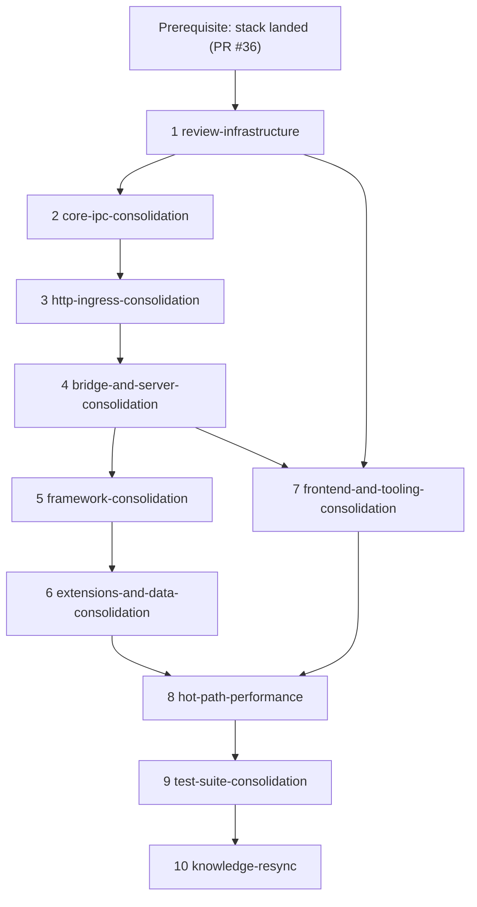

# Master PRD: Vertebra design quality, consolidation, and hot-path performance

## Context

Vertebra (`cofin/vertebra`, public on github.com) is a Python 3.12+/3.14t application backbone over a Rust 2024 runtime and a TypeScript SDK. Two feature waves (main #7–#13, then PR #12 and PRs #24–#33, landed together on `feat/stack-followups` as PR #36) added roughly 40k lines in a short time. Read-only audits of every module found the same pattern across the codebase: modules that nothing calls, implementations that exist twice (Rust and Python, or in two Rust crates), classes that store configuration and pretend to perform work, wire-format and lifecycle defects hidden by tests that only exercise stubs, and hot paths that copy or lock more than they need to.

There has been no release. Renames, module moves, and deletions are allowed with no compatibility aliases or re-export shims. Features stay: debloating removes dead code, duplication, redundant wrappers, speculative indirection, and weak tests, then reshapes what remains into deep modules with domain names.

### North Star

Every Vertebra module is small at its interface, honest about what it does, covered by tests that prove behavior, and measurably no slower (and on hot paths faster) than the recorded pre-change baseline. A zero-context agent can review any change against a repo-native checklist.

### Key outcomes

- A repo-native review system (area review skills, paired reviewer/specialist agents, one checklist with stable IDs, false-positive suppressions, a validator with tests) used for a baseline review and for every chapter's review gate.
- Benchmark baselines recorded before any refactor, plus a `make` gate that rejects regressions.
- Every audit finding in [findings.md](findings.md) is resolved by exactly one task, or explicitly routed through `/flow:revise`.
- Correctness defects fixed test-first.
- Knowledge bundle re-synced to the final module layout.

## Prerequisite (already done)

Landing the unmerged stack is complete: `feat/stack-followups` (PR #36 to `main`) is `main` plus 11 signed commits replaying #12 and #24–#33, with `make lint-all`, `make rs-test`, `make ts-test`, and `make py-test` (604 passed) green. `git diff --stat 2f5e19a edceea6` shows only `.agents/bundles/log.md`, so every `file:line` reference in this roadmap (taken from the `2f5e19a` snapshot) matches the checkout at `edceea6`. No chapter in this roadmap re-lands the stack.

## Specification

### Code Analysis Summary

Audits read every file under `src/rs/{vertebra-core,vertebra-http,vertebra-py,vertebra-bundler,vertebra-storage,vertebra-db}`, `src/py/vertebra/**`, `src/py/tests/**`, `src/ts/vertebra-client/**`, `tools/**`, `Makefile`, `pyproject.toml`, and `.github/workflows/**`. The full evidence ledger, with 279 findings, is [findings.md](findings.md). The findings with the largest consequences:

| Area | Finding | Evidence |
| --- | --- | --- |
| Rust core | MPMC `try_recv` returns early on `BufferTooSmall` after the head CAS and never releases the slot sequence, so the ring wedges with `Full` after one wrap (CORE-01). | `src/rs/vertebra-core/src/channel.rs:1563`, `:1596` |
| Rust core | SHM zero-copy reads trust the slot `len` written by the worker; `try_send_with` trusts the closure's returned length; a panicking closure leaves the slot unpublished (CORE-02, OKF-02). | `channel.rs:1005-1014`, `:1506-1520`, `:1666-1673` |
| Rust core / HTTP / bridge | Two response wire formats share the tiered rings. `submit_raw_response` writes `ResponseSlot` frames that the HTTP reader rejects as "bad magic"; `Dispatcher::handle_raw_response_slot` has no caller, so SHM workers cannot stream (CORE-03, HTTP-06). | `transport/ring_pair.rs:242-266`, `vertebra-http/src/response_reader.rs:271`, `dispatcher/mod.rs:229` |
| Rust core | Idle SHM workers spin in `Backoff::snooze` for the whole poll timeout because MPMC has no futex wake (CORE-10). | `channel.rs:1693-1715`, `transport/mod.rs:79-91` |
| Rust core | `logger.rs`, `telemetry.rs`, `guards.rs`, `protocol/state.rs`, core `Router`, `sync.rs` shared locks, `BufferChannel`, `cleanup.rs`, and the whole `vertebra-db` crate have no production consumer (CORE-11..16). | `rg` reference counts in [findings.md](findings.md) |
| HTTP | Thirteen ingress modules (cors, compression, access_log, assets, discovery, grpc, multipart, payload, profile, pubsub, sse, direct_worker, mcp_bridge) are never called by `response::handle` (HTTP-02). | `src/rs/vertebra-http/src/response.rs:75` |
| HTTP | A new `HealthEndpoint` is built per request, so draining is never observable; the circuit breaker takes a global `Mutex` and pushes onto an unbounded `VecDeque` on every response (HTTP-05, HTTP-11). | `response.rs`, `backpressure.rs:397` |
| HTTP | `(internal_id << 8) \| shard_idx` drops the top 8 bits of the 32-bit slab generation (OKF-01, HTTP-19). | `src/rs/vertebra-http/src/dispatcher/shm.rs:176` |
| Bridge | Four producers emit `x-vertebra-sendfile` headers that no Rust code reads: RSGI and Rust WSGI file responses go out with empty bodies and leak absolute paths (PYB-01). | `vertebra-py/src/rsgi_protocol.rs:156-221`, `wsgi_worker.rs:117-120` |
| Bridge | `VERTEBRA_WORKERS` (process count) is passed to `run_worker` as a loop-pool size, so 4 processes each start 4 GIL-bound loops (PYB-02). | `src/py/vertebra/supervisor/_worker.py:50` |
| Bridge | The `.pyi` stub declares methods that do not exist and mistypes others (PYB-47). | `src/py/vertebra/_vertebra.pyi` |
| Framework | `import vertebra.framework` takes 118 ms warm; 81 ms of it comes from `framework.channels` re-exporting `extensions.litestar` (FW-13, FW-14). | `-X importtime` |
| Framework | `McpServer`/`A2AServer` are unmounted partial JSON-RPC dispatchers; `attach_litestar_ecosystem_bridges` is a no-op on real Litestar `State`; litestar-mcp already provides the full MCP `2026-07-28` and A2A 1.0 surface (MCP-01, MCP-04, MCP-05). | `framework/mcp/__init__.py:52-173`, `extensions/litestar/ecosystem.py:84-85` |
| Data layer | Postgres/MySQL/Redis/Valkey "native drivers" return `[]` or use in-process dicts; `+vtb` dialects register descriptor instances; Arrow/Parquet exports write msgpack with fake magic; Oracle RRF passes unused binds (FW-01..05). | `db/postgres.py:135`, `extensions/sqlalchemy/dialects.py:191-263`, `sqlspec/storage.py:148-187`, `sqlspec/oracle.py:150-156` |
| Frontend | The native codegen watcher exits on its first poll because Python passes an argument the Rust method does not take; native dev mode drops its watcher immediately (FE-14, FE-13). | `build/codegen/_watch.py:141`, `vertebra-bundler/src/hmr.rs:185`, `build/_orchestrator.py:151-160` |
| Frontend | tsup lists `src/react/index.ts` (the file is `.tsx`); `./wasm` and `./arrow` exports have no build entries; CI never builds the TS package (FE-28, TOOL-10). | `src/ts/vertebra-client/tsup.config.ts`, `package.json` |
| Tests | 98 assertions check only not-None/callable/hasattr; 9 test files are named after PR waves; an autouse fixture deletes `/dev/shm/*vertebra*` after every test (TST-01, TST-03, TST-07). | `src/py/tests/**` |
| Tooling | No Makefile target runs criterion benches; the benchmark workflow commits an ignored file to `main`; `vtb-ft-native-4w` silently becomes an `echo` placeholder when the 3.14t binary is missing (TOOL-01, TOOL-04, OKF-08). | `Makefile`, `.github/workflows/`, `tools/benchmarks/targets.py:95-100` |

Standards already in good shape (verified with `rg`): no inline `#` comments, no `@dataclass` value objects (only `utils/type_guards.py` serializes user dataclasses), one direct `json` call outside `vertebra.utils.serializers`. The remaining standards debt is 68 function-scoped imports (most are optional-dependency guards; about 16 are cycle workarounds in `server/_native.py`), 11 direct `msgspec.msgpack` calls without a shared codec, re-export shims in `server/_native.py`, `_asgi/_extensions.py`, `extensions/alchemy/__init__.py`, and private-module imports of `vertebra.utils.serializers._json`.

### Relevant Patterns

- [Product guidelines](../../product/product-guidelines.md): clean-break domain naming, zero-copy hot paths, GIL release on blocking calls, lazy package startup, module/class layout, single FNV-1a route identity.
- [Python module and class layout](../../knowledge/patterns/python/module-and-class-layout.md) and [hot-path and async dispatch](../../knowledge/patterns/python/hot-path-and-async-dispatch.md).
- [PyO3 FFI and GIL discipline](../../knowledge/patterns/rust/ffi-and-gil-discipline.md) and [lock-free SHM and sharding](../../knowledge/patterns/rust/lock-free-shm-and-sharding.md): the SPSC SeqCst sleeper/waker handshake is load-bearing; any change to it needs a loom model plus stress tests.
- [Client SDK and framework adapter subpaths](../../knowledge/patterns/typescript/client-and-adapter-subpaths.md).
- [Polyglot test matrix](../../knowledge/testing/polyglot-test-matrix.md) and [benchmarks and free-threaded 3.14t](../../knowledge/testing/benchmarks-and-free-threaded.md).
- [Workflow](../../knowledge/workflow.md): `make dev` after any Rust edit before `pytest`; `make rs-test` purges `/dev/shm`; benchmark-only deps stay in `[dependency-groups].bench`.

### Requirements

| ID | Requirement |
| --- | --- |
| R1 | Install a repo-native review system: area review skills under `.agents/skills/review-*`, a shared review core (checklist with stable IDs, false-positive suppressions, test-strength criteria, ledger format), paired read-only reviewer and write-enabled specialist agents under `.agents/agents/` with full verification and research tools, a validator script with a pytest suite, and `make review-check` wired into `make lint-all`. |
| R2 | Run a baseline review of the whole codebase with those agents, reconcile it with [findings.md](findings.md), and route every new Critical or Important finding into the owning chapter through `/flow:revise`. |
| R3 | Record benchmark baselines (criterion, end-to-end `tools.benchmarks`, free-threaded, and Python bridge micro-benchmarks) before any refactor lands, and provide `make bench-check` that fails on a regression beyond the thresholds in Global Constraints. |
| R4 | Fix every correctness defect listed in [findings.md](findings.md) with a failing regression test first. |
| R5 | Remove dead code, duplicate implementations, redundant wrappers, re-export shims, and placeholder packages, with no compatibility aliases. |
| R6 | Resolve every placeholder that presents itself as a feature according to the stub policy in Global Constraints. No silent fakes remain. |
| R7 | Reorganize each crate and package into the target layouts in the chapter specs (deep modules, names that say what a concept is). |
| R8 | Enforce the code standards in Global Constraints with native gates where one exists (ruff rule selection, mypy scope, `mypy.stubtest` for `_vertebra.pyi`, clippy). |
| R9 | Deliver benchmark-proven hot-path improvements; every hot-path task compares against the recorded baseline. |
| R10 | Align MCP, A2A, and agent support with litestar-mcp: delegate the protocol surface instead of keeping partial reimplementations. |
| R11 | Consolidate the test suite into canonical module test files with behavior-level assertions; delete tautologies and tests of deleted stubs; keep coverage at or above the measured baseline. |
| R12 | Fix tooling and CI: benchmark workflow, single build per benchmark run, TS build and package lint in CI, http3 test job, dependency hygiene. |
| R13 | Re-sync the OKF knowledge bundle, product docs, and `AGENTS.md` with the final layout, and run a final review over the whole roadmap range. |

### Global Constraints

These rules apply to every chapter and every task.

1. **Branches and delivery.** Each chapter runs on its own branch `<type>/<flow_id>` created from the tip of the previous chapter's branch (chapter 1 starts from `feat/stack-followups`). Every PR targets `main`. Never merge a chapter PR into another feature branch; land bottom-up and retarget. Commits are signed conventional commits (`commit.gpgsign=true`), one per task, staged by exact path. Nothing is pushed unless the user asks. Never create, move, or delete Git tags.
2. **Privacy.** The repository is public. Never name other local repositories, internal product names, or local filesystem paths in any committed file, commit message, or PR body. The review validator enforces this with a pattern list plus private terms loaded from an environment variable or a gitignored file.
3. **No aliases or shims.** Renamed or moved symbols update every caller in the same commit. No `Old = New` assignments, no re-export modules, no deprecation wrappers.
4. **Python standards.** Value objects are `msgspec.Struct(frozen=True, gc=False)` (`array_like=True` on hot-path frames). JSON and msgpack go only through `vertebra.utils.serializers` public functions. Module layout: docstring, grouped top-level imports, `__all__`, public definitions, then private helpers. Class layout: class attributes, `__init__`, properties, public methods, private methods. Helpers used by one class become private methods of that class. No inline `#` comments (Google-style docstrings only). PEP 585/604/695 typing. No function-scoped imports except `if TYPE_CHECKING:` blocks and optional-dependency guards. Names state what a concept is, not how it is built.
5. **Rust standards.** No `#[allow(dead_code)]` on production items. Every new `unsafe` block carries a `// SAFETY:` comment. Hot paths avoid per-request allocation, clones of owned buffers, and locks held across blocking or Python calls. `cargo clippy --workspace --all-targets -- -D warnings` stays clean.
6. **Stub policy.** For each placeholder that presents itself as a feature, the owning task does exactly one of:
   - **Make it real** when an existing in-repo implementation, the standard library, or a dependency already in `pyproject.toml`/`Cargo.toml` or an optional extra added by the task can back it within one task (examples: SQLAlchemy `TypeDecorator`s, `pyarrow` Arrow/Parquet writers behind `import_optional`, `smtplib` email, `wasmtime` sandbox behind a `wasm` extra, litestar-mcp delegation, binding the Rust `AsyncLogCore`).
   - **Make it explicit** when no backend exists yet: keep the public type and its configuration, keep any working in-memory behavior under an explicit `memory` scheme or backend name, raise `UnsupportedBackendError` (a single exception type in `vertebra._typing`) for every option that would need the missing backend, and stop advertising capabilities that are not delivered. The missing backend is listed under "Follow-up feature specs" below.
   Silent fakes (returning `[]`, `"dispatched"`, or success without doing work) are not allowed after a task touches the module.
7. **Single implementation per concept.** When a concept exists in Rust and Python, the hot-path layer owns it and the other layer binds to it (telemetry logger, W3C trace context, and SQL sanitizing stay in Rust and are bound through `vertebra-py`; route, state, and field ids come from the Rust FNV functions). When a concept exists in two Rust crates, the lower crate owns it.
8. **Verification.** Each task declares one `verification_strategy` from the Flow matrix and names exact initial and final commands. Inner loop: `make lint` plus focused tests (`cargo test -p <crate> <filter>`, `uv run pytest <path> -q`, `bun run --cwd src/ts/vertebra-client test`). Run `make dev` before `pytest` whenever Rust changed. Chapter gates: `make lint-all`, `make rs-test`, `make py-test`, `make ts-test`, plus `make bench-check BASELINE=pre-refactor` for chapters that touch hot paths. Never run `make rs-test` or `make py-test` concurrently with another agent (both rewrite shared state).
9. **Performance gate.** A hot-path task fails if, against the recorded baseline, a criterion benchmark it lists regresses by more than 3% with criterion reporting the change as significant (p < 0.05), an end-to-end `tools.benchmarks` scenario loses more than 5% req/s or gains more than 10% p99 latency over the median of 3 runs, or a bridge micro-benchmark regresses by more than 5%. The task records before/after numbers in its `## Verification Evidence`.
10. **Tests.** New tests go into the existing canonical test file for the module (mirroring `src/` paths). Never create `test_*remediation*`, `test_*audit*`, stage-numbered, or PR-named test files. Strong tests assert observable behavior through the public interface; weak tests (not-None, `callable`, `hasattr`, signature introspection, constants, mocks that echo inputs, tests of stubs) are deleted or rewritten. Criteria live in `.agents/skills/review-core/references/test-strength.md` once chapter 1 lands.
11. **Line references.** `file:line` references are against `edceea6` (identical to the `2f5e19a` snapshot for all source files). Earlier tasks shift lines; executors locate code by the named symbol and treat line numbers as starting points.
12. **Review gate per chapter.** Before `/flow:finish`, run the chapter-1 area reviewers that `make review-route BASE=<chapter base>` selects over the chapter's commit range, then the Flow correctness and quality reviews. Critical and Important findings are fixed before finish.
13. **Prose.** Docs, specs, commit messages, and PR bodies use plain, direct language: no filler adjectives, no count-prefixed labels, no invented rule codes other than checklist IDs.

## Roadmap

Execution order is the chapter number. Chapter 7 depends only on chapters 1 and 4 and may run before chapter 5 if the user prefers, but chapters share `Makefile`, `pyproject.toml`, and `src/rs/Cargo.toml`, so chapters run one at a time.

| # | Chapter (`flow_id`) | Tasks | Depends on | Delivers |
| --- | --- | --- | --- | --- |
| 1 | [`review-infrastructure`](../review-infrastructure/spec.md) | 8 | prerequisite | Review validator, review core, area skills, paired agents, make/pre-commit wiring, benchmark harness and recorded `pre-refactor` baseline, baseline review ledger, knowledge chapter. |
| 2 | [`core-ipc-consolidation`](../core-ipc-consolidation/spec.md) | 9 | 1 | Ring correctness fixes, dead core modules and `vertebra-db` removed, `ring/` split with shared park helpers, one response wire format, transport and bridge cleanup, storage crate fixes. |
| 3 | [`http-ingress-consolidation`](../http-ingress-consolidation/spec.md) | 10 | 2 | Shared body/correlation primitives, batcher, dispatcher lifecycle and worker supervision, SHM streaming, lock-free backpressure, ingress pipeline wiring the orphan modules, protocols, realtime hub, config/main cleanup. |
| 4 | [`bridge-and-server-consolidation`](../bridge-and-server-consolidation/spec.md) | 10 | 3 | Accurate stubs, one submit path, explicit file bodies, shared request primitives, single WSGI path, loop pool, dispatcher split, ASGI/RSGI debloat, Rust-backed telemetry, wired platform controls. |
| 5 | [`framework-consolidation`](../framework-consolidation/spec.md) | 8 | 4 | Lazy imports and layering, dead utils removed, msgpack codec, native route/state ids, merged Inertia/SSR/dev packages, subdomain cores, queues/email, MCP/A2A delegated to litestar-mcp. |
| 6 | [`extensions-and-data-consolidation`](../extensions-and-data-consolidation/spec.md) | 7 | 5 | Litestar extension internals, one plugin base, storage split, honest data-layer drivers, real SQLAlchemy/SQLSpec integration, platform stub resolution, streaming gRPC. |
| 7 | [`frontend-and-tooling-consolidation`](../frontend-and-tooling-consolidation/spec.md) | 9 | 1, 4 | Bundler cleanup, working watchers, honest transform config, bounded SSR pool, codegen deepening, build/CLI surface, TS packaging and client deepening, CI/tooling gates. |
| 8 | [`hot-path-performance`](../hot-path-performance/spec.md) | 8 | 6, 7 | Missing benchmarks, MPMC futex wake, SPSC conditional wake (loom-proven), slot-lease batch decode, zero-copy responses, response coalescing, reader-callback drain, final comparison against `pre-refactor`. |
| 9 | [`test-suite-consolidation`](../test-suite-consolidation/spec.md) | 6 | 8 | Weak tests removed, canonical test layout across Python/Rust/TS, fixture cleanup, coverage floor. |
| 10 | [`knowledge-resync`](../knowledge-resync/spec.md) | 4 | 9 | Knowledge chapters, product docs, and `AGENTS.md` re-synced to the final layout; final review run over the roadmap range. |

## Requirement-to-chapter trace

| Requirement | Chapters and tasks |
| --- | --- |
| R1 | `review-infrastructure` 1.1–1.5, 1.8 |
| R2 | `review-infrastructure` 1.7; every chapter's review gate (Global Constraint 12); `knowledge-resync` 10.4 |
| R3 | `review-infrastructure` 1.6; `hot-path-performance` 8.1, 8.8 |
| R4 | `core-ipc-consolidation` 2.1, 2.5; `http-ingress-consolidation` 3.1, 3.4; `bridge-and-server-consolidation` 4.3, 4.5; `framework-consolidation` 5.8; `extensions-and-data-consolidation` 6.3, 6.5; `frontend-and-tooling-consolidation` 7.2, 7.7 |
| R5 | `core-ipc-consolidation` 2.2, 2.3; `http-ingress-consolidation` 3.10; `bridge-and-server-consolidation` 4.1, 4.7; `framework-consolidation` 5.2; `frontend-and-tooling-consolidation` 7.1 |
| R6 | `http-ingress-consolidation` 3.6, 3.7; `bridge-and-server-consolidation` 4.8, 4.10; `framework-consolidation` 5.7, 5.8; `extensions-and-data-consolidation` 6.4, 6.5, 6.6; `frontend-and-tooling-consolidation` 7.3 |
| R7 | `core-ipc-consolidation` 2.4, 2.6; `http-ingress-consolidation` 3.2, 3.3; `bridge-and-server-consolidation` 4.4, 4.7; `framework-consolidation` 5.1, 5.5; `extensions-and-data-consolidation` 6.1–6.3; `frontend-and-tooling-consolidation` 7.5, 7.6 |
| R8 | `bridge-and-server-consolidation` 4.1 (stubtest); `frontend-and-tooling-consolidation` 7.9 (ruff/mypy scope); every task (Global Constraints 4 and 5) |
| R9 | `core-ipc-consolidation` 2.4; `http-ingress-consolidation` 3.5; `hot-path-performance` 8.2–8.7 |
| R10 | `framework-consolidation` 5.8; `http-ingress-consolidation` 3.7, 3.10 |
| R11 | `test-suite-consolidation` 9.1–9.6 |
| R12 | `review-infrastructure` 1.5, 1.6; `frontend-and-tooling-consolidation` 7.7, 7.9 |
| R13 | `knowledge-resync` 10.1–10.4 |

Each finding's owning task is listed in the cross-reference table at the top of [findings.md](findings.md).

## Resolved Architectural Decisions

| ID | Decision | Resolution (Approved) | Affected tasks |
| --- | --- | --- | --- |
| D1 | Placeholder features with no backend in this PR (Postgres/MySQL/Oracle/Redis/Valkey network drivers, cross-process SHM broker leasing, `+vtb` dialects for non-SQLite databases, non-SMTP email providers, queue backends other than memory). | **Resolved:** In `vertebra-design-quality`, keep config types, URI/RESP builders, `memory://`, SQLite (`sqlite+vtb`), and `smtp://` working and raise `UnsupportedBackendError` for unimplemented network backends. Full implementations are planned in three dedicated, fully-refined sibling PRDs (`vertebra-native-db-drivers`, `vertebra-shm-connection-broker`, `vertebra-queues-and-messaging`). | 5.7, 6.4, 6.5, 6.6 |
| D2 | MCP, A2A, AgentRuntime, DynamicWorkflow, and Telemetry Harness ownership. | **Resolved:** In `vertebra-design-quality`, integrate `litestar-mcp` via `vertebra[mcp]` while keeping clean extension hooks; full native & Litestar-integrated agentic harness (MCP `2026-07-28`, A2A `1.0`, `AgentRuntime`, `SpecTree`, `DynamicWorkflow`, `SkillController`, queue tasks, and OpenTelemetry `gen_ai.*` observability of every component) is planned in the dedicated, fully-refined sibling PRD [`vertebra-agentic-harness`](../vertebra-agentic-harness/spec.md). | 5.8, 3.7, 3.10 |
| D3 | Rust discovery cache (`WellKnownDiscoveryCache`). | **Resolved:** Wire `WellKnownDiscoveryCache` into `vertebra-http` `ingress::Pipeline` with paths from configuration and keep it only if the Task 3.7 benchmark proves discovery `GET` is faster than the Python route; otherwise delete it in the same task. | 3.7 |
| D4 | Two-piece Rust acceleration ("Litestar Boosting" + Native-Feeling Rust Logger, Telemetry, and Guards). | **Resolved:** (1) **Litestar & Native Boosting:** Keep `vertebra-core/src/guards.rs` (`JwtValidator`, `RateLimiter`, `GuardSpec`) and `sanitize_sql_statement` (fixing UTF-8, `JOIN (`, and `VALUES`), wire `guards.rs` into `vertebra-http` `ingress::Pipeline` (Task 3.6) for pre-dispatch Rust guard evaluation and bind it in `vertebra-py` (Task 4.10) so `vertebra.framework.security.Guard` and `vertebra.extensions.litestar.offload` (Task 5.6) offload JWT/Bearer/rate-limit guards to Rust. (2) **Native-Feeling Loggers & Telemetry:** Bind `AsyncLogCore` and `W3cTraceContext` in `vertebra-py` (Task 4.10) and wire `vertebra.telemetry.LogHandler` / `LoggingConfig` into standard Python `logging.getLogger()` and Litestar `LoggingConfig` so loggers feel 100% native while formatting and flushing off-GIL in Rust. Delete only dead `protocol/state.rs` and duplicate core `Router` (Task 2.2). | 2.2, 3.6, 4.10, 5.6 |

## Companion Feature PRDs (Fully Refined in `specs/`)

Each distinct feature domain outside this consolidation roadmap has its own fully-refined Master PRD and child chapter task worksheets:

1. **[`vertebra-agentic-harness`](../vertebra-agentic-harness/spec.md)** (4 chapters, 19 tasks) — Extendable Agentic Harness: MCP `2026-07-28`, A2A `1.0`, `AgentRuntime`, `SpecTree`, `DynamicWorkflow` DAG engine, `SkillController`, queue bridge, and end-to-end OpenTelemetry `gen_ai.*` + Rust `AsyncLogCore` telemetry across every tool, skill, agent turn, and workflow step (`agentic-core-and-observability`, `agentic-mcp-protocol-and-bridge`, `agentic-a2a-protocol`, `agentic-runtime-and-workflows`).
2. **[`vertebra-native-db-drivers`](../vertebra-native-db-drivers/spec.md)** (3 chapters, 12 tasks) — Real network database drivers (`Postgres`, `MySQL`, `Oracle`, `Redis`, `Valkey`), live Cloud SQL & AlloyDB IAM mTLS dialers, Arrow zero-copy result streaming, `ChangeFeed` Parquet spill, `DataFusionEngine`, and `+vtb` SQLAlchemy 2.1 dialects (`db-postgres-and-cloud-dialers`, `db-mysql-and-oracle-drivers`, `db-redis-valkey-and-analytics`).
3. **[`vertebra-shm-connection-broker`](../vertebra-shm-connection-broker/spec.md)** (2 chapters, 8 tasks) — Cross-process shared-memory database connection lease broker (`ShmLeaseTable` with futex wait/wake and supervisor crash reclamation) and lock-free SHM prepared-statement digest/plan cache (`shm-broker-lease-table`, `shm-statement-and-result-cache`).
4. **[`vertebra-queues-and-messaging`](../vertebra-queues-and-messaging/spec.md)** (2 chapters, 8 tasks) — Distributed task queue backends (`Valkey`, `Redis`, `Postgres`, `Oracle`), lease-elected cron scheduler, `MultiLaneWorkerRunner` integration, and transactional email providers (`Resend`, `SendGrid`, `Mailgun`, `AWS SES` SigV4, `SMTP`) (`distributed-queue-backends`, `transactional-email-providers`).

## Implementation Plan

Chapter progress is tracked by each child spec's `state`. This roadmap has no tasks of its own.

- [x] 1 `review-infrastructure`
- [x] 2 `core-ipc-consolidation`
- [x] 3 `http-ingress-consolidation`
- [x] 4 `bridge-and-server-consolidation`
- [x] 5 `framework-consolidation`
- [x] 6 `extensions-and-data-consolidation`
- [x] 7 `frontend-and-tooling-consolidation`
- [x] 8 `hot-path-performance`
- [x] 9 `test-suite-consolidation`
- [x] 10 `knowledge-resync`

## Continuity Snapshot

- Active flow: `vertebra-design-quality` (roadmap), state `planned`.
- Current task: none. Next exact step: user approval of this roadmap and decisions D1–D4, then `/flow:implement review-infrastructure`.
- Plan identity: `plan_revision: 1`, `plan_commit: null`. State identity: `state_revision: 0`.
- Decisions: D1–D4 resolved and incorporated.
- Blockers: none.
- Knowledge paths: `.agents/bundles/product/product-guidelines.md`, `.agents/bundles/knowledge/workflow.md`, `.agents/bundles/knowledge/patterns/**`.
