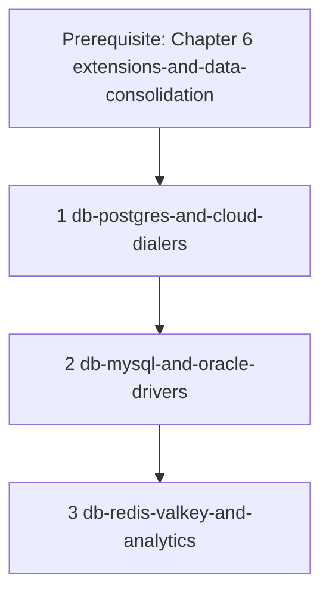

# Master PRD: Native network database drivers, cloud dialers, and +vtb SQLAlchemy/SQLSpec dialects

**Flow ID:** `vertebra-native-db-drivers`

## Context

`vertebra-design-quality` Decision D1 deferred the live network implementations for PostgreSQL, MySQL, Oracle, Redis, Valkey, Cloud SQL/AlloyDB dialers, DataFusion, and non-SQLite `+vtb` SQLAlchemy dialects into a dedicated follow-up roadmap after Chapter 6 (`extensions-and-data-consolidation`) replaces silent stubs with explicit `UnsupportedBackendError` contracts.

This Master PRD turns those explicit driver boundaries into full production implementations backed by optional extras (`vertebra[postgres]`, `vertebra[mysql]`, `vertebra[oracle]`, `vertebra[datafusion]`) and stdlib/asyncio RESP3 socket pools for Redis and Valkey.

### North Star

Every database driver, cloud dialer, cache client, analytical engine, and `+vtb` SQLAlchemy 2.1 dialect in `vertebra.db` and `vertebra.extensions.{sqlalchemy,sqlspec}` executes real network I/O, supports zero-copy Arrow result streaming where applicable, enforces TLS/mTLS and credential rotation without sidecars, and passes unit and integration verification without silent fallbacks.

### Key Outcomes

- Production `SyncPostgresDriver` (`psycopg` v3 pool, prepared statements, `COPY ... TO STDOUT (FORMAT BINARY)` Arrow batch streaming) and `AsyncPostgresDriver` (`asyncpg` / `psycopg.AsyncConnectionPool`) behind `vertebra[postgres]`.
- Live `CloudSqlDialer` (`:3307`) and `AlloyDbDialer` (`:5433`) with Google Cloud IAM token refresh, ephemeral X.509 client certificate exchange (`generateEphemeralCert` / `generateClientCertificate`), and mTLS socket factories.
- Real SQLAlchemy 2.1 `Dialect` subclasses (`PostgresVtbDialect`, `MysqlVtbDialect`, `OracleVtbDialect`, `SqliteVtbDialect`) registered under `postgresql+vtb`, `mysql+vtb`, `oracle+vtb`, and `sqlite+vtb` with `Vector`, `BinaryJson`, `INSERT ... RETURNING` sentinels, `DELETE ... USING`, and `AlembicImpl` DDL migration hooks.
- Production `SyncMysqlDriver` (`pymysql`) and `AsyncMysqlDriver` (`asyncmy`) behind `vertebra[mysql]`, plus `SyncOracleDriver` and `AsyncOracleDriver` (`oracledb` thin/thick mode) with `OracleWallet` (`tnsnames.ora`, `sqlnet.ora`, `ewallet.pem` mTLS), `DBMS_CLOUD` object store staging, and live `OracleHybridSearch` execution behind `vertebra[oracle]`.
- Native RESP3 sync (`socket` / `ssl.SSLSocket`) and async (`asyncio` streams) connection pools for `SyncRedisDriver`/`AsyncRedisDriver` and `SyncValkeyDriver`/`AsyncValkeyDriver` with pipelining, pub/sub, client-side cache invalidation push parsing, and `EVALSHA` script caching, wired into `MemoryStore`, `NamespacedStore`, and `ChannelsBackend`.
- Live PostgreSQL `ChangeFeed` logical replication / `LISTEN` consumer spilling large payloads to `ObjectStore` Parquet files, and `DataFusionEngine` executing vectorized SQL over registered Arrow and Parquet tables behind `vertebra[datafusion]`.

## Specification

### Code Analysis Summary

Inspection of `src/py/vertebra/db/`, `src/py/vertebra/extensions/{sqlalchemy,sqlspec}/`, `src/py/vertebra/framework/{stores,channels}/`, and `pyproject.toml` at commit `edceea6` confirmed the following gaps:

| Area | File & Lines | Current State | Target Production Implementation |
| --- | --- | --- | --- |
| PostgreSQL driver | `src/py/vertebra/db/postgres.py:109-173` | `SyncPostgresDriver.execute_tuples` (`:135-143`) ignores `sql` and `parameters` and returns `list(self._in_memory_rows)`; `AsyncPostgresDriver` (`:149-173`) wraps `SyncPostgresDriver` synchronously. | Real `psycopg_pool.ConnectionPool` and `psycopg_pool.AsyncConnectionPool` / `asyncpg` pool behind `vertebra[postgres]`, prepared statement cache sizing via `effective_statement_cache_size`, session GUC initialization (`build_session_gucs`), and `stream_arrow_batches` via `COPY (...) TO STDOUT (FORMAT BINARY)`. |
| Cloud SQL & AlloyDB dialers | `src/py/vertebra/db/dialer/cloudsql.py:58-113`, `alloydb.py:70-124` | `CloudSqlDialer.build_tls_context` (`:111-112`) raises `NotImplementedError` when client PEMs are provided; `refresh_Lead_seconds` (`:54`) is miscased; neither dialer fetches IAM tokens, exchanges ephemeral certs, or opens mTLS sockets. | Live RSA-2048 ephemeral certificate exchange against `generateEphemeralCert` / `generateClientCertificate`, ADC token refresh with `refresh_lead_seconds`, in-memory/temp `0o600` PEM loading into TLS 1.3 `SSLContext`, and `connect_sync` / `connect_async` socket factories. |
| SQLAlchemy `+vtb` dialects | `src/py/vertebra/extensions/sqlalchemy/dialects.py:43-264`, `pyproject.toml:22-30` | `pyproject.toml:23-30` points entry points at `PostgresVertebraDialect` (which does not exist); `PostgresDialect`, `MysqlDialect`, `OracleDialect`, and `SqliteDialect` (`:225-263`) are `DialectDescriptor` struct instances rather than `sqlalchemy.engine.default.DefaultDialect` subclasses; `DBAPIConnection` (`:101-150`) only runs `SyncSqliteDriver`. | Real SQLAlchemy 2.1 `DefaultDialect` subclasses (`PostgresVtbDialect`, `MysqlVtbDialect`, `OracleVtbDialect`, `SqliteVtbDialect`) with matching entry points, full `DBAPIConnection` routing across all 4 drivers, `description` metadata on `DBAPICursor`, `Vector` and `BinaryJson` `TypeDecorator` integration, `RETURNING` sentinels, and `DELETE ... USING` compilation. |
| MySQL driver | `src/py/vertebra/db/mysql.py:45-80` | `SyncMysqlDriver.execute_tuples` (`:58-61`) returns `[]`; `AsyncMysqlDriver` (`:64-80`) calls `self._sync.execute_tuples` synchronously. | Real `pymysql` connection pool in `SyncMysqlDriver` and `asyncmy` pool in `AsyncMysqlDriver` behind `vertebra[mysql]`, Cloud SQL `:3307` dialer socket injection, and transaction `commit`/`rollback`/`close`. |
| Oracle driver, wallet, & hybrid search | `src/py/vertebra/db/oracle/driver.py:69-183`, `wallet.py:21-228`, `extensions/sqlspec/oracle.py:53-157` | `SyncOracleDriver` and `AsyncOracleDriver` have no `execute_tuples` or `oracledb` pool lifecycle; `OracleWallet` does not parse `sqlnet.ora`; no `DBMS_CLOUD` staging helper exists; `OracleHybridSearch.build_rrf_sql` (`:108-157`) includes unused `rrf_k` and `candidate_limit` keys in `binds` (`:154-155`) while interpolating them into SQL. | Real `oracledb.create_pool` / `oracledb.create_pool_async` in Thin/Thick mode behind `vertebra[oracle]`, `sqlnet.ora` parsing in `OracleWallet`, `DBMS_CLOUD.COPY_DATA` Parquet/JSONL staging from `ObjectStore`, parameterized `:rrf_k` and `:candidate_limit` in `OracleHybridSearch.build_rrf_sql`, and `execute_rrf` / `execute_rrf_async`. |
| Redis & Valkey RESP3 drivers | `src/py/vertebra/db/redis.py:38-141`, `valkey.py:61-161` | Both drivers only mutate an in-process `self._kv` dict and have no RESP3 parser, socket pool, pub/sub listener, or Lua `EVALSHA` cache. | Full RESP3 wire parser (simple/blob strings, integers, doubles, booleans, maps, arrays, push frames `>`), sync/async TCP + TLS (`rediss://`, `valkeys://`) connection pools, `HELLO 3` + `CLIENT TRACKING` handshake execution, push invalidation dispatch, pipelining, pub/sub streaming, and `eval_script` (`EVALSHA` with `NOSCRIPT` fallback to `EVAL`). |
| Framework Stores & Channels | `src/py/vertebra/framework/stores.py`, `channels.py`, `extensions/litestar/store.py:19-122`, `channels.py:22-133` | `MemoryStore` (`store.py:59-100`) keeps an unbounded local `_entries` copy even when backed by Redis/Valkey and ignores `delete_all`/`expires_in` on the remote driver; `ChannelsBackend` (`channels.py:78-123`) publishes to `_driver` (`:83`) but never subscribes to remote Redis/Valkey pub/sub channels. | `KeyValueBackend` and `ChannelBus` in `vertebra.framework.{stores,channels}` backed by live `AsyncRedisDriver` / `AsyncValkeyDriver` with `PTTL`/`FLUSHDB` support, RESP3 invalidation callbacks, and background remote pub/sub fan-in tasks in `ChannelsBackend`. |
| CDC & DataFusion analytics | `src/py/vertebra/db/cdc.py:39-118`, `datafusion.py:46-84`, `pipeline.py:48-129` | `ChangeFeed` (`cdc.py:45`) stores spilled payloads in an in-memory `_spill_store: dict[int, dict[str, Any]]`; `DataFusionEngine` (`datafusion.py:76-84`) only returns a static dict from `explain_plan` and cannot execute SQL over Arrow/Parquet datasets. | `ChangeFeed` spills `>7,500`-byte payloads and WAL batches to `ObjectStore` Parquet/JSON objects and consumes PostgreSQL `LISTEN` / logical replication streams; `DataFusionEngine` binds `datafusion.SessionContext` behind `vertebra[datafusion]` to register Arrow/Parquet/Postgres/Oracle tables, execute vectorized SQL, and stream `pyarrow.RecordBatchReader` IPC responses; `QueryPipeline.execute` runs compiled single-RTT CTE pipelines on `SyncPostgresDriver` / `AsyncPostgresDriver`. |

### Requirements

| ID | Requirement |
| --- | --- |
| R1 | Add `vertebra[postgres]` (`psycopg[binary,pool]>=3.2`, `asyncpg>=0.30`, `pyarrow>=18.0`) and implement live connection pooling, prepared statement management, session GUC initialization, zero-copy `JSONB` decoding, and `COPY ... TO STDOUT (FORMAT BINARY)` Arrow batch streaming in `SyncPostgresDriver` and `AsyncPostgresDriver`. |
| R2 | Implement live Google Cloud IAM token refresh, ephemeral X.509 client certificate exchange (`generateEphemeralCert` and `generateClientCertificate`), in-memory/temp `0o600` PEM loading, and mTLS socket factories (`connect_sync`, `connect_async`) in `CloudSqlDialer` and `AlloyDbDialer`. |
| R3 | Implement real SQLAlchemy 2.1 `DefaultDialect` subclasses (`PostgresVtbDialect`, `MysqlVtbDialect`, `OracleVtbDialect`, `SqliteVtbDialect`), align `[project.entry-points."sqlalchemy.dialects"]` in `pyproject.toml`, and support `Vector`, `BinaryJson`, `RETURNING` sentinels, `DELETE ... USING`, and `AlembicImpl` migration hooks. |
| R4 | Add `vertebra[mysql]` (`pymysql>=1.1`, `asyncmy>=0.2.9`) and implement pooled `SyncMysqlDriver` and `AsyncMysqlDriver` with Cloud SQL `:3307` dialer integration and transaction control. |
| R5 | Add `vertebra[oracle]` (`oracledb>=2.5`, `cryptography>=43.0`) and implement pooled `SyncOracleDriver` and `AsyncOracleDriver` in Thin/Thick mode, `sqlnet.ora` + `tnsnames.ora` + `ewallet.pem` mTLS in `OracleWallet`, `DBMS_CLOUD` object store staging, and parameterized `OracleHybridSearch` RRF execution. |
| R6 | Implement a native RESP3 wire parser and sync/async TCP + TLS connection pool in `SyncRedisDriver`, `AsyncRedisDriver`, `SyncValkeyDriver`, and `AsyncValkeyDriver` supporting `HELLO 3`, `CLIENT TRACKING` push invalidations, pipelining, pub/sub subscriptions, and `EVALSHA` Lua script caching (`memory://` retained for unit test isolation). |
| R7 | Implement `KeyValueBackend` and `ChannelBus` adapters in `vertebra.framework.{stores,channels}` and wire live Redis/Valkey TTL (`PTTL`), `delete_all`, client-side cache invalidations, and remote pub/sub fan-in streams in `vertebra.extensions.litestar.{store,channels}`. |
| R8 | Implement `ObjectStore` Parquet/JSON spill and live PostgreSQL `LISTEN`/replication consumption in `ChangeFeed`, single-RTT `QueryPipeline.execute` / `execute_async`, and vectorized SQL execution with Arrow IPC streaming in `DataFusionEngine` behind `vertebra[datafusion]` (`datafusion>=43.0`, `pyarrow>=18.0`). |
| R9 | Verify all three chapters with unit and integration acceptance suites covering driver pools, mTLS dialers, `+vtb` SQLAlchemy dialects, Oracle wallets and hybrid search, RESP3 framing/pipelining/pub-sub, `ChangeFeed` Parquet spill, and `DataFusionEngine` Arrow queries. |

### Global Constraints

All Global Constraints from `vertebra-design-quality` apply:
1. **Branches and commits:** Each chapter runs on its own branch `feat/<flow_id>` with one signed conventional commit per task (`commit.gpgsign=true`). Never commit or push directly to `main`.
2. **Privacy:** Never reference local filesystem paths, internal hostnames, or non-public repository names in any file, test, or commit message. Use `"mock-oauth-token"` in GCP IAM tests to satisfy `git-secrets`.
3. **Python code standards:** `msgspec.Struct(..., frozen=True, gc=False)` for all value objects; JSON/msgpack only via `vertebra.utils.serializers`; strict module and class ordering; zero inline `#` comments (Google-style docstrings only); PEP 585/604/695 typing; top-level imports only (optional dependencies loaded via `importlib.import_module` or `MissingDependencyError` helpers).
4. **Explicit `memory://` vs network mode:** In-memory test fallbacks execute only when the configured DSN/URL explicitly starts with `memory://` (or `:memory:` for SQLite). Network DSNs require a connected pool or raise `MissingDependencyError` / `DriverConnectionError`.

## Roadmap

| # | Chapter (`flow_id`) | Tasks | Depends on | Delivers |
| --- | --- | --- | --- | --- |
| 1 | [`db-postgres-and-cloud-dialers`](../db-postgres-and-cloud-dialers/spec.md) | 4 | prerequisite | `SyncPostgresDriver` (`psycopg` v3 pool + Arrow binary `COPY`), `AsyncPostgresDriver` (`asyncpg` / `psycopg_pool`), live `CloudSqlDialer` and `AlloyDbDialer` mTLS + IAM cert exchange, `PostgresVtbDialect` (`postgresql+vtb`), and Postgres/dialer integration suite. |
| 2 | [`db-mysql-and-oracle-drivers`](../db-mysql-and-oracle-drivers/spec.md) | 4 | 1 | `SyncMysqlDriver` (`pymysql`), `AsyncMysqlDriver` (`asyncmy`), `MysqlVtbDialect` (`mysql+vtb`), `SyncOracleDriver`/`AsyncOracleDriver` (`oracledb` + `DBMS_CLOUD` staging + `OracleHybridSearch`), `OracleWallet` `sqlnet.ora` + mTLS, `OracleVtbDialect` (`oracle+vtb`) + `AlembicImpl` DDL hooks, and MySQL/Oracle integration suite. |
| 3 | [`db-redis-valkey-and-analytics`](../db-redis-valkey-and-analytics/spec.md) | 4 | 2 | Native RESP3 parser + sync/async TLS socket pools in `redis.py` and `valkey.py` with pipelining, pub/sub, and `EVALSHA`, live `KeyValueBackend` and `ChannelBus` adapters, `ChangeFeed` Parquet spill + `DataFusionEngine` vectorized Arrow SQL + `QueryPipeline.execute`, and Redis/Valkey/analytics integration suite. |

## Requirement-to-Chapter Trace

| Requirement | Chapter & Tasks |
| --- | --- |
| R1 | `db-postgres-and-cloud-dialers` 1.1, 1.4 |
| R2 | `db-postgres-and-cloud-dialers` 1.2, 1.4 |
| R3 | `db-postgres-and-cloud-dialers` 1.3, 1.4; `db-mysql-and-oracle-drivers` 2.1, 2.3, 2.4 |
| R4 | `db-mysql-and-oracle-drivers` 2.1, 2.4 |
| R5 | `db-mysql-and-oracle-drivers` 2.2, 2.3, 2.4 |
| R6 | `db-redis-valkey-and-analytics` 3.1, 3.4 |
| R7 | `db-redis-valkey-and-analytics` 3.2, 3.4 |
| R8 | `db-redis-valkey-and-analytics` 3.3, 3.4 |
| R9 | `db-postgres-and-cloud-dialers` 1.4; `db-mysql-and-oracle-drivers` 2.4; `db-redis-valkey-and-analytics` 3.4 |

## Implementation Plan

- [x] 1 `db-postgres-and-cloud-dialers` ([spec](../db-postgres-and-cloud-dialers/spec.md))
- [x] 2 `db-mysql-and-oracle-drivers` ([spec](../db-mysql-and-oracle-drivers/spec.md))
- [x] 3 `db-redis-valkey-and-analytics` ([spec](../db-redis-valkey-and-analytics/spec.md))

## Continuity Snapshot

- Active flow: `vertebra-native-db-drivers` (Master PRD), state `planned`.
- Current task: none. Next exact step: `/flow:implement db-postgres-and-cloud-dialers`.
- Plan identity: `plan_revision: 2`, `plan_commit: ""`. State identity: `state_revision: 0`.
- Blockers: none.
- Knowledge paths: `.agents/bundles/product/product-guidelines.md`, `.agents/bundles/knowledge/workflow.md`, `.agents/bundles/knowledge/domains/data/`.
