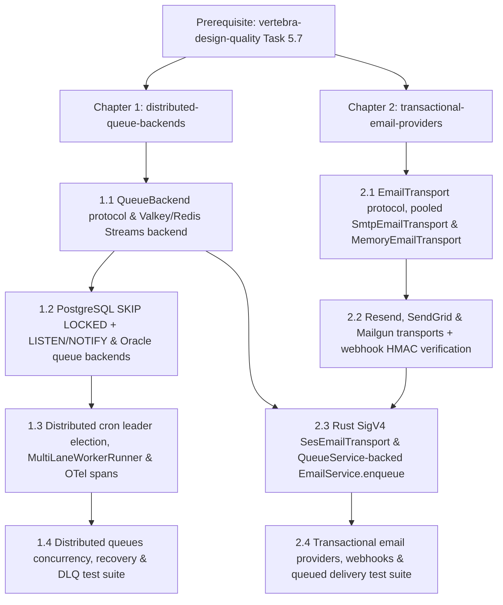

# Master PRD: Distributed Task Queues, Multi-Lane Worker Scheduler & Transactional Email Providers

**Flow ID:** `vertebra-queues-and-messaging`

## Context

In `vertebra-design-quality` (Task `5.7`, findings `FW-07` and `FW-08`), `vertebra.framework.queues` and `vertebra.framework.email` were consolidated around honest in-memory (`memory://`) and standard-library (`smtp`) implementations that raise `UnsupportedBackendError` when configured with distributed queue URLs (`valkey://`, `redis://`, `postgresql://`, `oracle://`) or external transactional email providers (`resend`, `sendgrid`, `mailgun`, `ses`). That roadmap recorded both surfaces under "Follow-up feature specs" so each backend could be built with full protocol semantics rather than silent in-memory stubs.

This Master PRD specifies the complete, production-grade implementation of those two follow-up subsystems across `vertebra.framework.queues`, `vertebra.server.lanes`, `vertebra.cli.workers`, `vertebra.framework.email`, and `vertebra-storage` (`vertebra._storage`):

1. **Chapter 1 (`distributed-queue-backends`)**: Pluggable `QueueBackend` protocol (`MemoryQueueBackend`, `ValkeyQueueBackend`, `RedisQueueBackend`, `PostgresQueueBackend`, `OracleQueueBackend`), at-least-once visibility-timeout recovery, delayed schedule promotion, dead-letter queues (DLQ), distributed lease-based cron leader election, `MultiLaneWorkerRunner` (`cpu`, `io`, `agent` lanes) with `LameDuckController` graceful `SIGTERM` drain, and OpenTelemetry `messaging.*` spans/metrics.
2. **Chapter 2 (`transactional-email-providers`)**: Pluggable `EmailTransport` protocol (`MemoryEmailTransport`, `SmtpEmailTransport`, `ResendEmailTransport`, `SendGridEmailTransport`, `MailgunEmailTransport`, `SesEmailTransport`), RFC 5322 `multipart/alternative` + attachment composition, webhook HMAC signature verification, Rust-accelerated AWS SigV4 request header signing (`vertebra._storage.py_sign_aws_sigv4_headers` / `sign_s3_v4` generalization in `py.detach`), and background queue-backed `EmailService.enqueue(...)` delivery.

### North Star

Every queue backend guarantees at-least-once delivery across worker crashes via visibility timeouts or row locks, promotes delayed and cron-scheduled jobs without duplicate leader execution, and drains cleanly on `SIGTERM`. Every transactional email provider supports single and batch sends, idempotency keys, bounded retry on `429`/`5xx`, webhook signature verification, and asynchronous background enqueueing through `QueueService`.

## Specification

### Code Analysis Summary

Inspected at repository checkout (`src/py/vertebra/**` and `src/rs/vertebra-storage/**`):

| File | Current State & Line References | Gap Addressed by This PRD |
| --- | --- | --- |
| `src/py/vertebra/framework/queues/__init__.py` | `145` lines. Defines `TaskLane = Literal["cpu", "io", "agent"]` (`:25`), `TaskRetryPolicy` (`:28-35`), `CronSchedule` (`:37-42`), `TaskDef` (`:44-52`), `TaskEnvelope` (`:54-62`), `QueueConfig` (`:65-71`), `QueueService` (`:73-125`), and `@task` (`:127-145`). `QueueService._pending` is an in-process `list[TaskEnvelope]` (`:81`) using `self._pending.pop(0)` (`:118`). | Extract `QueueBackend` protocol in `queues/base.py`; implement `ValkeyQueueBackend`/`RedisQueueBackend` (`queues/redis.py`), `PostgresQueueBackend` (`queues/postgres.py`), `OracleQueueBackend` (`queues/oracle.py`), and `CronScheduler` (`queues/scheduler.py`). |
| `src/py/vertebra/server/lanes.py` & `src/py/vertebra/cli/workers.py` | Worker lanes are consolidated in `server/lanes.py` (`MultiLaneWorkerRunner`). `cli/workers.py` (`73` lines) defines `execute_worker_cli` (`:16-42`) and `vtb workers run` (`:49-73`), which blocks on `asyncio.Event().wait()` (`:36`) without polling `QueueService` or wiring `LameDuckController`. | Introduce `src/py/vertebra/server/lanes.py` (`MultiLaneWorkerRunner`) binding `cpu`, `io`, and `agent` lane semaphores to `QueueService` pull loops, `CronScheduler`, `LameDuckController` (`src/py/vertebra/server/platform.py:71-100`), and `SpanExporter` (`src/py/vertebra/telemetry/otel.py:97-126`). |
| `src/py/vertebra/db/{redis,valkey,postgres}.py` & `src/py/vertebra/db/oracle/driver.py` | `RedisConfig`/`SyncRedisDriver` (`db/redis.py:17-108`), `ValkeyConfig`/`SyncValkeyDriver` (`db/valkey.py:19-119`), `PostgresConfig` (`db/postgres.py:23-107` with `effective_direct_dsn` at `:59-62`), and `OracleConfig`/`AsyncOracleDriver` (`db/oracle/driver.py:118-183`). | Reuse `RedisConfig`/`ValkeyConfig` RESP3 command encoding and `PostgresConfig.effective_direct_dsn` (`LISTEN/NOTIFY` requires direct primary connection bypassing transaction-mode poolers) in the queue backends. |
| `src/py/vertebra/framework/email/__init__.py` | `79` lines. Defines `EmailBackendType = Literal["memory", "smtp", "resend", "sendgrid", "mailgun", "ses"]` (`:17`), `EmailAttachment` (`:20-25`), `EmailMessage` (`:28-40`), `EmailConfig` (`:43-50`), and `EmailService` (`:53-79`). `EmailService.send` (`:72-75`) unconditionally appends to `self._outbox`. | Split into `email/{base,memory,smtp,providers,ses}.py` with `EmailTransport` protocol, `EmailReceipt`, `WebhookEvent`, pooled `SmtpEmailTransport`, REST transports (`Resend`, `SendGrid`, `Mailgun`, `SES`), and `EmailService.enqueue(...)` over `QueueService`. |
| `src/rs/vertebra-storage/src/signing.rs` & `src/rs/vertebra-storage/src/lib.rs` | `signing.rs:97-186` implements `S3SignConfig` and `sign_s3_v4_url` (HMAC-SHA256 key derivation `AWS4` -> `datestamp` -> `region` -> `service` -> `aws4_request` at `:173-180`, `sha256_hex` at `:22-26`, `constant_time_eq` at `:420-429`). `lib.rs:478-504` exposes `py_sign_s3_v4_url` with `py.detach`. | Add generic `sign_aws_sigv4_headers` in `signing.rs` (service `"ses"` or `"s3"`, payload SHA-256 header `x-amz-content-sha256`, `x-amz-date`, optional `x-amz-security-token`, and `Authorization: AWS4-HMAC-SHA256 ...`) and expose `py_sign_aws_sigv4_headers` in `lib.rs` (`vertebra._storage`) with `py.detach`. |

### Relevant Patterns & Knowledge Constraints

- **Product Guidelines (`.agents/bundles/product/product-guidelines.md`)**:
  - Value objects (`TaskRetryPolicy`, `CronSchedule`, `TaskEnvelope`, `DeadLetterEntry`, `CronLease`, `EmailAttachment`, `EmailMessage`, `EmailReceipt`, `EmailConfig`, `WebhookEvent`) must use `msgspec.Struct(..., frozen=True, gc=False, kw_only=True)` (`array_like=True` on wire/queue envelopes).
  - All JSON and MessagePack serialization must route exclusively through `vertebra.utils.serializers` (`encode_json_bytes`, `decode_json`, `encode_msgpack`, `decode_msgpack`).
  - Zero inline `#` comments in Python files; use Google-style docstrings and PEP 585/604/695 typing (`type TaskLane = ...`, builtin `tuple`/`dict`/`list`).
  - Module layout: module docstring, grouped top-level imports (with `if TYPE_CHECKING:` and `import_optional` guards), `__all__`, public classes/functions first, private `_...` helpers below.
  - Class layout: class attributes / `__slots__`, `__init__`, `@property`, public methods, `@staticmethod`/`@classmethod`, private `_...` methods at the bottom.
- **Hot-Path & FFI Discipline (`.agents/bundles/knowledge/patterns/rust/ffi-and-gil-discipline.md`)**:
  - Rust cryptographic signing (`sign_aws_sigv4_headers` in `vertebra-storage`) must release the GIL via `py.detach(|| ...)` so free-threaded `3.14t` and multi-lane asyncio workers never contend on the GIL during SES batch dispatch.
  - Synchronous stdlib I/O (`smtplib.SMTP`, socket fallback) must execute via `SyncPool` or non-blocking `asyncio` streams so the event loop is never blocked.

### Requirements

| ID | Requirement |
| --- | --- |
| R1 | Define the `QueueBackend` async protocol (`enqueue`, `dequeue`, `ack`, `nack`, `promote_scheduled`, `list_dlq`, `replay_dlq`, `acquire_lease`, `renew_lease`, `close`) and `MemoryQueueBackend` in `src/py/vertebra/framework/queues/base.py`, preserving `QueueService` ergonomics (`register`, `enqueue`, `enqueue_delayed`, `drain_once`). |
| R2 | Implement `ValkeyQueueBackend` and `RedisQueueBackend` in `src/py/vertebra/framework/queues/redis.py` using consumer groups (`XGROUP CREATE ... MKSTREAM`, `XREADGROUP`), explicit acknowledgment (`XACK`), visibility-timeout recovery (`XAUTOCLAIM`), delayed schedule promotion (`ZADD` + atomic `ZRANGEBYSCORE`/`ZREM` -> `XADD`), and dead-letter streams (`<stream>:dlq`). |
| R3 | Implement `PostgresQueueBackend` (`src/py/vertebra/framework/queues/postgres.py`) using `SELECT ... FOR UPDATE SKIP LOCKED`, zero-poll `LISTEN/NOTIFY` wakeups over `PostgresConfig.effective_direct_dsn`, exponential retry backoff with jitter, and a dead-letter table (`vertebra_queue_dlq`), plus `OracleQueueBackend` (`src/py/vertebra/framework/queues/oracle.py`) using `FOR UPDATE SKIP LOCKED` transactional dequeue and DLQ persistence. |
| R4 | Implement `CronScheduler` (`src/py/vertebra/framework/queues/scheduler.py`) with 5-field cron expression parsing, timezone-aware next-tick computation (`zoneinfo.ZoneInfo`), and distributed lease-based leader election (`acquire_lease`/`renew_lease`) so exactly one worker node enqueues each scheduled tick across a cluster. |
| R5 | Implement `MultiLaneWorkerRunner` (`src/py/vertebra/server/lanes.py`) and wire `vtb workers run` (`src/py/vertebra/cli/workers.py`) to run independent `cpu`, `io`, and `agent` lane pull loops, integrate `LameDuckController` (`SIGTERM` transitions readiness to `503` and drains in-flight jobs before closing backend connections), and emit OpenTelemetry `messaging.enqueue`, `messaging.process`, and `messaging.settle` spans/metrics through `SpanExporter`. |
| R6 | Define the `EmailTransport` protocol (`send`, `send_batch`, `close`), `EmailReceipt`, and `EmailDeliveryError` in `src/py/vertebra/framework/email/base.py`, `MemoryEmailTransport` in `src/py/vertebra/framework/email/memory.py`, and pooled `SmtpEmailTransport` (STARTTLS on 587, implicit TLS on 465, `multipart/alternative` text+HTML, and base64 `EmailAttachment` MIME parts) in `src/py/vertebra/framework/email/smtp.py`. |
| R7 | Implement `ResendEmailTransport`, `SendGridEmailTransport`, and `MailgunEmailTransport` in `src/py/vertebra/framework/email/providers.py` with single and batch send endpoints, `Idempotency-Key` headers, bounded retry with exponential backoff + `Retry-After` support on HTTP `429`/`5xx`, and constant-time webhook HMAC signature verification (`verify_resend_webhook`, `verify_sendgrid_webhook`, `verify_mailgun_webhook`). |
| R8 | Implement `SesEmailTransport` (`src/py/vertebra/framework/email/ses.py`) calling the AWS SES v2 `/v2/email/outbound-emails` REST API signed via Rust `vertebra._storage.py_sign_aws_sigv4_headers` in `py.detach`, and wire `EmailService.enqueue(...)` / `EmailService.enqueue_batch(...)` to dispatch outbound messages asynchronously through `QueueService` on the `"io"` lane. |
| R9 | Deliver unit and contract test suites (`src/py/tests/unit/framework/test_distributed_queues.py` and `src/py/tests/unit/framework/test_email_providers.py`) covering multi-worker concurrency, visibility-timeout recovery, cron leader election, DLQ routing/replay, LameDuck drain, OTel spans, SMTP MIME structure, provider REST contracts, webhook verification, Rust SigV4 SES signing, and queue-backed email delivery. |

### Architectural Decisions

| ID | Decision | Recommendation (Planned) | Alternative | Affected Tasks |
| --- | --- | --- | --- | --- |
| D1 | Redis/Valkey delayed task promotion atomicity | Use an atomic Lua script (`EVALSHA` with `EVAL` fallback) that pops due items from `<prefix>:scheduled` (`ZRANGEBYSCORE ... 0 now LIMIT 0 batch`) and appends them via `XADD` to `<prefix>:lane:<lane>` in a single server turn. | Client-side `ZRANGEBYSCORE` followed by `ZREM` + `XADD` (vulnerable to race conditions or partial failure between `ZREM` and `XADD`). | `1.1`, `1.4` |
| D2 | PostgreSQL `LISTEN/NOTIFY` connection topology | Use a dedicated direct connection (`PostgresConfig.effective_direct_dsn`) for `LISTEN vertebra_queue_wakeup` while running `SELECT ... FOR UPDATE SKIP LOCKED` dequeue transactions on the regular pool, falling back to bounded jittered poll (`poll_interval_seconds`) if `LISTEN` disconnects. | Poll-only without `LISTEN/NOTIFY` (adds idle query load and tail latency) or `LISTEN` on transaction-mode PgBouncer (unsupported by transaction pooling). | `1.2`, `1.4` |
| D3 | AWS SES v2 authentication & transport | Generalize `src/rs/vertebra-storage/src/signing.rs` with `sign_aws_sigv4_headers` (supporting service `"ses"`, payload SHA-256 hashing, and `X-Amz-Security-Token`) exposed as `vertebra._storage.py_sign_aws_sigv4_headers` via `py.detach`, rather than adding `boto3`/`botocore` (~80 MB transitive dependency). | Depend on `boto3`/`aioboto3` for SES v2 API calls. | `2.3`, `2.4` |
| D4 | Queue-backed email delivery integration | Register a built-in `"vertebra.email.send"` task on `QueueService` (lane `"io"`, `TaskRetryPolicy(max_retries=3)`) when `EmailService(config, queue_service=...)` is constructed, so `await email_service.enqueue(message)` persists the message in the configured distributed queue backend. | Keep an in-process `asyncio.create_task` fire-and-forget queue inside `EmailService` (loses messages on worker restart). | `2.1`, `2.3`, `2.4` |

## Roadmap

| # | Chapter (`flow_id`) | Tasks | Depends On | Delivers |
| --- | --- | --- | --- | --- |
| 1 | [`distributed-queue-backends`](../distributed-queue-backends/spec.md) | `1.1`–`1.4` | `vertebra-design-quality` (`5.7`) | `QueueBackend` protocol, `MemoryQueueBackend`, `ValkeyQueueBackend`, `RedisQueueBackend`, `PostgresQueueBackend`, `OracleQueueBackend`, `CronScheduler` with lease election, `MultiLaneWorkerRunner` with `LameDuckController` drain and OpenTelemetry `messaging.*` spans, and `test_distributed_queues.py`. |
| 2 | [`transactional-email-providers`](../transactional-email-providers/spec.md) | `2.1`–`2.4` | Chapter 1 (`1.1`) | `EmailTransport` protocol, `MemoryEmailTransport`, pooled `SmtpEmailTransport`, `ResendEmailTransport`, `SendGridEmailTransport`, `MailgunEmailTransport`, webhook HMAC verifiers, Rust SigV4 `SesEmailTransport`, `EmailService.enqueue(...)`, and `test_email_providers.py`. |

## Requirement-to-Chapter Trace

| Requirement | Chapter & Tasks | Verification |
| --- | --- | --- |
| R1 | `distributed-queue-backends` `1.1` | `uv run pytest src/py/tests/unit/framework/test_distributed_queues.py -k "memory or protocol" -q` |
| R2 | `distributed-queue-backends` `1.1`, `1.4` | `uv run pytest src/py/tests/unit/framework/test_distributed_queues.py -k "redis or valkey" -q` |
| R3 | `distributed-queue-backends` `1.2`, `1.4` | `uv run pytest src/py/tests/unit/framework/test_distributed_queues.py -k "postgres or oracle" -q` |
| R4 | `distributed-queue-backends` `1.3`, `1.4` | `uv run pytest src/py/tests/unit/framework/test_distributed_queues.py -k "cron or lease" -q` |
| R5 | `distributed-queue-backends` `1.3`, `1.4` | `uv run pytest src/py/tests/unit/framework/test_distributed_queues.py src/py/tests/unit/extensions/test_worker_lanes.py -q` |
| R6 | `transactional-email-providers` `2.1`, `2.4` | `uv run pytest src/py/tests/unit/framework/test_email_providers.py -k "memory or smtp" -q` |
| R7 | `transactional-email-providers` `2.2`, `2.4` | `uv run pytest src/py/tests/unit/framework/test_email_providers.py -k "resend or sendgrid or mailgun or webhook" -q` |
| R8 | `transactional-email-providers` `2.3`, `2.4` | `make dev && uv run pytest src/py/tests/unit/framework/test_email_providers.py -k "ses or enqueue" -q` |
| R9 | `distributed-queue-backends` `1.4`, `transactional-email-providers` `2.4` | `make lint-all && make rs-test && make py-test` |

## Implementation Plan

Chapter progress is tracked by each child spec's `state`.

- [x] 1 [`distributed-queue-backends`](../distributed-queue-backends/spec.md)
- [x] 2 [`transactional-email-providers`](../transactional-email-providers/spec.md)

## Continuity Snapshot

- Active flow: `vertebra-queues-and-messaging` (Master PRD), state `planned`.
- Current task: none. Next exact step: user approval of this PRD and decisions D1–D4, then `/flow:implement distributed-queue-backends`.
- Plan identity: `plan_revision: 2`, `plan_commit: ""`. State identity: `state_revision: 0`.
- Decisions pending user confirmation: D1–D4.
- Blockers: none.
- Knowledge paths: `.agents/bundles/product/product-guidelines.md`, `.agents/bundles/knowledge/workflow.md`, `.agents/bundles/knowledge/patterns/python/module-and-class-layout.md`, `.agents/bundles/knowledge/patterns/python/hot-path-and-async-dispatch.md`, `.agents/bundles/knowledge/patterns/rust/ffi-and-gil-discipline.md`.
