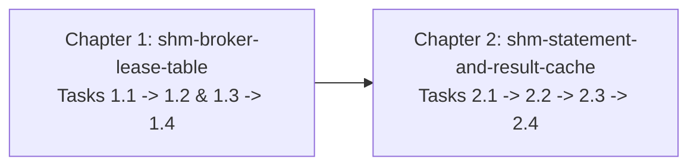

# Master PRD: Cross-Process Shared-Memory Database Connection Lease Broker & Prepared Statement Cache

## Executive Summary

Vertebra's multi-worker shared-memory (`shm`) topology spawns $N$ isolated Python worker processes (`python -m vertebra.supervisor._worker`) behind a single Rust HTTP/2 and HTTP/3 ingress supervisor (`src/rs/vertebra-http/src/workers/{factory,supervisor}.rs`). While HTTP request/response IPC traverses lock-free SPSC shared-memory ring buffers (`src/rs/vertebra-core/src/layout.rs`), database connection admission control in `src/py/vertebra/extensions/alchemy/broker.py:167-360` remains process-local:

1. `InMemoryBrokerTransport` (`src/py/vertebra/extensions/alchemy/broker.py:167-315`) coordinates connection leases strictly inside a single Python process using a `threading.Condition` (`self._cond`) and a Python `dict[str, ConnectionLease]`, polling with `self._cond.wait(timeout=min(remaining, 0.01))` (`:211`) on synchronous acquisition and `await asyncio.sleep(min(remaining, 0.002))` (`:230`) on asynchronous acquisition.
2. `ShmBrokerTransport` (`src/py/vertebra/extensions/alchemy/broker.py:318-360`) is an unfinished stub that allocates an unshared 64 KiB `ShmRegion("broker-default", 65536)` (`:351-360`), serializes `ChannelMessage` payloads with `msgspec.msgpack.Encoder()` only to discard the resulting bytes (`_ = self._encoder.encode(message)` at `:327` and `:338`), and falls back to `InMemoryBrokerTransport` (`super().acquire(...)` / `super().release(...)`).
3. Because each worker process maintains an independent connection budget of `pool_size + max_overflow`, a 16-worker deployment configured with `pool_size=20, max_overflow=10` permits up to $16 \times 30 = 480$ concurrent upstream PostgreSQL/SQLite connections during traffic spikes, exhausting upstream `max_connections` limits and triggering connection storms.
4. Each worker independently normalizes SQL text, computes parameter bind plans, and tracks prepared-statement metadata without sharing statement digests across worker processes.

This Master PRD specifies a production cross-process shared-memory connection lease broker and prepared-statement cache spanning `vertebra-core`, `vertebra-http`, `vertebra-py`, and `vertebra.extensions.{broker,alchemy,sqlspec}`:

- **Chapter 1 (`shm-broker-lease-table`)**: Implements `ShmLeaseTable` in `src/rs/vertebra-core/src/broker.rs` backed by a `ShmRegion` (`memfd_create` with `F_SEAL_SHRINK | F_SEAL_GROW | F_SEAL_SEAL` on Linux, `shm_open` on macOS) containing a cache-line-aligned header (`ShmLeaseHeader`) and a fixed array of 64-byte cache-line-isolated `LeaseSlot` entries (`#[repr(C, align(64))]`). Coordinates global `pool_size + max_overflow` limits via compare-and-swap (`Ordering::AcqRel`), zero-spin futex/ulock wait-wake (`WaitWord` in `src/rs/vertebra-core/src/platform/mod.rs`), monotonic nanosecond lease TTL expiration, supervisor-managed FD inheritance (`VERTEBRA_BROKER_SHM_FD`, `VERTEBRA_BROKER_SHM_SIZE`), worker crash lease reclamation (`reclaim_worker(worker_pid)` hooked into `WorkerLifecycle::check_alive` in `src/rs/vertebra-http/src/workers/supervisor.rs`), and GIL-detached PyO3 bindings (`NativeLeaseBroker`, `NativeLeaseGrant`, `NativeBrokerStats`).
- **Chapter 2 (`shm-statement-and-result-cache`)**: Extends the shared-memory broker segment with a lock-free seqlock prepared-statement digest and parameter-plan directory (`ShmStatementCache` in `src/rs/vertebra-core/src/broker.rs`, exposed as `NativeStatementCache` in `src/rs/vertebra-py/src/broker.rs`), extracts the unified `vertebra.extensions.broker` package (`transport.py`, `plugin.py`), rewires `ShmBrokerTransport` and `ShmSessionBroker` in `src/py/vertebra/extensions/alchemy/broker.py` to use `NativeLeaseBroker` + `SyncPool.default().submit_async` (`src/py/vertebra/utils/sync_tools.py:115-180`), and integrates live broker telemetry into `/debug/zpages/broker` (`ZPagesRegistry` in `src/py/vertebra/server/platform.py:102-157`) and OpenTelemetry `db.client.connections.*` metrics (`src/py/vertebra/telemetry/otel.py:97-168`).

---

## Architecture & Shared-Memory Layout

```mermaid
flowchart TD
    subgraph Supervisor["Rust Ingress Supervisor (vertebra-http)"]
        RF["WorkerFactory::new / spawn_worker<br/>(src/rs/vertebra-http/src/workers/factory.rs)"]
        WL["WorkerLifecycle::check_alive<br/>(pidfd / try_wait crash detection)"]
        SHM["ShmRegion (memfd_create / shm_open)<br/>VERTEBRA_BROKER_SHM_FD"]
        RF -->|Creates & seals SHM| SHM
        WL -->|reclaim_worker(dead_pid)| SHM
    end

    subgraph ShmSegment["Shared-Memory Broker Region (vertebra-core::broker)"]
        HDR["ShmLeaseHeader (256B, 64B-aligned)<br/>magic=VTBBRKR1, abi=1, pool_size, max_overflow<br/>active_leases, waiters, wake_seq: WaitWord"]
        SLOTS["LeaseSlot[0 .. pool_size + max_overflow]<br/>#[repr(C, align(64))] (64B per slot)<br/>state_and_pid, generation, acquired_ns, expiry_ns, bind_key_hash"]
        STMT["ShmStatementCache (Seqlock Directory + Arena)<br/>StatementSlot[0 .. capacity] (128B per slot)<br/>seq_and_clock, sql_hash, dialect, param_count, plan_bytes"]
        HDR --> SLOTS
        SLOTS --> STMT
    end

    subgraph WorkerA["Python Worker Process 1 (3.12 / 3.14t)"]
        PY1["ShmBrokerTransport / ShmSessionBroker<br/>(vertebra.extensions.broker / alchemy)"]
        NB1["PyO3 NativeLeaseBroker & NativeStatementCache<br/>(py.detach futex wait)"]
        PY1 --> NB1
    end

    subgraph WorkerB["Python Worker Process N (3.12 / 3.14t)"]
        PYN["ShmBrokerTransport / SQLSpec ProxyConfig<br/>(vertebra.extensions.sqlspec)"]
        NBN["PyO3 NativeLeaseBroker & NativeStatementCache<br/>(py.detach futex wait)"]
        PYN --> NBN
    end

    SHM === ShmSegment
    NB1 <==>|Atomic CAS + FUTEX_WAIT / FUTEX_WAKE| SLOTS
    NBN <==>|Atomic CAS + FUTEX_WAIT / FUTEX_WAKE| SLOTS
    NB1 <==>|Optimistic Seqlock Read / Write| STMT
    NBN <==>|Optimistic Seqlock Read / Write| STMT
```

---

## Requirements Traceability Matrix

| Requirement ID | Requirement Summary | Verification Target | Child Spec & Tasks |
| :--- | :--- | :--- | :--- |
| `BRK-R1` | Cache-line-isolated (`#[repr(C, align(64))]`) shared-memory `LeaseSlot` array enforcing global `pool_size + max_overflow` across worker processes via atomic compare-and-swap. | `cargo test -p vertebra-core --test it broker` | `shm-broker-lease-table` (`1.1`, `1.4`) |
| `BRK-R2` | Zero-spin cross-process futex/ulock wait-wake (`WaitWord` in `src/rs/vertebra-core/src/platform/mod.rs`) when the global lease budget is exhausted, replacing 2 ms / 10 ms Python sleep loops. | `cargo test -p vertebra-core --test it broker` | `shm-broker-lease-table` (`1.1`, `1.4`) |
| `BRK-R3` | Monotonic nanosecond lease TTL expiration (`expiry_ns`) and atomic generation counter (`generation`) preventing ABA release races after TTL reaping. | `cargo test -p vertebra-core --test it broker` | `shm-broker-lease-table` (`1.1`, `1.4`) |
| `BRK-R4` | Supervisor `ShmLeaseTable` allocation, `VERTEBRA_BROKER_SHM_FD` / `VERTEBRA_BROKER_SHM_SIZE` inheritance (`make_inheritable`), and automatic `reclaim_worker(exited_pid)` on worker crash (`check_alive`). | `cargo test -p vertebra-http` | `shm-broker-lease-table` (`1.2`, `1.4`) |
| `BRK-R5` | GIL-detached (`py.detach`) PyO3 `NativeLeaseBroker`, `NativeLeaseGrant`, and `NativeBrokerStats` bindings in `vertebra._vertebra` with strict `_vertebra.pyi` typing. | `uv run pytest src/py/tests/unit/extensions/test_shm_lease_broker.py` | `shm-broker-lease-table` (`1.3`, `1.4`) |
| `BRK-R6` | Lock-free shared-memory prepared-statement digest and parameter-plan cache (`ShmStatementCache` / `NativeStatementCache`) using optimistic seqlock reads and clock-second-chance eviction. | `uv run pytest src/py/tests/unit/extensions/test_broker_integration.py` | `shm-statement-and-result-cache` (`2.1`, `2.4`) |
| `BRK-R7` | Production `ShmBrokerTransport` and `ShmSessionBroker` in `vertebra.extensions.broker` and `vertebra.extensions.alchemy.broker` using `NativeLeaseBroker`, `NativeStatementCache`, and `SyncPool.default().submit_async`. | `uv run pytest src/py/tests/unit/extensions/test_broker_integration.py` | `shm-statement-and-result-cache` (`2.2`, `2.4`) |
| `BRK-R8` | Live `/debug/zpages/broker` JSON endpoint in `ZPagesRegistry` and OpenTelemetry `db.client.connections.*` / `db.client.statement_cache.*` telemetry in `AlchemyPlugin` and `SQLSpecPlugin`. | `uv run pytest src/py/tests/unit/extensions/test_broker_integration.py` | `shm-statement-and-result-cache` (`2.3`, `2.4`) |

---

## Key Architectural Decisions

### Decision `D1`: Cache-Line-Isolated `LeaseSlot` Array + `WaitWord` Futex Queue vs. Process-Shared Mutex

- **Context**: Holding a global process-shared mutex across every lease acquisition, TTL scan, and release serializes all worker threads and creates a single point of lock poisoning if a worker receives `SIGKILL` mid-operation.
- **Decision**: Represent each connection slot as an independent 64-byte `#[repr(C, align(64))] pub struct LeaseSlot` with `state_and_pid: AtomicU64` (packing 32-bit slot state `FREE = 0`, `PRIMARY = 1`, `OVERFLOW = 2` in the upper 32 bits and `worker_pid: u32` in the lower 32 bits), `generation: AtomicU64`, `acquired_ns: AtomicU64`, `expiry_ns: AtomicU64`, and `bind_key_hash: AtomicU64`. Global admission uses a lock-free CAS loop on `active_leases: CacheLine<AtomicU32>` combined with a round-robin slot scan (`rr_cursor`). Contended callers increment `waiters: CacheLine<AtomicU32>` and block on `wake_seq: CacheLine<WaitWord>` (`wait_timeout`), while `release` and `reclaim_worker` increment `wake_seq` and call `wake_one` / `wake_all`.
- **Consequences**: Uncontended lease acquire/release completes in 2 atomic CAS operations with zero syscalls; if a worker dies via `SIGKILL`, no lock is held and the supervisor reclaims slots owned by `dead_pid` atomically.

### Decision `D2`: Anonymous Supervisor `memfd`/`shm_open` Inheritance with Named SHM Fallback

- **Context**: In `src/rs/vertebra-http/src/workers/factory.rs`, `WorkerFactory` allocates anonymous `ShmRegion::create(size)` segments (`memfd_create` with seals on Linux, `shm_open` with immediate unlink after mapping on macOS) and passes file descriptors to child workers via `platform::process::make_inheritable` (`src/rs/vertebra-core/src/platform/process.rs`) and environment variables. However, standalone Python worker groups (such as CLI test harnesses or external process managers) may also attach without `WorkerFactory`.
- **Decision**: Support two attachment modes in `NativeLeaseBroker`:
  1. **Supervisor FD Inheritance (Primary)**: `WorkerFactory::new` allocates the combined broker + statement-cache `ShmRegion`, clears `FD_CLOEXEC`, and exports `VERTEBRA_BROKER_SHM_FD`, `VERTEBRA_BROKER_SHM_SIZE`, `VERTEBRA_BROKER_POOL_SIZE`, and `VERTEBRA_BROKER_MAX_OVERFLOW` to each spawned worker. `NativeLeaseBroker.from_env()` maps the inherited FD directly via `ShmRegion::from_fd`.
  2. **Named POSIX SHM (Standalone Fallback)**: `NativeLeaseBroker.create_named(name, pool_size, max_overflow, stmt_capacity)` and `NativeLeaseBroker.open_named(name)` use `ShmRegion::create_named` / `ShmRegion::open_named` (`src/rs/vertebra-core/src/shm.rs:124-186`).
- **Consequences**: Zero leaked `/dev/shm` files in supervised production deployments while retaining ergonomic named-region attachment for multi-process Python integration tests.

### Decision `D3`: Fixed-Slot Seqlock Directory for `ShmStatementCache`

- **Context**: SQLAlchemy and SQLSpec repeatedly normalize SQL strings and extract positional/named bind parameter orders on every worker process. Storing variable-length compiled SQL plans in shared memory requires safe concurrent reads without holding cross-process reader locks.
- **Decision**: Append a fixed-capacity 4-way set-associative seqlock table (`ShmStatementCache`, default 512 entries $\times$ 256 bytes = 128 KiB) to the broker `ShmRegion`. Each `#[repr(C, align(64))] pub struct StatementSlot` contains an atomic sequence counter `seq: AtomicU64` (odd while a writer updates the slot, even when quiescent), `sql_hash: AtomicU64`, `dialect_and_flags: AtomicU32`, `param_count: AtomicU16`, `payload_len: AtomicU16`, `access_bit: AtomicU32` (for clock eviction), and an inline 224-byte payload buffer storing the UTF-8 normalized SQL and msgpack-encoded parameter tuple. Readers validate `seq1 == seq2 && (seq1 & 1) == 0` after copying the inline payload bytes.
- **Consequences**: Lock-free cross-process statement plan lookups in $< 150\text{ ns}$ with zero heap allocation in shared memory and deterministic eviction when sets fill.

### Decision `D4`: GIL-Detached Futex Blocking + `SyncPool` Async Bridge

- **Context**: Calling `FUTEX_WAIT` directly on an `asyncio` event loop thread stalls all coroutines on that worker, whereas polling with `asyncio.sleep(0.002)` (`src/py/vertebra/extensions/alchemy/broker.py:230`) burns CPU and adds up to 2 ms of tail latency.
- **Decision**: `NativeLeaseBroker::acquire` in `src/rs/vertebra-py/src/broker.rs` wraps `ShmLeaseTable::acquire` inside `py.detach(|| ...)` so the Python GIL (on 3.12) is released before entering `WaitWord::wait_timeout`, and on free-threaded Python 3.14t the thread detaches cleanly from the interpreter runtime state. In `ShmBrokerTransport.acquire_async`, when an immediate non-blocking `try_acquire` (`timeout_ms=0`) returns `None`, the blocking `acquire` call is dispatched via `await SyncPool.default().submit_async(...)` (`src/py/vertebra/utils/sync_tools.py:165-180`).
- **Consequences**: Fast-path async acquisitions complete synchronously on the event loop in $< 1\,\mu\text{s}$ without thread-pool hop overhead; contended acquisitions block on the kernel futex inside `SyncPool` and wake within microseconds of `release()`.

---

## Child Specifications & Execution Order



| Order | Flow ID | Title | Tasks | Primary Scope |
| :--- | :--- | :--- | :--- | :--- |
| 1 | [`shm-broker-lease-table`](../shm-broker-lease-table/spec.md) | Shared-Memory Atomic Lease Table, Futex Wait Queue & Supervisor Reclamation | `1.1`, `1.2`, `1.3`, `1.4` | `src/rs/vertebra-core/src/broker.rs`, `src/rs/vertebra-http/src/workers/{factory,supervisor}.rs`, `src/rs/vertebra-py/src/broker.rs`, `src/py/vertebra/_vertebra.pyi` |
| 2 | [`shm-statement-and-result-cache`](../shm-statement-and-result-cache/spec.md) | Shared-Memory Prepared Statement Cache, Python Broker Transport & ZPages/OTel Telemetry | `2.1`, `2.2`, `2.3`, `2.4` | `src/rs/vertebra-core/src/broker.rs`, `src/py/vertebra/extensions/broker/`, `src/py/vertebra/extensions/alchemy/`, `src/py/vertebra/extensions/sqlspec/`, `src/py/vertebra/server/platform.py`, `src/py/vertebra/telemetry/otel.py` |

---

## Verification Gate Summary

1. **Rust Workspace Gate**: `make rs-test` (`cargo test --workspace --features tls,compression`) including `cargo test -p vertebra-core --test it broker` and `cargo test -p vertebra-http`.
2. **Python Extension & Unit Gate**: `make dev && uv run pytest src/py/tests/unit/extensions/test_shm_lease_broker.py src/py/tests/unit/extensions/test_broker_integration.py`.
3. **Lint & Typecheck Gate**: `make lint-all` (`ruff check`, `mypy`, `mypy.stubtest vertebra._vertebra`, `cargo clippy --workspace --all-targets -- -D warnings`).
4. **Benchmark Gate**: `cargo bench -p vertebra-core --bench broker -- --test`.
