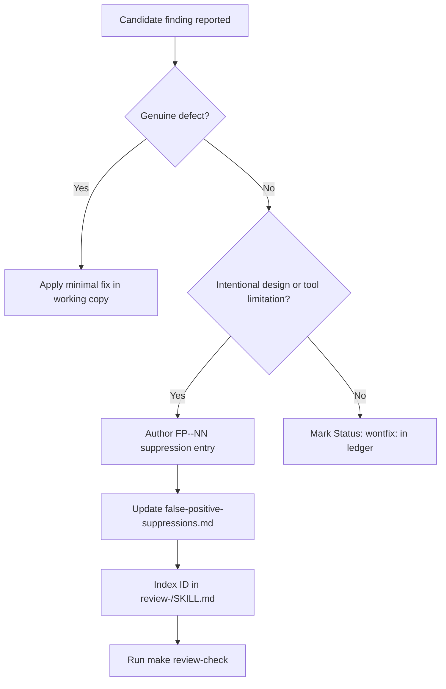

# False-Positive Suppression Playbook

This playbook defines triage workflows and suppression authoring standards for review findings and static linter warnings.

---

## Triage Workflow

When a reviewer reports a candidate finding:

---

## Authoring False-Positive Entries

1. **Heading**:
   - `### FP-<PREFIX>-<NN>: <Title>`
   - `<PREFIX>` must match an area declared in `areas.toml`.
   - `<NN>` is a strictly two-digit sequential number. Never reuse or renumber retired IDs.

2. **Required Bullets**:
   - `- **Applies to**:` Comma-separated active checklist IDs (`<PREFIX>-<NN>`).
   - `- **Scope**:` Comma-separated paths or globs matching at least one tracked file.
   - `- **Do not flag**:` Exact pattern, phrase, or claim that the reviewer wrongly suggests.
   - `- **Why**:` Rationale with a relative markdown link resolving to an OKF knowledge chapter in `.agents/bundles/knowledge/`.

3. **Bidirectional Parity**:
   - Every `FP-<PREFIX>-<NN>` entry in `false-positive-suppressions.md` must appear in the corresponding `review-<area>/SKILL.md` under `## Suppressions Index`.

---

## Static Lint Suppression Hierarchy

When handling static analysis or compiler warnings:

1. **Fix the root cause**: Restructure or refactor the code to eliminate the ambiguity.
2. **Promote to shared primitive**: Extract the pattern into an approved utility in `vertebra.utils`.
3. **Repository config allowance**: Add a targeted rule override in `pyproject.toml` or `Cargo.toml`.
4. **Targeted inline disable**: Use a scoped directive citing the suppression ID in docstrings or comments.
5. **Ratchet baseline**: Track legacy occurrences in a shrinking baseline file, never allowing additions.
