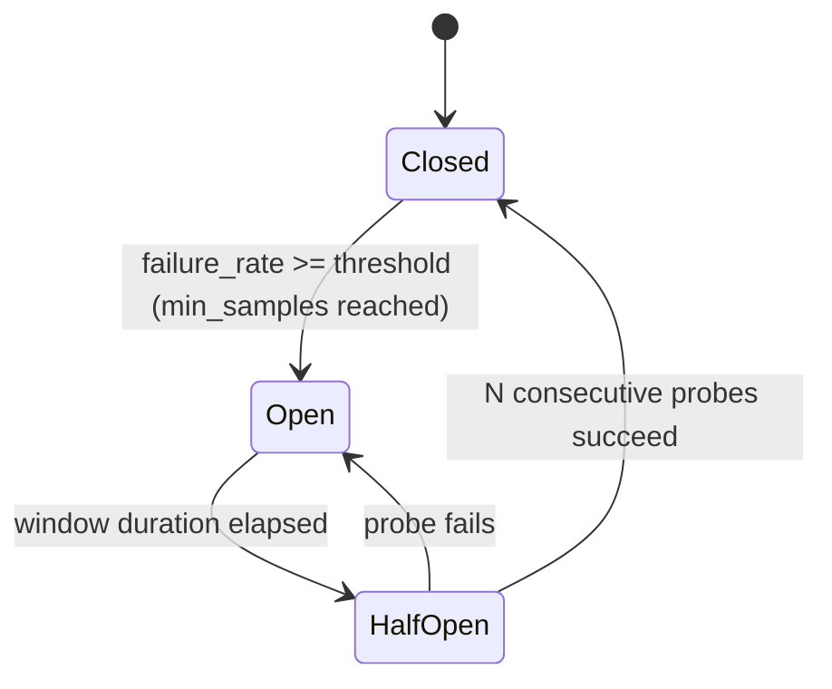

# HTTP/1.1, HTTP/2, HTTP/3 & gRPC Ingress (`vertebra-http`)

`vertebra-http` is the Rust network ingress engine built on Tokio, Hyper, `rustls`, and `quinn`. It terminates network protocols, routes static assets and HMR traffic directly in Rust, and batches dynamic requests for Python workers.

## Request Coalescing (`RequestBatcher`)

Crossing the Rust/Python FFI boundary or waking a shared-memory consumer per individual HTTP request limits throughput at high concurrency. `RequestBatcher` coalesces concurrent incoming requests over a microsecond window (or up to a maximum batch size) into a single `RequestBatch` vector, amortizing FFI and event-loop wake overhead across the entire batch.

## Multi-Protocol Support

| Protocol | Implementation Details |
| --- | --- |
| **HTTP/1.1 & HTTP/2** | Hyper connection state machines with pipelining, keep-alive, and ALPN TLS negotiation via `rustls`. |
| **HTTP/3 (QUIC)** | Optional UDP/QUIC listener (`--http3`) advertising `Alt-Svc` headers alongside TCP HTTP/2. |
| **gRPC Framing** | Native 5-byte length-prefixed gRPC frame parser and `grpc-status` trailer encoder bridged to `vertebra.extensions.grpc.GrpcBridge`. |
| **WebSocket & SSE** | RFC 6455 upgrade and frame demultiplexing plus low-latency Server-Sent Events streaming. |

## Backpressure & Admission Control (`BackpressureController`)

`vertebra-http::backpressure::BackpressureController` sheds excess load with explicit `503 Service Unavailable` or `429 Too Many Requests` responses instead of allowing unbounded queue growth.

### Rejection Reasons

| Reason | HTTP Status | Condition |
| --- | --- | --- |
| `Saturated` | `503` | In-flight permits exhausted **and** waiter queue is at `max_queue_depth`. |
| `QueueTimeout` | `503` | Request waited longer than `max_queue_time` for an in-flight permit. |
| `CircuitOpen` | `429` | Sliding-window failure rate reached `failure_rate_threshold` after at least `min_samples` responses. |

### Circuit Breaker Lifecycle

- **`Closed`**: Normal operation; failures accumulate in a sliding time window (`VERTEBRA_BP_CB_WINDOW_MS`).
- **`Open`**: Requests fail fast with `429 CircuitOpen` without dispatching to Python workers until the window elapses.
- **`HalfOpen`**: Admits probe requests; `VERTEBRA_BP_CB_HALF_OPEN_PROBES` consecutive successes close the circuit, while any `5xx` failure reopens it immediately.

### Metrics Snapshot

`BackpressureMetricsSnapshot` exposes atomic counters (`accepted`, `saturated_rejected`, `queue_rejected`, `circuit_rejected`, `timeout_rejected`) alongside live `in_flight`, `queue_depth`, and `circuit_state` gauges.
