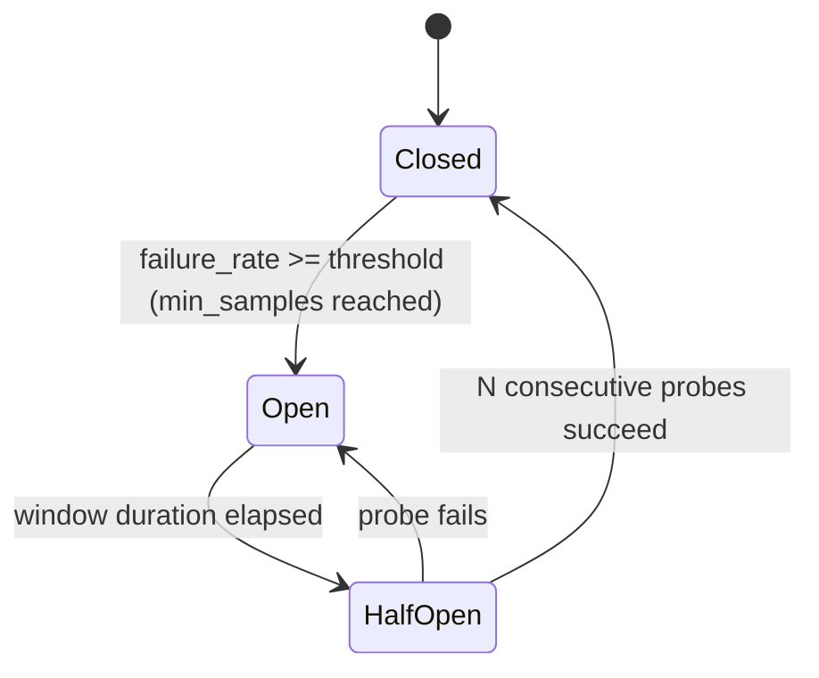

# HTTP/1.1, HTTP/2, HTTP/3 & gRPC Ingress (`vertebra-http`)

`vertebra-http` is the Rust HTTP server built on Tokio, Hyper, `rustls`, and `quinn`. It handles network connections, serves static files and Rust-offloaded middleware directly in Rust, and groups dynamic requests into batches for Python workers.

## Request Batching (`RequestBatcher`)

Calling into Python or waking a worker process once per HTTP request adds overhead under heavy concurrency. `RequestBatcher` groups concurrent incoming requests over a few microseconds (or up to a maximum batch size) into a single `RequestBatch` so Python processes an entire batch of requests per wake.

## Multi-Protocol Support

| Protocol | Implementation Details |
| --- | --- |
| **HTTP/1.1 & HTTP/2** | Hyper connection handlers with keep-alive, pipelining, and ALPN TLS negotiation via `rustls`. |
| **HTTP/3 (QUIC)** | Optional UDP/QUIC listener (`QuicConfig`) advertising `Alt-Svc` headers alongside TCP HTTP/2. |
| **gRPC Framing** | 5-byte length-prefixed gRPC frame parser and `grpc-status` trailer encoder connected to `vertebra.extensions.grpc.GrpcServiceRegistry`. |
| **WebSocket & SSE** | RFC 6455 WebSocket upgrade and frame handling plus Server-Sent Events streaming. |

## Rust-Direct Offload (Static Files, CORS, Compression & Discovery)

Before forwarding requests to Python, `vertebra-http` handles common edge tasks directly in Rust without acquiring the Python GIL:

- **Health & Agent Discovery**: Serves `/health`, `/.well-known/agent-card.json`, and `/.well-known/mcp.json` directly from Rust memory.
- **CORS & Security Headers**: Answers `OPTIONS` preflight requests and attaches `Access-Control-Allow-*` headers in Rust.
- **Response Compression**: Compresses outbound payloads with `zstd`, `br` (Brotli), or `gzip` based on `Accept-Encoding`.
- **Static Files & Multipart**: Serves static assets with `ETag`, `Cache-Control`, and path-traversal guards, and parses `multipart/form-data` uploads in Rust.

## Backpressure & Circuit Breaking (`BackpressureController`)

`vertebra-http::backpressure::BackpressureController` sheds overload with `503 Service Unavailable` or `429 Too Many Requests` responses instead of letting queues grow without bound.

### Rejection Reasons

| Reason | HTTP Status | Condition |
| --- | --- | --- |
| `Saturated` | `503` | Active request slots are full **and** the waiting queue is at `max_queue_depth`. |
| `QueueTimeout` | `503` | Request waited longer than `max_queue_time` for an active slot. |
| `CircuitOpen` | `429` | Recent error rate reached `failure_rate_threshold` after at least `min_samples` responses. |

### Circuit Breaker Lifecycle

- **`Closed`**: Normal operation; errors are tracked in a sliding time window (`VERTEBRA_BP_CB_WINDOW_MS`).
- **`Open`**: Requests fail immediately with `429 CircuitOpen` without calling Python workers until the window elapses.
- **`HalfOpen`**: Lets probe requests through; `VERTEBRA_BP_CB_HALF_OPEN_PROBES` consecutive successes close the circuit, while any `5xx` error reopens it immediately.

### Metrics Snapshot

`BackpressureMetricsSnapshot` tracks atomic counters (`accepted`, `saturated_rejected`, `queue_rejected`, `circuit_rejected`, `timeout_rejected`) and live gauges (`in_flight`, `queue_depth`, `circuit_state`).
