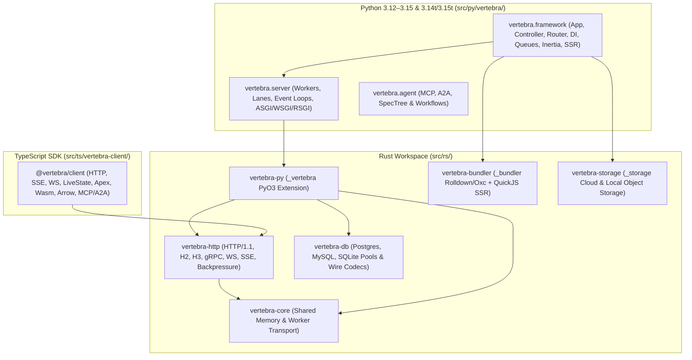

# Architecture Overview

Vertebra is organized into **Rust crates** (`src/rs/`), **Python framework and worker packages** (`src/py/vertebra/`), and the **TypeScript client SDK** (`src/ts/vertebra-client/`).

## Crate & Package Map

## Architecture Chapters

| Chapter | Focus Area |
| --- | --- |
| **[Runtime & Shared-Memory IPC](runtime-and-ipc.md)** | How `vertebra-core` moves requests and responses between Rust and Python workers in-process (`BatchBridge`) or across shared memory (`SpscRing`, `MpmcRing`, `TieredRingSet`). |
| **[HTTP/1.1, HTTP/2, HTTP/3 & gRPC Ingress](http-ingress.md)** | How `vertebra-http` batches requests, serves static assets, offloads CORS and compression, frames gRPC/WebSockets/SSE, and sheds excess load (`BackpressureController`). |
| **[PyO3 Bridge & Worker Lanes](pyo3-and-workers.md)** | How `vertebra-py` (`_vertebra`), `vertebra-db`, and `vertebra-storage` bridge Rust and Python, release the GIL during I/O, and isolate work across `fast`, `async`, `cpu`, and `blocking` lanes. |
| **[Bundler, QuickJS SSR & TypeScript SDK](bundler-and-client.md)** | How `vertebra-bundler` (`_bundler`) compiles frontend assets with Rolldown/Oxc, renders SSR pages in QuickJS, and pairs with `@vertebra/client`. |
