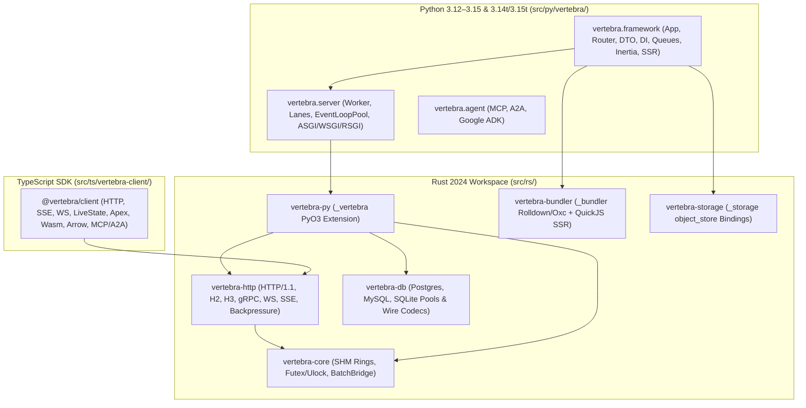

# Architecture Overview

Vertebra is a polyglot runtime divided into clear responsibilities across **Rust 2024 crates** (`src/rs/`), **Python framework and worker runners** (`src/py/vertebra/`), and the **TypeScript client SDK** (`src/ts/vertebra-client/`).

## Crate & Package Map

## Architecture Chapters

| Chapter | Focus Area |
| --- | --- |
| **[Runtime & Shared-Memory IPC](runtime-and-ipc.md)** | `vertebra-core` memory layout (`ShmHeader`), cache-line-padded SPSC and MPMC rings, tiered response rings (`TieredRingSet`), `futex`/`ulock` handshakes, and `BatchBridge`. |
| **[HTTP/1.1, HTTP/2, HTTP/3 & gRPC Ingress](http-ingress.md)** | `vertebra-http` request batching (`RequestBatcher`), radix routing, `BackpressureController` admission control and circuit breaking, and multi-protocol framing. |
| **[PyO3 Bridge & Worker Lanes](pyo3-and-workers.md)** | `vertebra-py` (`_vertebra`) zero-copy `RequestBatch`, `gil_used = false` free-threaded `3.14t`/`3.15t` execution, parallelism strategies, and worker lane isolation. |
| **[Bundler, QuickJS SSR & TypeScript SDK](bundler-and-client.md)** | `vertebra-bundler` (`_bundler`) embedded Rolldown/Oxc compilation, pooled QuickJS server-side rendering, and `@vertebra/client` subpath architecture. |
