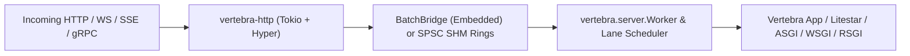

# Getting Started

Vertebra is a Python-first application backbone that pairs typed Python handlers (`App`, `Router`, `RouteDef`, `msgspec.Struct`, `Provide`) with a Rust 2024 HTTP and shared-memory IPC runtime (`vertebra-core`, `vertebra-http`, `vertebra-py`) and a type-safe TypeScript client (`@vertebra/client`).

## Guides in This Section

| Guide | Summary |
| --- | --- |
| **[Installation](installation.md)** | Install `vertebra-core` with `uv`, configure free-threaded Python `3.14t`/`3.15t`, install `@vertebra/client`, and set up local polyglot development. |
| **[Quickstart](quickstart.md)** | Create your first `App`, register typed routes and `msgspec.Struct` request/response models, run with `vtb`, and verify routes in `pytest`. |
| **[Configuration](configuration.md)** | Configure embedded vs. shared-memory (`shm`) topologies, worker counts, backpressure, TLS, and environment variables. |
| **[CLI](cli.md)** | Use the `vtb` CLI to run production workers, launch hot-reload development, manage frontend packages, generate TypeScript types, and build standalone binaries. |

## Execution Model at a Glance

- **Embedded Topology (`--topology embedded`)**: Runs Tokio HTTP ingress and the Python interpreter inside a single OS process via `BatchBridge`, eliminating cross-process serialization.
- **Shared-Memory Topology (`--topology shm`)**: Spawns independent Python worker processes connected to the Rust ingress parent over lock-free shared-memory SPSC rings with adaptive `futex`/`ulock` wakeups.
