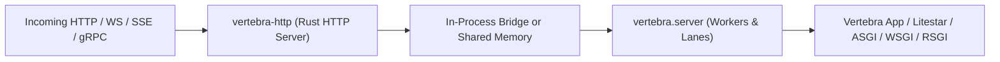

# Getting Started

Vertebra is a Python web framework and server that pairs typed Python handlers, controllers, and dependency injection with a Rust HTTP server and a TypeScript client (`@vertebra/client`).

## Guides in This Section

| Guide | Summary |
| --- | --- |
| **[Installation](installation.md)** | Install `vertebra-core` with `uv`, set up free-threaded Python `3.14t`/`3.15t`, install `@vertebra/client`, and configure local development. |
| **[Quickstart](quickstart.md)** | Create your first `App`, register routes and controllers with `msgspec.Struct` models, run with `vtb`, and test routes in `pytest`. |
| **[Configuration](configuration.md)** | Configure worker modes (`embedded` vs. `shm`), worker counts, backpressure, TLS, and environment variables. |
| **[CLI](cli.md)** | Use the `vtb` CLI to run servers, start hot-reload development, manage frontend packages, generate TypeScript types, and build standalone binaries. |

## Execution Modes at a Glance

- **Embedded Mode (`--topology embedded`)**: Runs the Rust HTTP server and Python inside a single OS process. Used automatically for single-worker runs and on free-threaded Python (`3.14t`/`3.15t`).
- **Shared-Memory Mode (`--topology shm`)**: Spawns separate Python worker processes connected to the Rust HTTP server over shared memory. Used automatically when `--workers > 1` on standard GIL-enabled Python.
