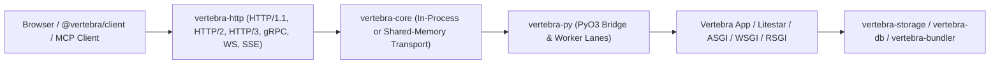

<h1 id="vertebra" class="vertebra-sr-only">Vertebra</h1>

<div class="vertebra-hero">
  <div class="vertebra-hero-lockup">
    
    <div class="vertebra-hero-divider" aria-hidden="true"></div>
    <span class="vertebra-brand-text">Vertebra</span>
  </div>
  <p class="vertebra-hero-lead">
    One runtime for Python and TypeScript — backend, frontend, web, gRPC, workers, and standalone apps.
  </p>
  <div class="vertebra-hero-actions">
    <a class="vertebra-cta vertebra-cta--primary" href="getting-started/quickstart/">Get Started</a>
    <a class="vertebra-cta" href="architecture/">Architecture</a>
    <a class="vertebra-cta" href="reference/">API Reference</a>
  </div>
</div>

## Install

=== "uv"
    ```bash
    uv add vertebra-core
    ```
=== "pip"
    ```bash
    pip install vertebra-core
    ```
=== "pdm"
    ```bash
    pdm add vertebra-core
    ```
=== "poetry"
    ```bash
    poetry add vertebra-core
    ```

The `@vertebra/client` TypeScript SDK is included natively within the wheel distribution and served directly by the server, eliminating external NPM package requirements.

## First Application

Define typed routes and controllers on `App` and run them with the `vtb` CLI:

```python
from vertebra import App

app = App()


@app.get("/health")
def health() -> dict[str, str]:
    return {"status": "ok"}
```

Run the server:

```bash
vtb run app:app --host 127.0.0.1 --port 8000
```

## Explore Vertebra

| Section | What You Will Find |
| --- | --- |
| **[Getting Started](getting-started/index.md)** | Installation, quickstart, configuration, `vtb` CLI commands, runnable examples, and release changelog. |
| **[Usage](usage/index.md)** | Subsystem guides for routing & controllers, server & worker topologies, databases & native statement pipelining, object storage, frontend & SSR, and MCP/A2A agents. |
| **[Architecture](architecture/index.md)** | How the Rust HTTP server, shared-memory worker rings, PyO3 bridge, and bundler work under the hood. |
| **[Reference](reference/index.md)** | API documentation organized by Framework, Server & Runtime, Databases, Object Storage, Frontend & Client SDK, and Agents & Native SDKs. |
| **[Examples](examples/index.md)** | Runnable Python examples covering routing, controllers, background queues, live state, storage, and MCP agent tools. |

## Core Capabilities

| Capability | Summary |
| --- | --- |
| **Rust HTTP Server** | HTTP/1.1, HTTP/2, HTTP/3 (QUIC), gRPC, WebSockets, SSE, TLS, compression, and static file serving in `vertebra-http`. |
| **Shared-Memory Workers** | Run in-process or scale across worker processes over shared memory in `vertebra-core`. |
| **Free-Threaded Python Ready** | Supports Python 3.12–3.15 including free-threaded `3.14t`/`3.15t` builds with isolated worker lanes (`fast`, `async`, `cpu`, `blocking`). |
| **Databases & Analytics** | Nine native database drivers, native `driver.pipeline()` batching (`SyncPipelineCapable` / `AsyncPipelineCapable`), zero-sidecar Cloud SQL/AlloyDB dialers, RLS, CDC, and Arrow/DataFusion analytics. |
| **Cloud & Local Object Storage** | Unified GIL-free `SyncObjectStore` / `AsyncObjectStore` across S3, GCS (with Google Cloud Application Default Credentials and DuckDB `httpfs` secret integration), Azure, Cloudflare R2, OCI, HTTP, Local, and Memory backends with HMAC/SigV4/Azure SAS/OCI Cavage presigning, and PyArrow `SyncReadableFile` / `AsyncReadableFile`. |
| **Frontend Bundler & SSR** | Built-in JavaScript bundler (`vertebra-bundler`), QuickJS SSR pool, Inertia v3, HTMX, and TypeScript/Zod code generation. |
| **Agent Protocols (MCP & A2A)** | Built-in Model Context Protocol (MCP) tools, resources, prompts, skills, stdio bridge, Agent-to-Agent (A2A) services, and DAG workflows. |

## Runtime Overview


