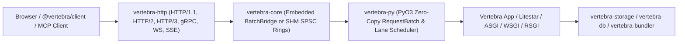

<h1 id="vertebra" class="vertebra-sr-only">Vertebra</h1>

<div class="vertebra-hero">
  <div class="vertebra-hero-lockup">
    
    <div class="vertebra-hero-divider" aria-hidden="true"></div>
    <span class="vertebra-brand-text">Vertebra</span>
  </div>
  <p class="vertebra-hero-lead">
    Python-first, high-performance polyglot application backbone combining Python 3.12–3.15 and free-threaded 3.14t/3.15t developer ergonomics with a Rust 2024 HTTP/IPC runtime and a full-stack type-safe TypeScript client.
  </p>
  <div class="vertebra-hero-actions">
    <a class="vertebra-cta vertebra-cta--primary" href="getting-started/quickstart/">Get Started</a>
    <a class="vertebra-cta" href="architecture/">Architecture</a>
    <a class="vertebra-cta" href="reference/">API Reference</a>
  </div>
</div>

## Install

Install `vertebra-core` with `uv`:

```bash
uv add vertebra-core
```

Install the optional `@vertebra/client` TypeScript SDK for frontend applications:

```bash
bun add @vertebra/client
```

## First Application

Define typed routes on `App`, validate parameters and `msgspec.Struct` payloads automatically, and run through the Rust HTTP ingress:

```python
from vertebra import App

app = App()


@app.get("/health")
def health() -> dict[str, str]:
    return {"status": "ok"}
```

Launch with the `vtb` CLI in embedded or shared-memory multi-worker mode:

```bash
vtb run app:app --host 127.0.0.1 --port 8000 --topology embedded
```

## Explore Vertebra

| Section | What You Will Find |
| --- | --- |
| **[Getting Started](getting-started/index.md)** | Installation, quickstart walkthrough, environment and topology configuration, and `vtb` CLI fundamentals. |
| **[Usage](usage/index.md)** | Practical guides for routing, DTOs, guards, dependency injection, task queues, Inertia v3, QuickJS SSR, storage, database pools, framework extensions, and MCP/A2A agent protocols. |
| **[Architecture](architecture/index.md)** | Deep dives into shared-memory SPSC/MPMC ring buffers, `futex`/`ulock` wakeups, HTTP/1.1, HTTP/2, HTTP/3, and gRPC ingress, PyO3 GIL release, and embedded Rolldown/Oxc bundling. |
| **[Reference](reference/index.md)** | Complete API documentation across Python packages, PEP 561 `.pyi` native extension stubs, `@vertebra/client` TypeScript exports, and `vtb` CLI commands. |
| **[Examples](examples/index.md)** | Verified, runnable Python examples demonstrating routing, background queues, live state, storage, and MCP agent tools. |

## Core Capabilities

| Capability | Summary |
| --- | --- |
| **Rust 2024 Multi-Protocol Ingress** | Hyper + Tokio HTTP/1.1, HTTP/2, HTTP/3 (QUIC), gRPC framing, WebSocket, SSE, TLS, compression, and static asset serving in `vertebra-http`. |
| **Zero-Copy Shared-Memory IPC** | Lock-free SPSC and MPMC rings, arena slot pools, and adaptive `futex`/`ulock` wakeups in `vertebra-core` for both embedded and multi-process SHM topologies. |
| **Free-Threaded Python Ready** | Designed for Python 3.12–3.15 including GIL-disabled `3.14t`/`3.15t` builds, with isolated worker lanes (`fast`, `async`, `cpu`, `blocking`) and zero-copy buffer views. |
| **Full-Stack Frontend & SSR** | Embedded Rolldown/Oxc bundler (`vertebra-bundler`), QuickJS server-side rendering pool, Inertia v3 protocol, and end-to-end TypeScript/Zod code generation. |
| **Native Storage & Database Pools** | Rust `object_store` bindings (`vertebra-storage`) for S3, GCS, Azure, R2, OCI, HTTP, and local files, plus native Postgres, MySQL, and SQLite pools (`vertebra-db`). |
| **Agent Protocols (MCP & A2A)** | First-class Model Context Protocol (MCP) tools, resources, prompts, skills, stdio-to-HTTP bridge, and Agent-to-Agent (A2A) task orchestration. |

## Runtime Overview


