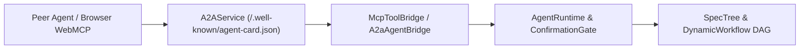

# A2A, WebMCP, Bridges & Agent Workflows

Vertebra supports peer-to-peer **Agent-to-Agent (A2A 1.0)** discovery and streaming tasks, browser-side **WebMCP** (`@vertebra/client/webmcp`), bidirectional MCP/A2A bridges, and durable `SpecTree` / `DynamicWorkflow` execution.



## Agent-to-Agent Protocol (`vertebra.agent.a2a`)

Expose an A2A 1.0 discovery card (`/.well-known/agent-card.json`) with optional JWS card signing (`card_secret` / `AgentCardSigner`) and JSON-RPC/SSE task endpoints using `AgentCard`, `A2AConfig`, and `A2AService`.

When `supported_interfaces` is omitted, Vertebra automatically populates a `JSONRPC` 1.0 `AgentInterface` and resolves its public URL dynamically from incoming request headers (`Forwarded`, `X-Forwarded-Proto`, `X-Forwarded-Host`, `Host`) and `A2AConfig.path` (or from `A2AConfig(base_url=...)` when explicitly configured):

```python
from vertebra.agent.a2a import (
    A2AConfig,
    A2AService,
    AgentCapabilities,
    AgentCard,
    AgentSkill,
)

skill = AgentSkill(
    id="order-lookup",
    name="Order Lookup",
    description="Query order status.",
)
card = AgentCard(
    name="OrderSupportAgent",
    description="Resolves order status and shipment inquiries.",
    capabilities=AgentCapabilities(streaming=True),
    skills=(skill,),
)
a2a = A2AService(A2AConfig(path="/a2a", agent_card=card))
```

## Browser WebMCP (`@vertebra/client/webmcp`) & Bidirectional Bridges

- **Browser WebMCP (`@vertebra/client/webmcp`)**: Register client-side browser tools on `navigator.modelContext` (`WebMcpBridge`, `registerWebMcpTools`) so browser agents and page assistants can invoke typed frontend actions directly.
- **Bidirectional MCP / A2A Bridges (`vertebra.agent.bridges`)**: Bridge MCP tools and A2A agents in either direction using `McpToolBridge`, `A2aAgentBridge`, `a2a_card_to_mcp_tools`, and `mcp_service_to_a2a`.

## `SpecTree` Planning & DAG Workflows (`vertebra.agent.spec`, `vertebra.agent.workflow`)

Decompose complex goals into hierarchical `SpecTree` task nodes (`SpecNode`) or execute parallel topological waves with `DynamicWorkflow`, `WorkflowNode`, `WorkflowEngine`, and real-time `WorkflowLiveState` delta broadcasting:

```python
from vertebra.agent.spec import SpecTree
from vertebra.agent.workflow import (
    DynamicWorkflow,
    WorkflowEngine,
    WorkflowNode,
)

tree = SpecTree(root_goal="Fulfill enterprise order")
validate_node = tree.add_node(
    "validate-inventory",
    description="Verify warehouse stock",
)
ship_node = tree.add_node(
    "create-shipment",
    description="Book carrier label",
    depends_on=(validate_node.id,),
)

workflow = DynamicWorkflow(
    name="order-fulfillment",
    nodes=[
        WorkflowNode(name="validate", fn=lambda ctx: {"ok": True}),
        WorkflowNode(
            name="ship",
            depends_on=("validate",),
            fn=lambda ctx: {"shipped": ctx.get_output("validate")["ok"]},
        ),
    ],
)
engine = WorkflowEngine()
```

## Agent Runtime, Confirmation Gates & Sessions

Combine `AgentPlugin`, `AgentRuntime`, `GoogleGenAIProvider`, `GuardChain`, `TurnBudget`, and human-in-the-loop `ConfirmationGate` (`ConfirmationTicket`, `ConfirmationDecisionRequest`) with pluggable session stores (`MemorySessionStore`, `CacheSessionStore`, `SQLSpecSessionStore`, `AlchemySessionStore`, `ObjectStoreSessionStore`).
