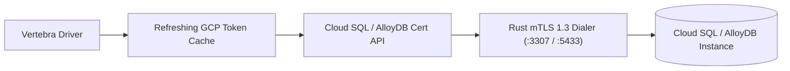

# Cloud SQL & AlloyDB Dialers

`vertebra.db.dialer` connects directly to Google Cloud SQL (`:3307` ephemeral mTLS certificates) and Google Cloud AlloyDB (`:5433` `MetadataExchangeRequest` protobuf handshake) from Rust and Python without deploying an external Cloud SQL Auth Proxy sidecar container.



## Direct Zero-Sidecar Connections

Configure `PostgreSQLConfig` with `cloud_sql_instance` / `alloydb_instance_uri` directly for integrated pooling, or construct `SyncCloudSQLDialer` / `AsyncCloudSQLDialer` and `SyncAlloyDBDialer` / `AsyncAlloyDBDialer` with Application Default Credentials and automatic IAM database authentication (`enable_iam_auth=True`):

```python
from vertebra.db import (
    AlloyDBConfig,
    CloudSQLConfig,
    PostgreSQLConfig,
    SyncAlloyDBDialer,
    SyncCloudSQLDialer,
)

pg_cloud_sql = PostgreSQLConfig(
    dsn="postgresql://iam_user@localhost/orders",
    cloud_sql_instance="my-project:us-central1:orders-db",
    enable_iam_auth=True,
)
pg_alloydb = PostgreSQLConfig(
    dsn="postgresql://iam_user@localhost/orders",
    alloydb_instance_uri=(
        "projects/my-project/locations/us-central1/clusters/prod/instances/primary"
    ),
    enable_iam_auth=True,
)

cloudsql = SyncCloudSQLDialer(
    CloudSQLConfig(
        instance_connection_name="my-project:us-central1:orders-db",
        enable_iam_auth=True,
    )
)
alloydb = SyncAlloyDBDialer(
    AlloyDBConfig(
        instance_uri=(
            "projects/my-project/locations/us-central1/"
            "clusters/prod/instances/primary"
        ),
        enable_iam_auth=True,
    )
)
```

## Capabilities

- **Cloud SQL (`CloudSQLConfig`, `SyncCloudSQLDialer`, `AsyncCloudSQLDialer`)**: Parses `project:region:instance` (including domain-scoped projects), fetches ephemeral X.509 client certificates via the SQL Admin `generateEphemeralCert` API, and establishes TLS 1.3 connections on port `3307` with custom `project:instance` server certificate verification across PostgreSQL, MySQL, and SQL Server.
- **AlloyDB (`AlloyDBConfig`, `SyncAlloyDBDialer`, `AsyncAlloyDBDialer`)**: Parses `projects/<p>/locations/<l>/clusters/<c>/instances/<i>` URIs, negotiates client certificates via `generateClientCertificate`, and executes the port `5433` protobuf `MetadataExchangeRequest` handshake (`BUILT_IN` or `IAM` token auth).
- **Automatic Session GUCs**: When `alloydb_instance_uri` is set or `enable_alloydb_columnar_engine=True` is configured on `PostgreSQLConfig`, `build_session_gucs` enables both `google_columnar_engine.enabled=on` and `alloydb.enable_columnar_engine=on`.
- **In-Database Vector Embeddings**: Pair AlloyDB connections with [`PushdownEmbedder` with `PostgresEmbeddingPushdown`](embeddings-and-vectors.md) to push `embedding()` execution directly into SQL.
