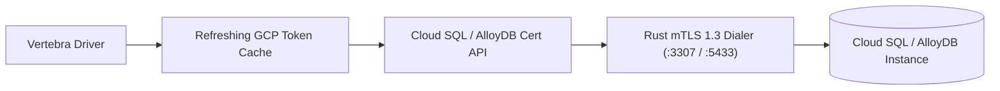

# Cloud SQL & AlloyDB Dialers

`vertebra.db.dialer` connects directly to Google Cloud SQL (`:3307` ephemeral mTLS certificates) and Google Cloud AlloyDB (`:5433` `MetadataExchangeRequest` protobuf handshake) from Rust and Python without deploying an external Cloud SQL Auth Proxy sidecar container.



## Direct Zero-Sidecar Connections

Configure `PostgreSQLConfig` with `cloud_sql_instance` / `alloydb_instance_uri` directly for integrated pooling, or construct `SyncCloudSQLDialer` / `AsyncCloudSQLDialer` and `SyncAlloyDBDialer` / `AsyncAlloyDBDialer` with Application Default Credentials and automatic IAM database authentication (`enable_iam_auth=True`):

```python
from vertebra.db import (
    AlloyDBConfig,
    CloudSQLConfig,
    SyncAlloyDBDialer,
    SyncCloudSQLDialer,
)
from vertebra.db.adapters.postgres import PostgreSQLConfig

pg_cloud_sql = PostgreSQLConfig(
    dsn="postgresql://iam_user@localhost/orders",
    cloud_sql_instance="my-project:us-central1:orders-db",
    enable_iam_auth=True,
)
pg_alloydb = PostgreSQLConfig(
    dsn="postgresql://iam_user@localhost/orders",
    alloydb_instance_uri=(
        "projects/my-project/locations/us-central1/clusters/prod/instances/primary"
    ),
    enable_iam_auth=True,
)

cloudsql = SyncCloudSQLDialer(
    CloudSQLConfig(
        instance_connection_name="my-project:us-central1:orders-db",
        enable_iam_auth=True,
    )
)
alloydb = SyncAlloyDBDialer(
    AlloyDBConfig(
        instance_uri=(
            "projects/my-project/locations/us-central1/"
            "clusters/prod/instances/primary"
        ),
        enable_iam_auth=True,
    )
)
```

## Capabilities

- **Cloud SQL (`CloudSQLConfig`, `SyncCloudSQLDialer`, `AsyncCloudSQLDialer`)**: Parses `project:region:instance` (including domain-scoped projects) and fetches ephemeral X.509 client certificates via SQL Admin `generateEphemeralCert`. It then establishes TLS 1.3 connections on port `3307` with `project:instance` server verification across PostgreSQL, MySQL, and SQL Server.
- **AlloyDB (`AlloyDBConfig`, `SyncAlloyDBDialer`, `AsyncAlloyDBDialer`)**: Parses `projects/<p>/locations/<l>/clusters/<c>/instances/<i>` URIs, negotiates client certificates via `generateClientCertificate`, and executes the port `5433` protobuf `MetadataExchangeRequest` handshake (`BUILT_IN` or `IAM` token auth).
- **Automatic Session GUCs**: When `alloydb_instance_uri` is set or `enable_alloydb_columnar_engine=True` is configured on `PostgreSQLConfig`, `build_session_gucs` enables both `google_columnar_engine.enabled=on` and `alloydb.enable_columnar_engine=on`.
- **In-Database Vector Embeddings**: Pair AlloyDB connections with [`PushdownEmbedder` with `PostgresEmbeddingPushdown`](embeddings-and-vectors.md) to push `embedding()` execution directly into SQL.

## AWS RDS, Aurora, and Aurora DSQL

Construct `SyncAwsRdsDialer` / `AsyncAwsRdsDialer` or `SyncAwsAuroraDsqlDialer` / `AsyncAwsAuroraDsqlDialer` to combine `verify-full` TLS verification with cached SigV4 IAM database authentication tokens, and unpack `connection_kwargs()` directly into `PostgreSQLConfig` or `MySQLConfig`:

```python
from vertebra.db import (
    SyncAwsAuroraDsqlDialer,
    SyncAwsRdsDialer,
    aws_rds_root_ca_pem,
)
from vertebra.db.adapters.mysql import MySQLConfig
from vertebra.db.adapters.postgres import PostgreSQLConfig

rds_pg = SyncAwsRdsDialer(
    "orders.c9akciq32.us-east-1.rds.amazonaws.com",
    username="iam_user",
    database="orders",
)
pg_rds_config = PostgreSQLConfig(**rds_pg.connection_kwargs())

rds_mysql = SyncAwsRdsDialer(
    "catalog.cluster-abc123xyz.us-east-1.rds.amazonaws.com",
    engine="mysql",
    username="iam_catalog",
    database="catalog",
)
mysql_rds_config = MySQLConfig(**rds_mysql.connection_kwargs())

dsql = SyncAwsAuroraDsqlDialer(
    "abc123def456.dsql.us-east-1.on.aws",
    admin=True,
)
pg_dsql_config = PostgreSQLConfig(**dsql.connection_kwargs(database="postgres"))
rds_ca_pem = aws_rds_root_ca_pem()
```

- **RDS, Aurora, and RDS Proxy (`SyncAwsRdsDialer`, `AsyncAwsRdsDialer`, `aws_rds_root_ca_pem`)**: Parses instance, cluster, reader, RDS Proxy, China, and GovCloud endpoints, pins `verify-full` TLS against the bundled AWS RDS Global Root CA PEM (`aws_rds_root_ca_pem()`), and refreshes SigV4 `rds-db` tokens across PostgreSQL (`5432`) and MySQL (`3306`).
- **Aurora DSQL (`SyncAwsAuroraDsqlDialer`, `AsyncAwsAuroraDsqlDialer`)**: Parses `<cluster>.dsql.<region>.on.aws` endpoints, verifies certificates against WebPKI roots (or a custom `ca_pem`), and signs SigV4 `dsql` tokens (`DbConnect` by default, or `DbConnectAdmin` when `admin=True`).

## Azure Entra ID

Construct `SyncAzureEntraDialer` or `AsyncAzureEntraDialer` for Azure Database for PostgreSQL Flexible Server, Azure Database for MySQL Flexible Server, and Azure SQL Database or Managed Instance. Both dialers provide automatic engine detection, `verify-full` TLS, and cached OAuth2 acquisition via Managed Identity IMDS, Workload Identity federation, or client credentials:

```python
from vertebra.db import SyncAzureEntraDialer
from vertebra.db.adapters.mssql import MSSQLConfig
from vertebra.db.adapters.mysql import MySQLConfig
from vertebra.db.adapters.postgres import PostgreSQLConfig

azure_pg = SyncAzureEntraDialer(
    "orders-pg.postgres.database.azure.com",
    username="entra_app",
    database="orders",
)
pg_azure_config = PostgreSQLConfig(**azure_pg.connection_kwargs())

azure_mysql = SyncAzureEntraDialer(
    "catalog-mysql.mysql.database.azure.com",
    username="entra_catalog",
    database="catalog",
)
mysql_azure_config = MySQLConfig(**azure_mysql.connection_kwargs())

azure_mssql = SyncAzureEntraDialer(
    "ledger-sql.database.windows.net",
    database="ledger",
)
mssql_azure_config = MSSQLConfig(**azure_mssql.connection_kwargs())
```

- **Automatic Scope & Engine Inference (`SyncAzureEntraDialer`, `AsyncAzureEntraDialer`)**: Infers `postgres` (`5432`), `mysql` (`3306`), or `mssql` (`1433` TDS `FEDAUTH` token authentication with `encryption="required"` and `trust_server_certificate=False`) from Azure commercial, Government, and China hostnames (or an explicit `engine=`), injecting the matching Entra OAuth2 scope automatically. Government and China hostnames get that cloud's scope and Entra authority; `authority_host=` or `AZURE_AUTHORITY_HOST` overrides the authority.

## TLS Defaults With Cloud Token Providers

When a config carries an AWS or Azure token provider and the server is remote, Vertebra verifies the server before sending the token:

| Config | No SSL mode set | Rejected on remote hosts | Allowed when set explicitly |
| --- | --- | --- | --- |
| `PostgreSQLConfig` | `sslmode=verify-full` | `disable`, `allow`, `prefer` | `require`, `verify-ca`, `verify-full` |
| `MySQLConfig` | `ssl_mode=verify-full` | `disable`, `prefer` | `require`, `verify-ca`, `verify-full` |
| `MSSQLConfig` | `encryption="required"` | unencrypted or login-only encryption, `trust_server_certificate=True` | `required`, `strict` |

Rejected settings raise `ImproperConfigurationError`. Loopback hosts, Unix sockets, and Cloud SQL targets keep their usual defaults, so local test servers still work. RDS configs use the bundled RDS root CAs unless you pass your own CA; Aurora DSQL and Azure use public roots. `MySQLConfig.ssl_mode` holds only what you set, and `canonical_ssl_mode` reports the mode in effect.
