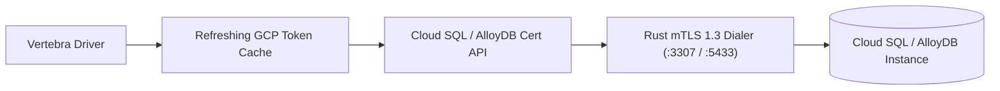

# Cloud SQL & AlloyDB Dialers

`vertebra.db.dialer` connects directly to Google Cloud SQL (`:3307` ephemeral mTLS certificates) and Google Cloud AlloyDB (`:5433` `MetadataExchangeRequest` protobuf handshake) from Rust and Python without deploying an external Cloud SQL Auth Proxy sidecar container.



## Direct Zero-Sidecar Connections

Configure `CloudSQLDialer` or `AlloyDBDialer` with Application Default Credentials and optional automatic IAM database authentication (`enable_iam_auth=True`):

```python
from vertebra.db import (
    AlloyDBConfig,
    AlloyDBDialer,
    CloudSQLConfig,
    CloudSQLDialer,
)

cloudsql = CloudSQLDialer(
    CloudSQLConfig(
        instance_connection_name="my-project:us-central1:orders-db",
        enable_iam_auth=True,
    )
)
alloydb = AlloyDBDialer(
    AlloyDBConfig(
        instance_uri=(
            "projects/my-project/locations/us-central1/"
            "clusters/prod/instances/primary"
        ),
        enable_iam_auth=True,
    )
)
```

## Capabilities

- **Cloud SQL (`CloudSQLConfig`, `CloudSQLDialer`)**: Parses `project:region:instance` (including domain-scoped projects), fetches ephemeral X.509 client certificates via the SQL Admin `generateEphemeralCert` API, and establishes TLS 1.3 connections on port `3307` with custom `project:instance` server certificate verification across PostgreSQL, MySQL, and SQL Server.
- **AlloyDB (`AlloyDBConfig`, `AlloyDBDialer`)**: Parses `projects/<p>/locations/<l>/clusters/<c>/instances/<i>` URIs, negotiates client certificates via `generateClientCertificate`, and executes the port `5433` protobuf `MetadataExchangeRequest` handshake (`BUILT_IN` or `IAM` token auth).
- **Automatic Session GUCs**: When connected to AlloyDB or when `enable_columnar_engine=True` is set on `PostgresConfig`, `build_session_gucs` enables `alloydb.enable_columnar_engine=on`.
- **In-Database Vector Embeddings**: Pair AlloyDB connections with [`AlloyDbEmbedder`](embeddings-and-vectors.md) to push `google_ml.embedding()` execution directly into SQL.
