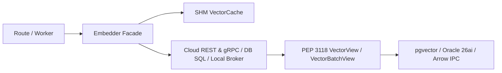

# Vector Embeddings & Shared-Memory Slabs

`vertebra.embeddings` provides shared-memory vector embeddings (`VectorView`, `VectorBatchView`) backed by a POSIX shared-memory `VectorSlab` and a set-associative seqlock `VectorCache`. It defaults to zero-weight Google Cloud transports (`VertexEmbedder` over HTTP/2 REST and `GeminiEmbedder` / `RemoteEmbedder` over HTTP/2 gRPC) and in-database SQL pushdown (`PushdownEmbedder` with engine adapters), while supporting `1x` RAM local models (`GemmaEmbedder`, `FastEmbedder`, `StaticEmbedder`) through `EmbeddingBroker`.



## Installation

Zero-weight cloud clients (`VertexEmbedder`, `GeminiEmbedder`, `RemoteEmbedder`), database SQL pushdown (`PushdownEmbedder` with engine adapters), pure-Rust `StaticEmbedder`, and `VectorView` / `VectorBatchView` ship in base `vertebra-core`. Install the `[embeddings]` extra only when running local ONNX / `EmbeddingGemma` weights:

=== "uv"

    ```bash
    uv add vertebra-core
    uv add "vertebra-core[embeddings]"
    ```

=== "pip"

    ```bash
    pip install vertebra-core
    pip install "vertebra-core[embeddings]"
    ```

=== "pdm"

    ```bash
    pdm add vertebra-core
    pdm add "vertebra-core[embeddings]"
    ```

=== "poetry"

    ```bash
    poetry add vertebra-core
    poetry add "vertebra-core[embeddings]"
    ```

## Embedder Selection Matrix

| Class | Default Model | Transport / Engine | Extra Required |
| --- | --- | --- | --- |
| `Embedder` | `gemini-embedding-001` (`768` dims) | Delegates to `VertexEmbedder` by default | None |
| `VertexEmbedder` | `gemini-embedding-001` (`768` dims) | Rust HTTP/2 REST (`:predict` / `:embedContent`) + `SyncGcpTokenCache` | None |
| `GeminiEmbedder` | `gemini-embedding-001` (`768` dims) | Rust HTTP/2 gRPC (`x-goog-api-key` or ADC) | None |
| `PushdownEmbedder` | `gemini-embedding-001` (`768` dims) | BigQuery, Spanner, PostgreSQL/AlloyDB, or Oracle SQL via `EmbeddingPushdown` | Driver extra for BigQuery/Spanner; Oracle needs the `oracle` extra (`vertebra._oracle`) |
| `StaticEmbedder` | `potion-base-8M` (`512` dims) | Pure-Rust `mmap` token lookup (`<50 µs`) | None |
| `GemmaEmbedder` | `embeddinggemma-2-270m` (`768` dims) | `1x` RAM `EmbeddingBroker` (`int8` / `q4` / `bf16` / `fp32`) | `[embeddings]` |
| `FastEmbedder` | `BAAI/bge-small-en-v1.5` (`384` dims) | `1x` RAM `EmbeddingBroker` (ONNX Runtime) | `[embeddings]` |
| `RemoteEmbedder` | `embeddinggemma-2-270m` (`768` dims) | Rust HTTP/2 gRPC `BatchEmbed` (optional `id_token_cache`) | None |

## Google Cloud & In-Database SQL Pushdown

`Embedder()` defaults to `VertexEmbedder("gemini-embedding-001", dimensions=768)`. `VertexEmbedder` dispatches `gemini-embedding-*` models to the Vertex AI v1 `:embedContent` REST endpoint and `text-embedding-*` models to `:predict` over HTTP/2 with `SyncGcpTokenCache`, forwarding `auto_truncate=False` for `:predict` models and decoding JSON float payloads into `VectorSlab` off-GIL. `GeminiEmbedder` uses HTTP/2 gRPC (`EmbedContent` / `BatchEmbedContents`) with `x-goog-api-key` or `SyncGcpTokenCache` and supports text and binary media parts via `embed_multimodal(...)`. `RemoteEmbedder` accepts an optional `id_token_cache` (`SyncGcpIdTokenCache` or `AsyncGcpIdTokenCache`) and `audience` for Cloud Run and IAP-protected gRPC endpoints:

```python
from vertebra.embeddings import (
    Embedder,
    GeminiEmbedder,
    RemoteEmbedder,
    VertexEmbedder,
)
from vertebra.storage import SyncGcpIdTokenCache

default_emb = Embedder()
vertex_emb = VertexEmbedder(
    "gemini-embedding-001",
    project="my-gcp-project",
    location="us-central1",
    dimensions=768,
)
gemini_emb = GeminiEmbedder("gemini-embedding-001")
remote_emb = RemoteEmbedder(
    endpoint="https://embed-svc-xyz.a.run.app",
    id_token_cache=SyncGcpIdTokenCache(),
)
```

All embedders expose a uniform `embed_batch(...)` contract that validates dimensions, rejects boolean values passed as numeric parameters, and unlinks per-call `/dev/shm/vtb-qvec-*` shared-memory query segments on teardown.

SQL generation belongs to the database adapters. Pass an existing sync or async driver to `BigQueryEmbeddingPushdown`, `SpannerEmbeddingPushdown`, `PostgresEmbeddingPushdown` (including AlloyDB), or `OracleEmbeddingPushdown`, then wrap it with `PushdownEmbedder` for caching, sync/async `embed_batch`, Arrow output, and in-memory similarity search. `OracleEmbeddingPushdown` takes a `SyncOracleDriver` or `AsyncOracleDriver`. The native Oracle driver package is not yet published, so constructing either driver raises `MissingDependencyError`:

```python
from vertebra.db.adapters.postgres import (
    AsyncPostgreSQLDriver,
    PostgresEmbeddingPushdown,
    SyncPostgreSQLDriver,
)
from vertebra.embeddings import PushdownEmbedder


def create_sql_embedder(
    driver: AsyncPostgreSQLDriver | SyncPostgreSQLDriver,
) -> PushdownEmbedder:
    pushdown = PostgresEmbeddingPushdown(driver, dimensions=768)
    return PushdownEmbedder(pushdown, dimensions=768)
```

Call `await embedder.vector_search("query", table="documents")` to search inside the database. `embedder.similarity_search(query, candidates)` searches an in-memory `VectorBatchView`. The capability methods also accept `dimensions` and `normalize` per call. BigQuery uses `ML.GENERATE_EMBEDDING` or `AI.GENERATE_EMBEDDING`; Spanner uses `ML.PREDICT` or `AI.GENERATE_EMBEDDING` (when `use_ai_function=True`, binding `@task_type` and `@output_dimensionality` parameters alongside `ORDER BY idx`).

Adapters raise `DataError` when the database returns empty or malformed vector rows; the facade translates inference `DataError` into `EmbeddingError`. Other driver errors propagate. SQL builders validate table and column identifiers; BigQuery model and table identifiers support hyphenated project IDs. PostgreSQL model strings are bound values. Oracle passes the model (including the Vertex `:predict` suffix) in JSON, batches both document and query embedding calls through `DBMS_VECTOR.UTL_TO_EMBEDDINGS` (`VECTOR_ARRAY_T`), validates Vertex endpoint URLs against its 128-byte UTF-8 limit, and rotates credentials from an explicit `token_cache` (`SyncGcpTokenCache` or `AsyncGcpTokenCache`) when the token generation advances.

## Local `1x` RAM Broker & `EmbeddingGemma`

When running multiple HTTP or background worker processes, `EmbeddingBroker` loads model weights **once (`1x` RAM)**, forms token-budgeted length-sorted batches (`max_batch_tokens=16384`, `max_pending_requests=1024`), and writes outputs into `VectorSlab`. On free-threaded Python `3.14t`/`3.15t`, `EmbeddingBroker` automatically isolates `onnxruntime` / `ctranslate2` in a dedicated child process so HTTP workers keep `sys._is_gil_enabled() == False`:

```python
from vertebra.embeddings import (
    FastEmbedder,
    GemmaEmbedder,
    StaticEmbedder,
)

gemma_emb = GemmaEmbedder(
    "embeddinggemma-2-270m",
    dimensions=256,
    precision="int8",
)
fast_emb = FastEmbedder("BAAI/bge-small-en-v1.5")
static_emb = StaticEmbedder(dimensions=256)
```

!!! warning "`EmbeddingGemma` Precision"
    `EmbeddingGemma` activations overflow IEEE 754 `fp16`. `GemmaEmbedder` enforces `precision` in `{"int8", "q4", "bf16", "fp32"}`, forwards the validated setting to the broker backend, and raises `ValueError` if `precision="fp16"` is requested.

When running outside subprocess quarantine, async `EmbeddingBroker` and the default `_GoogleEmbedder` helpers isolate state per running event loop so concurrent loops do not share futures or client handles. Custom brokers pass either `backend_fn` (in-process callable, offloaded via `asyncio.to_thread` with `max_pending_requests` queue-cap backpressure) or `BackendFactory(target="package.module:callable", options={...})`, which the quarantined child process imports and runs on free-threaded Python (`3.14t`/`3.15t`).

## Zero-Copy `VectorView`, Matryoshka Truncation & Binary Wire Codecs

`VectorView` (1D) and `VectorBatchView` (2D) implement PEP 3118 (`memoryview`, `np.asarray`), SIMD Matryoshka `.truncate(dims)` with L2 re-normalization, scalar `.quantize_int8()`, bit-packed `.quantize_binary()`, and binary database wire encoders:

```python title="docs/examples/embeddings_app.py"
--8<-- "docs/examples/embeddings_app.py:example"
```

## Staging Models with `vtb ai models` & Co-Located Workers

Stage model bundles into GCS, S3, R2, Azure, or OCI without a Hugging Face account at runtime, warm the shared-memory cache on container startup, and run co-located background workers alongside HTTP ingress:

```bash
vtb ai models list
vtb ai models pull embeddinggemma-2-270m --quant int8
vtb ai models stage embeddinggemma-2-270m --to gs://my-bucket/models/
vtb ai models warm embeddinggemma-2-270m --from gs://my-bucket/models/ --shm
vtb run app:app --with-workers --queues default,embeddings \
    --lane-concurrency default=8,embeddings=2
```
