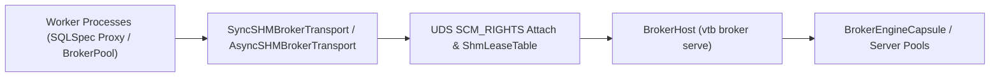

# Framework Extensions

`vertebra.extensions` connects Vertebra's native HTTP server, shared-memory worker pools, and multicloud object storage to Litestar, SQLSpec, SQLAlchemy / Advanced Alchemy, gRPC, and Oracle APEX.

=== "uv"

    ```bash
    uv add "vertebra-core[sqlspec,alchemy]"
    ```

=== "pip"

    ```bash
    pip install "vertebra-core[sqlspec,alchemy]"
    ```

=== "pdm"

    ```bash
    pdm add "vertebra-core[sqlspec,alchemy]"
    ```

=== "poetry"

    ```bash
    poetry add "vertebra-core[sqlspec,alchemy]"
    ```

## Litestar Integration & Middleware Offload (`vertebra.extensions.litestar`)

Vertebra provides first-class support for Litestar applications. Use `VertebraPlugin` and `VertebraConfig` to run a Litestar application on Vertebra's native HTTP ingress while offloading CORS, response compression, and static asset serving directly to the native server:

```python
from litestar import Litestar, get
from vertebra.extensions.litestar import VertebraConfig, VertebraPlugin


@get("/hello")
async def hello() -> dict[str, str]:
    return {"hello": "litestar"}


app = Litestar(
    route_handlers=[hello],
    plugins=[VertebraPlugin(VertebraConfig())],
)
```

`VertebraConfig(swap_memory_channels=True, swap_memory_response_cache=True)` opts into replacing Litestar's in-memory channels backend and response cache store with Vertebra's implementations. Both are off by default.

### CLI Integration (`litestar run` Override & `vtb` CLI Extensions)

- **`litestar run` CLI Override**: `VertebraPlugin` implements Litestar's `CLIPluginProtocol` (`on_cli_init(cli)` and `server_lifespan(app)`). When `VertebraPlugin` is registered on a `Litestar` app, running `litestar --app app:app run` launches the native Vertebra HTTP/IPC server supervisor while supporting all standard `litestar run` flags (`--host`, `--port`, `--wc` / `--web-concurrency`, `--reload`, `--debug`, `--pdb`) plus Vertebra runtime options (`--workers`, `--topology`, `--threads`, `--loop`, `--drain-timeout`, `--jit` / `--no-jit`, `--no-banner`).
- **Auto-Integration on `vtb run` / `vtb dev`**: Running an unmodified `Litestar`, `FastAPI`, `Starlette`, or `Flask` application with `vtb run app:app` (or `vtb --app app:app run`) automatically attaches and finalizes the corresponding `VertebraPlugin` (`ensure_vertebra_integration`) when native acceleration is enabled.
- **Pluggable `vtb` CLI (`CLIPlugin`, `VertebraExtensionGroup`, `VertebraEnv`)**: Both `vertebra.App(plugins=[...])` and host-framework plugins implementing `on_cli_init(cli)` can register custom subcommands on `vtb`. Command callbacks declaring `app` or `env: VertebraEnv` parameters automatically receive the resolved application instance and `VertebraEnv` context when invoked via `vtb --app app:app <subcommand>`.

### Fast-Path Dispatch & Native Middleware Offload

- **Route Compiler**: `RouteCompiler` extracts Litestar routes into an optimized route table matched by the native HTTP router.
- **Fast-Path Dispatch**: `FastPath` dispatches simple handlers directly, bypassing ASGI middleware layers when routes have no custom guards or intermediate transforms.
- **Realtime Channels**: `ChannelsBackend` integrates with Litestar Channels through the engine-neutral `ChannelBus` in `vertebra.server._channels` (also available from `vertebra.framework.channels`). It provides local fan-out, bounded history, and optional `NotificationSource`, `AsyncChangeSource`, and `ChangeFeed` bridges. Client disconnection and cleanup use cancellation-shielded scopes.
- **Response Caching**: `ResponseCacheStore` backs Litestar's `ResponseCacheConfig` using Vertebra's in-memory / SHM cache store.

### Litestar Ecosystem Plugins (`vertebra.extensions.litestar.*`)

Vertebra provides modular, independently installable extensions for the Litestar ecosystem under `vertebra.extensions.litestar`:

| Plugin | Module | Optional Extra | Description |
| --- | --- | --- | --- |
| **Queues** | `vertebra.extensions.litestar.queues` | `queues` | `SHMQueueBackend` with adaptive wakeup clamping, `SHMExecutionBackend`, `create_shm_queue_config`, and `create_sqlspec_queue_config`. |
| **Security** | `vertebra.extensions.litestar.security` | `security` | `JWTAuthenticationMechanism` accelerated by native `JWTGuard`, `IngressIdentityMechanism` for trusted mTLS/XFCC headers, and `RateLimitGuard`. |
| **Autowire** | `vertebra.extensions.litestar.autowire` | `autowire` | `AutowireBridgeIntegration` running controller discovery deterministically before the route compiler. |
| **Email** | `vertebra.extensions.litestar.email` | `email` | `SESEmailBackend` with native AWS SigV4 signing (`py_sign_aws_sigv4_headers`) requiring zero `botocore` dependency. |
| **MCP** | `vertebra.extensions.litestar.mcp` | `mcp` | `ObjectStoreSkillSource`, `WellKnownAgentCardOffload` with ETag/304 caching, and `JSONRPCFrameAccelerator`. |
| **Vite** | `vertebra.extensions.litestar.vite` | `vite` | `VitePlugin` integration with automatic resolution of wheel-native `@vertebra/client` assets. |
| **AsyncAPI** | `vertebra.extensions.litestar.asyncapi` | `asyncapi` | Event and schema documentation for background tasks and WebSocket channels. |
| **HTMX** | `vertebra.extensions.litestar.htmx` | `htmx` | HTMX response headers, partials, and push-URL directives. |

Configure Litestar integration with `VertebraPlugin` and `VertebraConfig` (and attach any optional `vertebra.extensions.litestar.*` helper plugins listed above):

```python
from litestar import Litestar
from vertebra.extensions.litestar import (
    VertebraConfig,
    VertebraPlugin,
)

app = Litestar(
    plugins=[
        VertebraPlugin(VertebraConfig()),
    ],
)
```

## SQLSpec Integration, Statement Stacks & SHM Proxy (`vertebra.extensions.sqlspec`)

Vertebra provides first-class support for `sqlspec` (`>=0.69.0`) across 8 database engines, native statement pipelining, and shared-memory connection pooling:

- **Native Drivers**: Typed sync and async database configs across relational, analytical, and cloud-native engines (`PostgreSQLSyncConfig`, `PostgreSQLAsyncConfig`, `MySQLSyncConfig`, `MySQLAsyncConfig`, `SQLiteSyncConfig`, `SQLiteAsyncConfig`, `OracleSyncConfig`, `OracleAsyncConfig`, `MSSQLSyncConfig`, `MSSQLAsyncConfig`, `DuckDBSyncConfig`, `DuckDBAsyncConfig`, `BigQuerySyncConfig`, `BigQueryAsyncConfig`, `SpannerSyncConfig`, `SpannerAsyncConfig`).
- **Shared-Memory Proxy**: `ProxySyncConfig` and `ProxyAsyncConfig` (`ProxySyncDriver`, `ProxyAsyncDriver`) lease pooled connections over shared memory from the parent process so multi-worker deployments never multiply connection counts.
- **Native Statement Pipelining**: SQLSpec `execute_stack` uses `SyncPipelineCapable` / `AsyncPipelineCapable` through `driver.pipeline()` for supported stacks and returns one ordered result per operation. Other stacks use sequential execution with transaction boundaries.
- **Change Feed & CDC**: `ChangeFeedSyncEventBackend` and `ChangeFeedAsyncEventBackend` implement `sqlspec.extensions.events` protocols over PostgreSQL logical replication (`pg_logical_emit_message`) with automatic Parquet spillover for payloads exceeding 7,500 bytes.
- **Object Storage & Arrow Export**: `ObjectStoreBackend` integrates with `sqlspec.storage.storage_registry` and provides PyArrow IPC and Parquet dataset streaming.

```python
from vertebra.extensions.sqlspec import (
    SQLiteSyncConfig,
    create_sqlspec_plugin,
)

config = SQLiteSyncConfig(path=":memory:")
sqlspec_plugin = create_sqlspec_plugin(config)
```

## SQLAlchemy 2.0+, Advanced Alchemy 1.12 & `+vtb` Dialects (`vertebra.extensions.alchemy`, `vertebra.extensions.sqlalchemy`)

`vertebra.extensions.alchemy` and `vertebra.extensions.sqlalchemy` provide drop-in SQLAlchemy 2.0.36+ and Advanced Alchemy 1.12+ support backed by Vertebra's native drivers and connection leasing:

- **Dialects & Broker Pooling**: Registers `+vertebra`, `+vtb`, `+vertebra_async`, and `+vtb_async` URL schemes (`postgresql+vtb://`, `postgresql+vtb_async://`, `mysql+vtb://`, `sqlite+vtb://`, `oracle+vtb://`, `mssql+vtb://`, `duckdb+vtb://`, `bigquery+vtb://`, `spanner+vtb://`, `spangres+vtb://`) over standalone [`vertebra.db.dbapi`](../reference/db.md) PEP 249 interfaces (`SyncDBAPIModule` and `SQLAlchemyAsyncDBAPI`), using `NullPool` when `?shm_broker=true` is passed on dialect URLs (`StaticPool` for `:memory:` SQLite, `QueuePool` / `AsyncAdaptedQueuePool` otherwise) and wiring `BrokerPool` / `AsyncBrokerPool` + `broker_creator` through `create_sync_alchemy_config` / `create_async_alchemy_config` when a shared-memory broker is attached. Cloud SQL / AlloyDB dialers integrate directly, and missing optional wheels (`vertebra-core[postgres]`, `[mysql]`, `[oracle]`, `[mssql]`, `[duckdb]`, `[bigquery]`, `[spanner]`) raise `MissingDependencyError` while malformed URLs raise DB-API `InterfaceError`.
- **Type System**: Native `Vector(dimensions)` for vector embeddings and `BinaryJSON` for PostgreSQL `JSONB` and Oracle `OSON`.
- **Object Storage Attachments**: `ObjectStoreBackend` implements Advanced Alchemy's `advanced_alchemy.types.file_object.StorageBackend`, enabling transactional file attachments on models via `FileObject` and `StoredObject`.
- **Alembic Custom Operations**: Autogenerates vector index and view DDL operations (`CreateVectorIndexOp`, `CreateViewOp`, `DropViewOp`).

BigQuery, Spanner, and Spangres DBAPI connections use statement autocommit. Their
`commit()` and `rollback()` calls do not group or undo completed statements;
setting `autocommit=False` raises `NotSupportedError`. Reason: BigQuery permanent
DDL cannot run inside a transaction, and the Spanner driver's explicit scope
buffers writes until commit. Use the native driver's transaction or batching API
for its engine-specific scope, separately from the SQLAlchemy connection.

```python
from vertebra.extensions.alchemy import (
    ObjectStoreBackend,
    create_alchemy_plugin,
    create_async_alchemy_config,
)
from vertebra.storage import SyncObjectStore

alchemy_config = create_async_alchemy_config(
    connection_string="sqlite+vtb_async:///:memory:",
)
alchemy_plugin = create_alchemy_plugin(alchemy_config)

store = SyncObjectStore("memory://")
backend = ObjectStoreBackend(store=store, prefix="uploads")
```

## gRPC Services & Protobuf Schemas (`vertebra.extensions.grpc`)

`GrpcServiceRegistry` and `@grpc_method` route 5-byte length-prefixed HTTP/2 gRPC frames from `vertebra-http` directly to typed Python methods across all 4 RPC modes (`unary`, `server_streaming`, `client_streaming`, `bidi_streaming`), with automatic `.proto` generation from `msgspec.Struct` models (`ProtobufSchemaGenerator`):

```python
import msgspec
from vertebra.extensions.grpc import (
    GrpcContext,
    GrpcServiceRegistry,
    ProtobufSchemaGenerator,
    grpc_method,
)


class LookupRequest(msgspec.Struct):
    sku: str


class LookupReply(msgspec.Struct):
    sku: str
    available: int


registry = GrpcServiceRegistry()


@grpc_method(service="Inventory", package="inventory", name="Lookup")
async def lookup(request: LookupRequest, ctx: GrpcContext) -> LookupReply:
    return LookupReply(sku=request.sku, available=42)


registry.register(lookup)
schema_gen = ProtobufSchemaGenerator(package="inventory")
proto_source = schema_gen.generate_from_registry(registry)
```

## Oracle APEX Gateway, Islands & 26ai Duality Views (`vertebra.extensions.apex`)

Modernize Oracle APEX applications incrementally without a full rewrite using `vertebra.extensions.apex` and `@vertebra/client/apex`:

- **Session & Security**: `ApexSessionContext`, `OracleSessionManager.acquire_scoped` (`DBMS_SESSION.SET_IDENTIFIER` + automatic teardown), `ApexSessionAuth`, `ApexGateway` (`verify_checksum`), and `ConfirmationGate` for human-in-the-loop PL/SQL mutations.
- **Islands & Offline Outbox**: `ApexIslandRegistry` mounts Vite-bundled React/Vue/Svelte islands inside APEX regions (`ApexRegion`), and `ApexOfflineSyncEngine` (`ApexOfflineOutbox`) replays offline mutations with HLC conflict detection.
- **Federated Queries & 26ai Duality Views**: `ApexFederatedQuery` joins Oracle tables with Parquet/S3 datasets in DataFusion, while `ApexOpenAPIGenerator`, `DualityViewSpec`, and `DualityViewMcpHandler` expose Oracle 26ai JSON Relational Duality Views as OpenAPI endpoints and MCP agent tools with ETag optimistic concurrency.

## Shared-Memory Session Broker (`vertebra.extensions.broker`)

`BrokerPlugin` (`BrokerConfig`, `BrokerHost`, `BrokerEngineDiscovery`, `SyncSHMBrokerTransport` / `AsyncSHMBrokerTransport`, `SyncConnectionLease` / `AsyncConnectionLease`, `StatementPlan`, `LeaseQuarantinedError`) manages cross-worker database connection leases and prepared statement plans over shared memory so N Python worker processes share a bounded pool without multiplying database connections.



- **Named SHM & Authenticated UDS Attach**: Owner segments write `ShmOwnerHeader` generation and PID ownership metadata; cross-process workers attach either by name or through `BrokerAttachClient` / `BrokerAttachServer` over a `0600` Unix domain socket inside a `0700` directory authenticated with `VERTEBRA_BROKER_SECRET` (`SCM_RIGHTS` FD passing).
- **Supervision, Crash Recovery & Quarantine**: `vtb broker serve` runs `BrokerHost` and drains or rolls back active slots on shutdown (`ShutdownReport`), while `reclaim_worker_leases` transitions crashed worker slots into `Quarantined`, runs server `ROLLBACK` cleanup, and disposes dirty slots (`vtb broker status` and `DbPoolMetricSample` report `quarantined`, `total_quarantined`, and `total_disposed`). Session release or pool check-in failures quarantine the lease and raise `LeaseQuarantinedError`.
- **SQLAlchemy & Advanced Alchemy Pool Sharing**: Pass `BrokerPool` / `AsyncBrokerPool` (and `broker_creator`) with `create_engine` / `create_async_engine`, or pass a transport to `create_sync_alchemy_config` / `create_async_alchemy_config` to partition broker leases by config `pool_key()`.

```python
from sqlalchemy import create_engine, text
from vertebra.extensions.broker import (
    BrokerConfig,
    BrokerHost,
    SyncSHMBrokerTransport,
)
from vertebra.extensions.sqlalchemy import BrokerPool, broker_creator

config = BrokerConfig(pool_size=4, shm_name="/vtb-app-broker", role="owner")
with BrokerHost(config) as host:
    worker_cfg = BrokerConfig(
        pool_size=4,
        shm_name="/vtb-app-broker",
        role="worker",
    )
    transport = SyncSHMBrokerTransport(worker_cfg)
    pool_cls = BrokerPool.bind_class(
        broker=transport,
        url="sqlite+vtb:///app.db",
    )
    engine = create_engine(
        "sqlite+vtb:///app.db",
        poolclass=pool_cls,
        creator=broker_creator("sqlite+vtb:///app.db", broker=transport),
    )
    with engine.connect() as conn:
        value = conn.execute(text("SELECT 1")).scalar_one()
    engine.dispose()
    transport.close()
```
